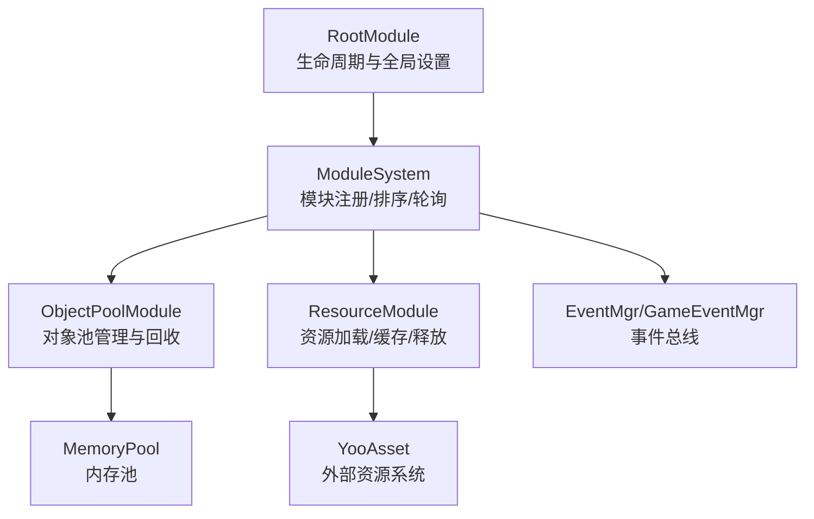
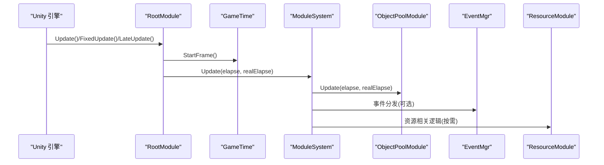
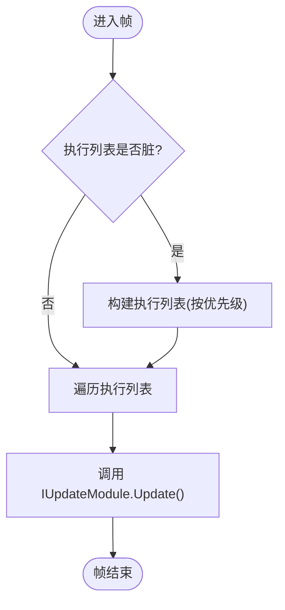
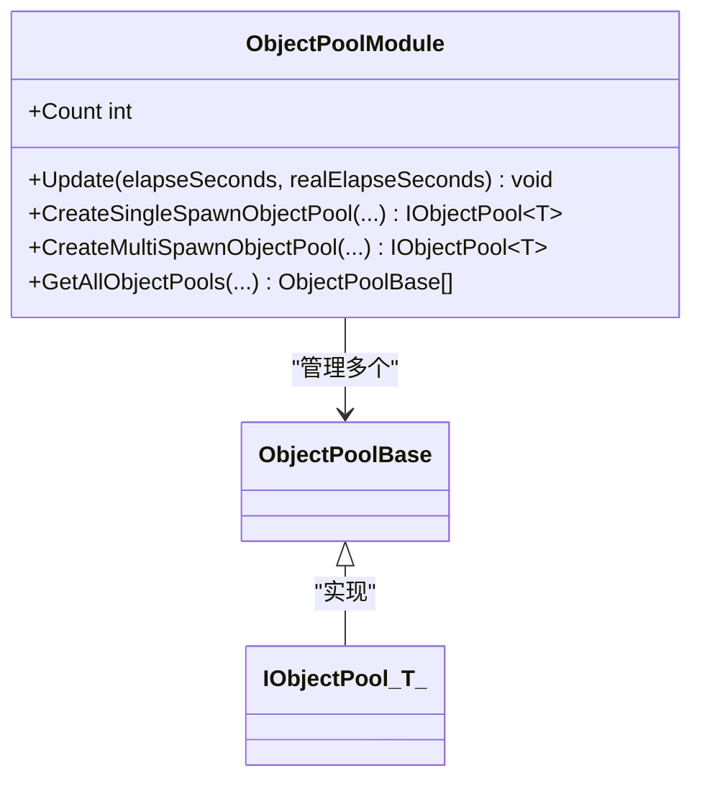
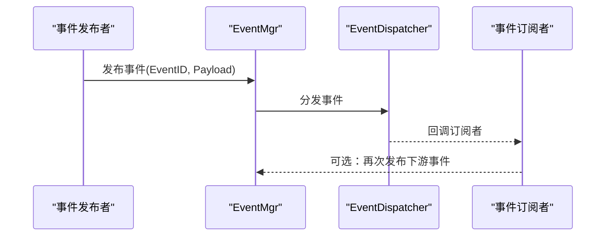
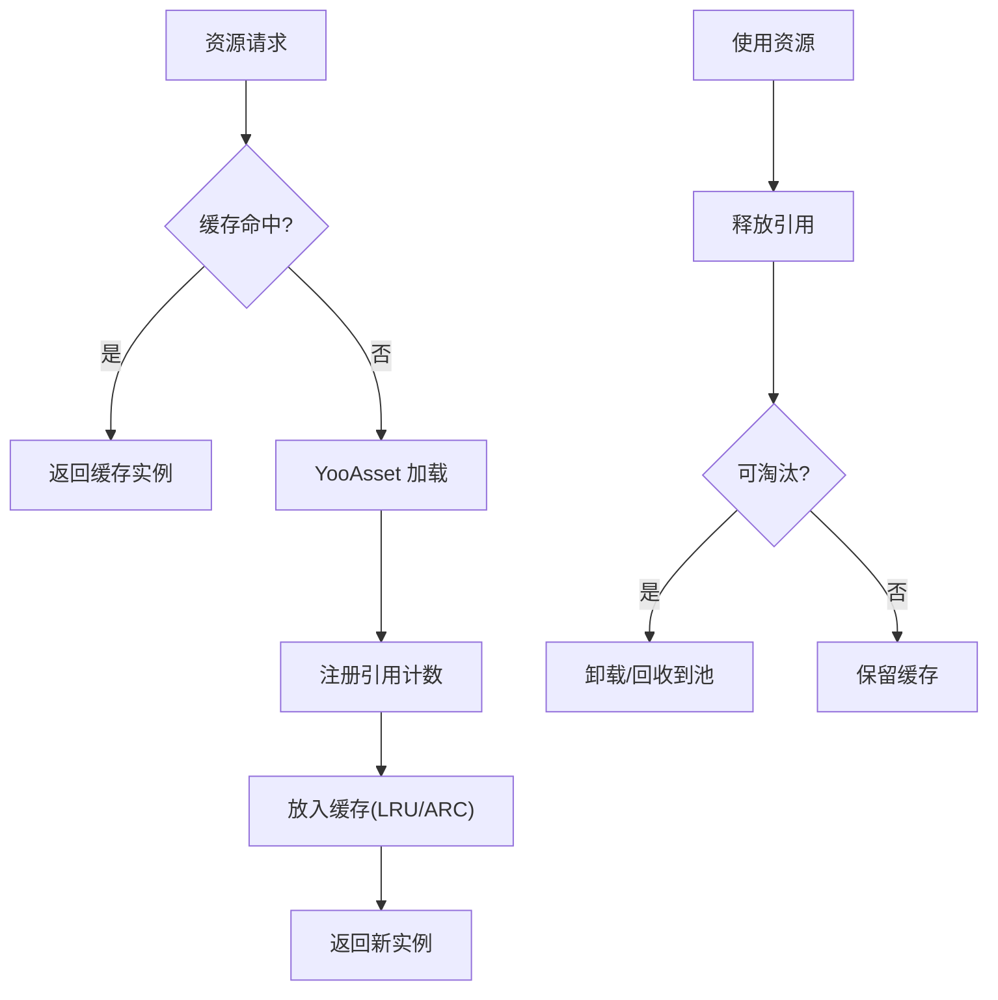
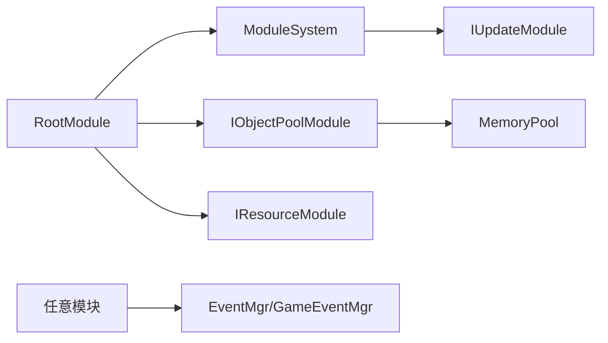

# 数据流架构

<cite>
**本文引用的文件**   
- [README.md](file://README.md)
- [RootModule.cs](file://UnityProject/Assets/TEngine/Runtime/Module/RootModule.cs)
- [ModuleSystem.cs](file://UnityProject/Assets/TEngine/Runtime/Core/ModuleSystem.cs)
- [Module.cs](file://UnityProject/Assets/TEngine/Runtime/Core/Module.cs)
- [ObjectPoolModule.cs](file://UnityProject/Assets/TEngine/Runtime/Module/ObjectPoolModule/ObjectPoolModule.cs)
- [EventDispatcher.cs](file://UnityProject/Assets/TEngine/Runtime/Core/GameEvent/EventDispatcher.cs)
- [EventMgr.cs](file://UnityProject/Assets/TEngine/Runtime/Core/GameEvent/EventMgr.cs)
- [GameEventMgr.cs](file://UnityProject/Assets/TEngine/Runtime/Core/GameEvent/GameEventMgr.cs)
- [MemoryPool.cs](file://UnityProject/Assets/TEngine/Runtime/Core/MemoryPool/MemoryPool.cs)
- [ResourceModule.cs](file://UnityProject/Assets/TEngine/Runtime/Module/ResourceModule/ResourceModule.cs)
</cite>

## 目录
1. [简介](#简介)
2. [项目结构](#项目结构)
3. [核心组件](#核心组件)
4. [架构总览](#架构总览)
5. [详细组件分析](#详细组件分析)
6. [依赖关系分析](#依赖关系分析)
7. [性能与内存管理](#性能与内存管理)
8. [异步处理与一致性](#异步处理与一致性)
9. [监控与调试](#监控与调试)
10. [故障排查](#故障排查)
11. [结论](#结论)

## 简介
本技术文档聚焦 TEngine 的数据流架构，围绕“模块间数据传递、事件驱动传播、资源数据流转、缓存与对象池复用、异步与协程集成、一致性保证、监控与调试”展开。通过架构图与流程图，帮助开发者理解从帧循环到模块更新、从事件分发到对象池回收的完整数据路径，并给出优化建议与排错指南。

## 项目结构
TEngine 采用模块化架构：根模块负责生命周期与全局设置；模块系统统一注册、排序与轮询；各业务模块（资源、对象池、UI、流程等）在框架内协作。运行时核心位于 Runtime 目录，包含 Core（基础能力）、Module（业务模块）、Extension（扩展）。

图表来源
- [RootModule.cs:116-144](file://UnityProject/Assets/TEngine/Runtime/Module/RootModule.cs#L116-L144)
- [ModuleSystem.cs:29-42](file://UnityProject/Assets/TEngine/Runtime/Core/ModuleSystem.cs#L29-L42)
- [ObjectPoolModule.cs:35-41](file://UnityProject/Assets/TEngine/Runtime/Module/ObjectPoolModule/ObjectPoolModule.cs#L35-L41)
- [ResourceModule.cs:17-17](file://UnityProject/Assets/TEngine/Runtime/Module/ResourceModule/ResourceModule.cs#L17-L17)

章节来源
- [README.md:173-201](file://README.md#L173-L201)

## 核心组件
- 根模块 RootModule：初始化文本/日志/JSON 辅助、设置帧率与时间缩放、订阅低内存事件、驱动 GameTime 与 ModuleSystem 更新。
- 模块系统 ModuleSystem：维护模块集合、按优先级排序、构建执行列表、每帧调用 IUpdateModule.Update，并在关闭时统一清理。
- 对象池 ObjectPoolModule：统一管理多类型对象池，支持单次/多次获取、容量/过期/优先级配置，定期 Update 触发回收。
- 事件系统 EventMgr/GameEventMgr/EventDispatcher：提供零 GC 事件分发，支持字符串/整型事件 ID，结合 UI 生命周期自动解绑。
- 内存池 MemoryPool：为框架内部数据结构提供复用，减少分配与 GC。
- 资源模块 ResourceModule：基于 YooAsset 的资源加载、引用计数、LRU/ARC 策略与自动释放。

章节来源
- [RootModule.cs:116-144](file://UnityProject/Assets/TEngine/Runtime/Module/RootModule.cs#L116-L144)
- [ModuleSystem.cs:29-42](file://UnityProject/Assets/TEngine/Runtime/Core/ModuleSystem.cs#L29-L42)
- [ObjectPoolModule.cs:35-41](file://UnityProject/Assets/TEngine/Runtime/Module/ObjectPoolModule/ObjectPoolModule.cs#L35-L41)
- [MemoryPool.cs](file://UnityProject/Assets/TEngine/Runtime/Core/MemoryPool/MemoryPool.cs)
- [ResourceModule.cs:17-17](file://UnityProject/Assets/TEngine/Runtime/Module/ResourceModule/ResourceModule.cs#L17-L17)

## 架构总览
下图展示从 Unity 帧回调到模块更新的控制流，以及事件与对象池在数据流中的位置。

图表来源
- [RootModule.cs:140-149](file://UnityProject/Assets/TEngine/Runtime/Module/RootModule.cs#L140-L149)
- [ModuleSystem.cs:29-42](file://UnityProject/Assets/TEngine/Runtime/Core/ModuleSystem.cs#L29-L42)
- [ObjectPoolModule.cs:35-41](file://UnityProject/Assets/TEngine/Runtime/Module/ObjectPoolModule/ObjectPoolModule.cs#L35-L41)

## 详细组件分析

### 模块系统与帧循环
- 职责：集中管理所有模块的生命周期与执行顺序，确保高优先级模块先执行、后关闭。
- 关键点：
  - 通过接口 IUpdateModule 将需要每帧更新的模块纳入统一调度。
  - 使用链表+脏标记重建执行列表，避免每帧重复排序。
  - Shutdown 阶段反向遍历模块进行有序销毁，并清理内存池与全局缓存。

图表来源
- [ModuleSystem.cs:29-42](file://UnityProject/Assets/TEngine/Runtime/Core/ModuleSystem.cs#L29-L42)
- [ModuleSystem.cs:143-194](file://UnityProject/Assets/TEngine/Runtime/Core/ModuleSystem.cs#L143-L194)

章节来源
- [ModuleSystem.cs:29-42](file://UnityProject/Assets/TEngine/Runtime/Core/ModuleSystem.cs#L29-L42)
- [ModuleSystem.cs:143-194](file://UnityProject/Assets/TEngine/Runtime/Core/ModuleSystem.cs#L143-L194)
- [Module.cs:8-16](file://UnityProject/Assets/TEngine/Runtime/Core/Module.cs#L8-L16)

### 对象池与数据复用
- 职责：为游戏对象与可复用数据结构提供池化，降低分配与 GC 压力。
- 关键点：
  - 支持单次/多次获取模式，区分生命周期与归还语义。
  - 支持容量、过期时间、优先级等参数，便于精细化控制。
  - 每帧 Update 中遍历所有对象池，触发内部回收与统计。

图表来源
- [ObjectPoolModule.cs:35-41](file://UnityProject/Assets/TEngine/Runtime/Module/ObjectPoolModule/ObjectPoolModule.cs#L35-L41)
- [ObjectPoolModule.cs:77-132](file://UnityProject/Assets/TEngine/Runtime/Module/ObjectPoolModule/ObjectPoolModule.cs#L77-L132)
- [ObjectPoolModule.cs:371-733](file://UnityProject/Assets/TEngine/Runtime/Module/ObjectPoolModule/ObjectPoolModule.cs#L371-L733)

章节来源
- [ObjectPoolModule.cs:35-41](file://UnityProject/Assets/TEngine/Runtime/Module/ObjectPoolModule/ObjectPoolModule.cs#L35-L41)
- [ObjectPoolModule.cs:77-132](file://UnityProject/Assets/TEngine/Runtime/Module/ObjectPoolModule/ObjectPoolModule.cs#L77-L132)
- [ObjectPoolModule.cs:371-733](file://UnityProject/Assets/TEngine/Runtime/Module/ObjectPoolModule/ObjectPoolModule.cs#L371-L733)

### 事件驱动的数据传播
- 职责：以事件为中心进行模块间解耦通信，支持字符串/整型事件 ID，UI 生命周期自动绑定与清理。
- 关键点：
  - EventMgr/GameEventMgr 作为事件总线，EventDispatcher 负责派发。
  - 事件处理器可订阅特定事件，收到消息后触发相应数据更新或动作。
  - 与 UI 模块联动，窗口销毁时自动解绑，避免悬挂引用。

图表来源
- [EventMgr.cs](file://UnityProject/Assets/TEngine/Runtime/Core/GameEvent/EventMgr.cs)
- [GameEventMgr.cs](file://UnityProject/Assets/TEngine/Runtime/Core/GameEvent/GameEventMgr.cs)
- [EventDispatcher.cs](file://UnityProject/Assets/TEngine/Runtime/Core/GameEvent/EventDispatcher.cs)

章节来源
- [EventMgr.cs](file://UnityProject/Assets/TEngine/Runtime/Core/GameEvent/EventMgr.cs)
- [GameEventMgr.cs](file://UnityProject/Assets/TEngine/Runtime/Core/GameEvent/GameEventMgr.cs)
- [EventDispatcher.cs](file://UnityProject/Assets/TEngine/Runtime/Core/GameEvent/EventDispatcher.cs)

### 资源数据流转与缓存
- 职责：封装 YooAsset，提供统一的资源加载、引用计数、缓存与释放能力。
- 关键点：
  - 支持 LRU/ARC 策略，按热度或引用数淘汰。
  - 同步/异步加载 API，配合 UniTask 提升吞吐。
  - 与 RootModule 的低内存回调联动，主动释放非关键资源。

图表来源
- [ResourceModule.cs:17-17](file://UnityProject/Assets/TEngine/Runtime/Module/ResourceModule/ResourceModule.cs#L17-L17)
- [RootModule.cs:287-301](file://UnityProject/Assets/TEngine/Runtime/Module/RootModule.cs#L287-L301)

章节来源
- [ResourceModule.cs:17-17](file://UnityProject/Assets/TEngine/Runtime/Module/ResourceModule/ResourceModule.cs#L17-L17)
- [RootModule.cs:287-301](file://UnityProject/Assets/TEngine/Runtime/Module/RootModule.cs#L287-L301)

## 依赖关系分析
- RootModule 依赖 ModuleSystem 驱动更新，依赖 GameTime 提供时间信息，依赖各模块接口（如 IObjectPoolModule、IResourceModule）。
- ModuleSystem 依赖 IUpdateModule 接口，对实现类进行排序与调用。
- ObjectPoolModule 依赖 MemoryPool 进行底层内存复用。
- 事件系统独立于模块系统，但被各模块广泛使用。

图表来源
- [RootModule.cs:116-144](file://UnityProject/Assets/TEngine/Runtime/Module/RootModule.cs#L116-L144)
- [ModuleSystem.cs:29-42](file://UnityProject/Assets/TEngine/Runtime/Core/ModuleSystem.cs#L29-L42)
- [ObjectPoolModule.cs:35-41](file://UnityProject/Assets/TEngine/Runtime/Module/ObjectPoolModule/ObjectPoolModule.cs#L35-L41)
- [MemoryPool.cs](file://UnityProject/Assets/TEngine/Runtime/Core/MemoryPool/MemoryPool.cs)

章节来源
- [RootModule.cs:116-144](file://UnityProject/Assets/TEngine/Runtime/Module/RootModule.cs#L116-L144)
- [ModuleSystem.cs:29-42](file://UnityProject/Assets/TEngine/Runtime/Core/ModuleSystem.cs#L29-L42)
- [ObjectPoolModule.cs:35-41](file://UnityProject/Assets/TEngine/Runtime/Module/ObjectPoolModule/ObjectPoolModule.cs#L35-L41)

## 性能与内存管理
- 对象池复用：通过 ObjectPoolModule 统一管理对象生命周期，减少频繁分配与 GC。
- 内存池复用：MemoryPool 为框架内部数据结构提供池化，降低分配开销。
- 资源缓存策略：ResourceModule 基于 YooAsset 实现 LRU/ARC，按引用与热度淘汰，避免内存膨胀。
- 低内存响应：RootModule 在低内存事件中主动释放对象池未用项与资源模块缓存，保障稳定性。

章节来源
- [ObjectPoolModule.cs:35-41](file://UnityProject/Assets/TEngine/Runtime/Module/ObjectPoolModule/ObjectPoolModule.cs#L35-L41)
- [MemoryPool.cs](file://UnityProject/Assets/TEngine/Runtime/Core/MemoryPool/MemoryPool.cs)
- [ResourceModule.cs:17-17](file://UnityProject/Assets/TEngine/Runtime/Module/ResourceModule/ResourceModule.cs#L17-L17)
- [RootModule.cs:287-301](file://UnityProject/Assets/TEngine/Runtime/Module/RootModule.cs#L287-L301)

## 异步处理与一致性
- 异步处理：框架强调基于 UniTask 的异步系统，资源加载、网络通信等均采用异步 API，避免阻塞主线程。
- 协程集成：RootModule 在退出时停止所有协程，防止后台任务泄漏。
- 一致性保证：
  - 模块更新顺序由优先级决定，避免竞态条件。
  - 事件分发为单线程同步回调，保证同一帧内事件处理的确定性。
  - 资源引用计数与缓存淘汰策略协同，避免悬空引用与重复释放。

章节来源
- [RootModule.cs:156-160](file://UnityProject/Assets/TEngine/Runtime/Module/RootModule.cs#L156-L160)
- [ModuleSystem.cs:29-42](file://UnityProject/Assets/TEngine/Runtime/Core/ModuleSystem.cs#L29-L42)

## 监控与调试
- 调试模块：DebuggerModule 提供调试面板与分组，便于观察模块状态、对象池指标与资源占用。
- 日志系统：RootModule 启动时注入日志辅助，统一输出关键流程与异常信息。
- 性能观测：结合对象池数量、缓存命中率、资源引用计数等指标，定位热点与泄漏点。

章节来源
- [RootModule.cs:238-261](file://UnityProject/Assets/TEngine/Runtime/Module/RootModule.cs#L238-L261)

## 故障排查
- 症状：内存持续增长
  - 检查对象池是否正确归还，是否存在未释放的多次获取对象。
  - 检查资源引用计数是否正确释放，是否有悬挂引用。
  - 关注低内存回调是否触发，必要时手动触发释放。
- 症状：事件未触发或重复触发
  - 确认事件 ID 一致，订阅/解绑是否在正确生命周期。
  - 检查 UI 生命周期是否自动解绑，避免重复订阅。
- 症状：模块未按预期顺序执行
  - 检查 IUpdateModule 的 Priority 设置，确保期望的执行顺序。

章节来源
- [ObjectPoolModule.cs:35-41](file://UnityProject/Assets/TEngine/Runtime/Module/ObjectPoolModule/ObjectPoolModule.cs#L35-L41)
- [RootModule.cs:287-301](file://UnityProject/Assets/TEngine/Runtime/Module/RootModule.cs#L287-L301)
- [ModuleSystem.cs:143-194](file://UnityProject/Assets/TEngine/Runtime/Core/ModuleSystem.cs#L143-L194)

## 结论
TEngine 的数据流以模块系统为核心，通过事件驱动与对象池/内存池复用，构建了高效、可扩展且易于调试的运行环境。资源模块与 YooAsset 的深度集成提供了成熟的缓存与释放策略，配合低内存响应机制，保障了在不同平台上的稳定表现。开发者应遵循优先级与生命周期约定，合理使用异步 API 与对象池，以获得最佳性能与可维护性。