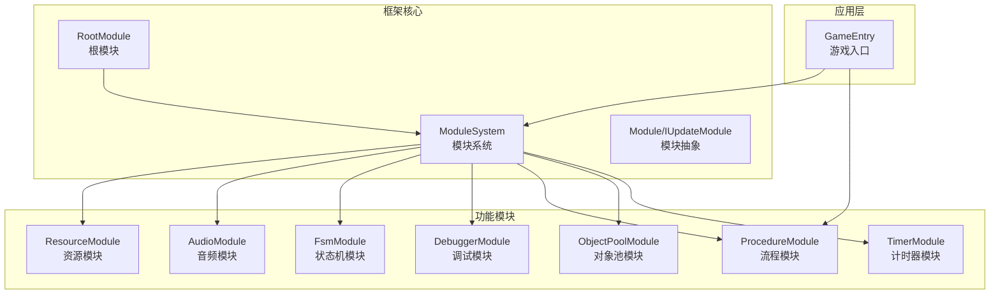
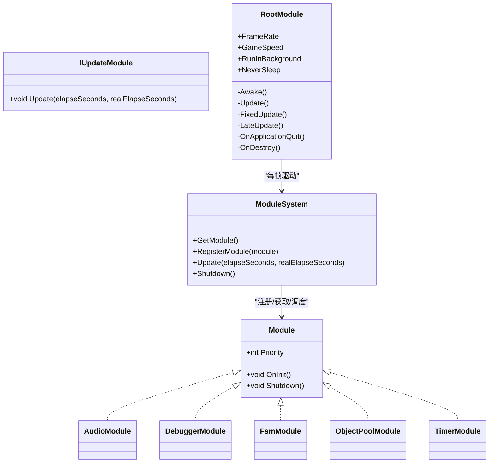
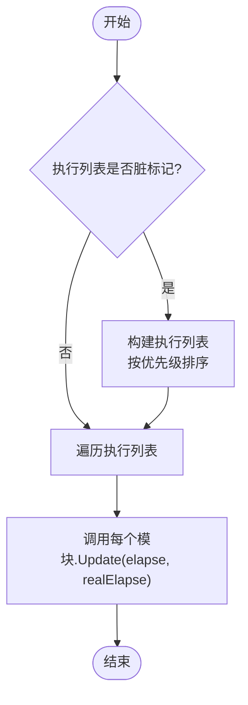
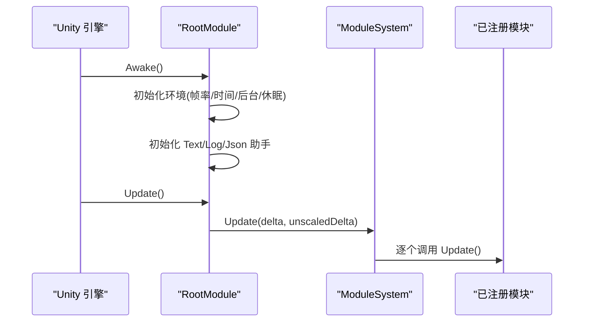
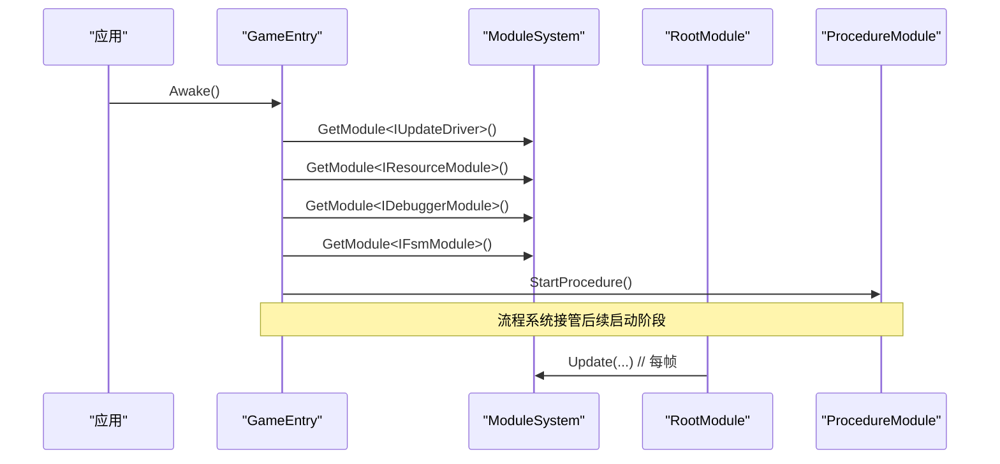
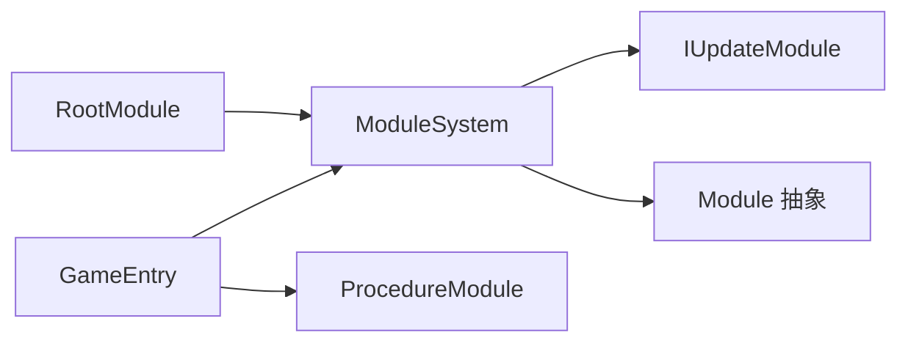

# 核心架构

<cite>
**本文引用的文件**   
- [GameEntry.cs](file://UnityProject/Assets/GameScripts/GameEntry.cs)
- [ModuleSystem.cs](file://UnityProject/Assets/TEngine/Runtime/Core/ModuleSystem.cs)
- [Module.cs](file://UnityProject/Assets/TEngine/Runtime/Core/Module.cs)
- [RootModule.cs](file://UnityProject/Assets/TEngine/Runtime/Module/RootModule.cs)
- [2-框架概览.md](file://Books/2-框架概览.md)
</cite>

## 目录
1. [简介](#简介)
2. [项目结构](#项目结构)
3. [核心组件](#核心组件)
4. [架构总览](#架构总览)
5. [详细组件分析](#详细组件分析)
6. [依赖关系分析](#依赖关系分析)
7. [性能考量](#性能考量)
8. [故障排查指南](#故障排查指南)
9. [结论](#结论)

## 简介
本文件面向 TEngine 核心架构，系统性阐述模块化设计、模块生命周期管理、根模块管理机制与 ModuleSystem 的工作原理（模块注册、依赖注入、优先级管理），并给出从 GameEntry 到 RootModule 再到各功能模块的启动流程与时序。同时说明数据流与组件间通信机制，配合架构图与时序图帮助开发者快速理解整体设计思路。

## 项目结构
TEngine 的核心运行时代码位于 UnityProject/Assets/TEngine/Runtime 下，其中：
- Core：框架核心能力（模块系统、基础抽象）
- Module：具体功能模块（资源、音频、UI、场景、计时器、FSM、调试器等）
- Extension：扩展能力（如 UI 脚本生成、HTML 转 UGUI 等）

游戏入口在 UnityProject/Assets/GameScripts/GameEntry.cs，负责初始化关键模块并启动流程系统。

图表来源
- [GameEntry.cs:6-14](file://UnityProject/Assets/GameScripts/GameEntry.cs#L6-L14)
- [RootModule.cs:116-144](file://UnityProject/Assets/TEngine/Runtime/Module/RootModule.cs#L116-L144)
- [ModuleSystem.cs:29-42](file://UnityProject/Assets/TEngine/Runtime/Core/ModuleSystem.cs#L29-L42)

章节来源
- [2-框架概览.md:1-60](file://Books/2-框架概览.md#L1-L60)

## 核心组件
- 模块抽象与更新接口
  - Module：定义模块优先级、OnInit、Shutdown 生命周期钩子
  - IUpdateModule：定义 Update(elapse, realElapse) 轮询接口
- 模块系统 ModuleSystem
  - 模块注册与获取（按接口类型反射创建）
  - 优先级排序与更新队列构建
  - 全局 Update 调度与 Shutdown 清理
- 根模块 RootModule
  - 引擎环境初始化（帧率、时间缩放、后台运行、休眠策略）
  - 每帧驱动 ModuleSystem.Update
  - 低内存回调触发对象池与资源模块释放

章节来源
- [Module.cs:8-39](file://UnityProject/Assets/TEngine/Runtime/Core/Module.cs#L8-L39)
- [ModuleSystem.cs:9-60](file://UnityProject/Assets/TEngine/Runtime/Core/ModuleSystem.cs#L9-L60)
- [RootModule.cs:116-144](file://UnityProject/Assets/TEngine/Runtime/Module/RootModule.cs#L116-L144)

## 架构总览
TEngine 采用“面向接口 + 模块化”的设计：
- 所有功能以模块形式提供，通过接口对外暴露能力
- ModuleSystem 统一管理模块的注册、查找、优先级与更新调度
- RootModule 作为引擎桥接点，驱动帧循环与模块系统
- GameEntry 作为应用入口，按需获取核心模块并启动流程

图表来源
- [Module.cs:8-39](file://UnityProject/Assets/TEngine/Runtime/Core/Module.cs#L8-L39)
- [ModuleSystem.cs:9-60](file://UnityProject/Assets/TEngine/Runtime/Core/ModuleSystem.cs#L9-L60)
- [RootModule.cs:116-144](file://UnityProject/Assets/TEngine/Runtime/Module/RootModule.cs#L116-L144)

## 详细组件分析

### ModuleSystem 工作原理
- 模块注册
  - 支持通过 RegisterModule<T>(module) 显式注册
  - 支持通过 GetModule<T>() 懒加载：若未注册则根据接口名反射构造实例并注册
- 依赖注入
  - 通过接口类型作为键进行查找与缓存，实现解耦的依赖访问
- 优先级管理
  - 模块按 Priority 降序插入双向链表，保证高优先级优先执行
  - 对实现 IUpdateModule 的模块维护独立更新列表，并在变更时重建执行队列
- 更新调度
  - 每帧由 RootModule 调用 ModuleSystem.Update，遍历执行列表调用各模块 Update
- 关闭清理
  - Shutdown 按逆序调用 Shutdown，并清空内部容器与内存池

图表来源
- [ModuleSystem.cs:29-42](file://UnityProject/Assets/TEngine/Runtime/Core/ModuleSystem.cs#L29-L42)
- [ModuleSystem.cs:199-206](file://UnityProject/Assets/TEngine/Runtime/Core/ModuleSystem.cs#L199-L206)

章节来源
- [ModuleSystem.cs:62-120](file://UnityProject/Assets/TEngine/Runtime/Core/ModuleSystem.cs#L62-L120)
- [ModuleSystem.cs:122-194](file://UnityProject/Assets/TEngine/Runtime/Core/ModuleSystem.cs#L122-L194)
- [ModuleSystem.cs:199-206](file://UnityProject/Assets/TEngine/Runtime/Core/ModuleSystem.cs#L199-L206)

### 根模块 RootModule 的职责
- 引擎环境初始化
  - 设置 DPI、目标帧率、Time.timeScale、后台运行、屏幕休眠策略
  - 初始化文本、日志、JSON 助手（通过可配置的类型名反射创建）
- 帧循环驱动
  - Update/FixedUpdate/LateUpdate 中统一推进 GameTime 并调用 ModuleSystem.Update
- 生命周期收尾
  - OnApplicationQuit 移除事件监听
  - OnDestroy 在非编辑器环境下调用 ModuleSystem.Shutdown

图表来源
- [RootModule.cs:116-144](file://UnityProject/Assets/TEngine/Runtime/Module/RootModule.cs#L116-L144)
- [ModuleSystem.cs:29-42](file://UnityProject/Assets/TEngine/Runtime/Core/ModuleSystem.cs#L29-L42)

章节来源
- [RootModule.cs:116-167](file://UnityProject/Assets/TEngine/Runtime/Module/RootModule.cs#L116-L167)
- [RootModule.cs:214-285](file://UnityProject/Assets/TEngine/Runtime/Module/RootModule.cs#L214-L285)

### 启动流程：GameEntry → RootModule → 模块加载
- GameEntry.Awake
  - 按需获取 IUpdateDriver、IResourceModule、IDebuggerModule、IFsmModule
  - 启动流程：Settings.ProcedureSetting.StartProcedure()
  - 保持自身不被销毁
- RootModule.Awake
  - 完成引擎环境与辅助工具初始化
  - 启动帧循环驱动 ModuleSystem
- 模块加载顺序
  - 首次 GetModule<T>() 触发反射创建并注册
  - 注册时按优先级插入链表，并调用 OnInit
  - 实现 IUpdateModule 的模块加入更新列表，等待每帧调度

图表来源
- [GameEntry.cs:6-14](file://UnityProject/Assets/GameScripts/GameEntry.cs#L6-L14)
- [ModuleSystem.cs:62-120](file://UnityProject/Assets/TEngine/Runtime/Core/ModuleSystem.cs#L62-L120)
- [RootModule.cs:140-144](file://UnityProject/Assets/TEngine/Runtime/Module/RootModule.cs#L140-L144)

章节来源
- [GameEntry.cs:6-14](file://UnityProject/Assets/GameScripts/GameEntry.cs#L6-L14)
- [ModuleSystem.cs:62-120](file://UnityProject/Assets/TEngine/Runtime/Core/ModuleSystem.cs#L62-L120)

### 数据流与组件通信机制
- 数据流
  - 帧数据：RootModule 驱动 GameTime，ModuleSystem 将逻辑/真实时间传递给各模块 Update
  - 资源/场景/音频等模块在 Update 中处理异步任务、队列消费与状态推进
- 组件通信
  - 事件系统：基于零 GC 的事件 ID，适合 MVE 架构（Model-View-Event）
  - 模块间通过各自接口暴露能力，避免直接耦合
  - 低内存回调：RootModule 触发对象池与资源模块的释放策略

章节来源
- [2-框架概览.md:229-237](file://Books/2-框架概览.md#L229-L237)
- [RootModule.cs:287-302](file://UnityProject/Assets/TEngine/Runtime/Module/RootModule.cs#L287-L302)

## 依赖关系分析
- 内聚性
  - ModuleSystem 仅依赖 Module/IUpdateModule 抽象，不感知具体模块实现
  - RootModule 仅依赖 ModuleSystem 与 Unity 运行时 API
- 耦合度
  - 业务模块通过接口与 ModuleSystem 交互，降低耦合
  - GameEntry 仅依赖少量核心模块接口，便于扩展流程
- 外部依赖
  - Unity 引擎 API（Time、Application、Screen）
  - 第三方库（如 UniTask、YooAsset 等，由具体模块集成）

图表来源
- [GameEntry.cs:6-14](file://UnityProject/Assets/GameScripts/GameEntry.cs#L6-L14)
- [ModuleSystem.cs:29-42](file://UnityProject/Assets/TEngine/Runtime/Core/ModuleSystem.cs#L29-L42)
- [Module.cs:8-39](file://UnityProject/Assets/TEngine/Runtime/Core/Module.cs#L8-L39)

章节来源
- [ModuleSystem.cs:9-60](file://UnityProject/Assets/TEngine/Runtime/Core/ModuleSystem.cs#L9-L60)
- [Module.cs:8-39](file://UnityProject/Assets/TEngine/Runtime/Core/Module.cs#L8-L39)

## 性能考量
- 更新队列优化
  - 使用双向链表维护模块顺序，避免频繁扩容
  - 仅在 IUpdateModule 集合变化时重建执行列表，减少每帧开销
- 内存与 GC
  - 默认模块容量预分配，减少动态扩容
  - 低内存回调触发对象池与资源模块释放，缓解峰值压力
- 时间驱动
  - 统一使用 GameTime 提供的逻辑/真实时间，确保多平台一致性

章节来源
- [ModuleSystem.cs:17-22](file://UnityProject/Assets/TEngine/Runtime/Core/ModuleSystem.cs#L17-L22)
- [ModuleSystem.cs:199-206](file://UnityProject/Assets/TEngine/Runtime/Core/ModuleSystem.cs#L199-L206)
- [RootModule.cs:287-302](file://UnityProject/Assets/TEngine/Runtime/Module/RootModule.cs#L287-L302)

## 故障排查指南
- 无法找到模块类型
  - 现象：GetModule<T>() 抛出异常提示找不到模块类型
  - 原因：接口命名或程序集路径不符合约定，导致反射失败
  - 处理：检查接口命名空间、名称与程序集名称是否符合 ModuleSystem 的构造规则
- 模块未按预期执行
  - 现象：模块 Update 未被调用或顺序异常
  - 原因：未实现 IUpdateModule 或未正确注册；优先级设置不当
  - 处理：确认模块实现 IUpdateModule，并通过 RegisterModule 或 GetModule 完成注册；调整 Priority 控制执行顺序
- 低内存未触发释放
  - 现象：内存占用过高
  - 原因：未实现对象池或资源模块的低内存回调
  - 处理：确保 RootModule.OnLowMemory 能获取到对应模块并调用释放方法

章节来源
- [ModuleSystem.cs:62-89](file://UnityProject/Assets/TEngine/Runtime/Core/ModuleSystem.cs#L62-L89)
- [ModuleSystem.cs:143-194](file://UnityProject/Assets/TEngine/Runtime/Core/ModuleSystem.cs#L143-L194)
- [RootModule.cs:287-302](file://UnityProject/Assets/TEngine/Runtime/Module/RootModule.cs#L287-L302)

## 结论
TEngine 通过清晰的模块化设计与 ModuleSystem 的统一调度，实现了高内聚、低耦合的可扩展架构。RootModule 作为引擎桥接点，稳定驱动帧循环与模块系统；GameEntry 聚焦于核心模块的初始化和流程启动。结合事件系统与资源/对象池等基础设施，框架为复杂游戏提供了稳健的运行基座与高效的开发体验。