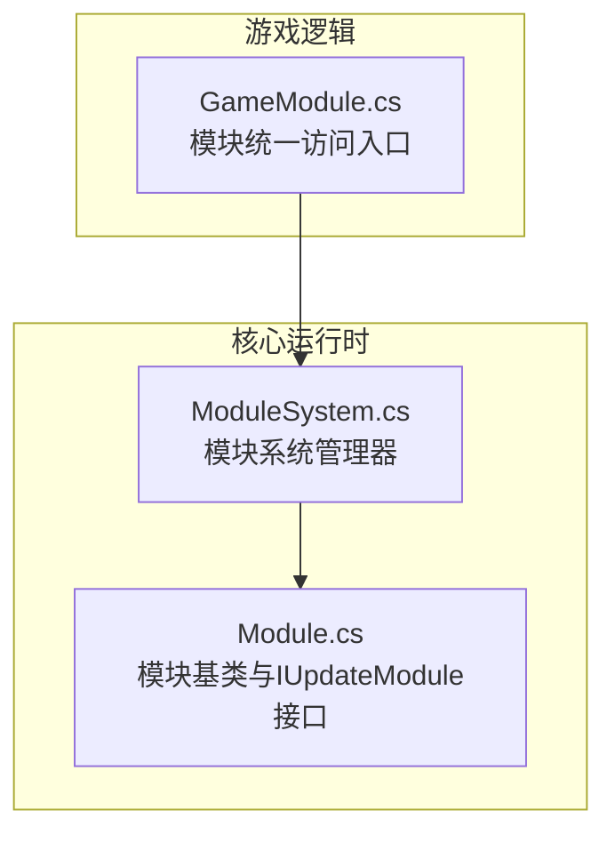
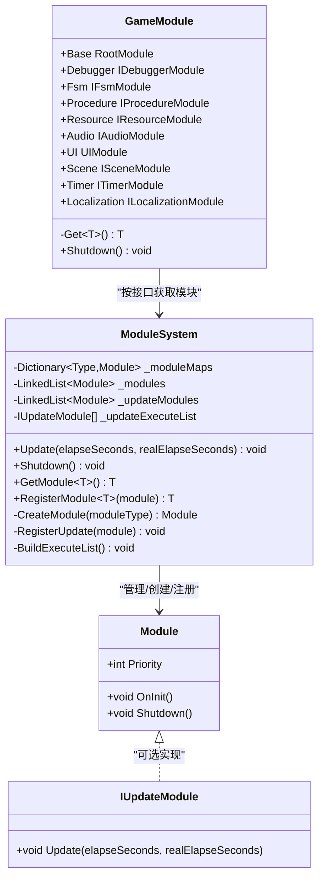
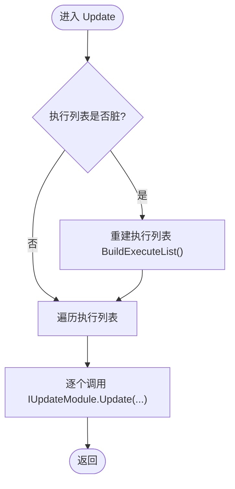
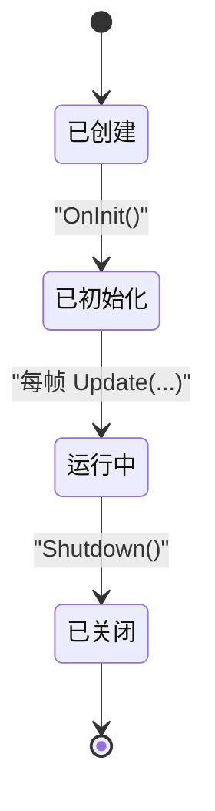
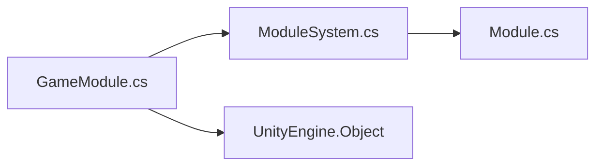

# 模块系统设计

<cite>
**本文引用的文件**   
- [ModuleSystem.cs](file://UnityProject/Assets/TEngine/Runtime/Core/ModuleSystem.cs)
- [Module.cs](file://UnityProject/Assets/TEngine/Runtime/Core/Module.cs)
- [GameModule.cs](file://UnityProject/Assets/GameScripts/HotFix/GameLogic/GameModule.cs)
</cite>

## 目录
1. [简介](#简介)
2. [项目结构](#项目结构)
3. [核心组件](#核心组件)
4. [架构总览](#架构总览)
5. [详细组件分析](#详细组件分析)
6. [依赖关系分析](#依赖关系分析)
7. [性能考量](#性能考量)
8. [故障排查指南](#故障排查指南)
9. [结论](#结论)
10. [附录：自定义模块开发最佳实践](#附录自定义模块开发最佳实践)

## 简介
本文件面向 TEngine 的模块系统，系统性阐述 ModuleSystem 的核心设计原理与实现机制，包括模块注册、依赖注入（基于接口解析）、优先级管理、生命周期方法（OnInit、OnUpdate、OnShutdown）的执行流程，以及模块自动发现与实例化过程。文档同时提供架构图、流程图与时序图，帮助读者从高层到代码层全面理解模块系统，并给出自定义模块开发的实践建议。

## 项目结构
围绕模块系统的核心代码位于 UnityProject/Assets/TEngine/Runtime/Core 目录下，关键文件如下：
- ModuleSystem.cs：模块系统管理器，负责模块注册、查找、更新调度与关闭清理。
- Module.cs：模块抽象基类与可轮询接口 IUpdateModule。
- GameModule.cs：游戏侧对框架模块的统一访问入口，通过接口类型获取具体模块实例。

图表来源
- [ModuleSystem.cs:1-208](file://UnityProject/Assets/TEngine/Runtime/Core/ModuleSystem.cs#L1-L208)
- [Module.cs:1-40](file://UnityProject/Assets/TEngine/Runtime/Core/Module.cs#L1-L40)
- [GameModule.cs:1-118](file://UnityProject/Assets/GameScripts/HotFix/GameLogic/GameModule.cs#L1-L118)

章节来源
- [ModuleSystem.cs:1-208](file://UnityProject/Assets/TEngine/Runtime/Core/ModuleSystem.cs#L1-L208)
- [Module.cs:1-40](file://UnityProject/Assets/TEngine/Runtime/Core/Module.cs#L1-L40)
- [GameModule.cs:1-118](file://UnityProject/Assets/GameScripts/HotFix/GameLogic/GameModule.cs#L1-L118)

## 核心组件
- ModuleSystem：静态模块系统管理器，维护模块映射表、模块链表、更新模块链表与执行列表；提供 Update、Shutdown、GetModule<T>()、RegisterModule<T>() 等能力。
- Module：模块抽象基类，定义 Priority、OnInit、Shutdown 三个关键成员；所有具体模块需继承该类。
- IUpdateModule：可被框架每帧调度的接口，实现该接口的模块会在 Update 中被调用。
- GameModule：游戏侧对框架模块的统一访问门面，内部通过 ModuleSystem.GetModule<T>() 按接口类型获取模块实例。

章节来源
- [ModuleSystem.cs:1-208](file://UnityProject/Assets/TEngine/Runtime/Core/ModuleSystem.cs#L1-L208)
- [Module.cs:1-40](file://UnityProject/Assets/TEngine/Runtime/Core/Module.cs#L1-L40)
- [GameModule.cs:1-118](file://UnityProject/Assets/GameScripts/HotFix/GameLogic/GameModule.cs#L1-L118)

## 架构总览
模块系统采用“接口优先”的设计：业务以接口形式暴露能力，框架通过接口名称反射构造对应实现类，完成自动发现与实例化。模块在注册时根据优先级插入有序链表，实现初始化顺序与关闭顺序的可控性；实现 IUpdateModule 的模块会被纳入每帧更新队列。

图表来源
- [ModuleSystem.cs:1-208](file://UnityProject/Assets/TEngine/Runtime/Core/ModuleSystem.cs#L1-L208)
- [Module.cs:1-40](file://UnityProject/Assets/TEngine/Runtime/Core/Module.cs#L1-L40)
- [GameModule.cs:1-118](file://UnityProject/Assets/GameScripts/HotFix/GameLogic/GameModule.cs#L1-L118)

## 详细组件分析

### ModuleSystem：模块注册、查找与调度
- 模块存储与查找
  - 使用字典将接口类型映射到模块实例，支持按接口类型 GetModule<T>() 获取或懒创建。
  - 当未命中缓存时，根据接口命名规则推导实现类全名并通过反射创建实例，随后注册入系统。
- 优先级与排序
  - 模块链 _modules 与更新模块链 _updateModules 均按 Priority 降序插入，保证高优先级模块先初始化、后关闭；实现 IUpdateModule 的模块在更新队列中同样遵循优先级顺序。
- 更新调度
  - 每帧调用 Update(elapseSeconds, realElapseSeconds)，若执行列表脏标记为真则重建 _updateExecuteList，再依次调用各模块的 Update。
- 关闭清理
  - Shutdown 按逆序调用各模块 Shutdown，然后清空所有容器并释放底层资源。

图表来源
- [ModuleSystem.cs:29-42](file://UnityProject/Assets/TEngine/Runtime/Core/ModuleSystem.cs#L29-L42)
- [ModuleSystem.cs:199-206](file://UnityProject/Assets/TEngine/Runtime/Core/ModuleSystem.cs#L199-L206)

章节来源
- [ModuleSystem.cs:1-208](file://UnityProject/Assets/TEngine/Runtime/Core/ModuleSystem.cs#L1-L208)

### Module：模块基类与生命周期
- Priority：默认 0，子类可重写以控制初始化与关闭顺序。
- OnInit：模块初始化钩子，由系统在注册完成后立即调用。
- Shutdown：模块销毁钩子，由系统在框架关闭时按逆序调用。

图表来源
- [Module.cs:22-39](file://UnityProject/Assets/TEngine/Runtime/Core/Module.cs#L22-L39)
- [ModuleSystem.cs:143-194](file://UnityProject/Assets/TEngine/Runtime/Core/ModuleSystem.cs#L143-L194)

章节来源
- [Module.cs:1-40](file://UnityProject/Assets/TEngine/Runtime/Core/Module.cs#L1-L40)
- [ModuleSystem.cs:143-194](file://UnityProject/Assets/TEngine/Runtime/Core/ModuleSystem.cs#L143-L194)

### GameModule：模块统一访问门面
- 通过静态属性暴露常用模块（如 Resource、Audio、UI、Scene、Timer、Localization 等），内部统一委托给 ModuleSystem.GetModule<T>()。
- 提供 Shutdown 用于释放引用，便于测试或热重载场景下的状态重置。

章节来源
- [GameModule.cs:1-118](file://UnityProject/Assets/GameScripts/HotFix/GameLogic/GameModule.cs#L1-L118)

## 依赖关系分析
- 耦合关系
  - GameModule 强依赖 ModuleSystem 提供的接口式模块获取能力。
  - ModuleSystem 依赖 Module 抽象与 IUpdateModule 接口，不感知具体实现细节，体现松耦合。
- 外部依赖
  - 反射 Type.GetType 用于按约定自动发现模块实现类。
  - Unity 相关类型（如 Object）在 GameModule 中用于场景级单例查找（RootModule）。

图表来源
- [GameModule.cs:1-118](file://UnityProject/Assets/GameScripts/HotFix/GameLogic/GameModule.cs#L1-L118)
- [ModuleSystem.cs:1-208](file://UnityProject/Assets/TEngine/Runtime/Core/ModuleSystem.cs#L1-L208)
- [Module.cs:1-40](file://UnityProject/Assets/TEngine/Runtime/Core/Module.cs#L1-L40)

章节来源
- [GameModule.cs:1-118](file://UnityProject/Assets/GameScripts/HotFix/GameLogic/GameModule.cs#L1-L118)
- [ModuleSystem.cs:1-208](file://UnityProject/Assets/TEngine/Runtime/Core/ModuleSystem.cs#L1-L208)
- [Module.cs:1-40](file://UnityProject/Assets/TEngine/Runtime/Core/Module.cs#L1-L40)

## 性能考量
- 预分配容量
  - 模块集合初始容量 DESIGN_MODULE_COUNT 减少扩容与 GC 压力。
- 延迟构建执行列表
  - 仅在模块增删导致 _isExecuteListDirty 为真时才重建 _updateExecuteList，避免每帧重复构建。
- 链表排序插入
  - 使用 LinkedList 按优先级插入，避免频繁移动数组元素；但需注意大量模块注册时的线性扫描成本。
- 反射开销
  - 首次按接口获取模块时会进行字符串拼接与 Type.GetType 反射，建议在启动阶段预热常用模块以减少运行时反射成本。

[本节为通用性能指导，不直接分析具体文件]

## 故障排查指南
- 无法找到模块类型
  - 现象：按接口获取模块时报错找不到实现类。
  - 原因：接口命名与实现类命名不符合框架约定的反射规则，或程序集未加载。
  - 处理：检查接口命名空间与实现类命名是否符合“接口名去掉前缀 I 作为实现类名”的规则，并确保实现类所在程序集已加载。
- 模块未按预期顺序执行
  - 现象：初始化或关闭顺序不符合预期。
  - 原因：未正确重写 Priority 或实现 IUpdateModule 但未加入更新队列。
  - 处理：确保需要参与更新的模块实现 IUpdateModule，并在需要时重写 Priority 调整顺序。
- 模块未触发 OnInit
  - 现象：模块未执行初始化逻辑。
  - 原因：模块未被注册或未通过 GetModule<T>() 触发懒创建。
  - 处理：显式调用 RegisterModule<T>() 或通过 GetModule<T>() 触发懒创建。

章节来源
- [ModuleSystem.cs:68-120](file://UnityProject/Assets/TEngine/Runtime/Core/ModuleSystem.cs#L68-L120)
- [ModuleSystem.cs:128-141](file://UnityProject/Assets/TEngine/Runtime/Core/ModuleSystem.cs#L128-L141)
- [ModuleSystem.cs:143-194](file://UnityProject/Assets/TEngine/Runtime/Core/ModuleSystem.cs#L143-L194)

## 结论
TEngine 模块系统以接口为中心，通过反射自动发现与实例化模块，结合优先级链表实现可控的初始化与关闭顺序，并以 IUpdateModule 接口接入每帧更新循环。整体设计强调解耦与可扩展性，适合大型项目的模块化组织与团队协作。

[本节为总结性内容，不直接分析具体文件]

## 附录：自定义模块开发最佳实践
- 定义接口
  - 以 I 开头定义模块对外能力接口，例如 IMyService。
- 实现模块
  - 新建类 MyService 继承 Module，按需重写 Priority、OnInit、Shutdown。
  - 如需每帧更新，请实现 IUpdateModule 接口。
- 注册模块
  - 方式一（推荐）：在应用启动处通过 ModuleSystem.RegisterModule<IMyService>(new MyService()) 显式注册。
  - 方式二：首次通过 ModuleSystem.GetModule<IMyService>() 触发懒创建，要求实现类命名符合框架反射约定。
- 访问模块
  - 在游戏侧通过 GameModule 暴露的静态属性或直接调用 ModuleSystem.GetModule<IMyService>() 获取实例。
- 生命周期注意事项
  - 在 OnInit 中进行轻量初始化，避免阻塞主线程。
  - 在 Shutdown 中释放资源、取消订阅事件、清理定时器。
  - 在 Update 中避免重计算与频繁分配内存，注意 elapseSeconds 与 realElapseSeconds 的使用差异。

章节来源
- [ModuleSystem.cs:68-120](file://UnityProject/Assets/TEngine/Runtime/Core/ModuleSystem.cs#L68-L120)
- [ModuleSystem.cs:128-141](file://UnityProject/Assets/TEngine/Runtime/Core/ModuleSystem.cs#L128-L141)
- [Module.cs:22-39](file://UnityProject/Assets/TEngine/Runtime/Core/Module.cs#L22-L39)
- [GameModule.cs:94-101](file://UnityProject/Assets/GameScripts/HotFix/GameLogic/GameModule.cs#L94-L101)