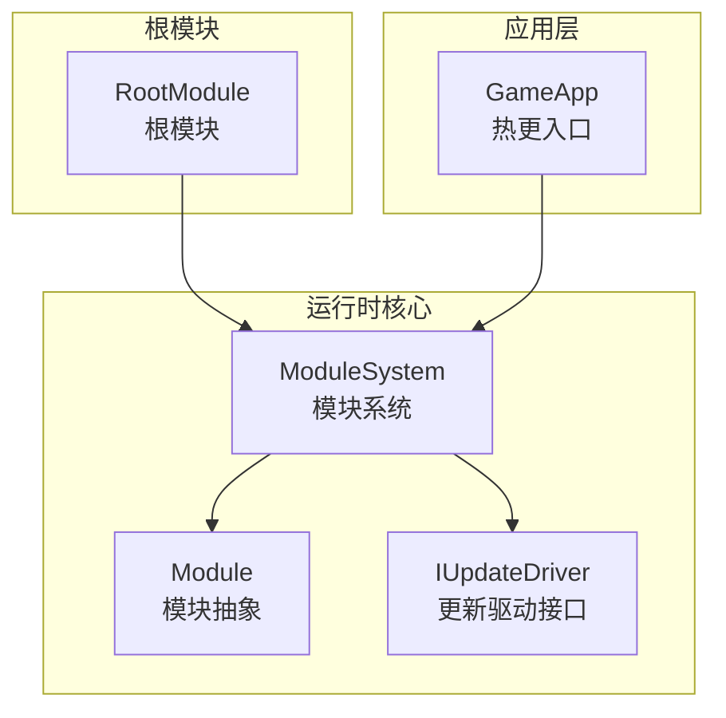
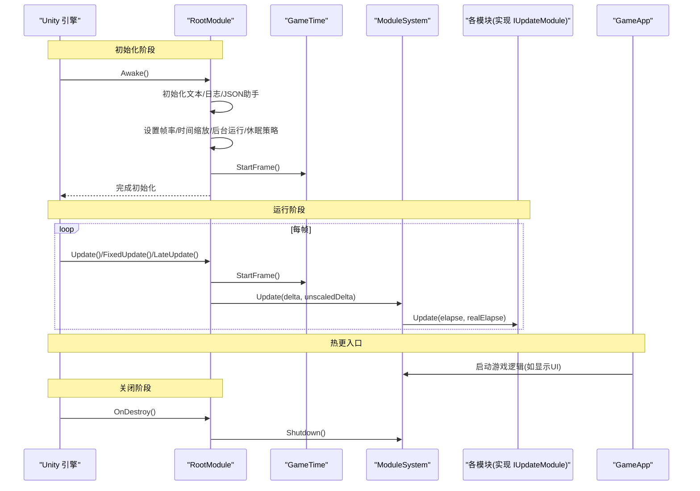
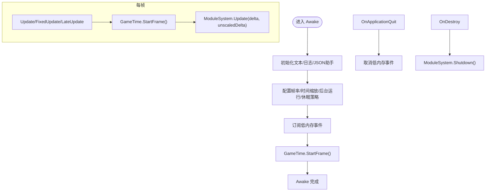
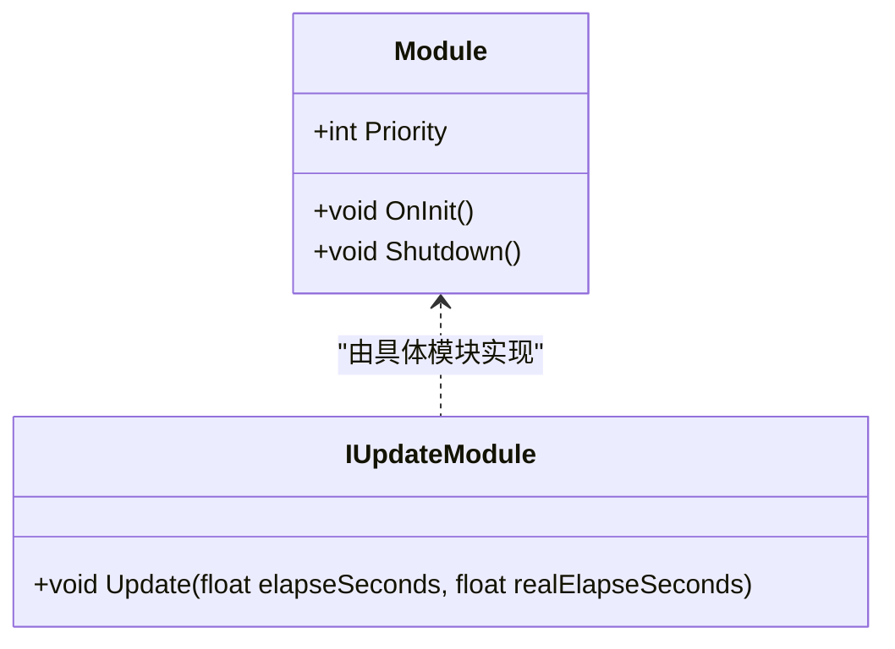
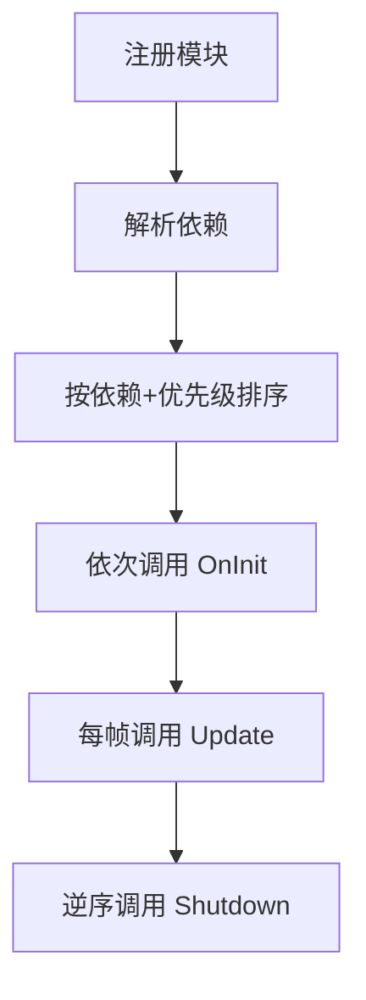
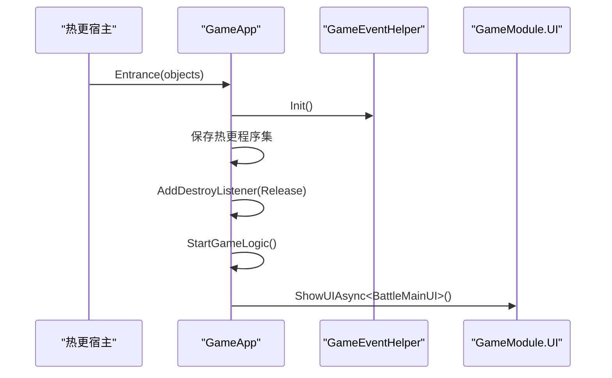
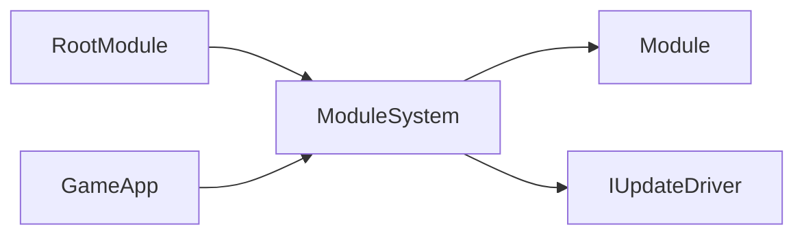
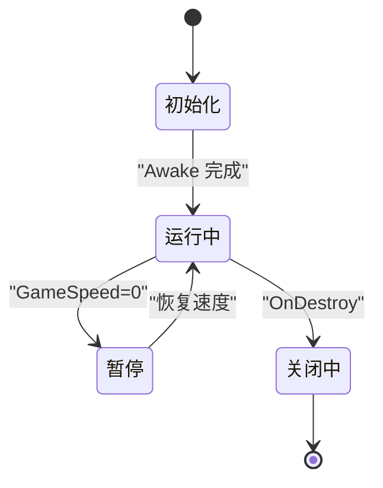

# 生命周期管理

<cite>
**本文引用的文件**   
- [RootModule.cs](file://UnityProject/Assets/TEngine/Runtime/Module/RootModule.cs)
- [Module.cs](file://UnityProject/Assets/TEngine/Runtime/Core/Module.cs)
- [ModuleSystem.cs](file://UnityProject/Assets/TEngine/Runtime/Core/ModuleSystem.cs)
- [IUpdateDriver.cs](file://UnityProject/Assets/TEngine/Runtime/Module/UpdataDriver/IUpdateDriver.cs)
- [GameApp.cs](file://UnityProject/Assets/GameScripts/HotFix/GameLogic/GameApp.cs)
</cite>

## 目录
1. [简介](#简介)
2. [项目结构](#项目结构)
3. [核心组件](#核心组件)
4. [架构总览](#架构总览)
5. [详细组件分析](#详细组件分析)
6. [依赖关系分析](#依赖关系分析)
7. [性能考量](#性能考量)
8. [故障排查指南](#故障排查指南)
9. [结论](#结论)
10. [附录](#附录)

## 简介
本技术文档聚焦 TEngine 框架的生命周期管理机制，围绕初始化阶段、运行阶段与关闭阶段的完整流程展开。重点解释 RootModule 作为根模块的职责边界，如何协调各子模块的初始化、更新与销毁；说明 Update 循环中逻辑时间与真实时间的处理机制；阐述模块间的依赖管理与初始化顺序控制；并通过状态图与时序图帮助开发者理解框架的运行机制。

## 项目结构
与生命周期相关的核心代码主要位于以下路径：
- UnityProject/Assets/TEngine/Runtime/Module/RootModule.cs：根模块，负责引擎环境初始化、时间驱动与全局事件接入。
- UnityProject/Assets/TEngine/Runtime/Core/Module.cs：模块抽象基类与更新接口定义。
- UnityProject/Assets/TEngine/Runtime/Core/ModuleSystem.cs：模块系统，负责模块注册、依赖解析、初始化顺序与更新调度。
- UnityProject/Assets/TEngine/Runtime/Module/UpdataDriver/IUpdateDriver.cs：更新驱动接口（用于扩展或替换更新调度策略）。
- UnityProject/Assets/GameScripts/HotFix/GameLogic/GameApp.cs：热更域入口，启动游戏逻辑。

图表来源
- [RootModule.cs:116-167](file://UnityProject/Assets/TEngine/Runtime/Module/RootModule.cs#L116-L167)
- [Module.cs:22-39](file://UnityProject/Assets/TEngine/Runtime/Core/Module.cs#L22-L39)
- [ModuleSystem.cs](file://UnityProject/Assets/TEngine/Runtime/Core/ModuleSystem.cs)
- [IUpdateDriver.cs](file://UnityProject/Assets/TEngine/Runtime/Module/UpdataDriver/IUpdateDriver.cs)
- [GameApp.cs:25-40](file://UnityProject/Assets/GameScripts/HotFix/GameLogic/GameApp.cs#L25-L40)

章节来源
- [RootModule.cs:116-167](file://UnityProject/Assets/TEngine/Runtime/Module/RootModule.cs#L116-L167)
- [Module.cs:22-39](file://UnityProject/Assets/TEngine/Runtime/Core/Module.cs#L22-L39)
- [GameApp.cs:25-40](file://UnityProject/Assets/GameScripts/HotFix/GameLogic/GameApp.cs#L25-L40)

## 核心组件
- RootModule：根 MonoBehaviour，负责引擎级初始化（文本、日志、JSON 助手）、帧率与时间缩放设置、低内存回调、以及每帧调用 ModuleSystem.Update。
- Module：所有模块的抽象基类，定义 OnInit 与 Shutdown 生命周期钩子，并提供 Priority 以控制初始化与关闭顺序。
- ModuleSystem：模块系统的中枢，负责模块注册、依赖解析、按优先级排序执行 OnInit/Shutdown，并在每帧调用实现 IUpdateModule 的模块的 Update。
- IUpdateDriver：更新驱动接口，允许自定义更新调度策略（例如固定步长、插值等）。
- GameApp：热更域入口，负责在热更加载后启动游戏逻辑（如 UI 展示）。

章节来源
- [RootModule.cs:116-167](file://UnityProject/Assets/TEngine/Runtime/Module/RootModule.cs#L116-L167)
- [Module.cs:22-39](file://UnityProject/Assets/TEngine/Runtime/Core/Module.cs#L22-L39)
- [IUpdateDriver.cs](file://UnityProject/Assets/TEngine/Runtime/Module/UpdataDriver/IUpdateDriver.cs)
- [GameApp.cs:25-40](file://UnityProject/Assets/GameScripts/HotFix/GameLogic/GameApp.cs#L25-L40)

## 架构总览
下图展示了从 Unity 引擎回调到模块更新的完整时序，包括初始化、运行与关闭三个阶段。

图表来源
- [RootModule.cs:116-167](file://UnityProject/Assets/TEngine/Runtime/Module/RootModule.cs#L116-L167)
- [Module.cs:22-39](file://UnityProject/Assets/TEngine/Runtime/Core/Module.cs#L22-L39)
- [GameApp.cs:25-40](file://UnityProject/Assets/GameScripts/HotFix/GameLogic/GameApp.cs#L25-L40)

## 详细组件分析

### RootModule：根模块与生命周期协调者
职责要点
- 引擎环境初始化：通过反射动态加载并注入 TextHelper、LogHelper、JsonHelper。
- 全局参数配置：帧率、时间缩放、后台运行、屏幕休眠策略。
- 低内存响应：释放对象池未使用对象，触发资源模块的低内存回调。
- 时间驱动：每帧调用 GameTime.StartFrame() 并委托 ModuleSystem.Update 进行模块轮询。
- 生命周期钩子：Awake/FixedUpdate/LateUpdate/OnDestroy 统一协调时间推进与模块更新。

图表来源
- [RootModule.cs:116-167](file://UnityProject/Assets/TEngine/Runtime/Module/RootModule.cs#L116-L167)
- [RootModule.cs:214-285](file://UnityProject/Assets/TEngine/Runtime/Module/RootModule.cs#L214-L285)
- [RootModule.cs:287-302](file://UnityProject/Assets/TEngine/Runtime/Module/RootModule.cs#L287-L302)

章节来源
- [RootModule.cs:116-167](file://UnityProject/Assets/TEngine/Runtime/Module/RootModule.cs#L116-L167)
- [RootModule.cs:214-285](file://UnityProject/Assets/TEngine/Runtime/Module/RootModule.cs#L214-L285)
- [RootModule.cs:287-302](file://UnityProject/Assets/TEngine/Runtime/Module/RootModule.cs#L287-L302)

### Module：模块抽象与更新接口
- Module：提供 Priority、OnInit、Shutdown 三个关键成员，Priority 越高越先初始化，越晚关闭。
- IUpdateModule：定义 Update(elapseSeconds, realElapseSeconds)，其中 elapseSeconds 为逻辑时间增量，realElapseSeconds 为真实时间增量。

图表来源
- [Module.cs:8-16](file://UnityProject/Assets/TEngine/Runtime/Core/Module.cs#L8-L16)
- [Module.cs:22-39](file://UnityProject/Assets/TEngine/Runtime/Core/Module.cs#L22-L39)

章节来源
- [Module.cs:8-16](file://UnityProject/Assets/TEngine/Runtime/Core/Module.cs#L8-L16)
- [Module.cs:22-39](file://UnityProject/Assets/TEngine/Runtime/Core/Module.cs#L22-L39)

### ModuleSystem：模块系统与依赖管理
职责要点
- 模块注册与发现：收集已注册的模块类型。
- 依赖解析与拓扑排序：根据模块间依赖关系确定初始化顺序。
- 优先级控制：同依赖层级内按 Priority 排序。
- 生命周期调度：依次调用 OnInit，运行时调用 Update，关闭时逆序调用 Shutdown。
- 更新驱动：支持通过 IUpdateDriver 扩展更新调度策略。

图表来源
- [ModuleSystem.cs](file://UnityProject/Assets/TEngine/Runtime/Core/ModuleSystem.cs)
- [Module.cs:22-39](file://UnityProject/Assets/TEngine/Runtime/Core/Module.cs#L22-L39)
- [IUpdateDriver.cs](file://UnityProject/Assets/TEngine/Runtime/Module/UpdataDriver/IUpdateDriver.cs)

章节来源
- [ModuleSystem.cs](file://UnityProject/Assets/TEngine/Runtime/Core/ModuleSystem.cs)
- [Module.cs:22-39](file://UnityProject/Assets/TEngine/Runtime/Core/Module.cs#L22-L39)
- [IUpdateDriver.cs](file://UnityProject/Assets/TEngine/Runtime/Module/UpdataDriver/IUpdateDriver.cs)

### GameApp：热更入口与应用启动
- Entrance：热更域入口，初始化事件系统，保存热更程序集，添加销毁监听，启动游戏逻辑。
- StartGameLogic：示例中直接通过 GameModule.UI 展示主界面。
- Release：释放单例系统，输出清理日志。

图表来源
- [GameApp.cs:25-40](file://UnityProject/Assets/GameScripts/HotFix/GameLogic/GameApp.cs#L25-L40)
- [GameApp.cs:42-46](file://UnityProject/Assets/GameScripts/HotFix/GameLogic/GameApp.cs#L42-L46)

章节来源
- [GameApp.cs:25-40](file://UnityProject/Assets/GameScripts/HotFix/GameLogic/GameApp.cs#L25-L40)
- [GameApp.cs:42-46](file://UnityProject/Assets/GameScripts/HotFix/GameLogic/GameApp.cs#L42-L46)

## 依赖关系分析
- RootModule 依赖 ModuleSystem 进行模块更新与关闭。
- ModuleSystem 依赖 Module 抽象与 IUpdateModule 接口，实现对具体模块的统一调度。
- IUpdateDriver 作为可选扩展点，可替换默认更新策略。
- GameApp 在热更域中启动业务逻辑，间接依赖 ModuleSystem 提供的服务。

图表来源
- [RootModule.cs:116-167](file://UnityProject/Assets/TEngine/Runtime/Module/RootModule.cs#L116-L167)
- [Module.cs:22-39](file://UnityProject/Assets/TEngine/Runtime/Core/Module.cs#L22-L39)
- [IUpdateDriver.cs](file://UnityProject/Assets/TEngine/Runtime/Module/UpdataDriver/IUpdateDriver.cs)
- [GameApp.cs:25-40](file://UnityProject/Assets/GameScripts/HotFix/GameLogic/GameApp.cs#L25-L40)

章节来源
- [RootModule.cs:116-167](file://UnityProject/Assets/TEngine/Runtime/Module/RootModule.cs#L116-L167)
- [Module.cs:22-39](file://UnityProject/Assets/TEngine/Runtime/Core/Module.cs#L22-L39)
- [GameApp.cs:25-40](file://UnityProject/Assets/GameScripts/HotFix/GameLogic/GameApp.cs#L25-L40)

## 性能考量
- 时间控制：通过 RootModule.GameSpeed 控制 Time.timeScale，避免在暂停状态下执行不必要的逻辑。
- 更新频率：合理设置 RootModule.FrameRate，平衡流畅度与功耗。
- 后台运行：RunInBackground 影响非前台时的更新行为，需结合平台特性调整。
- 低内存优化：RootModule 在低内存事件中主动释放对象池与资源模块缓存，降低峰值内存。
- 模块优先级：利用 Module.Priority 将高频更新模块置于较高优先级，减少抖动。

[本节为通用指导，不直接分析具体文件]

## 故障排查指南
常见问题与定位建议
- 模块未更新：检查是否实现 IUpdateModule 且被 ModuleSystem 正确注册。
- 初始化顺序异常：确认模块依赖声明与 Priority 设置是否符合预期。
- 热更入口未触发：核查热更加载流程是否正确调用 GameApp.Entrance。
- 低内存无响应：确认 RootModule.OnLowMemory 是否成功订阅，并确保相关模块存在。
- 时间不同步：确保每帧都调用了 GameTime.StartFrame()，并由 RootModule 统一驱动。

章节来源
- [RootModule.cs:116-167](file://UnityProject/Assets/TEngine/Runtime/Module/RootModule.cs#L116-L167)
- [RootModule.cs:287-302](file://UnityProject/Assets/TEngine/Runtime/Module/RootModule.cs#L287-L302)
- [GameApp.cs:25-40](file://UnityProject/Assets/GameScripts/HotFix/GameLogic/GameApp.cs#L25-L40)

## 结论
TEngine 的生命周期管理以 RootModule 为入口，通过 ModuleSystem 统一管理模块的初始化、更新与关闭。模块通过 Module 抽象与 IUpdateModule 接口参与框架调度，依赖关系与优先级共同决定执行顺序。Update 循环严格区分逻辑时间与真实时间，便于在不同时间缩放下保持行为一致。借助 IUpdateDriver 可扩展更新策略，满足多样化场景需求。

[本节为总结性内容，不直接分析具体文件]

## 附录
- 生命周期状态图（概念示意）

[此图为概念示意，无需图表来源]