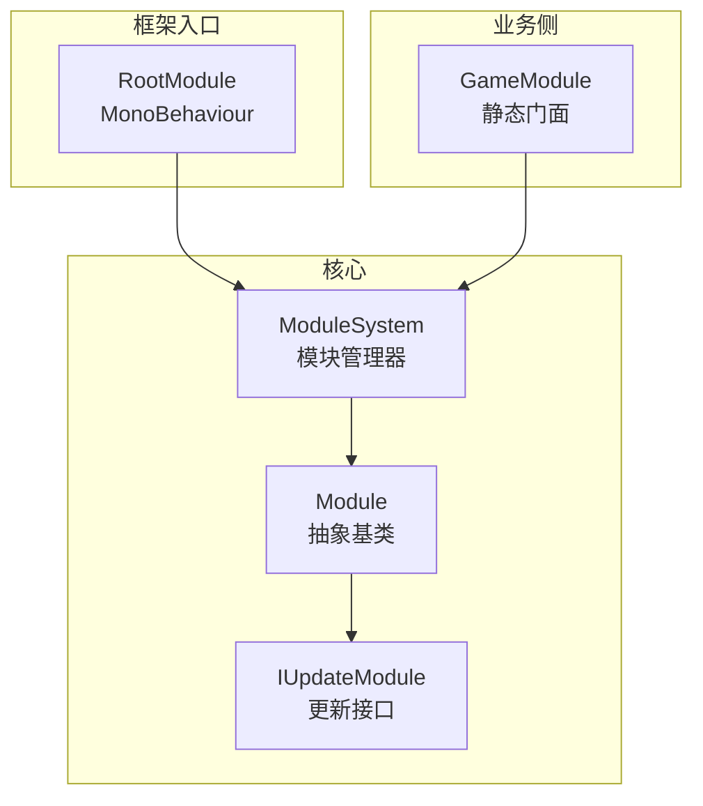
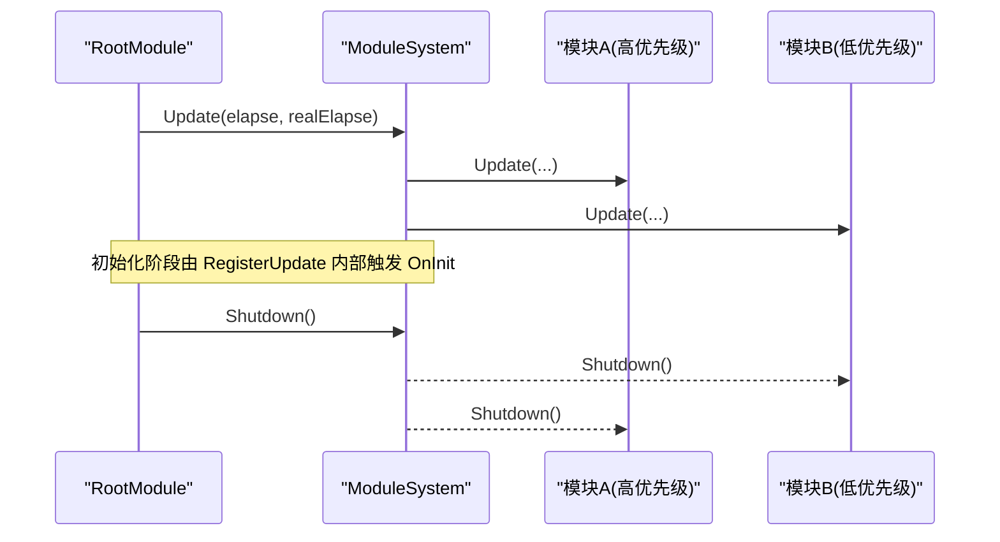
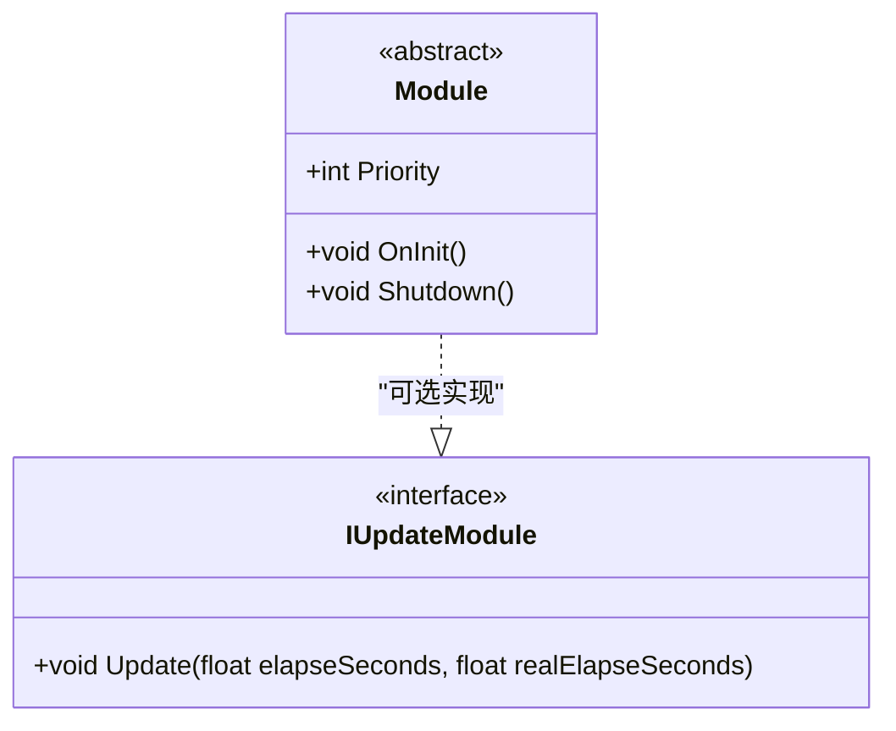
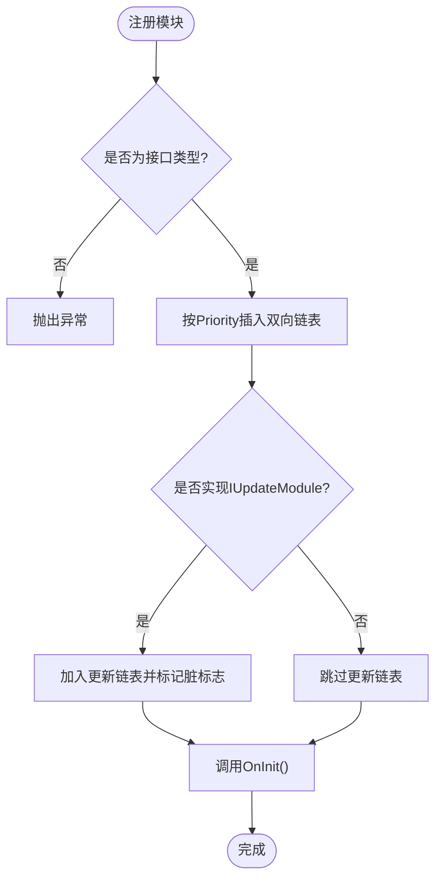
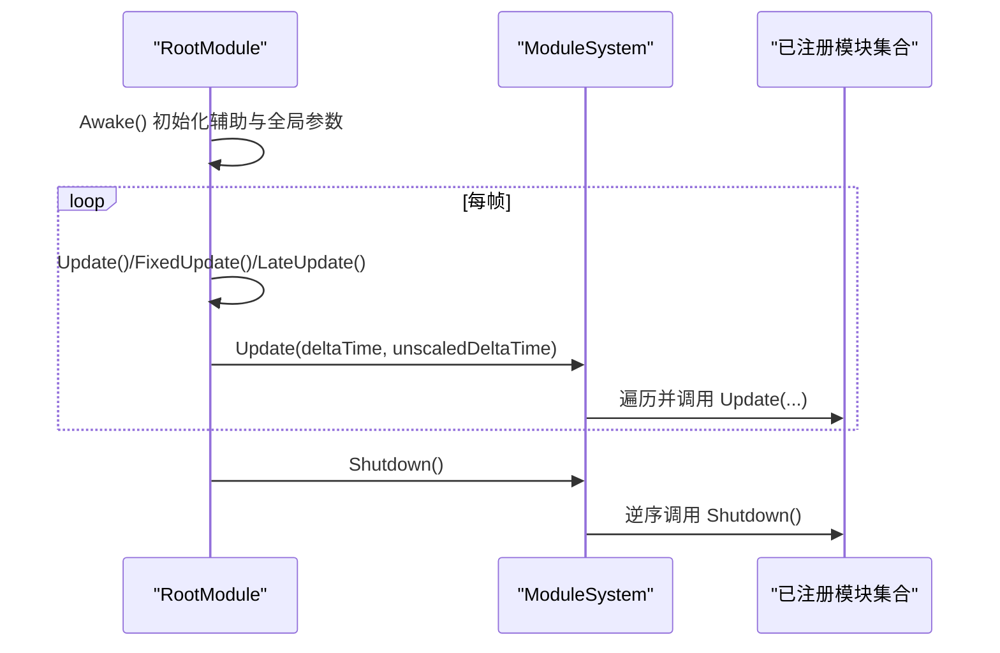
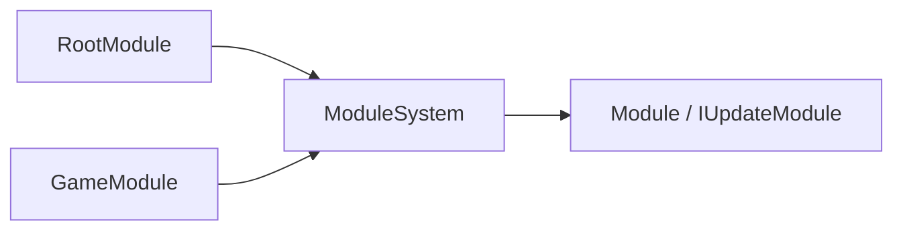

# 模块基础概念

<cite>
**本文引用的文件**   
- [Module.cs](file://UnityProject/Assets/TEngine/Runtime/Core/Module.cs)
- [ModuleSystem.cs](file://UnityProject/Assets/TEngine/Runtime/Core/ModuleSystem.cs)
- [RootModule.cs](file://UnityProject/Assets/TEngine/Runtime/Module/RootModule.cs)
- [GameModule.cs](file://UnityProject/Assets/GameScripts/HotFix/GameLogic/GameModule.cs)
</cite>

## 目录
1. [简介](#简介)
2. [项目结构](#项目结构)
3. [核心组件](#核心组件)
4. [架构总览](#架构总览)
5. [详细组件分析](#详细组件分析)
6. [依赖关系分析](#依赖关系分析)
7. [性能与优先级机制](#性能与优先级机制)
8. [自定义模块开发指南](#自定义模块开发指南)
9. [常见问题排查](#常见问题排查)
10. [结论](#结论)

## 简介
本章节面向 TEngine 的“模块系统”，聚焦 Module 基类的设计理念、生命周期方法（OnInit、Shutdown）、优先级机制、状态管理，以及与 Unity MonoBehaviour 的关系。文档将解释如何通过继承 Module 基类创建自定义模块，并给出从定义到使用的完整流程示例路径。同时对比 Module 与 Unity MonoBehaviour 的差异与优势，帮助读者在 TEngine 中正确组织游戏逻辑。

## 项目结构
模块系统位于 TEngine 运行时核心层，主要包含：
- 抽象基类与接口：Module、IUpdateModule
- 模块管理器：ModuleSystem
- 根节点与框架入口：RootModule（MonoBehaviour）
- 业务侧统一访问入口：GameModule（静态门面）

图示来源
- [Module.cs:5-39](file://UnityProject/Assets/TEngine/Runtime/Core/Module.cs#L5-L39)
- [ModuleSystem.cs:9-207](file://UnityProject/Assets/TEngine/Runtime/Core/ModuleSystem.cs#L9-L207)
- [RootModule.cs:10-167](file://UnityProject/Assets/TEngine/Runtime/Module/RootModule.cs#L10-L167)
- [GameModule.cs:5-118](file://UnityProject/Assets/GameScripts/HotFix/GameLogic/GameModule.cs#L5-L118)

章节来源
- [Module.cs:5-39](file://UnityProject/Assets/TEngine/Runtime/Core/Module.cs#L5-L39)
- [ModuleSystem.cs:9-207](file://UnityProject/Assets/TEngine/Runtime/Core/ModuleSystem.cs#L9-L207)
- [RootModule.cs:10-167](file://UnityProject/Assets/TEngine/Runtime/Module/RootModule.cs#L10-L167)
- [GameModule.cs:5-118](file://UnityProject/Assets/GameScripts/HotFix/GameLogic/GameModule.cs#L5-L118)

## 核心组件
- Module 抽象基类
  - 提供 Priority 属性控制初始化与关闭顺序
  - 定义 OnInit 与 Shutdown 两个生命周期钩子
  - 可选实现 IUpdateModule 以接入每帧 Update 轮询
- ModuleSystem 模块管理器
  - 负责模块的注册、查找、创建、排序、更新调度与销毁
  - 维护按优先级排序的模块链表与更新执行列表
- RootModule 框架根节点
  - MonoBehaviour 单例，驱动 GameTime 与 ModuleSystem.Update
  - 在 OnDestroy 时调用 ModuleSystem.Shutdown 完成清理
- GameModule 业务侧门面
  - 通过 ModuleSystem.GetModule<T>() 获取各子系统模块实例
  - 提供统一的静态访问点，屏蔽底层细节

章节来源
- [Module.cs:5-39](file://UnityProject/Assets/TEngine/Runtime/Core/Module.cs#L5-L39)
- [ModuleSystem.cs:9-207](file://UnityProject/Assets/TEngine/Runtime/Core/ModuleSystem.cs#L9-L207)
- [RootModule.cs:10-167](file://UnityProject/Assets/TEngine/Runtime/Module/RootModule.cs#L10-L167)
- [GameModule.cs:5-118](file://UnityProject/Assets/GameScripts/HotFix/GameLogic/GameModule.cs#L5-L118)

## 架构总览
下图展示模块系统在运行期的关键交互：RootModule 驱动帧循环，ModuleSystem 根据优先级调度模块的 OnInit 与 Update，并在退出时按逆序调用 Shutdown。

图示来源
- [RootModule.cs:140-167](file://UnityProject/Assets/TEngine/Runtime/Module/RootModule.cs#L140-L167)
- [ModuleSystem.cs:29-60](file://UnityProject/Assets/TEngine/Runtime/Core/ModuleSystem.cs#L29-L60)
- [ModuleSystem.cs:143-194](file://UnityProject/Assets/TEngine/Runtime/Core/ModuleSystem.cs#L143-L194)

## 详细组件分析

### Module 抽象基类与 IUpdateModule
- 设计要点
  - Priority：数值越大，越先初始化；关闭时则相反（后初始化者先关闭）。
  - OnInit：模块初始化入口，用于资源准备、订阅事件等。
  - Shutdown：模块释放入口，用于反订阅、释放资源、清理状态。
  - IUpdateModule：若需每帧执行逻辑，实现该接口即可被 ModuleSystem 调度。
- 复杂度与行为
  - 默认 Priority 为 0，可被子类重写以调整顺序。
  - 是否参与 Update 取决于是否实现 IUpdateModule。

图示来源
- [Module.cs:5-39](file://UnityProject/Assets/TEngine/Runtime/Core/Module.cs#L5-L39)

章节来源
- [Module.cs:5-39](file://UnityProject/Assets/TEngine/Runtime/Core/Module.cs#L5-L39)

### ModuleSystem 模块管理器
- 职责
  - 模块注册与查找：支持通过接口类型自动反射创建具体实现，或显式注册。
  - 优先级排序：维护按 Priority 升序插入的双向链表，保证高优先在前。
  - 更新调度：对实现 IUpdateModule 的模块构建执行列表，每帧遍历调用。
  - 生命周期管理：在注册时调用 OnInit，在 Shutdown 时逆序调用 Shutdown。
- 关键流程
  - GetModule<T>()：按接口名推断实现类名并反射创建，缓存于字典。
  - RegisterModule<T>()：允许外部直接注入模块实例。
  - RegisterUpdate(module)：插入排序并决定是否加入更新队列，随后调用 OnInit。
  - BuildExecuteList()：惰性重建更新执行列表，避免频繁 GC。

图示来源
- [ModuleSystem.cs:128-194](file://UnityProject/Assets/TEngine/Runtime/Core/ModuleSystem.cs#L128-L194)

章节来源
- [ModuleSystem.cs:9-207](file://UnityProject/Assets/TEngine/Runtime/Core/ModuleSystem.cs#L9-L207)

### RootModule 框架根节点
- 职责
  - 作为 MonoBehaviour 单例，负责初始化全局辅助（文本、日志、JSON），设置帧率与时间缩放。
  - 在 Update/FixedUpdate/LateUpdate 中推进 GameTime 并调用 ModuleSystem.Update。
  - 在 OnDestroy 中调用 ModuleSystem.Shutdown 进行统一清理。
  - 处理低内存回调，触发对象池与资源模块的回收。
- 与模块系统的耦合
  - 通过 ModuleSystem.Update 驱动所有模块的 Update。
  - 通过 ModuleSystem.Shutdown 驱动所有模块的 Shutdown。

图示来源
- [RootModule.cs:116-167](file://UnityProject/Assets/TEngine/Runtime/Module/RootModule.cs#L116-L167)
- [ModuleSystem.cs:29-60](file://UnityProject/Assets/TEngine/Runtime/Core/ModuleSystem.cs#L29-L60)

章节来源
- [RootModule.cs:10-167](file://UnityProject/Assets/TEngine/Runtime/Module/RootModule.cs#L10-L167)

### GameModule 业务侧门面
- 职责
  - 提供静态属性访问常用模块（调试、FSM、流程、资源、音频、UI、场景、计时器、本地化等）。
  - 内部通过 ModuleSystem.GetModule<T>() 获取模块实例，并进行断言检查。
  - 提供 Shutdown 清空静态引用，便于测试或热重载后清理。
- 使用方式
  - 业务代码通过 GameModule.Resource、GameModule.UI 等访问对应模块能力。

章节来源
- [GameModule.cs:5-118](file://UnityProject/Assets/GameScripts/HotFix/GameLogic/GameModule.cs#L5-L118)

## 依赖关系分析
- ModuleSystem 依赖
  - Module 抽象基类与 IUpdateModule 接口
  - 反射工具与通用异常类型（用于错误提示）
  - 内存池与 Marshal 工具（在 Shutdown 时统一清理）
- RootModule 依赖
  - Unity 引擎 API（Application、Screen、Time 等）
  - ModuleSystem 以驱动模块生命周期
- GameModule 依赖
  - ModuleSystem 以获取模块实例

图示来源
- [ModuleSystem.cs:9-207](file://UnityProject/Assets/TEngine/Runtime/Core/ModuleSystem.cs#L9-L207)
- [RootModule.cs:10-167](file://UnityProject/Assets/TEngine/Runtime/Module/RootModule.cs#L10-L167)
- [GameModule.cs:5-118](file://UnityProject/Assets/GameScripts/HotFix/GameLogic/GameModule.cs#L5-L118)

章节来源
- [ModuleSystem.cs:9-207](file://UnityProject/Assets/TEngine/Runtime/Core/ModuleSystem.cs#L9-L207)
- [RootModule.cs:10-167](file://UnityProject/Assets/TEngine/Runtime/Module/RootModule.cs#L10-L167)
- [GameModule.cs:5-118](file://UnityProject/Assets/GameScripts/HotFix/GameLogic/GameModule.cs#L5-L118)

## 性能与优先级机制
- 优先级机制
  - 初始化顺序：Priority 高的模块先 OnInit。
  - 关闭顺序：与初始化相反，后初始化的模块先 Shutdown。
  - 更新顺序：仅对实现 IUpdateModule 的模块生效，同样遵循优先级顺序。
- 性能优化
  - 使用双向链表维护模块顺序，插入时按优先级定位，减少全量排序开销。
  - 更新执行列表惰性重建，仅在新增/变更时重建，降低每帧分配。
  - 预分配容量常量以减少扩容带来的 GC 压力。
- 建议
  - 合理设置 Priority，确保依赖模块在被依赖前完成初始化。
  - 将高频更新的模块放在较高优先级，避免被阻塞。
  - 避免在 OnInit/Shutdown 中进行耗时操作，必要时异步化。

章节来源
- [ModuleSystem.cs:143-194](file://UnityProject/Assets/TEngine/Runtime/Core/ModuleSystem.cs#L143-L194)
- [ModuleSystem.cs:196-206](file://UnityProject/Assets/TEngine/Runtime/Core/ModuleSystem.cs#L196-L206)

## 自定义模块开发指南

### 步骤一：定义模块接口与实现
- 定义接口（例如 IMyModule），暴露对外能力。
- 实现 Module 抽象类，并重写 Priority、OnInit、Shutdown。
- 如需每帧执行逻辑，实现 IUpdateModule 接口。

参考路径
- [Module.cs:5-39](file://UnityProject/Assets/TEngine/Runtime/Core/Module.cs#L5-L39)

### 步骤二：注册模块
两种方式任选其一：
- 自动发现：保持命名约定，ModuleSystem 会根据接口名推断实现类名并反射创建。
- 显式注册：在合适时机调用 ModuleSystem.RegisterModule<IMyModule>(new MyModule())。

参考路径
- [ModuleSystem.cs:68-141](file://UnityProject/Assets/TEngine/Runtime/Core/ModuleSystem.cs#L68-L141)

### 步骤三：使用模块
- 通过 GameModule 提供的静态属性访问，或直接调用 ModuleSystem.GetModule<IMyModule>()。
- 在业务逻辑中调用模块暴露的方法。

参考路径
- [GameModule.cs:94-101](file://UnityProject/Assets/GameScripts/HotFix/GameLogic/GameModule.cs#L94-L101)

### 示例流程（从定义到使用）
- 定义接口 IMyModule
- 实现 MyModule : Module，按需实现 IUpdateModule
- 在启动流程中注册 MyModule（自动发现或显式注册）
- 业务代码通过 GameModule 或 ModuleSystem 获取并使用

[本节为概念性说明，不直接分析具体文件]

## 常见问题排查
- 无法找到模块类型
  - 现象：GetModule<T>() 抛异常提示找不到模块类型。
  - 原因：未遵循命名约定或未显式注册。
  - 解决：确认实现类命名符合推断规则，或在启动时显式注册。
  - 参考路径
    - [ModuleSystem.cs:81-88](file://UnityProject/Assets/TEngine/Runtime/Core/ModuleSystem.cs#L81-L88)
- 模块未按预期顺序初始化
  - 现象：依赖模块尚未就绪即被使用。
  - 原因：Priority 设置不当。
  - 解决：提高依赖模块的 Priority，确保其先初始化。
  - 参考路径
    - [ModuleSystem.cs:143-163](file://UnityProject/Assets/TEngine/Runtime/Core/ModuleSystem.cs#L143-L163)
- 模块 Update 未被调用
  - 现象：模块逻辑未在每帧执行。
  - 原因：未实现 IUpdateModule。
  - 解决：让模块实现 IUpdateModule 接口。
  - 参考路径
    - [ModuleSystem.cs:165-191](file://UnityProject/Assets/TEngine/Runtime/Core/ModuleSystem.cs#L165-L191)
- 应用退出后仍有残留
  - 现象：退出后仍有资源或监听未释放。
  - 原因：未在 Shutdown 中清理。
  - 解决：在模块 Shutdown 中释放资源、取消订阅。
  - 参考路径
    - [ModuleSystem.cs:44-60](file://UnityProject/Assets/TEngine/Runtime/Core/ModuleSystem.cs#L44-L60)

章节来源
- [ModuleSystem.cs:81-88](file://UnityProject/Assets/TEngine/Runtime/Core/ModuleSystem.cs#L81-L88)
- [ModuleSystem.cs:143-191](file://UnityProject/Assets/TEngine/Runtime/Core/ModuleSystem.cs#L143-L191)
- [ModuleSystem.cs:44-60](file://UnityProject/Assets/TEngine/Runtime/Core/ModuleSystem.cs#L44-L60)

## 结论
TEngine 的模块系统以 Module 抽象基类为核心，结合 ModuleSystem 的管理能力，提供了清晰的生命周期、灵活的优先级机制与可扩展的更新调度。通过 RootModule 驱动帧循环，模块得以在正确的时机初始化、更新与销毁。业务侧通过 GameModule 获得简洁的访问入口。相比 Unity MonoBehaviour，Module 更专注于纯逻辑与跨平台一致性，避免了 MonoBehaviour 的生命周期耦合与编辑器依赖，更适合构建稳定、可测试、可热更新的游戏架构。