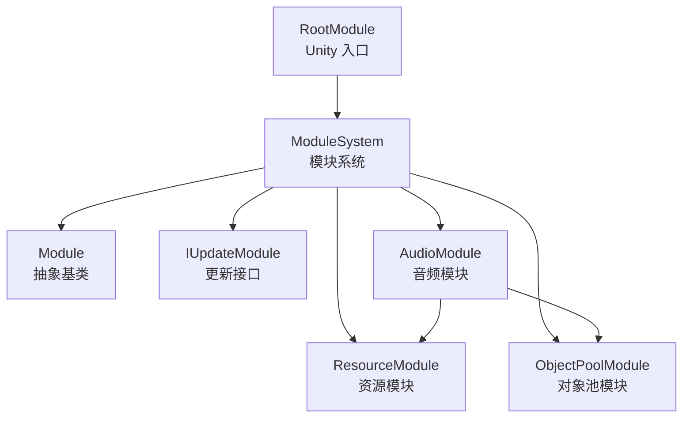
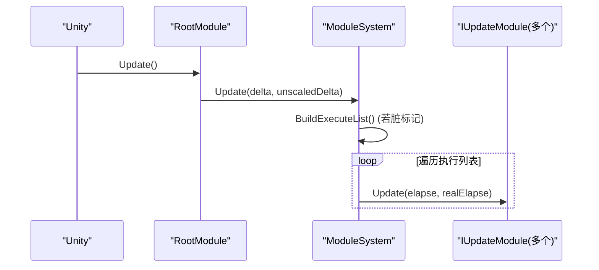
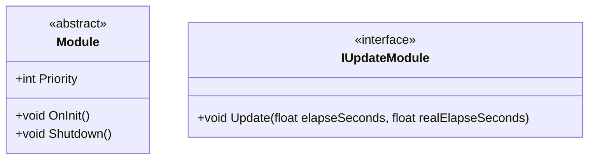
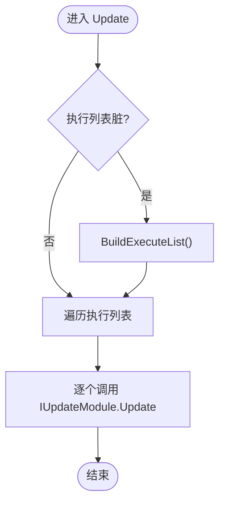
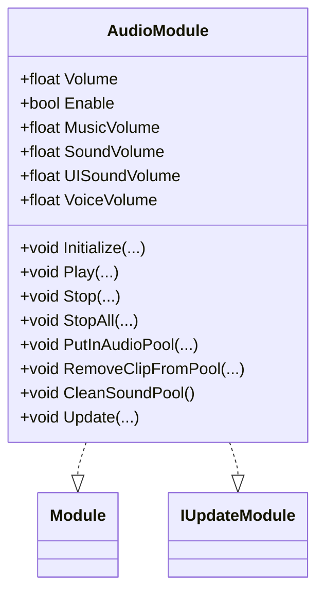
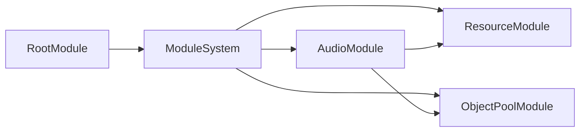

# 模块系统

<cite>
**本文引用的文件**   
- [Module.cs](file://UnityProject/Assets/TEngine/Runtime/Core/Module.cs)
- [ModuleSystem.cs](file://UnityProject/Assets/TEngine/Runtime/Core/ModuleSystem.cs)
- [RootModule.cs](file://UnityProject/Assets/TEngine/Runtime/Module/RootModule.cs)
- [AudioModule.cs](file://UnityProject/Assets/TEngine/Runtime/Module/AudioModule/AudioModule.cs)
- [ObjectPoolModule.cs](file://UnityProject/Assets/TEngine/Runtime/Module/ObjectPoolModule/ObjectPoolModule.cs)
- [ResourceModule.cs](file://UnityProject/Assets/TEngine/Runtime/Module/ResourceModule/ResourceModule.cs)
</cite>

## 目录
1. [简介](#简介)
2. [项目结构](#项目结构)
3. [核心组件](#核心组件)
4. [架构总览](#架构总览)
5. [详细组件分析](#详细组件分析)
6. [依赖关系分析](#依赖关系分析)
7. [性能考量](#性能考量)
8. [故障排查指南](#故障排查指南)
9. [结论](#结论)
10. [附录：自定义模块开发指南](#附录自定义模块开发指南)

## 简介
本文件系统性阐述 TEngine 的模块系统，包括设计模式、实现原理与生命周期管理；解释 ModuleSystem 的注册、查找与销毁机制；说明模块优先级驱动的初始化顺序与轮询调度；并通过音频、对象池、资源等内置模块展示模块间通信与数据共享的实践。文末提供自定义模块开发的完整步骤与最佳实践。

## 项目结构
模块系统位于 Runtime 核心层与模块层：
- 核心层：Module 抽象基类与 IUpdateModule 接口，ModuleSystem 统一调度
- 模块层：各业务模块（如 AudioModule、ObjectPoolModule、ResourceModule）继承 Module 并实现各自能力
- 启动层：RootModule 作为 Unity MonoBehaviour 入口，驱动帧循环并调用 ModuleSystem.Update

图表来源
- [RootModule.cs:116-144](file://UnityProject/Assets/TEngine/Runtime/Module/RootModule.cs#L116-L144)
- [ModuleSystem.cs:24-42](file://UnityProject/Assets/TEngine/Runtime/Core/ModuleSystem.cs#L24-L42)
- [Module.cs:5-39](file://UnityProject/Assets/TEngine/Runtime/Core/Module.cs#L5-L39)
- [AudioModule.cs:11-12](file://UnityProject/Assets/TEngine/Runtime/Module/AudioModule/AudioModule.cs#L11-L12)
- [ObjectPoolModule.cs:9-10](file://UnityProject/Assets/TEngine/Runtime/Module/ObjectPoolModule/ObjectPoolModule.cs#L9-L10)
- [ResourceModule.cs:17-18](file://UnityProject/Assets/TEngine/Runtime/Module/ResourceModule/ResourceModule.cs#L17-L18)

章节来源
- [RootModule.cs:116-144](file://UnityProject/Assets/TEngine/Runtime/Module/RootModule.cs#L116-L144)
- [ModuleSystem.cs:24-42](file://UnityProject/Assets/TEngine/Runtime/Core/ModuleSystem.cs#L24-L42)
- [Module.cs:5-39](file://UnityProject/Assets/TEngine/Runtime/Core/Module.cs#L5-L39)

## 核心组件
- Module 抽象基类：定义模块的统一生命周期回调 OnInit 与 Shutdown，并提供 Priority 用于排序
- IUpdateModule 接口：为需要每帧更新的模块提供 Update(elapse, realElapse) 回调
- ModuleSystem：静态模块系统，负责模块的自动创建、注册、查找、按优先级排序、构建执行列表与每帧轮询，以及统一关闭清理

章节来源
- [Module.cs:5-39](file://UnityProject/Assets/TEngine/Runtime/Core/Module.cs#L5-L39)
- [ModuleSystem.cs:9-20](file://UnityProject/Assets/TEngine/Runtime/Core/ModuleSystem.cs#L9-L20)

## 架构总览
模块系统采用“抽象基类 + 可选更新接口”的设计：
- 所有模块继承 Module，按需实现 IUpdateModule
- ModuleSystem 通过反射或显式注册将模块加入内部链表，并按 Priority 排序
- RootModule 在 Update 中调用 ModuleSystem.Update，从而驱动所有实现了 IUpdateModule 的模块

图表来源
- [RootModule.cs:140-144](file://UnityProject/Assets/TEngine/Runtime/Module/RootModule.cs#L140-L144)
- [ModuleSystem.cs:24-42](file://UnityProject/Assets/TEngine/Runtime/Core/ModuleSystem.cs#L24-L42)
- [ModuleSystem.cs:199-206](file://UnityProject/Assets/TEngine/Runtime/Core/ModuleSystem.cs#L199-L206)

## 详细组件分析

### Module 基类与 IUpdateModule 接口
- Module
  - Priority：返回模块优先级，数值越大越先被轮询，且关闭时后处理
  - OnInit：模块初始化回调
  - Shutdown：模块关闭与清理回调
- IUpdateModule
  - Update(elapseSeconds, realElapseSeconds)：每帧逻辑更新

图表来源
- [Module.cs:5-39](file://UnityProject/Assets/TEngine/Runtime/Core/Module.cs#L5-L39)

章节来源
- [Module.cs:5-39](file://UnityProject/Assets/TEngine/Runtime/Core/Module.cs#L5-L39)

### ModuleSystem：模块注册、查找、销毁与轮询
- 数据结构
  - _moduleMaps：类型到模块实例的映射
  - _modules：按 Priority 升序排列的模块链表
  - _updateModules：仅包含实现 IUpdateModule 的模块链表
  - _updateExecuteList：每帧执行的 IUpdateModule 列表（缓存以减小 GC）
  - _isExecuteListDirty：执行列表是否需重建
- 关键流程
  - GetModule<T>()：按接口类型获取模块，不存在则通过反射构造并注册
  - RegisterModule<T>(module)：显式注册自定义模块
  - RegisterUpdate(module)：按 Priority 插入链表，若实现 IUpdateModule 则加入更新队列
  - Update(...)：若执行列表脏则重建，然后依次调用每个 IUpdateModule.Update
  - Shutdown()：逆序调用所有模块.Shutdown，清空集合与全局缓存

图表来源
- [ModuleSystem.cs:24-42](file://UnityProject/Assets/TEngine/Runtime/Core/ModuleSystem.cs#L24-L42)
- [ModuleSystem.cs:199-206](file://UnityProject/Assets/TEngine/Runtime/Core/ModuleSystem.cs#L199-L206)

章节来源
- [ModuleSystem.cs:9-20](file://UnityProject/Assets/TEngine/Runtime/Core/ModuleSystem.cs#L9-L20)
- [ModuleSystem.cs:24-42](file://UnityProject/Assets/TEngine/Runtime/Core/ModuleSystem.cs#L24-L42)
- [ModuleSystem.cs:62-120](file://UnityProject/Assets/TEngine/Runtime/Core/ModuleSystem.cs#L62-L120)
- [ModuleSystem.cs:122-194](file://UnityProject/Assets/TEngine/Runtime/Core/ModuleSystem.cs#L122-L194)
- [ModuleSystem.cs:196-206](file://UnityProject/Assets/TEngine/Runtime/Core/ModuleSystem.cs#L196-L206)
- [ModuleSystem.cs:44-60](file://UnityProject/Assets/TEngine/Runtime/Core/ModuleSystem.cs#L44-L60)

### RootModule：框架入口与帧驱动
- Awake：初始化文本、日志、JSON 辅助，设置帧率、时间缩放、后台运行等
- Update/FixedUpdate/LateUpdate：调用 GameTime.StartFrame 并驱动 ModuleSystem.Update
- OnDestroy：非编辑器环境下调用 ModuleSystem.Shutdown 统一销毁模块

章节来源
- [RootModule.cs:116-144](file://UnityProject/Assets/TEngine/Runtime/Module/RootModule.cs#L116-L144)
- [RootModule.cs:156-167](file://UnityProject/Assets/TEngine/Runtime/Module/RootModule.cs#L156-L167)

### 示例模块：AudioModule（音频模块）
- 继承 Module，同时实现 IAudioModule 与 IUpdateModule
- 在 OnInit 中通过 ModuleSystem.GetModule<IResourceModule>() 获取资源模块，完成初始化
- 在 Update 中遍历音频分类进行状态更新
- 提供音量、开关、播放、停止、预加载、对象池管理等能力

图表来源
- [AudioModule.cs:11-12](file://UnityProject/Assets/TEngine/Runtime/Module/AudioModule/AudioModule.cs#L11-L12)
- [AudioModule.cs:322-332](file://UnityProject/Assets/TEngine/Runtime/Module/AudioModule/AudioModule.cs#L322-L332)
- [AudioModule.cs:560-569](file://UnityProject/Assets/TEngine/Runtime/Module/AudioModule/AudioModule.cs#L560-L569)

章节来源
- [AudioModule.cs:11-12](file://UnityProject/Assets/TEngine/Runtime/Module/AudioModule/AudioModule.cs#L11-L12)
- [AudioModule.cs:322-332](file://UnityProject/Assets/TEngine/Runtime/Module/AudioModule/AudioModule.cs#L322-L332)
- [AudioModule.cs:560-569](file://UnityProject/Assets/TEngine/Runtime/Module/AudioModule/AudioModule.cs#L560-L569)

### 示例模块：ObjectPoolModule（对象池模块）
- 继承 Module，实现 IObjectPoolModule 与 IUpdateModule
- 提供大量 CreateSingleSpawnObjectPool / CreateMultiSpawnObjectPool 重载，支持容量、过期时间、优先级等参数
- Update 中遍历所有对象池执行维护（如自动释放、过期回收）

章节来源
- [ObjectPoolModule.cs:9-10](file://UnityProject/Assets/TEngine/Runtime/Module/ObjectPoolModule/ObjectPoolModule.cs#L9-L10)
- [ObjectPoolModule.cs:35-41](file://UnityProject/Assets/TEngine/Runtime/Module/ObjectPoolModule/ObjectPoolModule.cs#L35-L41)
- [ObjectPoolModule.cs:53-70](file://UnityProject/Assets/TEngine/Runtime/Module/ObjectPoolModule/ObjectPoolModule.cs#L53-L70)
- [ObjectPoolModule.cs:371-733](file://UnityProject/Assets/TEngine/Runtime/Module/ObjectPoolModule/ObjectPoolModule.cs#L371-L733)

### 示例模块：ResourceModule（资源模块）
- 继承 Module，实现 IResourceModule
- 提供 Initialize、InitPackage、LoadAsset、UnloadUnusedAssets、OnLowMemory 等能力
- 与 YooAsset 集成，支持离线、主机、Web 等多种运行模式

章节来源
- [ResourceModule.cs:17-18](file://UnityProject/Assets/TEngine/Runtime/Module/ResourceModule/ResourceModule.cs#L17-L18)
- [ResourceModule.cs:119-138](file://UnityProject/Assets/TEngine/Runtime/Module/ResourceModule/ResourceModule.cs#L119-L138)
- [ResourceModule.cs:140-261](file://UnityProject/Assets/TEngine/Runtime/Module/ResourceModule/ResourceModule.cs#L140-L261)
- [ResourceModule.cs:392-447](file://UnityProject/Assets/TEngine/Runtime/Module/ResourceModule/ResourceModule.cs#L392-L447)

## 依赖关系分析
- RootModule 驱动 ModuleSystem.Update，间接驱动所有 IUpdateModule
- AudioModule 依赖 ResourceModule 进行资源加载，依赖 ObjectPoolModule 进行对象复用
- ModuleSystem 统一管理所有模块的生命周期与执行顺序

图表来源
- [RootModule.cs:140-144](file://UnityProject/Assets/TEngine/Runtime/Module/RootModule.cs#L140-L144)
- [AudioModule.cs:322-326](file://UnityProject/Assets/TEngine/Runtime/Module/AudioModule/AudioModule.cs#L322-L326)
- [ObjectPoolModule.cs:9-10](file://UnityProject/Assets/TEngine/Runtime/Module/ObjectPoolModule/ObjectPoolModule.cs#L9-L10)
- [ResourceModule.cs:17-18](file://UnityProject/Assets/TEngine/Runtime/Module/ResourceModule/ResourceModule.cs#L17-L18)

章节来源
- [RootModule.cs:140-144](file://UnityProject/Assets/TEngine/Runtime/Module/RootModule.cs#L140-L144)
- [AudioModule.cs:322-326](file://UnityProject/Assets/TEngine/Runtime/Module/AudioModule/AudioModule.cs#L322-L326)

## 性能考量
- 执行列表缓存：ModuleSystem 使用 _updateExecuteList 缓存每帧执行序列，仅在模块增删时重建，降低 GC 压力
- 初始容量优化：DESIGN_MODULE_COUNT 预设默认容量，减少扩容开销
- 优先级控制：Priority 决定模块轮询顺序，高优先级模块先更新、后关闭，便于依赖方优先就绪
- 资源卸载：ResourceModule 提供 UnloadUnusedAssets 与 OnLowMemory 回调，配合 RootModule 的低内存事件触发资源回收

章节来源
- [ModuleSystem.cs:11-20](file://UnityProject/Assets/TEngine/Runtime/Core/ModuleSystem.cs#L11-L20)
- [ModuleSystem.cs:24-42](file://UnityProject/Assets/TEngine/Runtime/Core/ModuleSystem.cs#L24-L42)
- [ResourceModule.cs:392-447](file://UnityProject/Assets/TEngine/Runtime/Module/ResourceModule/ResourceModule.cs#L392-L447)

## 故障排查指南
- 无法找到模块类型
  - 现象：GetModule<T>() 抛出异常，提示找不到模块类型
  - 原因：接口命名空间/程序集名不匹配，或未正确注册
  - 解决：确保接口命名空间与程序集名称一致，或通过 RegisterModule<T>(module) 显式注册
- 模块未执行 Update
  - 现象：模块未收到每帧回调
  - 原因：未实现 IUpdateModule
  - 解决：让模块实现 IUpdateModule 并在 OnInit 中完成必要初始化
- 低内存未触发资源回收
  - 现象：内存告警但未释放资源
  - 原因：未订阅低内存回调或未实现 OnLowMemory
  - 解决：在 RootModule.OnLowMemory 中调用资源模块的回收方法，或在模块中实现相应逻辑

章节来源
- [ModuleSystem.cs:62-89](file://UnityProject/Assets/TEngine/Runtime/Core/ModuleSystem.cs#L62-L89)
- [RootModule.cs:287-302](file://UnityProject/Assets/TEngine/Runtime/Module/RootModule.cs#L287-L302)

## 结论
TEngine 模块系统通过简洁的抽象基类与可选更新接口，结合 ModuleSystem 的统一调度，实现了可插拔、可扩展的模块化架构。借助 Priority 控制初始化与销毁顺序，结合 RootModule 的帧驱动，模块间通信清晰可控。内置音频、对象池、资源等模块展示了典型用法，开发者可据此快速扩展业务模块。

## 附录：自定义模块开发指南

### 1. 创建业务模块
- 新建类继承 Module，并根据需要实现 IUpdateModule
- 在 OnInit 中完成依赖注入与资源准备
- 在 Shutdown 中释放资源、取消订阅、清理状态

参考路径
- [Module.cs:22-39](file://UnityProject/Assets/TEngine/Runtime/Core/Module.cs#L22-L39)
- [AudioModule.cs:322-332](file://UnityProject/Assets/TEngine/Runtime/Module/AudioModule/AudioModule.cs#L322-L332)

### 2. 模块注册与查找
- 自动发现：通过 GetModule<T>() 按接口类型获取，不存在则反射构造并注册
- 手动注册：通过 RegisterModule<T>(module) 显式注册已有实例

参考路径
- [ModuleSystem.cs:62-120](file://UnityProject/Assets/TEngine/Runtime/Core/ModuleSystem.cs#L62-L120)
- [ModuleSystem.cs:122-141](file://UnityProject/Assets/TEngine/Runtime/Core/ModuleSystem.cs#L122-L141)

### 3. 模块生命周期事件
- OnInit：模块初始化，适合做依赖获取、配置读取、对象创建
- Update：每帧逻辑更新，适合状态机、计时器、批量任务推进
- Shutdown：模块销毁，适合释放资源、解绑事件、清理缓存

参考路径
- [Module.cs:22-39](file://UnityProject/Assets/TEngine/Runtime/Core/Module.cs#L22-L39)
- [ModuleSystem.cs:44-60](file://UnityProject/Assets/TEngine/Runtime/Core/ModuleSystem.cs#L44-L60)

### 4. 模块间数据共享
- 通过 ModuleSystem.GetModule<Interface>() 获取其他模块实例，调用其公开 API
- 建议以接口暴露能力，避免直接耦合具体实现

参考路径
- [AudioModule.cs:322-326](file://UnityProject/Assets/TEngine/Runtime/Module/AudioModule/AudioModule.cs#L322-L326)

### 5. 初始化顺序与依赖管理
- 通过重写 Priority 控制模块初始化与销毁顺序
- 高优先级模块先初始化、后销毁，保证依赖方先就绪

参考路径
- [ObjectPoolModule.cs:20-24](file://UnityProject/Assets/TEngine/Runtime/Module/ObjectPoolModule/ObjectPoolModule.cs#L20-L24)
- [ResourceModule.cs:42-46](file://UnityProject/Assets/TEngine/Runtime/Module/ResourceModule/ResourceModule.cs#L42-L46)
- [ModuleSystem.cs:143-194](file://UnityProject/Assets/TEngine/Runtime/Core/ModuleSystem.cs#L143-L194)

### 6. 最佳实践
- 始终通过接口访问模块，保持松耦合
- 在 OnInit 中完成依赖获取，避免在 Update 中做重型操作
- 合理使用 Priority，明确模块间的依赖关系
- 在 Shutdown 中彻底释放资源，避免内存泄漏
- 对频繁调用的 Update 进行批量化与节流，降低 CPU 占用

[本节为通用指导，不直接分析具体文件]