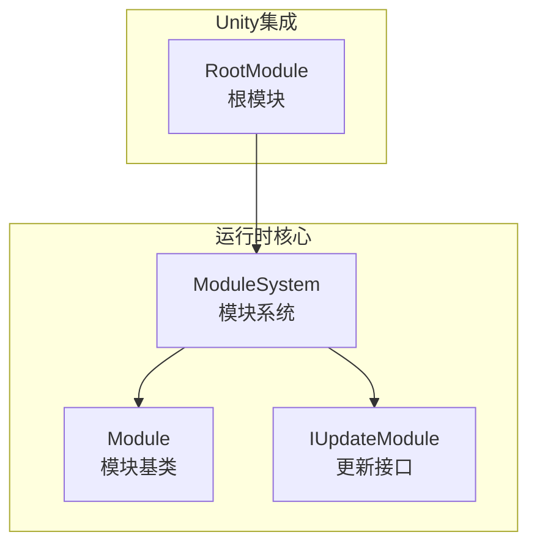
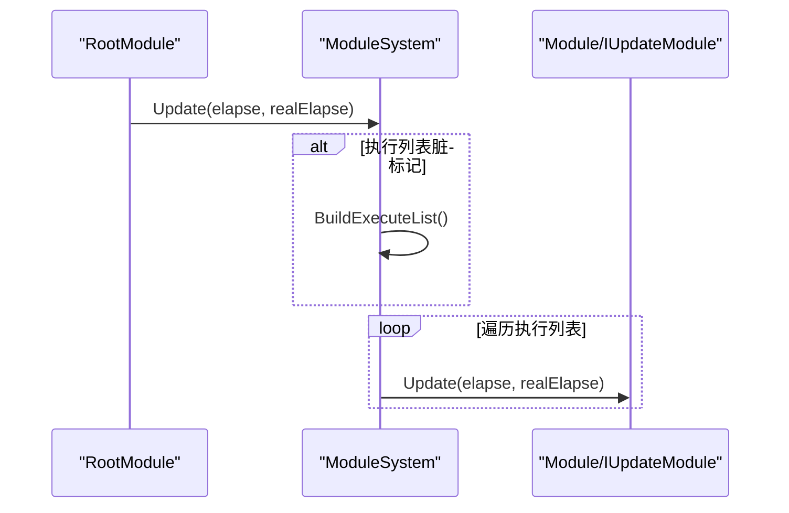
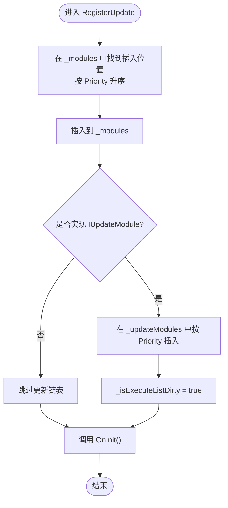
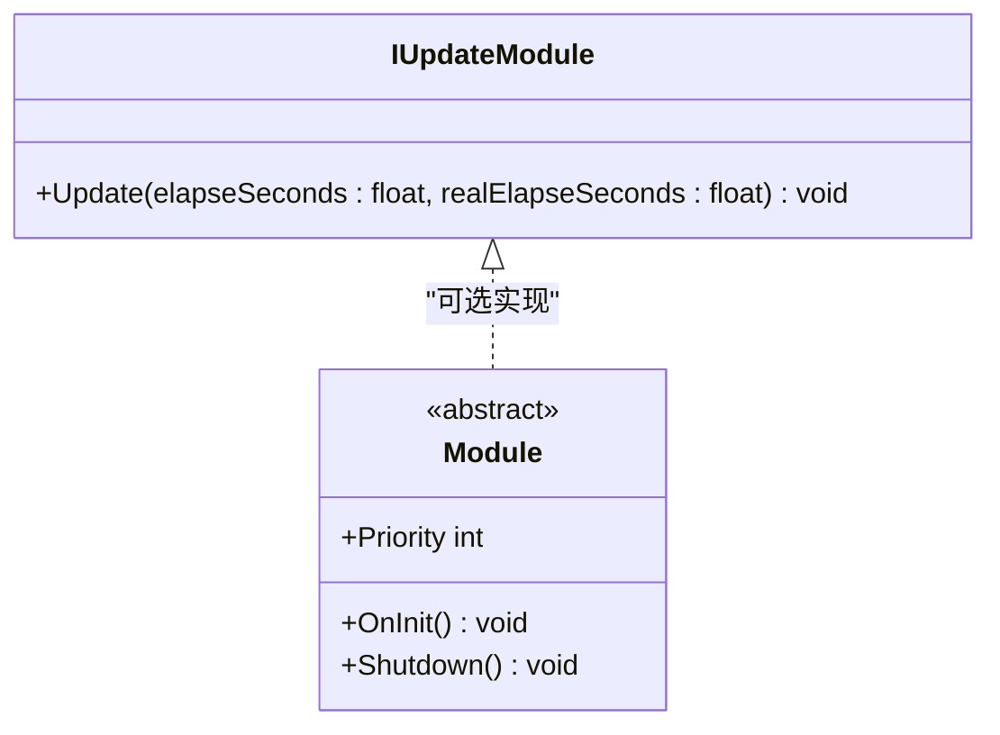
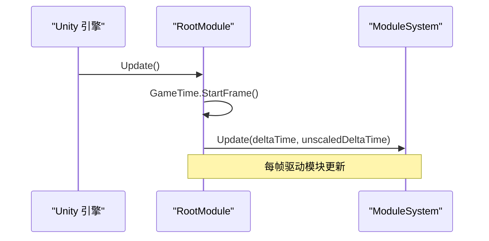
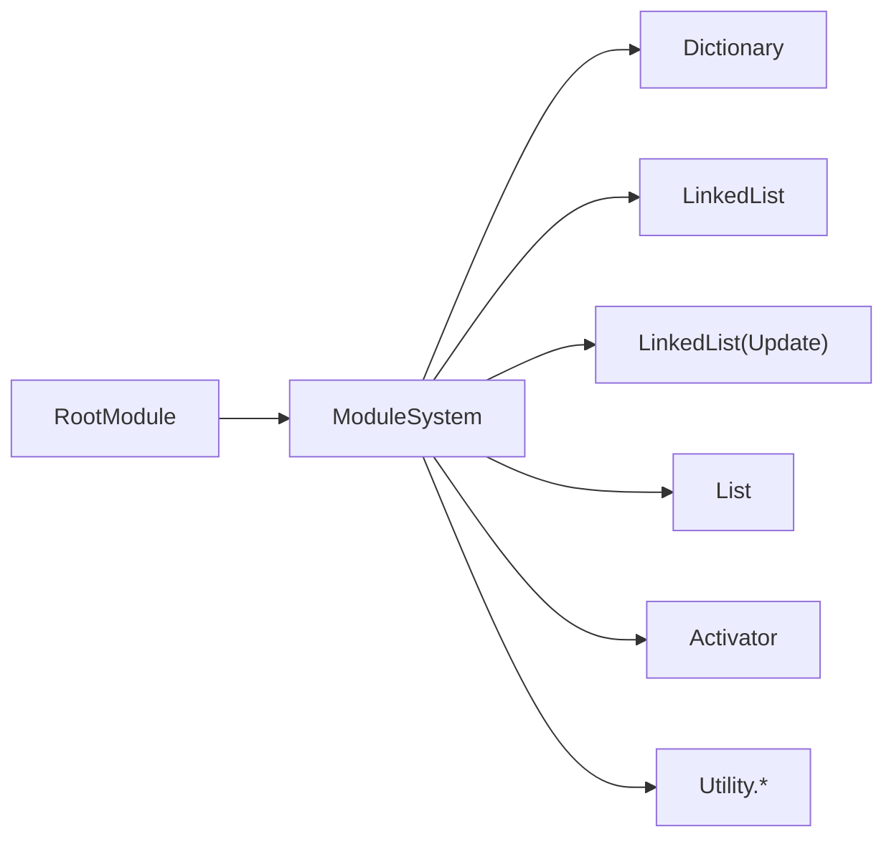

# 模块系统核心

<cite>
**本文引用的文件**   
- [ModuleSystem.cs](file://UnityProject/Assets/TEngine/Runtime/Core/ModuleSystem.cs)
- [Module.cs](file://UnityProject/Assets/TEngine/Runtime/Core/Module.cs)
- [RootModule.cs](file://UnityProject/Assets/TEngine/Runtime/Module/RootModule.cs)
</cite>

## 目录
1. [简介](#简介)
2. [项目结构](#项目结构)
3. [核心组件](#核心组件)
4. [架构总览](#架构总览)
5. [详细组件分析](#详细组件分析)
6. [依赖关系分析](#依赖关系分析)
7. [性能考虑](#性能考虑)
8. [故障排查指南](#故障排查指南)
9. [结论](#结论)

## 简介
本文件聚焦 TEngine 模块系统的核心实现，围绕 ModuleSystem 类展开，系统性说明：
- 模块注册机制（RegisterModule）
- 模块获取机制（GetModule<T> 与基于 Type 的 GetModule）
- 模块生命周期管理（OnInit、Shutdown）
- 自动发现与实例化流程
- 接口驱动的模块查找算法
- 更新系统（IUpdateModule 与 Update 循环）
- 优先级排序与执行顺序控制
- 销毁与资源清理流程
- 性能优化建议与最佳实践

## 项目结构
模块系统相关代码位于 Runtime/Core 与 Runtime/Module 下：
- Core/ModuleSystem.cs：模块系统入口，负责模块注册、获取、更新调度与生命周期管理。
- Core/Module.cs：模块抽象基类与 IUpdateModule 接口定义。
- Module/RootModule.cs：Unity 场景中的根节点，驱动游戏帧并调用 ModuleSystem.Update。

图表来源
- [ModuleSystem.cs:9-207](file://UnityProject/Assets/TEngine/Runtime/Core/ModuleSystem.cs#L9-L207)
- [Module.cs:8-39](file://UnityProject/Assets/TEngine/Runtime/Core/Module.cs#L8-L39)
- [RootModule.cs:140-144](file://UnityProject/Assets/TEngine/Runtime/Module/RootModule.cs#L140-L144)

章节来源
- [ModuleSystem.cs:9-207](file://UnityProject/Assets/TEngine/Runtime/Core/ModuleSystem.cs#L9-L207)
- [Module.cs:8-39](file://UnityProject/Assets/TEngine/Runtime/Core/Module.cs#L8-L39)
- [RootModule.cs:140-144](file://UnityProject/Assets/TEngine/Runtime/Module/RootModule.cs#L140-L144)

## 核心组件
- ModuleSystem：静态模块系统，维护模块映射表、有序模块链表、更新模块链表与执行列表；提供 RegisterModule、GetModule、Update、Shutdown 等能力。
- Module：抽象基类，定义 Priority、OnInit、Shutdown 三个关键成员。
- IUpdateModule：标记需要每帧更新的模块，提供 Update(elapseSeconds, realElapseSeconds)。
- RootModule：Unity MonoBehaviour，在 Update 中驱动 ModuleSystem.Update，并在 OnDestroy 触发 Shutdown。

章节来源
- [ModuleSystem.cs:9-207](file://UnityProject/Assets/TEngine/Runtime/Core/ModuleSystem.cs#L9-L207)
- [Module.cs:8-39](file://UnityProject/Assets/TEngine/Runtime/Core/Module.cs#L8-L39)
- [RootModule.cs:140-144](file://UnityProject/Assets/TEngine/Runtime/Module/RootModule.cs#L140-L144)

## 架构总览
模块系统采用“接口驱动 + 反射自动发现”的设计：
- 通过接口类型（如 IFooModule）作为键进行模块注册与获取。
- 未显式注册的模块，可通过接口名推断具体实现类名（去掉前缀 I，拼接命名空间与程序集），使用反射创建实例。
- 模块按 Priority 升序插入有序链表，确保高优先级模块先初始化、后关闭。
- 实现 IUpdateModule 的模块会被加入更新链表，并在每帧统一执行。

图表来源
- [RootModule.cs:140-144](file://UnityProject/Assets/TEngine/Runtime/Module/RootModule.cs#L140-L144)
- [ModuleSystem.cs:29-42](file://UnityProject/Assets/TEngine/Runtime/Core/ModuleSystem.cs#L29-L42)
- [ModuleSystem.cs:199-206](file://UnityProject/Assets/TEngine/Runtime/Core/ModuleSystem.cs#L199-L206)

## 详细组件分析

### ModuleSystem：模块注册、获取与生命周期
- 数据结构
  - _moduleMaps：以接口类型为键、Module 为值的字典，用于 O(1) 查找。
  - _modules：LinkedList<Module>，按 Priority 升序维护所有模块。
  - _updateModules：LinkedList<Module>，仅包含实现 IUpdateModule 的模块，同样按 Priority 升序。
  - _updateExecuteList：List<IUpdateModule>，每帧执行的扁平化列表，避免每帧遍历链表。
  - _isExecuteListDirty：当更新模块集合变化时置真，下次 Update 重建执行列表。

- 模块注册（RegisterModule<T>）
  - 校验传入类型必须是接口。
  - 将接口到 Module 实例的映射写入 _moduleMaps。
  - 调用 RegisterUpdate 完成有序插入与更新链表维护。
  - 返回强类型引用。

- 模块获取（GetModule<T>）
  - 校验 T 必须是接口。
  - 若已注册则直接返回。
  - 否则根据接口全限定名推导实现类名（去除首字母 I，拼接命名空间与程序集名），通过 Type.GetType 反射加载。
  - 若反射失败抛出异常；否则递归调用 GetModule(Type) 创建并缓存。

- 模块创建（CreateModule）
  - 使用 Activator.CreateInstance 实例化模块。
  - 将新模块加入 _moduleMaps。
  - 调用 RegisterUpdate 完成有序插入与更新链表维护。

- 有序插入与更新链表维护（RegisterUpdate）
  - 在 _modules 链表中找到第一个 Priority 大于等于当前模块的位置，插入其前；否则追加至末尾。
  - 若模块实现 IUpdateModule，则在 _updateModules 中以相同策略插入。
  - 若更新模块集合发生变化，设置 _isExecuteListDirty = true。
  - 最后调用 module.OnInit() 完成初始化。

- 更新循环（Update）
  - 若 _isExecuteListDirty 为真，重建 _updateExecuteList。
  - 顺序调用每个 IUpdateModule.Update(elapseSeconds, realElapseSeconds)。

- 关闭与清理（Shutdown）
  - 逆序遍历 _modules，依次调用 Shutdown。
  - 清空 _modules、_moduleMaps、_updateModules、_updateExecuteList。
  - 调用 MemoryPool.ClearAll() 与 Utility.Marshal.FreeCachedHGlobal() 释放底层资源。

图表来源
- [ModuleSystem.cs:143-194](file://UnityProject/Assets/TEngine/Runtime/Core/ModuleSystem.cs#L143-L194)

章节来源
- [ModuleSystem.cs:17-22](file://UnityProject/Assets/TEngine/Runtime/Core/ModuleSystem.cs#L17-L22)
- [ModuleSystem.cs:62-120](file://UnityProject/Assets/TEngine/Runtime/Core/ModuleSystem.cs#L62-L120)
- [ModuleSystem.cs:122-194](file://UnityProject/Assets/TEngine/Runtime/Core/ModuleSystem.cs#L122-L194)
- [ModuleSystem.cs:196-206](file://UnityProject/Assets/TEngine/Runtime/Core/ModuleSystem.cs#L196-L206)
- [ModuleSystem.cs:44-60](file://UnityProject/Assets/TEngine/Runtime/Core/ModuleSystem.cs#L44-L60)

### Module 与 IUpdateModule：抽象与接口
- IUpdateModule：定义 Update(elapseSeconds, realElapseSeconds)，供框架每帧调用。
- Module：抽象基类
  - Priority：默认 0，子类可重写以调整初始化与关闭顺序。
  - OnInit：模块初始化钩子，由 RegisterUpdate 在插入后调用。
  - Shutdown：模块关闭钩子，由 Shutdown 逆序调用。

图表来源
- [Module.cs:8-39](file://UnityProject/Assets/TEngine/Runtime/Core/Module.cs#L8-L39)

章节来源
- [Module.cs:8-39](file://UnityProject/Assets/TEngine/Runtime/Core/Module.cs#L8-L39)

### RootModule：Unity 集成与帧驱动
- Awake：初始化文本、日志、JSON 辅助器，设置 DPI、帧率、时间缩放、后台运行与休眠策略，订阅低内存事件。
- Update：调用 GameTime.StartFrame() 并驱动 ModuleSystem.Update(deltaTime, unscaledDeltaTime)。
- FixedUpdate/LateUpdate：同步 GameTime 帧计时。
- OnApplicationQuit：取消订阅低内存事件，停止协程。
- OnDestroy：在非编辑器环境下调用 ModuleSystem.Shutdown()。
- 低内存回调：尝试释放对象池未用项并通知资源模块。

图表来源
- [RootModule.cs:140-144](file://UnityProject/Assets/TEngine/Runtime/Module/RootModule.cs#L140-L144)

章节来源
- [RootModule.cs:116-167](file://UnityProject/Assets/TEngine/Runtime/Module/RootModule.cs#L116-L167)
- [RootModule.cs:287-302](file://UnityProject/Assets/TEngine/Runtime/Module/RootModule.cs#L287-L302)

## 依赖关系分析
- ModuleSystem 依赖：
  - Dictionary<Type, Module>：O(1) 查找模块实例。
  - LinkedList<Module>：维持模块与更新模块的有序序列。
  - List<IUpdateModule>：每帧执行的高效扁平化列表。
  - Activator：反射创建模块实例。
  - Utility.Text/Utility.Assembly：字符串格式化与类型解析。
  - MemoryPool/Utility.Marshal：底层资源清理。
- RootModule 依赖：
  - ModuleSystem：驱动更新与关闭。
  - GameTime：帧计时。
  - Application/Screen/Time：平台与运行时参数。

图表来源
- [ModuleSystem.cs:17-22](file://UnityProject/Assets/TEngine/Runtime/Core/ModuleSystem.cs#L17-L22)
- [ModuleSystem.cs:107-120](file://UnityProject/Assets/TEngine/Runtime/Core/ModuleSystem.cs#L107-L120)
- [RootModule.cs:140-144](file://UnityProject/Assets/TEngine/Runtime/Module/RootModule.cs#L140-L144)

章节来源
- [ModuleSystem.cs:17-22](file://UnityProject/Assets/TEngine/Runtime/Core/ModuleSystem.cs#L17-L22)
- [ModuleSystem.cs:107-120](file://UnityProject/Assets/TEngine/Runtime/Core/ModuleSystem.cs#L107-L120)
- [RootModule.cs:140-144](file://UnityProject/Assets/TEngine/Runtime/Module/RootModule.cs#L140-L144)

## 性能考虑
- 预分配容量
  - DESIGN_MODULE_COUNT 用于 Dictionary 与 List 初始容量，减少扩容与 GC 压力。
- 执行列表缓存
  - 仅在更新模块集合变化时重建 _updateExecuteList，避免每帧链表遍历与装箱。
- 有序插入复杂度
  - 基于 LinkedList 的线性扫描插入，单次 O(n)；模块数量通常较小，开销可控。
- 反射成本
  - 首次 GetModule<T> 可能触发 Type.GetType 与 Activator.CreateInstance，建议尽早预热常用模块或显式 RegisterModule。
- 更新粒度
  - 尽量在 IUpdateModule.Update 中做轻量逻辑，复杂任务拆分到定时器或异步管线。
- 资源清理
  - 在 Shutdown 中集中释放底层资源，避免泄漏。

[本节为通用性能指导，不直接分析具体文件]

## 故障排查指南
- 通过非接口类型获取模块
  - 现象：抛出异常提示必须通过接口获取模块。
  - 原因：GetModule<T> 要求 T 为接口类型。
  - 处理：改为接口类型调用。
  - 参考路径：[ModuleSystem.cs:68-79](file://UnityProject/Assets/TEngine/Runtime/Core/ModuleSystem.cs#L68-L79)

- 找不到模块类型
  - 现象：抛出异常提示无法找到模块类型。
  - 原因：接口名推导的实现类不存在或未正确命名（需遵循 I 前缀约定）。
  - 处理：检查命名空间、类名与程序集名称是否正确。
  - 参考路径：[ModuleSystem.cs:81-88](file://UnityProject/Assets/TEngine/Runtime/Core/ModuleSystem.cs#L81-L88)

- 无法创建模块实例
  - 现象：抛出异常提示无法创建模块。
  - 原因：模块无默认构造函数或构造过程抛错。
  - 处理：确保模块具备可访问的默认构造函数，或改用 RegisterModule 显式注入。
  - 参考路径：[ModuleSystem.cs:107-120](file://UnityProject/Assets/TEngine/Runtime/Core/ModuleSystem.cs#L107-L120)

- 更新未执行
  - 现象：模块未收到 Update 调用。
  - 原因：模块未实现 IUpdateModule。
  - 处理：让模块实现 IUpdateModule 接口。
  - 参考路径：[ModuleSystem.cs:165-191](file://UnityProject/Assets/TEngine/Runtime/Core/ModuleSystem.cs#L165-L191)

- 模块初始化未触发
  - 现象：OnInit 未被调用。
  - 原因：模块未通过 RegisterModule 或 GetModule 被纳入系统。
  - 处理：确保模块已被注册或按需获取。
  - 参考路径：[ModuleSystem.cs:193-194](file://UnityProject/Assets/TEngine/Runtime/Core/ModuleSystem.cs#L193-L194)

- 资源未释放
  - 现象：退出后仍有内存占用。
  - 原因：未在 Shutdown 中释放底层资源。
  - 处理：在模块 Shutdown 中释放句柄、缓存与外部资源。
  - 参考路径：[ModuleSystem.cs:44-60](file://UnityProject/Assets/TEngine/Runtime/Core/ModuleSystem.cs#L44-L60)

章节来源
- [ModuleSystem.cs:68-88](file://UnityProject/Assets/TEngine/Runtime/Core/ModuleSystem.cs#L68-L88)
- [ModuleSystem.cs:107-120](file://UnityProject/Assets/TEngine/Runtime/Core/ModuleSystem.cs#L107-L120)
- [ModuleSystem.cs:165-194](file://UnityProject/Assets/TEngine/Runtime/Core/ModuleSystem.cs#L165-L194)
- [ModuleSystem.cs:44-60](file://UnityProject/Assets/TEngine/Runtime/Core/ModuleSystem.cs#L44-L60)

## 结论
TEngine 模块系统以 ModuleSystem 为核心，通过接口驱动与反射自动发现，实现了简洁而强大的模块注册、获取与生命周期管理。结合 IUpdateModule 与有序优先级机制，系统在保持扩展性的同时提供了稳定的更新调度与资源清理能力。合理运用 RegisterModule 预热模块、明确优先级与职责边界，可在保证性能的前提下获得良好的可维护性与可扩展性。