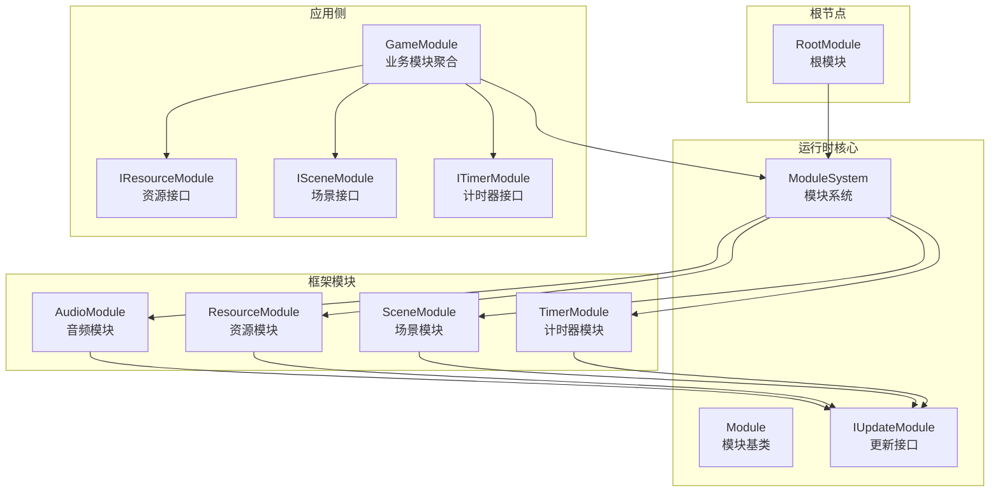
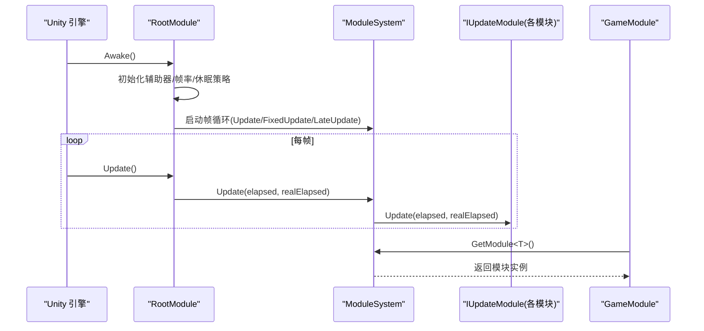
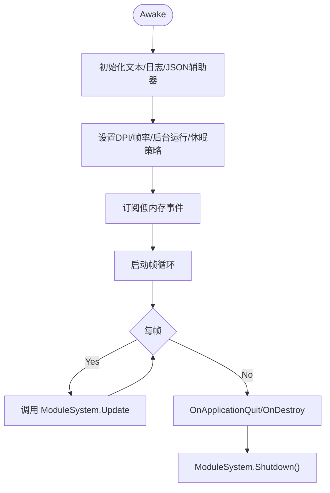
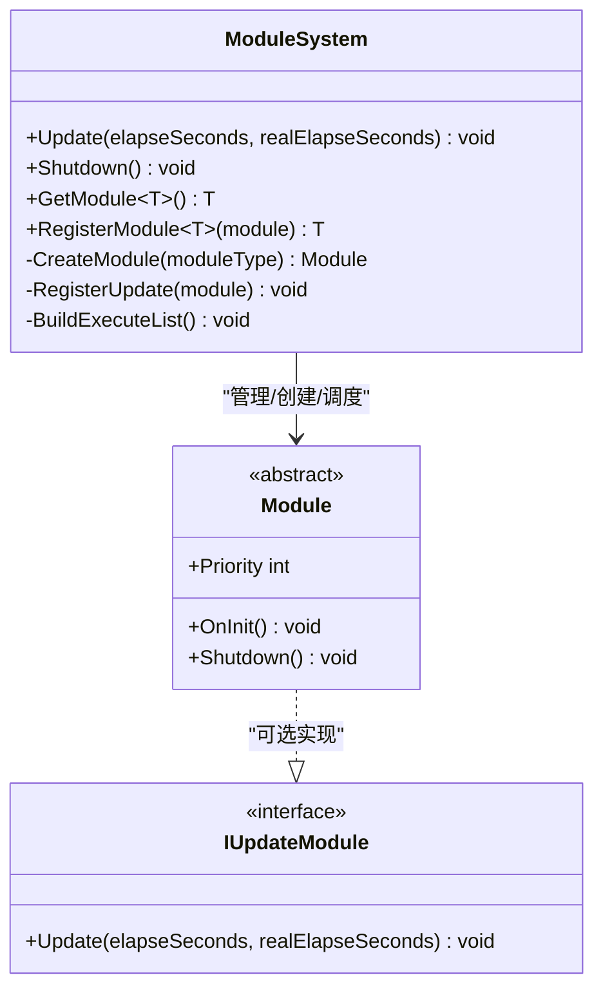
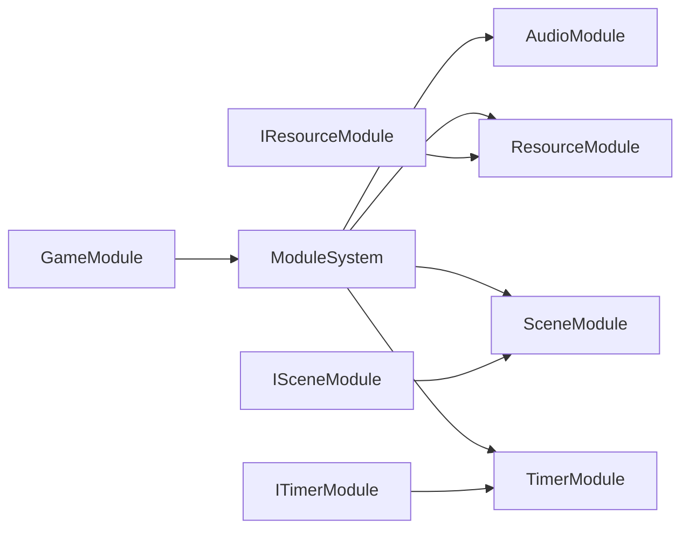

# 自定义模块开发

<cite>
**本文引用的文件**   
- [RootModule.cs](file://UnityProject/Assets/TEngine/Runtime/Module/RootModule.cs)
- [ModuleSystem.cs](file://UnityProject/Assets/TEngine/Runtime/Core/ModuleSystem.cs)
- [Module.cs](file://UnityProject/Assets/TEngine/Runtime/Core/Module.cs)
- [GameModule.cs](file://UnityProject/Assets/GameScripts/HotFix/GameLogic/GameModule.cs)
- [AudioModule.cs](file://UnityProject/Assets/TEngine/Runtime/Module/AudioModule/AudioModule.cs)
- [IResourceModule.cs](file://UnityProject/Assets/TEngine/Runtime/Module/ResourceModule/IResourceModule.cs)
- [ISceneModule.cs](file://UnityProject/Assets/TEngine/Runtime/Module/SceneModule/ISceneModule.cs)
- [ITimerModule.cs](file://UnityProject/Assets/TEngine/Runtime/Module/TimerModule/ITimerModule.cs)
</cite>

## 目录
1. [简介](#简介)
2. [项目结构](#项目结构)
3. [核心组件](#核心组件)
4. [架构总览](#架构总览)
5. [详细组件分析](#详细组件分析)
6. [依赖关系分析](#依赖关系分析)
7. [性能考量](#性能考量)
8. [故障排查指南](#故障排查指南)
9. [结论](#结论)
10. [附录：完整开发流程示例](#附录完整开发流程示例)

## 简介
本指南面向希望在 TEngine 中开发“自定义模块”的开发者，系统讲解从模块接口设计、实现、生命周期管理到注册与使用的全流程。重点说明 RootModule 的设计模式与作用，解释根模块在模块系统中的特殊地位；以 GameModule 为例展示业务侧如何统一访问框架模块；提供模块间通信的最佳实践（基于接口与事件），并给出错误处理与异常管理的建议。最后通过一个从零开始的示例，演示如何定义、实现、注册并使用一个自定义模块。

## 项目结构
TEngine 的模块系统位于 Runtime 层，核心由 ModuleSystem（模块系统）、Module（模块基类）和 IUpdateModule（更新接口）构成；具体功能模块（如音频、资源、场景、计时器等）各自实现对应接口并通过 ModuleSystem 进行管理与调度。RootModule 作为 Unity 场景中的根节点，负责初始化全局辅助器、帧循环驱动以及模块系统的关闭清理。GameModule 是游戏逻辑侧的统一入口，集中暴露常用框架模块的静态访问点。

图表来源
- [ModuleSystem.cs:9-208](file://UnityProject/Assets/TEngine/Runtime/Core/ModuleSystem.cs#L9-L208)
- [Module.cs:8-39](file://UnityProject/Assets/TEngine/Runtime/Core/Module.cs#L8-L39)
- [AudioModule.cs:11-11](file://UnityProject/Assets/TEngine/Runtime/Module/AudioModule/AudioModule.cs#L11-L11)
- [IResourceModule.cs](file://UnityProject/Assets/TEngine/Runtime/Module/ResourceModule/IResourceModule.cs)
- [ISceneModule.cs](file://UnityProject/Assets/TEngine/Runtime/Module/SceneModule/ISceneModule.cs)
- [ITimerModule.cs](file://UnityProject/Assets/TEngine/Runtime/Module/TimerModule/ITimerModule.cs)
- [GameModule.cs:5-118](file://UnityProject/Assets/GameScripts/HotFix/GameLogic/GameModule.cs#L5-L118)
- [RootModule.cs:10-304](file://UnityProject/Assets/TEngine/Runtime/Module/RootModule.cs#L10-L304)

章节来源
- [RootModule.cs:10-304](file://UnityProject/Assets/TEngine/Runtime/Module/RootModule.cs#L10-L304)
- [ModuleSystem.cs:9-208](file://UnityProject/Assets/TEngine/Runtime/Core/ModuleSystem.cs#L9-L208)
- [Module.cs:8-39](file://UnityProject/Assets/TEngine/Runtime/Core/Module.cs#L8-L39)
- [GameModule.cs:5-118](file://UnityProject/Assets/GameScripts/HotFix/GameLogic/GameModule.cs#L5-L118)

## 核心组件
- ModuleSystem：模块容器与调度中心，负责模块的自动发现、创建、注册、按优先级排序、更新执行与统一关闭。
- Module：所有模块的抽象基类，定义 OnInit 与 Shutdown 生命周期钩子，并提供 Priority 控制初始化与关闭顺序。
- IUpdateModule：可选接口，用于参与每帧 Update 调度。
- RootModule：Unity 根节点，负责全局辅助器初始化、帧循环驱动、低内存回收等，并在销毁时调用 ModuleSystem.Shutdown。
- GameModule：业务侧聚合类，集中暴露常用框架模块的静态访问点，简化业务代码对框架模块的获取。

章节来源
- [ModuleSystem.cs:9-208](file://UnityProject/Assets/TEngine/Runtime/Core/ModuleSystem.cs#L9-L208)
- [Module.cs:8-39](file://UnityProject/Assets/TEngine/Runtime/Core/Module.cs#L8-L39)
- [RootModule.cs:10-304](file://UnityProject/Assets/TEngine/Runtime/Module/RootModule.cs#L10-L304)
- [GameModule.cs:5-118](file://UnityProject/Assets/GameScripts/HotFix/GameLogic/GameModule.cs#L5-L118)

## 架构总览
下图展示了模块系统在运行时的关键交互：RootModule 驱动帧循环，ModuleSystem.Update 遍历已注册的 IUpdateModule 并调用其 Update；模块通过 ModuleSystem.GetModule<T>() 或 RegisterModule<T>() 进行获取与注册；业务侧通过 GameModule 统一访问框架模块。

图表来源
- [RootModule.cs:116-167](file://UnityProject/Assets/TEngine/Runtime/Module/RootModule.cs#L116-L167)
- [ModuleSystem.cs:29-42](file://UnityProject/Assets/TEngine/Runtime/Core/ModuleSystem.cs#L29-L42)
- [GameModule.cs:94-101](file://UnityProject/Assets/GameScripts/HotFix/GameLogic/GameModule.cs#L94-L101)

## 详细组件分析

### RootModule：根模块与设计模式
- 职责
  - 单例式全局访问（Instance）。
  - 初始化文本、日志、JSON 辅助器，设置 DPI、帧率、后台运行、屏幕休眠策略。
  - 订阅低内存事件，触发对象池与资源模块释放。
  - 驱动帧循环，调用 ModuleSystem.Update。
  - 在游戏退出时调用 ModuleSystem.Shutdown。
- 设计模式
  - 单例 + 门面：对外暴露统一的运行时配置与能力。
  - 观察者：订阅低内存事件，协调其他模块进行资源回收。
- 生命周期
  - Awake：初始化与启动。
  - Update/FixedUpdate/LateUpdate：驱动帧循环。
  - OnApplicationQuit/OnDestroy：清理与关闭。

图表来源
- [RootModule.cs:116-167](file://UnityProject/Assets/TEngine/Runtime/Module/RootModule.cs#L116-L167)
- [RootModule.cs:287-302](file://UnityProject/Assets/TEngine/Runtime/Module/RootModule.cs#L287-L302)

章节来源
- [RootModule.cs:10-304](file://UnityProject/Assets/TEngine/Runtime/Module/RootModule.cs#L10-L304)

### ModuleSystem：模块系统与生命周期
- 模块发现与创建
  - 通过接口类型反射构造模块类型，若未找到则抛出异常。
  - 首次获取时自动创建并缓存。
- 注册与优先级
  - RegisterModule<T>() 支持手动注册自定义模块。
  - 模块按 Priority 升序插入链表，高优先级的模块先初始化、后关闭。
- 更新调度
  - 维护 _updateModules 与 _updateExecuteList，惰性构建执行列表，避免每帧重复分配。
  - Update() 遍历执行列表调用 IUpdateModule.Update。
- 关闭流程
  - Shutdown() 逆序调用各模块 Shutdown，然后清空集合与内存池。

图表来源
- [ModuleSystem.cs:9-208](file://UnityProject/Assets/TEngine/Runtime/Core/ModuleSystem.cs#L9-L208)
- [Module.cs:8-39](file://UnityProject/Assets/TEngine/Runtime/Core/Module.cs#L8-L39)

章节来源
- [ModuleSystem.cs:9-208](file://UnityProject/Assets/TEngine/Runtime/Core/ModuleSystem.cs#L9-L208)
- [Module.cs:8-39](file://UnityProject/Assets/TEngine/Runtime/Core/Module.cs#L8-L39)

### GameModule：业务侧模块聚合
- 作用
  - 为业务代码提供统一的静态访问点，屏蔽底层 ModuleSystem 细节。
  - 集中引用常用框架模块（调试、FSM、流程、资源、音频、UI、场景、计时、本地化）。
- 特点
  - 懒加载缓存，避免重复查找。
  - 提供 Shutdown 方法，便于测试或热重载时清理引用。

章节来源
- [GameModule.cs:5-118](file://UnityProject/Assets/GameScripts/HotFix/GameLogic/GameModule.cs#L5-L118)

### 典型框架模块示例
- AudioModule：实现 IAudioModule 与 IUpdateModule，提供音频播放、音量控制等能力，并参与帧更新。
- ResourceModule：实现 IResourceModule，负责资源加载、卸载、缓存与低内存处理。
- SceneModule：实现 ISceneModule，负责场景切换与管理。
- TimerModule：实现 ITimerModule 与 IUpdateModule，提供定时器能力。

章节来源
- [AudioModule.cs:11-11](file://UnityProject/Assets/TEngine/Runtime/Module/AudioModule/AudioModule.cs#L11-L11)
- [IResourceModule.cs](file://UnityProject/Assets/TEngine/Runtime/Module/ResourceModule/IResourceModule.cs)
- [ISceneModule.cs](file://UnityProject/Assets/TEngine/Runtime/Module/SceneModule/ISceneModule.cs)
- [ITimerModule.cs](file://UnityProject/Assets/TEngine/Runtime/Module/TimerModule/ITimerModule.cs)

## 依赖关系分析
- 耦合度
  - 业务代码通过 GameModule 访问框架模块，降低与 ModuleSystem 的直接耦合。
  - 模块之间通过接口解耦，避免直接依赖具体实现。
- 外部依赖
  - Unity 生命周期回调（Awake/Update/OnDestroy）。
  - 反射与类型解析（通过接口名推断模块类型）。
- 潜在风险
  - 反射失败或类型不存在会抛出异常，需确保命名空间与程序集名称正确。
  - 模块优先级不当可能导致初始化顺序不符合预期。

图表来源
- [GameModule.cs:94-101](file://UnityProject/Assets/GameScripts/HotFix/GameLogic/GameModule.cs#L94-L101)
- [ModuleSystem.cs:68-141](file://UnityProject/Assets/TEngine/Runtime/Core/ModuleSystem.cs#L68-L141)
- [AudioModule.cs:11-11](file://UnityProject/Assets/TEngine/Runtime/Module/AudioModule/AudioModule.cs#L11-L11)
- [IResourceModule.cs](file://UnityProject/Assets/TEngine/Runtime/Module/ResourceModule/IResourceModule.cs)
- [ISceneModule.cs](file://UnityProject/Assets/TEngine/Runtime/Module/SceneModule/ISceneModule.cs)
- [ITimerModule.cs](file://UnityProject/Assets/TEngine/Runtime/Module/TimerModule/ITimerModule.cs)

章节来源
- [GameModule.cs:5-118](file://UnityProject/Assets/GameScripts/HotFix/GameLogic/GameModule.cs#L5-L118)
- [ModuleSystem.cs:68-141](file://UnityProject/Assets/TEngine/Runtime/Core/ModuleSystem.cs#L68-L141)

## 性能考量
- 延迟构建执行列表：ModuleSystem 仅在模块注册变化时重建 IUpdateModule 执行列表，减少每帧 GC 压力。
- 预分配容量：模块集合与执行列表使用固定初始容量，降低扩容开销。
- 优先级排序：通过链表插入保持有序，避免每次排序带来的额外开销。
- 低内存优化：RootModule 在低内存事件中触发对象池与资源模块的释放，有助于峰值内存控制。

[本节为通用性能建议，不直接分析具体文件]

## 故障排查指南
- 无法找到模块类型
  - 现象：获取模块时报错提示找不到模块类型。
  - 原因：接口命名空间或程序集名称不正确，或未实现对应模块类。
  - 处理：检查接口命名空间与程序集名称是否与默认推导一致；或通过 RegisterModule<T>() 显式注册。
- 模块未更新
  - 现象：模块未收到 Update 调用。
  - 原因：未实现 IUpdateModule 或未注册到 ModuleSystem。
  - 处理：实现 IUpdateModule 并确保通过 GetModule<T>() 或 RegisterModule<T>() 完成注册。
- 初始化顺序问题
  - 现象：模块依赖尚未就绪。
  - 原因：模块优先级设置不当。
  - 处理：调整 Priority，使被依赖模块先于依赖模块初始化。
- 低内存导致崩溃或卡顿
  - 现象：低内存时出现卡顿或崩溃。
  - 原因：未及时释放对象与资源。
  - 处理：确保实现 IObjectPoolModule 与 IResourceModule 的低内存回调；或在 RootModule.OnLowMemory 中触发释放。

章节来源
- [ModuleSystem.cs:68-141](file://UnityProject/Assets/TEngine/Runtime/Core/ModuleSystem.cs#L68-L141)
- [RootModule.cs:287-302](file://UnityProject/Assets/TEngine/Runtime/Module/RootModule.cs#L287-L302)

## 结论
TEngine 的模块系统通过 ModuleSystem 统一管理模块的生命周期与更新调度，配合 RootModule 的根节点职责与 GameModule 的业务聚合，形成清晰的分层与松耦合架构。开发者应遵循接口优先、优先级可控、按需注册的原则，结合事件与接口进行模块间通信，以获得可维护、可扩展且高性能的系统。

[本节为总结性内容，不直接分析具体文件]

## 附录：完整开发流程示例
以下以一个“日志统计模块”为例，展示从零开始定义、实现、注册与使用的完整流程。为避免泄露实现细节，仅提供步骤与路径指引。

- 步骤一：定义模块接口
  - 新建接口 ILogStatsModule，声明统计与查询方法。
  - 参考路径：[IResourceModule.cs](file://UnityProject/Assets/TEngine/Runtime/Module/ResourceModule/IResourceModule.cs)

- 步骤二：实现模块类
  - 新建类 LogStatsModule，继承 Module，实现 ILogStatsModule。
  - 在 OnInit 中完成内部状态初始化；在 Shutdown 中释放资源。
  - 如需每帧更新，实现 IUpdateModule 并在 Update 中累计统计。
  - 参考路径：[Module.cs:22-39](file://UnityProject/Assets/TEngine/Runtime/Core/Module.cs#L22-L39)、[ModuleSystem.cs:122-141](file://UnityProject/Assets/TEngine/Runtime/Core/ModuleSystem.cs#L122-L141)

- 步骤三：注册模块
  - 方式A：让 ModuleSystem 自动发现（遵循命名约定）。
  - 方式B：显式注册 ModuleSystem.RegisterModule<ILogStatsModule>(new LogStatsModule())。
  - 参考路径：[ModuleSystem.cs:122-141](file://UnityProject/Assets/TEngine/Runtime/Core/ModuleSystem.cs#L122-L141)

- 步骤四：在业务中使用
  - 通过 GameModule 扩展静态属性或直接调用 ModuleSystem.GetModule<ILogStatsModule>()。
  - 参考路径：[GameModule.cs:94-101](file://UnityProject/Assets/GameScripts/HotFix/GameLogic/GameModule.cs#L94-L101)

- 步骤五：生命周期与优先级
  - 根据依赖关系设置 Priority，确保被依赖模块先初始化。
  - 在 Shutdown 中释放对象池、取消订阅事件等。
  - 参考路径：[Module.cs:22-39](file://UnityProject/Assets/TEngine/Runtime/Core/Module.cs#L22-L39)

- 步骤六：错误处理与异常管理
  - 对反射与类型解析进行保护，必要时提供降级方案。
  - 在低内存事件中主动释放统计缓存。
  - 参考路径：[RootModule.cs:287-302](file://UnityProject/Assets/TEngine/Runtime/Module/RootModule.cs#L287-L302)

章节来源
- [Module.cs:22-39](file://UnityProject/Assets/TEngine/Runtime/Core/Module.cs#L22-L39)
- [ModuleSystem.cs:122-141](file://UnityProject/Assets/TEngine/Runtime/Core/ModuleSystem.cs#L122-L141)
- [GameModule.cs:94-101](file://UnityProject/Assets/GameScripts/HotFix/GameLogic/GameModule.cs#L94-L101)
- [RootModule.cs:287-302](file://UnityProject/Assets/TEngine/Runtime/Module/RootModule.cs#L287-L302)