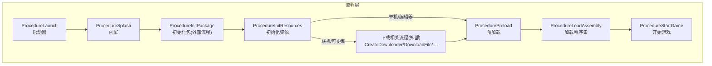
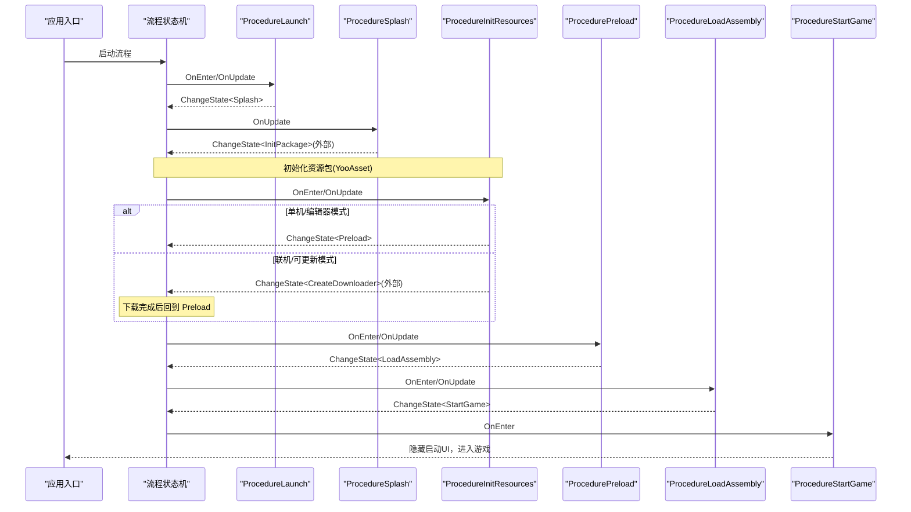
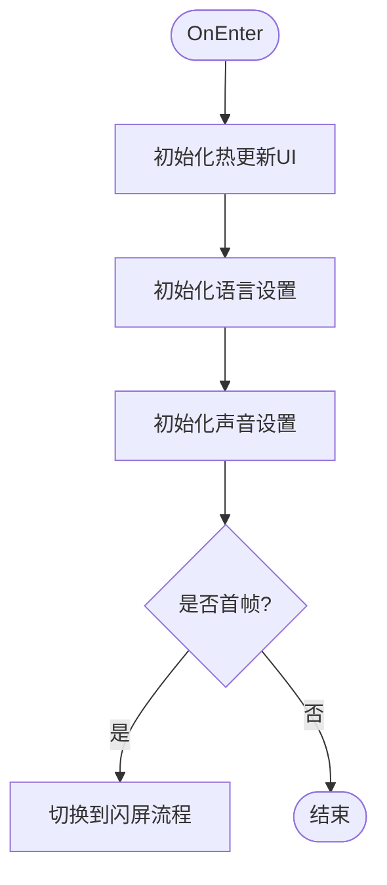
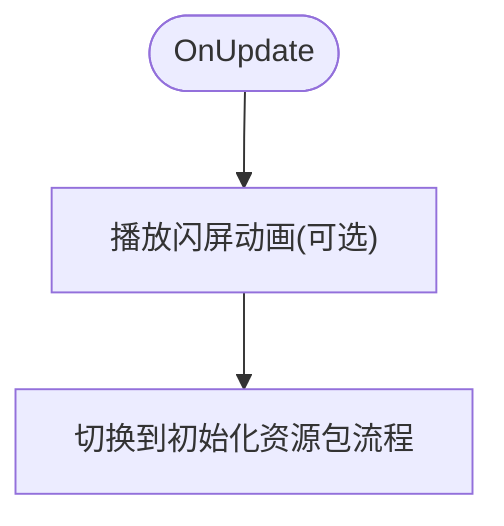
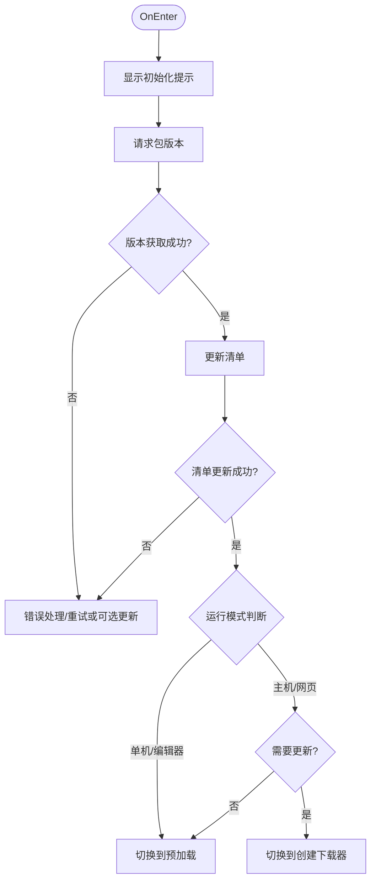
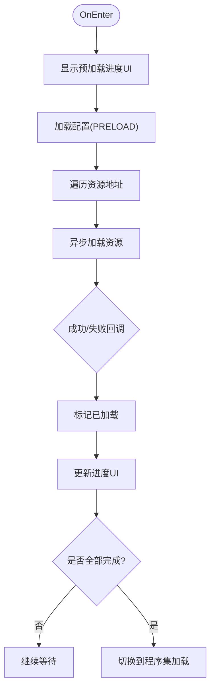
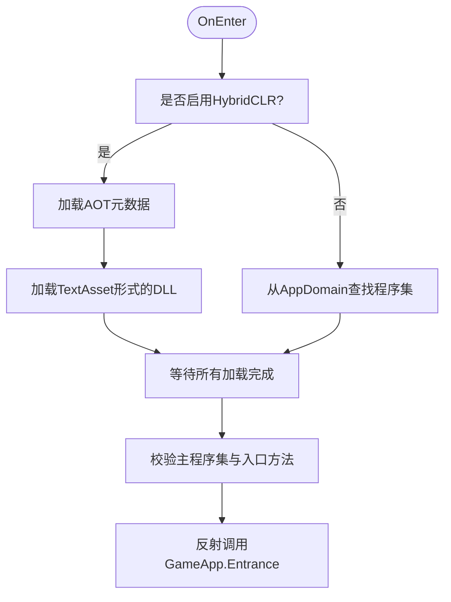
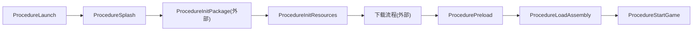

# 内置流程详解

<cite>
**本文引用的文件**   
- [ProcedureBase.cs](file://UnityProject/Assets/GameScripts/Procedure/ProcedureBase.cs)
- [ProcedureLaunch.cs](file://UnityProject/Assets/GameScripts/Procedure/ProcedureLaunch.cs)
- [ProcedureSplash.cs](file://UnityProject/Assets/GameScripts/Procedure/ProcedureSplash.cs)
- [ProcedureInitResources.cs](file://UnityProject/Assets/GameScripts/Procedure/ProcedureInitResources.cs)
- [ProcedurePreload.cs](file://UnityProject/Assets/GameScripts/Procedure/ProcedurePreload.cs)
- [ProcedureLoadAssembly.cs](file://UnityProject/Assets/GameScripts/Procedure/ProcedureLoadAssembly.cs)
- [ProcedureStartGame.cs](file://UnityProject/Assets/GameScripts/Procedure/ProcedureStartGame.cs)
- [3-7-流程模块.md](file://Books/3-7-流程模块.md)
</cite>

## 目录
1. [引言](#引言)
2. [项目结构](#项目结构)
3. [核心组件](#核心组件)
4. [架构总览](#架构总览)
5. [详细组件分析](#详细组件分析)
6. [依赖关系分析](#依赖关系分析)
7. [性能与资源特性](#性能与资源特性)
8. [调试与监控指南](#调试与监控指南)
9. [最佳实践与使用场景](#最佳实践与使用场景)
10. [结论](#结论)

## 引言
本文面向 TEngine 的“内置流程”子系统，系统性梳理从应用启动到进入游戏主逻辑的完整链路。重点覆盖以下流程：
- 启动流程 ProcedureLaunch
- 闪屏流程 ProcedureSplash
- 资源初始化流程 ProcedureInitResources
- 预加载流程 ProcedurePreload
- 程序集加载流程 ProcedureLoadAssembly
- 游戏启动流程 ProcedureStartGame

文档将说明每个流程的职责、执行时机、参数传递方式、与其他流程的协作关系，以及依赖顺序、调试方法与最佳实践。

## 项目结构
流程相关代码位于 UnityProject/Assets/GameScripts/Procedure 目录下，所有内置流程均继承自统一的基类 ProcedureBase，并通过状态机切换（ChangeState）串联执行。流程文档在 Books/3-7-流程模块.md 中给出了标准执行顺序与扩展方法。

图表来源
- [3-7-流程模块.md:84-108](file://Books/3-7-流程模块.md#L84-L108)

章节来源
- [3-7-流程模块.md:26-108](file://Books/3-7-流程模块.md#L26-L108)

## 核心组件
- ProcedureBase：流程抽象基类，提供 UseNativeDialog 属性与 IResourceModule 便捷访问。
- ProcedureLaunch：负责热更新 UI 初始化、语言与声音设置，并在首帧后切换到闪屏流程。
- ProcedureSplash：展示闪屏动画占位，随后进入资源包初始化流程。
- ProcedureInitResources：初始化 YooAsset 资源包，根据运行模式决定后续分支（直连预加载或先进行版本检查与下载）。
- ProcedurePreload：按配置预加载关键资源（如 PRELOAD 分组），并驱动进度 UI，完成后进入程序集加载。
- ProcedureLoadAssembly：加载主逻辑与热更新程序集，必要时为 AOT 程序集补充元数据，最终反射调用 GameApp.Entrance。
- ProcedureStartGame：隐藏启动器 UI，完成启动收尾。

章节来源
- [ProcedureBase.cs:1-15](file://UnityProject/Assets/GameScripts/Procedure/ProcedureBase.cs#L1-L15)
- [ProcedureLaunch.cs:1-95](file://UnityProject/Assets/GameScripts/Procedure/ProcedureLaunch.cs#L1-L95)
- [ProcedureSplash.cs:1-23](file://UnityProject/Assets/GameScripts/Procedure/ProcedureSplash.cs#L1-L23)
- [ProcedureInitResources.cs:1-172](file://UnityProject/Assets/GameScripts/Procedure/ProcedureInitResources.cs#L1-L172)
- [ProcedurePreload.cs:1-175](file://UnityProject/Assets/GameScripts/Procedure/ProcedurePreload.cs#L1-L175)
- [ProcedureLoadAssembly.cs:1-294](file://UnityProject/Assets/GameScripts/Procedure/ProcedureLoadAssembly.cs#L1-L294)
- [ProcedureStartGame.cs:1-24](file://UnityProject/Assets/GameScripts/Procedure/ProcedureStartGame.cs#L1-L24)

## 架构总览
下图展示了内置流程之间的调用链路与关键交互点。

图表来源
- [ProcedureLaunch.cs:23-43](file://UnityProject/Assets/GameScripts/Procedure/ProcedureLaunch.cs#L23-L43)
- [ProcedureSplash.cs:13-20](file://UnityProject/Assets/GameScripts/Procedure/ProcedureSplash.cs#L13-L20)
- [ProcedureInitResources.cs:37-66](file://UnityProject/Assets/GameScripts/Procedure/ProcedureInitResources.cs#L37-L66)
- [ProcedurePreload.cs:54-100](file://UnityProject/Assets/GameScripts/Procedure/ProcedurePreload.cs#L54-L100)
- [ProcedureLoadAssembly.cs:110-126](file://UnityProject/Assets/GameScripts/Procedure/ProcedureLoadAssembly.cs#L110-L126)
- [ProcedureStartGame.cs:12-22](file://UnityProject/Assets/GameScripts/Procedure/ProcedureStartGame.cs#L12-L22)

## 详细组件分析

### 启动流程 ProcedureLaunch
职责
- 初始化热更新 UI（LauncherMgr.Initialize）。
- 初始化语言设置（ILocalizationModule），支持读取用户偏好与回退策略。
- 初始化声音设置（IAudioModule），从持久化配置恢复音量与开关。
- 首帧结束后切换到闪屏流程。

执行时机
- OnInit：获取音频模块。
- OnEnter：初始化 UI、语言、声音。
- OnUpdate：仅运行一帧即切换。

参数与协作
- 通过 ModuleSystem 获取 IAudioModule、ILocalizationModule。
- 使用 Utility.PlayerPrefs 读写语言与声音配置。
- 使用 LauncherMgr 控制启动器 UI。

错误处理
- 语言解析异常时记录错误日志并回退默认语言。

图表来源
- [ProcedureLaunch.cs:17-43](file://UnityProject/Assets/GameScripts/Procedure/ProcedureLaunch.cs#L17-L43)

章节来源
- [ProcedureLaunch.cs:17-92](file://UnityProject/Assets/GameScripts/Procedure/ProcedureLaunch.cs#L17-L92)

### 闪屏流程 ProcedureSplash
职责
- 显示闪屏动画占位（示例注释）。
- 切换到资源包初始化流程（ProcedureInitPackage，属于外部流程）。

执行时机
- OnUpdate：每帧检测，直接切换至下一流程。

图表来源
- [ProcedureSplash.cs:13-20](file://UnityProject/Assets/GameScripts/Procedure/ProcedureSplash.cs#L13-L20)

章节来源
- [ProcedureSplash.cs:1-23](file://UnityProject/Assets/GameScripts/Procedure/ProcedureSplash.cs#L1-L23)

### 资源初始化流程 ProcedureInitResources
职责
- 初始化 YooAsset 资源包清单与版本信息。
- 根据运行模式决定后续分支：
  - 单机/编辑器模式：直接进入预加载。
  - 主机/网页模式：检查是否需要更新，必要时进入下载流程。

执行时机
- OnEnter：显示“初始化资源中...”提示，启动协程初始化资源。
- OnUpdate：等待初始化完成，再根据模式切换流程。

关键步骤
- RequestPackageVersionAsync：获取远程包版本。
- UpdatePackageManifestAsync：更新本地清单。
- 保存 GAME_VERSION 用于离线回退。
- 错误处理：网络失败或清单更新失败时弹出重试对话框，支持可选更新策略。

图表来源
- [ProcedureInitResources.cs:18-66](file://UnityProject/Assets/GameScripts/Procedure/ProcedureInitResources.cs#L18-L66)
- [ProcedureInitResources.cs:71-105](file://UnityProject/Assets/GameScripts/Procedure/ProcedureInitResources.cs#L71-L105)
- [ProcedureInitResources.cs:112-170](file://UnityProject/Assets/GameScripts/Procedure/ProcedureInitResources.cs#L112-L170)

章节来源
- [ProcedureInitResources.cs:1-172](file://UnityProject/Assets/GameScripts/Procedure/ProcedureInitResources.cs#L1-L172)

### 预加载流程 ProcedurePreload
职责
- 显示预加载进度 UI。
- 根据配置（PRELOAD 分组）异步预加载关键资源。
- 统计加载进度并刷新 UI。
- 全部完成后切换到程序集加载流程。

执行时机
- OnEnter：清空已加载标记，显示进度 UI，触发预加载。
- OnUpdate：计算进度并刷新 UI；当所有目标资源加载完成，切换流程。

关键点
- 使用 _loadedFlag 字典跟踪各地址资源的加载状态。
- 使用 LoadAssetCallbacks 回调处理成功与失败。
- WebGL 平台额外加载 WEBGL_PRELOAD 分组。

图表来源
- [ProcedurePreload.cs:41-52](file://UnityProject/Assets/GameScripts/Procedure/ProcedurePreload.cs#L41-L52)
- [ProcedurePreload.cs:54-100](file://UnityProject/Assets/GameScripts/Procedure/ProcedurePreload.cs#L54-L100)
- [ProcedurePreload.cs:118-173](file://UnityProject/Assets/GameScripts/Procedure/ProcedurePreload.cs#L118-L173)

章节来源
- [ProcedurePreload.cs:1-175](file://UnityProject/Assets/GameScripts/Procedure/ProcedurePreload.cs#L1-L175)

### 程序集加载流程 ProcedureLoadAssembly
职责
- 加载主逻辑程序集与热更新程序集。
- 在启用 HybridCLR 时，为 AOT 程序集加载元数据。
- 反射查找并调用 GameApp.Entrance，传入热更新程序集列表。

执行时机
- OnInit：读取更新设置。
- OnEnter：启动异步加载流程。
- OnUpdate：等待所有程序集与元数据加载完成，统一切换。

关键步骤
- 若启用 HybridCLR：
  - 加载 AOT 元数据（LoadMetadataForAOTAssembly）。
  - 从资源系统加载 TextAsset 形式的 DLL 并 Assembly.Load。
- 若未启用或编辑器模拟模式：
  - 直接从当前 AppDomain 查找主逻辑与热更新程序集。
- 全部完成后：
  - 校验主程序集与入口类型/方法是否存在。
  - 反射调用入口方法。

图表来源
- [ProcedureLoadAssembly.cs:36-48](file://UnityProject/Assets/GameScripts/Procedure/ProcedureLoadAssembly.cs#L36-L48)
- [ProcedureLoadAssembly.cs:50-108](file://UnityProject/Assets/GameScripts/Procedure/ProcedureLoadAssembly.cs#L50-L108)
- [ProcedureLoadAssembly.cs:110-150](file://UnityProject/Assets/GameScripts/Procedure/ProcedureLoadAssembly.cs#L110-L150)
- [ProcedureLoadAssembly.cs:152-179](file://UnityProject/Assets/GameScripts/Procedure/ProcedureLoadAssembly.cs#L152-L179)
- [ProcedureLoadAssembly.cs:220-292](file://UnityProject/Assets/GameScripts/Procedure/ProcedureLoadAssembly.cs#L220-L292)

章节来源
- [ProcedureLoadAssembly.cs:1-294](file://UnityProject/Assets/GameScripts/Procedure/ProcedureLoadAssembly.cs#L1-L294)

### 游戏启动流程 ProcedureStartGame
职责
- 隐藏启动器 UI，完成启动收尾。

执行时机
- OnEnter：异步隐藏所有启动器 UI。

章节来源
- [ProcedureStartGame.cs:12-22](file://UnityProject/Assets/GameScripts/Procedure/ProcedureStartGame.cs#L12-L22)

## 依赖关系分析
- 流程间依赖
  - ProcedureLaunch → ProcedureSplash → ProcedureInitPackage（外部）→ ProcedureInitResources → ProcedurePreload → ProcedureLoadAssembly → ProcedureStartGame。
  - 在联机/可更新模式下，ProcedureInitResources 之后会插入下载相关流程（CreateDownloader/DownloadFile/DownloadOver/ClearCache），然后才进入 ProcedurePreload。
- 模块依赖
  - IResourceModule：所有流程通过基类 ProcedureBase 访问资源模块。
  - IAudioModule、ILocalizationModule：仅在 ProcedureLaunch 中使用。
  - LauncherMgr：用于启动器 UI 的显示/隐藏与进度更新。
- 外部依赖
  - YooAsset：资源包与清单管理。
  - HybridCLR：热更新与 AOT 元数据加载（条件编译 ENABLE_HYBRIDCLR）。

图表来源
- [3-7-流程模块.md:84-108](file://Books/3-7-流程模块.md#L84-L108)

章节来源
- [3-7-流程模块.md:84-108](file://Books/3-7-流程模块.md#L84-L108)

## 性能与资源特性
- 异步优先：流程内耗时操作采用 UniTask 异步，避免阻塞主线程。
- 进度反馈：预加载阶段通过 UI 实时反馈进度，提升用户体验。
- 资源分组：利用 YooAsset 的分组（如 PRELOAD、WEBGL_PRELOAD）精准预加载关键资源。
- 模式适配：根据运行模式（EditorSimulateMode、HostPlayMode、WebPlayMode）选择最优路径，减少不必要的网络请求。
- 内存管理：程序集加载后及时释放临时 TextAsset，避免内存泄漏。

[本节为通用指导，不直接分析具体文件]

## 调试与监控指南
- 日志输出
  - 使用 Log.Info/Debug/Warning/Error/Fatal 在各流程关键节点输出日志，便于定位问题。
  - 重点关注资源清单更新、程序集加载、反射入口调用等关键步骤。
- UI 提示
  - 使用 LauncherMgr.ShowUI 与 RefreshProgress 显示初始化与预加载进度。
  - 使用 ShowMessageBox 处理错误与重试逻辑。
- 断点与追踪
  - 在 OnEnter/OnUpdate 与关键异步回调处设置断点，观察流程切换与状态变化。
  - 在 ProcedureLoadAssembly 的 LoadAssetSuccess 与 LoadMetadataAssetSuccess 中检查程序集加载结果。
- 常见问题排查
  - 资源清单更新失败：检查网络连接与服务器清单可用性，确认 GAME_VERSION 回退逻辑。
  - 程序集缺失：确认 ENABLE_HYBRIDCLR 宏定义与 LogicMainDllName 配置正确。
  - 预加载未完成：检查 PRELOAD 分组配置与资源地址是否正确。

章节来源
- [ProcedureInitResources.cs:112-170](file://UnityProject/Assets/GameScripts/Procedure/ProcedureInitResources.cs#L112-L170)
- [ProcedurePreload.cs:158-173](file://UnityProject/Assets/GameScripts/Procedure/ProcedurePreload.cs#L158-L173)
- [ProcedureLoadAssembly.cs:181-218](file://UnityProject/Assets/GameScripts/Procedure/ProcedureLoadAssembly.cs#L181-L218)
- [ProcedureLoadAssembly.cs:256-292](file://UnityProject/Assets/GameScripts/Procedure/ProcedureLoadAssembly.cs#L256-L292)

## 最佳实践与使用场景
- 流程职责单一：每个流程只负责一个明确任务，便于维护与测试。
- 使用异步：耗时操作一律使用 UniTask，避免 Coroutine。
- 提供进度反馈：对需要时间的流程，持续更新 UI 进度。
- 配置驱动：通过 PRELOAD 分组与更新设置灵活控制预加载与热更新行为。
- 错误处理：在网络与资源加载失败时提供重试与降级方案，保证用户体验。
- 实际项目建议
  - 在编辑器模式下跳过网络请求，直接预加载本地资源。
  - 在联机模式下优先检查版本与清单，按需下载后再预加载。
  - 在 WebGL 平台增加 WEBGL_PRELOAD 分组以优化首屏体验。
  - 在热更新场景下确保 AOT 元数据正确加载，避免泛型解释模式异常。

[本节为通用指导，不直接分析具体文件]

## 结论
TEngine 的内置流程通过清晰的状态机与模块化设计，实现了从启动到游戏主逻辑的完整链路。各流程职责明确、依赖清晰，结合 YooAsset 与 HybridCLR 提供了强大的资源与热更新能力。遵循本文的流程顺序、异步规范与错误处理策略，可在实际项目中构建稳定、可维护且高性能的启动流程。