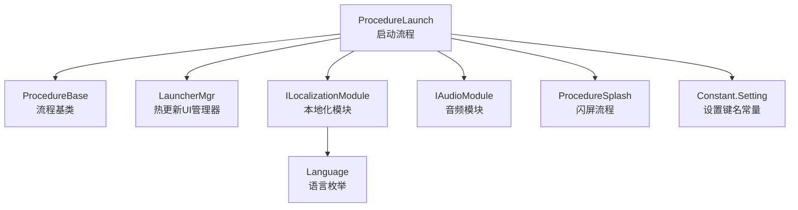
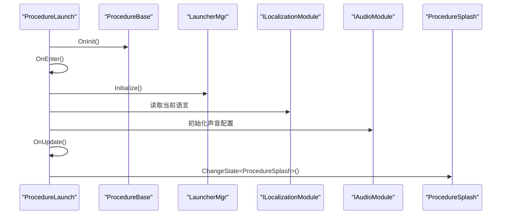
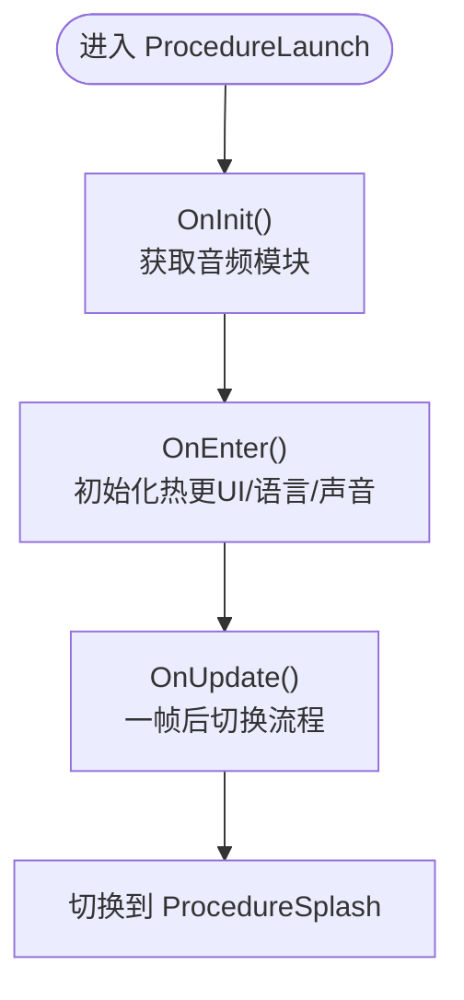
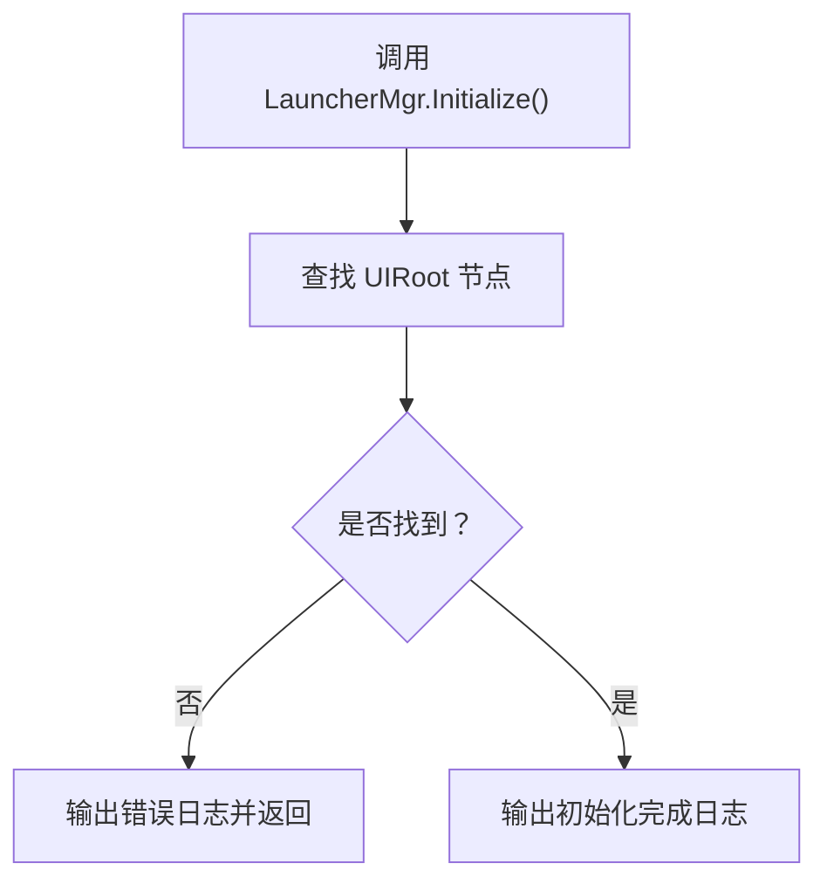
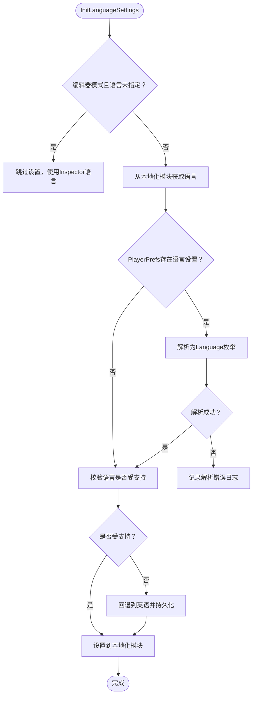
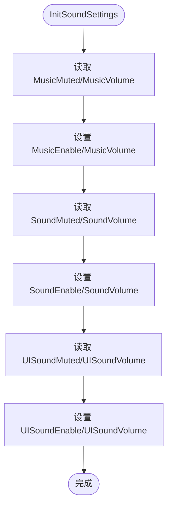
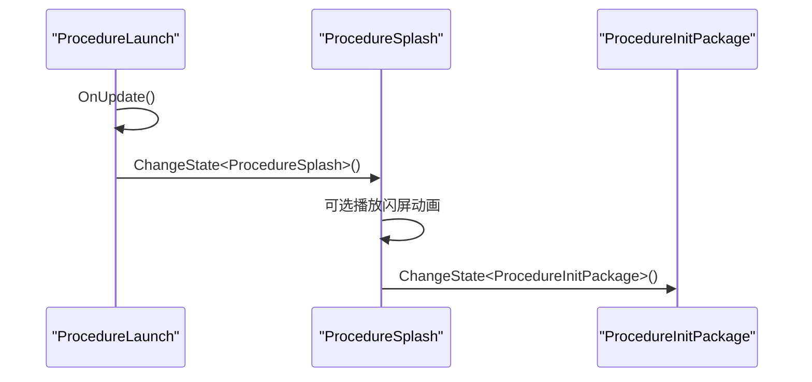
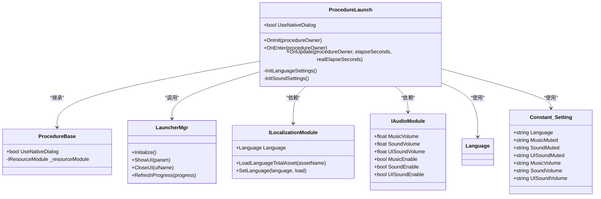

# 启动流程 (ProcedureLaunch)

<cite>
**本文引用的文件**   
- [ProcedureLaunch.cs](file://UnityProject/Assets/GameScripts/Procedure/ProcedureLaunch.cs)
- [ProcedureBase.cs](file://UnityProject/Assets/GameScripts/Procedure/ProcedureBase.cs)
- [LauncherMgr.cs](file://UnityProject/Assets/Launcher/Scripts/LauncherMgr.cs)
- [Constant.cs](file://UnityProject/Assets/TEngine/Runtime/Core/Constant/Constant.cs)
- [Language.cs](file://UnityProject/Assets/TEngine/Runtime(Module)/LocalizationModule/Language.cs)
- [ILocalizationModule.cs](file://UnityProject/Assets/TEngine/Runtime(Module)/LocalizationModule/ILocalizationModule.cs)
- [IAudioModule.cs](file://UnityProject/Assets/TEngine/Runtime(Module)/AudioModule/IAudioModule.cs)
- [ProcedureSplash.cs](file://UnityProject/Assets/GameScripts/Procedure/ProcedureSplash.cs)
</cite>

## 目录
1. [简介](#简介)
2. [项目结构](#项目结构)
3. [核心组件](#核心组件)
4. [架构总览](#架构总览)
5. [详细组件分析](#详细组件分析)
6. [依赖关系分析](#依赖关系分析)
7. [性能考量](#性能考量)
8. [故障排查指南](#故障排查指南)
9. [结论](#结论)
10. [附录](#附录)

## 简介
本文聚焦于 TEngine 框架中的“启动流程”（ProcedureLaunch），系统梳理其初始化逻辑、生命周期方法执行时机与职责，重点解析热更新 UI 初始化、语言配置设置、声音配置初始化等关键能力。同时给出语言优先级策略（编辑器模式 vs 运行时）、支持的语言类型、默认语言处理机制，以及音乐、音效、UI 声音的独立控制方式。文末提供调试方法与常见问题解决方案，并附带实际项目中的配置示例与最佳实践建议。

## 项目结构
- ProcedureLaunch：启动流程入口，负责热更新 UI 初始化、语言与声音配置初始化，并在首帧后切换到闪屏流程。
- ProcedureBase：流程基类，暴露 UseNativeDialog 属性与资源模块引用。
- LauncherMgr：热更新 UI 加载管理器，负责 UIRoot 查找、窗口实例化与显示/关闭。
- Constant.Setting：持久化键名常量（语言、音量、静音开关）。
- Language：本地化语言枚举，包含多语言选项。
- ILocalizationModule：本地化模块接口，用于获取/设置当前语言。
- IAudioModule：音频模块接口，用于控制音乐、音效、UI 声音的开关与音量。
- ProcedureSplash：闪屏流程，承接启动流程后的下一步初始化。

图表来源
- [ProcedureLaunch.cs:11-43](file://UnityProject/Assets/GameScripts/Procedure/ProcedureLaunch.cs#L11-L43)
- [ProcedureBase.cs:5-14](file://UnityProject/Assets/GameScripts/Procedure/ProcedureBase.cs#L5-L14)
- [LauncherMgr.cs:11-29](file://UnityProject/Assets/Launcher/Scripts/LauncherMgr.cs#L11-L29)
- [ILocalizationModule.cs:5-10](file://UnityProject/Assets/TEngine/Runtime(Module)/LocalizationModule/ILocalizationModule.cs#L5-L10)
- [IAudioModule.cs:8-58](file://UnityProject/Assets/TEngine/Runtime(Module)/AudioModule/IAudioModule.cs#L8-L58)
- [Language.cs:6-81](file://UnityProject/Assets/TEngine/Runtime(Module)/LocalizationModule/Language.cs#L6-L81)
- [Constant.cs:6-19](file://UnityProject/Assets/TEngine/Runtime/Core/Constant/Constant.cs#L6-L19)
- [ProcedureSplash.cs:9-20](file://UnityProject/Assets/GameScripts/Procedure/ProcedureSplash.cs#L9-L20)

章节来源
- [ProcedureLaunch.cs:11-43](file://UnityProject/Assets/GameScripts/Procedure/ProcedureLaunch.cs#L11-L43)
- [ProcedureBase.cs:5-14](file://UnityProject/Assets/GameScripts/Procedure/ProcedureBase.cs#L5-L14)
- [LauncherMgr.cs:11-29](file://UnityProject/Assets/Launcher/Scripts/LauncherMgr.cs#L11-L29)
- [Constant.cs:6-19](file://UnityProject/Assets/TEngine/Runtime/Core/Constant/Constant.cs#L6-L19)
- [Language.cs:6-81](file://UnityProject/Assets/TEngine/Runtime(Module)/LocalizationModule/Language.cs#L6-L81)
- [ILocalizationModule.cs:5-10](file://UnityProject/Assets/TEngine/Runtime(Module)/LocalizationModule/ILocalizationModule.cs#L5-L10)
- [IAudioModule.cs:8-58](file://UnityProject/Assets/TEngine/Runtime(Module)/AudioModule/IAudioModule.cs#L8-L58)
- [ProcedureSplash.cs:9-20](file://UnityProject/Assets/GameScripts/Procedure/ProcedureSplash.cs#L9-L20)

## 核心组件
- 启动流程（ProcedureLaunch）
  - 职责：在 OnEnter 中完成热更新 UI 初始化、语言配置设置、声音配置初始化；在 OnUpdate 中一帧后切换到闪屏流程。
  - 关键点：UseNativeDialog 为 true，表示可使用原生对话框进行提示。
- 热更新 UI 管理器（LauncherMgr）
  - 职责：查找 UIRoot，提供 ShowUI/CloseUI/RefreshProgress 等方法，管理热更新相关 UI 的生命周期。
- 本地化模块（ILocalizationModule）
  - 职责：提供 Language 属性的读写，支持按语言名称或枚举设置语言。
- 音频模块（IAudioModule）
  - 职责：提供 Music/Sound/UISound 三类声音的 Enable 与 Volume 控制，以及全局 Enable/Volume。
- 语言枚举（Language）
  - 职责：定义所有支持的语言类型，包括英语、简体中文、繁体中文等。
- 设置常量（Constant.Setting）
  - 职责：定义语言、音乐、音效、UI 声音的持久化键名。

章节来源
- [ProcedureLaunch.cs:11-92](file://UnityProject/Assets/GameScripts/Procedure/ProcedureLaunch.cs#L11-L92)
- [LauncherMgr.cs:11-131](file://UnityProject/Assets/Launcher/Scripts/LauncherMgr.cs#L11-L131)
- [ILocalizationModule.cs:5-58](file://UnityProject/Assets/TEngine/Runtime(Module)/LocalizationModule/ILocalizationModule.cs#L5-L58)
- [IAudioModule.cs:8-127](file://UnityProject/Assets/TEngine/Runtime(Module)/AudioModule/IAudioModule.cs#L8-L127)
- [Language.cs:6-262](file://UnityProject/Assets/TEngine/Runtime(Module)/LocalizationModule/Language.cs#L6-L262)
- [Constant.cs:6-19](file://UnityProject/Assets/TEngine/Runtime/Core/Constant/Constant.cs#L6-L19)

## 架构总览
启动流程作为游戏启动的第一阶段，承担环境准备与用户偏好初始化工作。其调用链如下：

图表来源
- [ProcedureLaunch.cs:17-43](file://UnityProject/Assets/GameScripts/Procedure/ProcedureLaunch.cs#L17-L43)
- [LauncherMgr.cs:18-29](file://UnityProject/Assets/Launcher/Scripts/LauncherMgr.cs#L18-L29)
- [ILocalizationModule.cs:5-10](file://UnityProject/Assets/TEngine/Runtime(Module)/LocalizationModule/ILocalizationModule.cs#L5-L10)
- [IAudioModule.cs:8-58](file://UnityProject/Assets/TEngine/Runtime(Module)/AudioModule/IAudioModule.cs#L8-L58)
- [ProcedureSplash.cs:13-20](file://UnityProject/Assets/GameScripts/Procedure/ProcedureSplash.cs#L13-L20)

## 详细组件分析

### 启动流程（ProcedureLaunch）生命周期与职责
- OnInit
  - 获取音频模块引用，供后续声音配置使用。
- OnEnter
  - 调用 LauncherMgr.Initialize() 完成热更新 UI 根节点查找与基础初始化。
  - 调用 InitLanguageSettings() 完成语言配置设置。
  - 调用 InitSoundSettings() 完成声音配置设置。
- OnUpdate
  - 运行一帧后切换到闪屏流程（ProcedureSplash）。

图表来源
- [ProcedureLaunch.cs:17-43](file://UnityProject/Assets/GameScripts/Procedure/ProcedureLaunch.cs#L17-L43)
- [ProcedureSplash.cs:13-20](file://UnityProject/Assets/GameScripts/Procedure/ProcedureSplash.cs#L13-L20)

章节来源
- [ProcedureLaunch.cs:17-43](file://UnityProject/Assets/GameScripts/Procedure/ProcedureLaunch.cs#L17-L43)
- [ProcedureSplash.cs:13-20](file://UnityProject/Assets/GameScripts/Procedure/ProcedureSplash.cs#L13-L20)

### 热更新 UI 初始化（LauncherMgr.Initialize）
- 查找 UIRoot 节点路径，若不存在则输出错误日志并返回。
- 成功后记录初始化完成日志，供后续 UI 展示使用。

图表来源
- [LauncherMgr.cs:18-29](file://UnityProject/Assets/Launcher/Scripts/LauncherMgr.cs#L18-L29)

章节来源
- [LauncherMgr.cs:18-29](file://UnityProject/Assets/Launcher/Scripts/LauncherMgr.cs#L18-L29)

### 语言设置优先级与默认语言处理
- 编辑器模式优先：当处于编辑器模拟模式且编辑器语言未指定时，直接跳过运行时语言设置，保留 Inspector 上的语言配置。
- 运行时模式：
  - 从本地化模块获取当前语言。
  - 若 PlayerPrefs 中存在语言设置，尝试解析为 Language 枚举。
  - 若解析失败，记录错误日志。
  - 若语言不在支持列表（英语、简体中文、繁体中文），则回退到英语，并持久化该语言设置。
  - 最终将语言设置到本地化模块。

图表来源
- [ProcedureLaunch.cs:45-81](file://UnityProject/Assets/GameScripts/Procedure/ProcedureLaunch.cs#L45-L81)
- [Language.cs:6-81](file://UnityProject/Assets/TEngine/Runtime(Module)/LocalizationModule/Language.cs#L6-L81)
- [ILocalizationModule.cs:5-10](file://UnityProject/Assets/TEngine/Runtime(Module)/LocalizationModule/ILocalizationModule.cs#L5-L10)
- [Constant.cs:10-10](file://UnityProject/Assets/TEngine/Runtime/Core/Constant/Constant.cs#L10-L10)

章节来源
- [ProcedureLaunch.cs:45-81](file://UnityProject/Assets/GameScripts/Procedure/ProcedureLaunch.cs#L45-L81)
- [Language.cs:6-81](file://UnityProject/Assets/TEngine/Runtime(Module)/LocalizationModule/Language.cs#L6-L81)
- [ILocalizationModule.cs:5-10](file://UnityProject/Assets/TEngine/Runtime(Module)/LocalizationModule/ILocalizationModule.cs#L5-L10)
- [Constant.cs:10-10](file://UnityProject/Assets/TEngine/Runtime/Core/Constant/Constant.cs#L10-L10)

### 声音配置读取与设置
- 从 PlayerPrefs 读取以下设置项：
  - 音乐：MusicMuted、MusicVolume
  - 音效：SoundMuted、SoundVolume
  - UI 声音：UISoundMuted、UISoundVolume
- 将静音开关取反后赋值给对应 Enable 属性，并将音量值赋值给对应 Volume 属性。
- 完成后输出初始化完成日志。

图表来源
- [ProcedureLaunch.cs:83-92](file://UnityProject/Assets/GameScripts/Procedure/ProcedureLaunch.cs#L83-L92)
- [IAudioModule.cs:20-58](file://UnityProject/Assets/TEngine/Runtime(Module)/AudioModule/IAudioModule.cs#L20-L58)
- [Constant.cs:13-18](file://UnityProject/Assets/TEngine/Runtime/Core/Constant/Constant.cs#L13-L18)

章节来源
- [ProcedureLaunch.cs:83-92](file://UnityProject/Assets/GameScripts/Procedure/ProcedureLaunch.cs#L83-L92)
- [IAudioModule.cs:20-58](file://UnityProject/Assets/TEngine/Runtime(Module)/AudioModule/IAudioModule.cs#L20-L58)
- [Constant.cs:13-18](file://UnityProject/Assets/TEngine/Runtime/Core/Constant/Constant.cs#L13-L18)

### 流程切换与后续步骤
- 启动流程在 OnUpdate 中一帧后切换到闪屏流程（ProcedureSplash）。
- 闪屏流程可播放闪屏动画，随后进入资源包初始化流程（ProcedureInitPackage）。

图表来源
- [ProcedureLaunch.cs:37-43](file://UnityProject/Assets/GameScripts/Procedure/ProcedureLaunch.cs#L37-L43)
- [ProcedureSplash.cs:13-20](file://UnityProject/Assets/GameScripts/Procedure/ProcedureSplash.cs#L13-L20)

章节来源
- [ProcedureLaunch.cs:37-43](file://UnityProject/Assets/GameScripts/Procedure/ProcedureLaunch.cs#L37-L43)
- [ProcedureSplash.cs:13-20](file://UnityProject/Assets/GameScripts/Procedure/ProcedureSplash.cs#L13-L20)

## 依赖关系分析
- ProcedureLaunch 依赖：
  - ProcedureBase：流程基类，提供 UseNativeDialog 与资源模块引用。
  - LauncherMgr：热更新 UI 初始化与展示。
  - ILocalizationModule：语言设置与查询。
  - IAudioModule：声音开关与音量控制。
  - Constant.Setting：持久化键名。
  - Language：语言枚举。
- 外部模块：
  - ModuleSystem：用于获取各模块实例。
  - Utility.PlayerPrefs：用于读写用户设置。
  - Log：用于输出日志。

图表来源
- [ProcedureLaunch.cs:11-92](file://UnityProject/Assets/GameScripts/Procedure/ProcedureLaunch.cs#L11-L92)
- [ProcedureBase.cs:5-14](file://UnityProject/Assets/GameScripts/Procedure/ProcedureBase.cs#L5-L14)
- [LauncherMgr.cs:11-131](file://UnityProject/Assets/Launcher/Scripts/LauncherMgr.cs#L11-L131)
- [ILocalizationModule.cs:5-58](file://UnityProject/Assets/TEngine/Runtime(Module)/LocalizationModule/ILocalizationModule.cs#L5-L58)
- [IAudioModule.cs:8-127](file://UnityProject/Assets/TEngine/Runtime(Module)/AudioModule/IAudioModule.cs#L8-L127)
- [Language.cs:6-262](file://UnityProject/Assets/TEngine/Runtime(Module)/LocalizationModule/Language.cs#L6-L262)
- [Constant.cs:6-19](file://UnityProject/Assets/TEngine/Runtime/Core/Constant/Constant.cs#L6-L19)

章节来源
- [ProcedureLaunch.cs:11-92](file://UnityProject/Assets/GameScripts/Procedure/ProcedureLaunch.cs#L11-L92)
- [ProcedureBase.cs:5-14](file://UnityProject/Assets/GameScripts/Procedure/ProcedureBase.cs#L5-L14)
- [LauncherMgr.cs:11-131](file://UnityProject/Assets/Launcher/Scripts/LauncherMgr.cs#L11-L131)
- [ILocalizationModule.cs:5-58](file://UnityProject/Assets/TEngine/Runtime(Module)/LocalizationModule/ILocalizationModule.cs#L5-L58)
- [IAudioModule.cs:8-127](file://UnityProject/Assets/TEngine/Runtime(Module)/AudioModule/IAudioModule.cs#L8-L127)
- [Language.cs:6-262](file://UnityProject/Assets/TEngine/Runtime(Module)/LocalizationModule/Language.cs#L6-L262)
- [Constant.cs:6-19](file://UnityProject/Assets/TEngine/Runtime/Core/Constant/Constant.cs#L6-L19)

## 性能考量
- 启动流程仅执行一次初始化，避免重复 IO 与对象创建。
- 语言与声音配置直接从 PlayerPrefs 读取，开销极低。
- 热更新 UI 初始化仅在首次进入流程时执行，减少重复查找 UIRoot 的成本。
- 建议在后续流程中缓存已初始化的 UI 实例，避免频繁 Resources.Load 与 Instantiate。

[本节为通用指导，不直接分析具体文件]

## 故障排查指南
- 热更新 UI 无法显示
  - 检查 UIRoot 节点是否存在于场景中，路径是否正确。
  - 查看 LauncherMgr.Initialize 的错误日志输出。
- 语言设置无效
  - 确认 PlayerPrefs 中是否存在语言设置键。
  - 检查语言字符串是否能正确解析为 Language 枚举。
  - 若语言不受支持，将被回退到英语并持久化。
- 声音无输出
  - 检查对应声音类型的 Enable 是否为 true。
  - 检查音量值是否在合理范围（0~1）。
  - 确认音频模块已正确初始化。

章节来源
- [LauncherMgr.cs:18-29](file://UnityProject/Assets/Launcher/Scripts/LauncherMgr.cs#L18-L29)
- [ProcedureLaunch.cs:45-92](file://UnityProject/Assets/GameScripts/Procedure/ProcedureLaunch.cs#L45-L92)
- [IAudioModule.cs:20-58](file://UnityProject/Assets/TEngine/Runtime(Module)/AudioModule/IAudioModule.cs#L20-L58)

## 结论
ProcedureLaunch 作为游戏启动的关键流程，承担了热更新 UI 初始化、语言与声音配置的准备工作，并在首帧后平滑过渡到闪屏流程。通过清晰的优先级策略与独立的音轨控制，确保在不同环境与用户偏好下都能稳定运行。结合本指南的配置示例与最佳实践，可在项目中快速落地并扩展更多自定义行为。

[本节为总结性内容，不直接分析具体文件]

## 附录

### 语言设置优先级说明
- 编辑器模式优先：当处于编辑器模拟模式且编辑器语言未指定时，直接使用 Inspector 上的语言设置，跳过运行时逻辑。
- 运行时模式：
  - 优先使用本地化模块当前语言。
  - 若 PlayerPrefs 中存在语言设置，则以该设置为准。
  - 若语言不受支持，回退到英语并持久化。

章节来源
- [ProcedureLaunch.cs:45-81](file://UnityProject/Assets/GameScripts/Procedure/ProcedureLaunch.cs#L45-L81)
- [Language.cs:6-81](file://UnityProject/Assets/TEngine/Runtime(Module)/LocalizationModule/Language.cs#L6-L81)

### 声音配置键名与默认值
- 音乐
  - 静音键：Setting.MusicMuted（默认 false）
  - 音量键：Setting.MusicVolume（默认 1f）
- 音效
  - 静音键：Setting.SoundMuted（默认 false）
  - 音量键：Setting.SoundVolume（默认 1f）
- UI 声音
  - 静音键：Setting.UISoundMuted（默认 false）
  - 音量键：Setting.UISoundVolume（默认 1f）

章节来源
- [Constant.cs:13-18](file://UnityProject/Assets/TEngine/Runtime/Core/Constant/Constant.cs#L13-L18)
- [ProcedureLaunch.cs:83-92](file://UnityProject/Assets/GameScripts/Procedure/ProcedureLaunch.cs#L83-L92)

### 实际项目配置示例与最佳实践
- 首次启动
  - 不设置任何 PlayerPrefs，系统将使用系统语言或回退到英语。
  - 声音默认开启且音量为最大。
- 用户自定义
  - 在游戏设置界面修改语言与声音后，写入 PlayerPrefs。
  - 下次启动时自动应用用户偏好。
- 编辑器开发
  - 在编辑器模式下，可通过 Inspector 设置语言，便于本地化测试。
- 发布前检查
  - 确认 UIRoot 节点存在且路径正确。
  - 确认语言资源已打包并可用。
  - 确认音频模块已初始化且混音器配置正确。

[本节为通用指导，不直接分析具体文件]