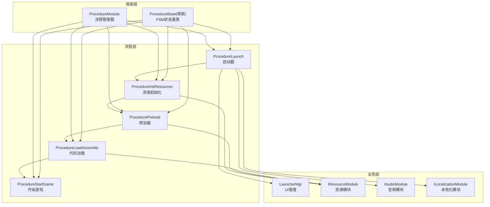
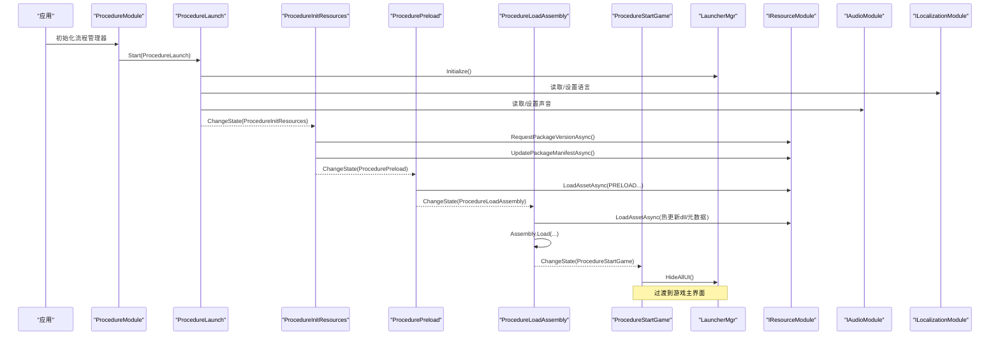
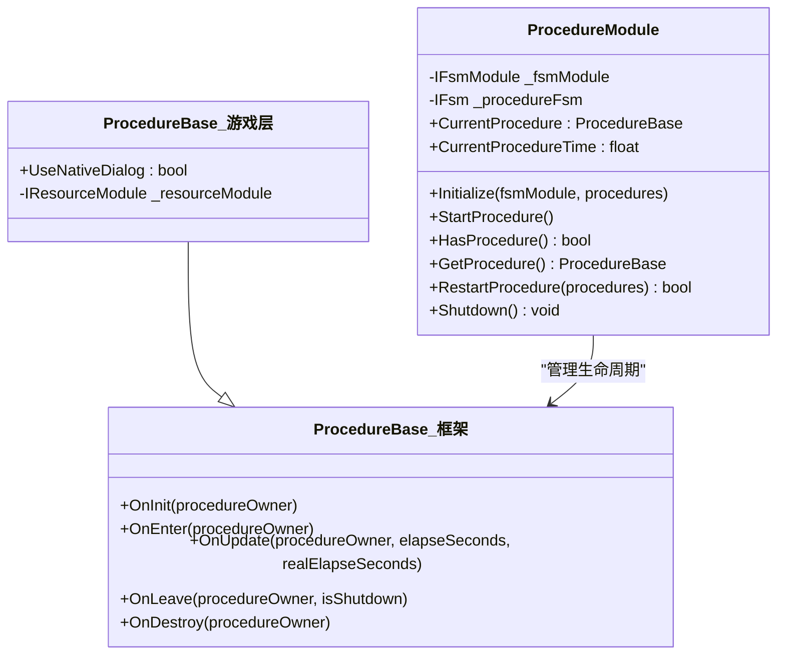
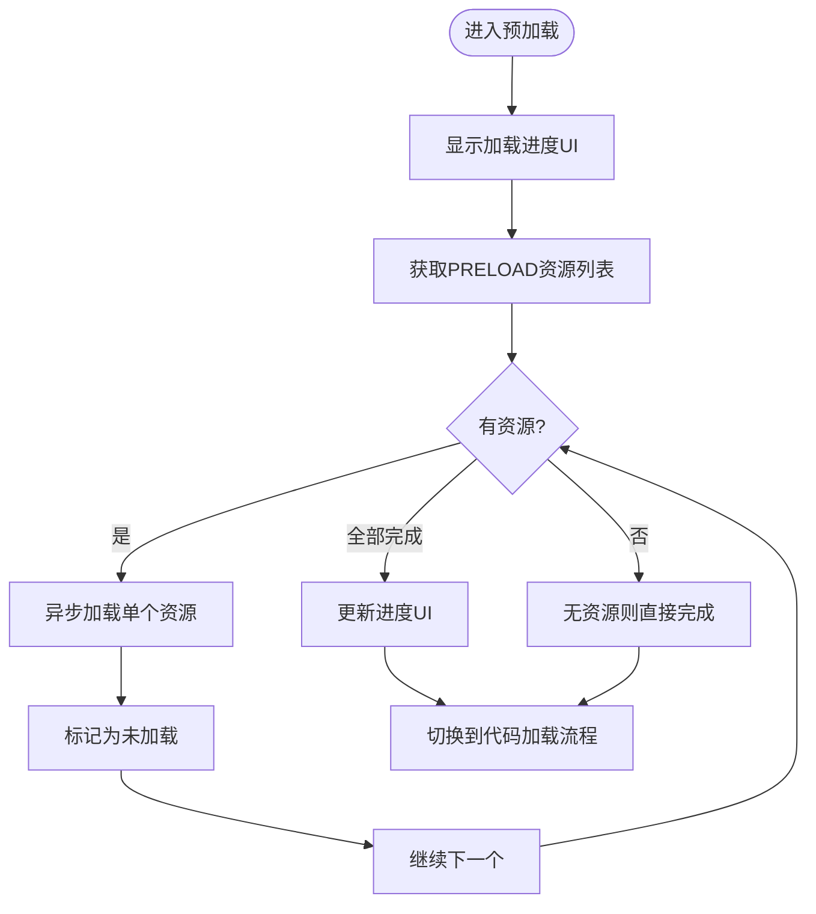
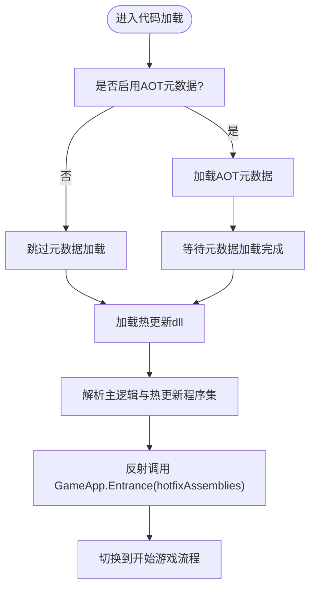
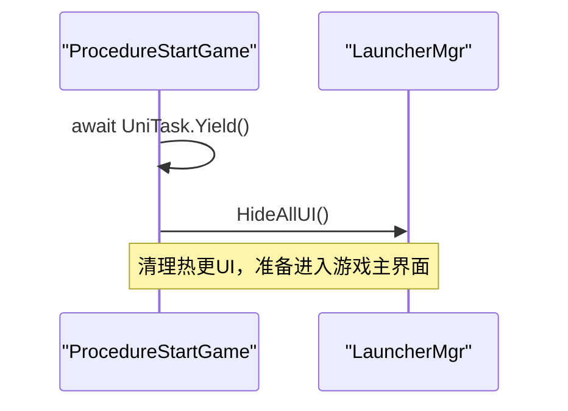
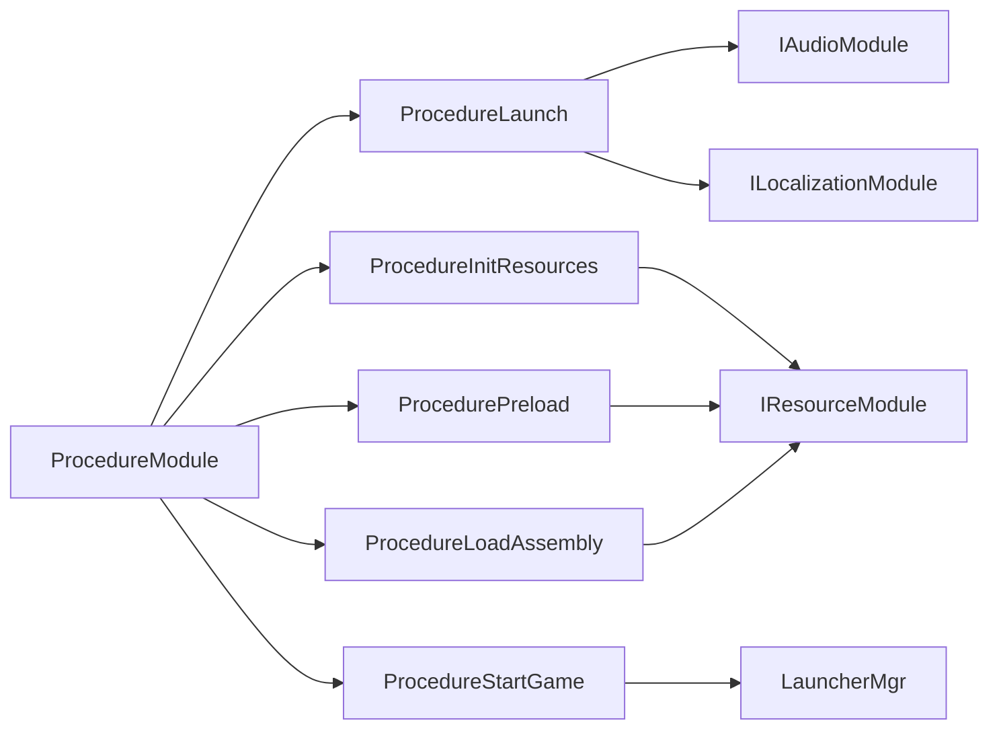

# 游戏启动流程 (ProcedureStartGame)

<cite>
**本文引用的文件**   
- [ProcedureStartGame.cs](file://UnityProject/Assets/GameScripts/Procedure/ProcedureStartGame.cs)
- [ProcedureBase.cs（游戏层）](file://UnityProject/Assets/GameScripts/Procedure/ProcedureBase.cs)
- [ProcedureBase.cs（框架层）](file://UnityProject/Assets/TEngine/Runtime/Module/ProcedureModule/ProcedureBase.cs)
- [ProcedureModule.cs](file://UnityProject/Assets/TEngine/Runtime/Module/ProcedureModule/ProcedureModule.cs)
- [ProcedureLaunch.cs](file://UnityProject/Assets/GameScripts/Procedure/ProcedureLaunch.cs)
- [ProcedureInitResources.cs](file://UnityProject/Assets/GameScripts/Procedure/ProcedureInitResources.cs)
- [ProcedurePreload.cs](file://UnityProject/Assets/GameScripts/Procedure/ProcedurePreload.cs)
- [ProcedureLoadAssembly.cs](file://UnityProject/Assets/GameScripts/Procedure/ProcedureLoadAssembly.cs)
- [LauncherMgr.cs](file://UnityProject/Assets/Launcher/Scripts/LauncherMgr.cs)
</cite>

## 目录
1. [简介](#简介)
2. [项目结构](#项目结构)
3. [核心组件](#核心组件)
4. [架构总览](#架构总览)
5. [详细组件分析](#详细组件分析)
6. [依赖关系分析](#依赖关系分析)
7. [性能考量](#性能考量)
8. [故障排查指南](#故障排查指南)
9. [结论](#结论)
10. [附录：扩展与最佳实践](#附录扩展与最佳实践)

## 简介
本文围绕“游戏启动流程”中的关键节点 ProcedureStartGame，结合 TEngine 的流程系统、资源模块、热更新装配加载以及 Launcher UI 管理，完整梳理从应用启动到进入游戏主逻辑的全生命周期。重点包括：
- 流程状态机驱动与生命周期回调
- 业务模块初始化顺序与依赖注入
- 用户会话与环境配置（语言、声音等）
- 资源清单获取、预加载与程序集加载
- 网络服务连接与第三方 SDK 初始化时机
- 启动性能分析与调试方法
- 架构模式与扩展指南

## 项目结构
本项目采用“流程（Procedure）+ 模块（Module）”的架构组织方式：
- 流程层：以有限状态机驱动各阶段（启动、资源初始化、预加载、代码加载、开始游戏等）
- 模块层：通过 ModuleSystem 提供资源、音频、本地化、FSM 等能力
- Launcher 层：负责热更期间的 UI 展示与控制

图表来源
- [ProcedureModule.cs:8-209](file://UnityProject/Assets/TEngine/Runtime/Module/ProcedureModule/ProcedureModule.cs#L8-L209)
- [ProcedureBase.cs（框架层）:8-57](file://UnityProject/Assets/TEngine/Runtime/Module/ProcedureModule/ProcedureBase.cs#L8-L57)
- [ProcedureLaunch.cs:11-95](file://UnityProject/Assets/GameScripts/Procedure/ProcedureLaunch.cs#L11-L95)
- [ProcedureInitResources.cs:10-172](file://UnityProject/Assets/GameScripts/Procedure/ProcedureInitResources.cs#L10-L172)
- [ProcedurePreload.cs:16-175](file://UnityProject/Assets/GameScripts/Procedure/ProcedurePreload.cs#L16-L175)
- [ProcedureLoadAssembly.cs:19-294](file://UnityProject/Assets/GameScripts/Procedure/ProcedureLoadAssembly.cs#L19-L294)
- [LauncherMgr.cs:11-135](file://UnityProject/Assets/Launcher/Scripts/LauncherMgr.cs#L11-L135)

章节来源
- [ProcedureModule.cs:8-209](file://UnityProject/Assets/TEngine/Runtime/Module/ProcedureModule/ProcedureModule.cs#L8-L209)
- [ProcedureBase.cs（框架层）:8-57](file://UnityProject/Assets/TEngine/Runtime/Module/ProcedureModule/ProcedureBase.cs#L8-L57)

## 核心组件
- 流程管理器（ProcedureModule）：基于 FSM 管理流程生命周期，提供 Start/HasState/GetState/Restart 等能力
- 流程基类（ProcedureBase）：定义 OnInit/OnEnter/OnUpdate/OnLeave/OnDestroy 等生命周期钩子
- 启动流程（ProcedureLaunch）：初始化 Launcher UI、语言与声音设置，并进入 Splash
- 资源初始化（ProcedureInitResources）：请求远程版本、更新清单、处理可选更新策略
- 预加载（ProcedurePreload）：按 PRELOAD 标签批量异步加载资源，更新进度 UI
- 代码加载（ProcedureLoadAssembly）：加载热更新/元数据程序集，反射调用 GameApp.Entrance
- 开始游戏（ProcedureStartGame）：隐藏 Launcher UI，过渡到游戏主界面
- Launcher 管理（LauncherMgr）：统一显示/关闭 UI，提供消息框与进度刷新

章节来源
- [ProcedureModule.cs:8-209](file://UnityProject/Assets/TEngine/Runtime/Module/ProcedureModule/ProcedureModule.cs#L8-L209)
- [ProcedureBase.cs（框架层）:8-57](file://UnityProject/Assets/TEngine/Runtime/Module/ProcedureModule/ProcedureBase.cs#L8-L57)
- [ProcedureLaunch.cs:11-95](file://UnityProject/Assets/GameScripts/Procedure/ProcedureLaunch.cs#L11-L95)
- [ProcedureInitResources.cs:10-172](file://UnityProject/Assets/GameScripts/Procedure/ProcedureInitResources.cs#L10-L172)
- [ProcedurePreload.cs:16-175](file://UnityProject/Assets/GameScripts/Procedure/ProcedurePreload.cs#L16-L175)
- [ProcedureLoadAssembly.cs:19-294](file://UnityProject/Assets/GameScripts/Procedure/ProcedureLoadAssembly.cs#L19-L294)
- [ProcedureStartGame.cs:8-24](file://UnityProject/Assets/GameScripts/Procedure/ProcedureStartGame.cs#L8-L24)
- [LauncherMgr.cs:11-135](file://UnityProject/Assets/Launcher/Scripts/LauncherMgr.cs#L11-L135)

## 架构总览
下图展示了从应用启动到游戏主逻辑入口的完整时序，涵盖流程切换、资源与代码加载、UI 控制与最终入口调用。

图表来源
- [ProcedureModule.cs:86-109](file://UnityProject/Assets/TEngine/Runtime/Module/ProcedureModule/ProcedureModule.cs#L86-L109)
- [ProcedureLaunch.cs:17-43](file://UnityProject/Assets/GameScripts/Procedure/ProcedureLaunch.cs#L17-L43)
- [ProcedureInitResources.cs:18-66](file://UnityProject/Assets/GameScripts/Procedure/ProcedureInitResources.cs#L18-L66)
- [ProcedurePreload.cs:41-100](file://UnityProject/Assets/GameScripts/Procedure/ProcedurePreload.cs#L41-L100)
- [ProcedureLoadAssembly.cs:42-150](file://UnityProject/Assets/GameScripts/Procedure/ProcedureLoadAssembly.cs#L42-L150)
- [ProcedureStartGame.cs:12-22](file://UnityProject/Assets/GameScripts/Procedure/ProcedureStartGame.cs#L12-L22)
- [LauncherMgr.cs:18-29](file://UnityProject/Assets/Launcher/Scripts/LauncherMgr.cs#L18-L29)

## 详细组件分析

### 流程基类与流程管理器
- 框架层 ProcedureBase 定义了 FSM 状态的完整生命周期钩子，所有自定义流程继承该基类以获得统一的 Init/Enter/Update/Leave/Destroy 行为
- ProcedureModule 封装了 FSM 的创建、销毁与流程启停，对外暴露 Start/HasState/GetState/Restart 等方法，并提供 CurrentProcedure 与 CurrentProcedureTime 等查询接口

图表来源
- [ProcedureBase.cs（框架层）:8-57](file://UnityProject/Assets/TEngine/Runtime/Module/ProcedureModule/ProcedureBase.cs#L8-L57)
- [ProcedureModule.cs:8-209](file://UnityProject/Assets/TEngine/Runtime/Module/ProcedureModule/ProcedureModule.cs#L8-L209)
- [ProcedureBase.cs（游戏层）:5-14](file://UnityProject/Assets/GameScripts/Procedure/ProcedureBase.cs#L5-L14)

章节来源
- [ProcedureBase.cs（框架层）:8-57](file://UnityProject/Assets/TEngine/Runtime/Module/ProcedureModule/ProcedureBase.cs#L8-L57)
- [ProcedureModule.cs:8-209](file://UnityProject/Assets/TEngine/Runtime/Module/ProcedureModule/ProcedureModule.cs#L8-L209)
- [ProcedureBase.cs（游戏层）:5-14](file://UnityProject/Assets/GameScripts/Procedure/ProcedureBase.cs#L5-L14)

### 启动流程（ProcedureLaunch）
职责：
- 初始化 Launcher UI 根节点
- 根据平台与编辑器模式设置语言
- 从持久化存储恢复声音配置
- 一帧后切换到 Splash 流程

关键点：
- 使用 ModuleSystem 获取 IAudioModule 与 ILocalizationModule
- 在编辑器模拟模式下优先使用 Inspector 设置的语言
- 对不支持的语言回退为英语并保存

章节来源
- [ProcedureLaunch.cs:17-43](file://UnityProject/Assets/GameScripts/Procedure/ProcedureLaunch.cs#L17-L43)
- [ProcedureLaunch.cs:45-92](file://UnityProject/Assets/GameScripts/Procedure/ProcedureLaunch.cs#L45-L92)
- [LauncherMgr.cs:18-29](file://UnityProject/Assets/Launcher/Scripts/LauncherMgr.cs#L18-L29)

### 资源初始化（ProcedureInitResources）
职责：
- 请求远程包版本并更新清单
- 根据运行模式（Host/Web/单机）决定后续流程
- 支持可选更新提示与重试机制

关键路径：
- RequestPackageVersionAsync -> UpdatePackageManifestAsync
- 若 WebPlayMode 或 UpdatableWhilePlaying 直接跳转预加载
- 否则进入下载器流程（ProcedureCreateDownloader），再进入预加载

错误处理：
- 网络失败时弹出对话框，支持重试或退出
- 可选更新场景下可跳过更新直接进入预加载

章节来源
- [ProcedureInitResources.cs:18-66](file://UnityProject/Assets/GameScripts/Procedure/ProcedureInitResources.cs#L18-L66)
- [ProcedureInitResources.cs:71-105](file://UnityProject/Assets/GameScripts/Procedure/ProcedureInitResources.cs#L71-L105)
- [ProcedureInitResources.cs:112-170](file://UnityProject/Assets/GameScripts/Procedure/ProcedureInitResources.cs#L112-L170)

### 预加载（ProcedurePreload）
职责：
- 显示加载进度 UI
- 遍历 PRELOAD 标签的资源地址，异步批量加载
- 统计加载完成数量，平滑更新进度条
- 完成后切换到代码加载流程

算法要点：
- 使用字典记录每个资源的加载状态
- OnUpdate 中计算已加载数量并刷新 UI
- 平滑动画更新进度值

图表来源
- [ProcedurePreload.cs:41-100](file://UnityProject/Assets/GameScripts/Procedure/ProcedurePreload.cs#L41-L100)
- [ProcedurePreload.cs:118-173](file://UnityProject/Assets/GameScripts/Procedure/ProcedurePreload.cs#L118-L173)

章节来源
- [ProcedurePreload.cs:41-100](file://UnityProject/Assets/GameScripts/Procedure/ProcedurePreload.cs#L41-L100)
- [ProcedurePreload.cs:118-173](file://UnityProject/Assets/GameScripts/Procedure/ProcedurePreload.cs#L118-L173)

### 代码加载（ProcedureLoadAssembly）
职责：
- 加载热更新程序集与 AOT 元数据
- 解析主逻辑程序集并反射调用 GameApp.Entrance
- 将热更新程序集列表传递给入口函数

关键步骤：
- 根据配置决定是否加载 AOT 元数据
- 从资源模块加载 TextAsset 形式的 dll 字节流
- Assembly.Load 载入程序集，区分主逻辑与热更新程序集
- 等待所有加载完成后调用入口

图表来源
- [ProcedureLoadAssembly.cs:50-108](file://UnityProject/Assets/GameScripts/Procedure/ProcedureLoadAssembly.cs#L50-L108)
- [ProcedureLoadAssembly.cs:124-150](file://UnityProject/Assets/GameScripts/Procedure/ProcedureLoadAssembly.cs#L124-L150)
- [ProcedureLoadAssembly.cs:224-292](file://UnityProject/Assets/GameScripts/Procedure/ProcedureLoadAssembly.cs#L224-L292)

章节来源
- [ProcedureLoadAssembly.cs:50-108](file://UnityProject/Assets/GameScripts/Procedure/ProcedureLoadAssembly.cs#L50-L108)
- [ProcedureLoadAssembly.cs:124-150](file://UnityProject/Assets/GameScripts/Procedure/ProcedureLoadAssembly.cs#L124-L150)
- [ProcedureLoadAssembly.cs:224-292](file://UnityProject/Assets/GameScripts/Procedure/ProcedureLoadAssembly.cs#L224-L292)

### 开始游戏（ProcedureStartGame）
职责：
- 隐藏 Launcher 的所有 UI
- 过渡到游戏主界面

实现要点：
- 使用 UniTask.Yield 确保下一帧执行
- 调用 LauncherMgr.HideAllUI 清理热更 UI

图表来源
- [ProcedureStartGame.cs:12-22](file://UnityProject/Assets/GameScripts/Procedure/ProcedureStartGame.cs#L12-L22)
- [LauncherMgr.cs:106-114](file://UnityProject/Assets/Launcher/Scripts/LauncherMgr.cs#L106-L114)

章节来源
- [ProcedureStartGame.cs:12-22](file://UnityProject/Assets/GameScripts/Procedure/ProcedureStartGame.cs#L12-L22)
- [LauncherMgr.cs:106-114](file://UnityProject/Assets/Launcher/Scripts/LauncherMgr.cs#L106-L114)

## 依赖关系分析
- 流程层依赖框架层的 FSM 与流程基类
- 流程层依赖业务模块（资源、音频、本地化）
- Launcher 层独立于流程，但被多个流程用于 UI 控制
- 资源模块贯穿资源初始化、预加载与代码加载阶段

图表来源
- [ProcedureLaunch.cs:17-43](file://UnityProject/Assets/GameScripts/Procedure/ProcedureLaunch.cs#L17-L43)
- [ProcedureInitResources.cs:18-66](file://UnityProject/Assets/GameScripts/Procedure/ProcedureInitResources.cs#L18-L66)
- [ProcedurePreload.cs:41-100](file://UnityProject/Assets/GameScripts/Procedure/ProcedurePreload.cs#L41-L100)
- [ProcedureLoadAssembly.cs:42-150](file://UnityProject/Assets/GameScripts/Procedure/ProcedureLoadAssembly.cs#L42-L150)
- [ProcedureStartGame.cs:12-22](file://UnityProject/Assets/GameScripts/Procedure/ProcedureStartGame.cs#L12-L22)
- [ProcedureModule.cs:86-109](file://UnityProject/Assets/TEngine/Runtime/Module/ProcedureModule/ProcedureModule.cs#L86-L109)

章节来源
- [ProcedureModule.cs:86-109](file://UnityProject/Assets/TEngine/Runtime/Module/ProcedureModule/ProcedureModule.cs#L86-L109)
- [ProcedureLaunch.cs:17-43](file://UnityProject/Assets/GameScripts/Procedure/ProcedureLaunch.cs#L17-L43)
- [ProcedureInitResources.cs:18-66](file://UnityProject/Assets/GameScripts/Procedure/ProcedureInitResources.cs#L18-L66)
- [ProcedurePreload.cs:41-100](file://UnityProject/Assets/GameScripts/Procedure/ProcedurePreload.cs#L41-L100)
- [ProcedureLoadAssembly.cs:42-150](file://UnityProject/Assets/GameScripts/Procedure/ProcedureLoadAssembly.cs#L42-L150)
- [ProcedureStartGame.cs:12-22](file://UnityProject/Assets/GameScripts/Procedure/ProcedureStartGame.cs#L12-L22)

## 性能考量
- 资源加载并行度：预加载阶段使用异步批量加载，建议评估并发数与内存峰值，避免一次性加载过多资源导致卡顿
- 进度反馈优化：使用平滑插值更新进度条，减少 UI 重绘频率
- 程序集加载：热更新 dll 与元数据加载应分步进行，避免阻塞主线程；必要时可在后台线程加载后再切回主线程实例化
- UI 清理：在进入游戏前统一清理 Launcher UI，避免残留对象占用内存
- 日志与监控：在关键节点输出耗时与错误信息，便于定位瓶颈

[本节为通用指导，不直接分析具体文件]

## 故障排查指南
常见问题与定位思路：
- 无法获取远程版本或清单更新失败
  - 检查网络连接与服务器可达性
  - 查看 ProcedureInitResources 的错误分支与重试逻辑
- 预加载资源为空或进度不更新
  - 确认 PRELOAD 标签是否正确配置
  - 检查资源地址与 YooAsset 打包产物
- 程序集加载失败或入口方法缺失
  - 核对配置中的主逻辑与热更新 dll 名称
  - 检查 ENABLE_HYBRIDCLR 宏与元数据加载
- Launcher UI 未隐藏或残留
  - 确认 ProcedureStartGame 是否成功调用 HideAllUI
  - 检查 UI 根节点是否存在

章节来源
- [ProcedureInitResources.cs:112-170](file://UnityProject/Assets/GameScripts/Procedure/ProcedureInitResources.cs#L112-L170)
- [ProcedurePreload.cs:158-168](file://UnityProject/Assets/GameScripts/Procedure/ProcedurePreload.cs#L158-L168)
- [ProcedureLoadAssembly.cs:124-150](file://UnityProject/Assets/GameScripts/Procedure/ProcedureLoadAssembly.cs#L124-L150)
- [ProcedureStartGame.cs:12-22](file://UnityProject/Assets/GameScripts/Procedure/ProcedureStartGame.cs#L12-L22)
- [LauncherMgr.cs:18-29](file://UnityProject/Assets/Launcher/Scripts/LauncherMgr.cs#L18-L29)

## 结论
ProcedureStartGame 作为游戏启动流程的收尾环节，承担清理热更 UI 与过渡到游戏主界面的职责。其前置流程涵盖了环境初始化、资源清单获取、预加载、程序集加载与入口调用，形成一条清晰且可扩展的启动链路。通过流程状态机与模块解耦，系统在保持高内聚的同时具备良好的可维护性与扩展性。

[本节为总结性内容，不直接分析具体文件]

## 附录：扩展与最佳实践
- 扩展点
  - 新增流程：继承 ProcedureBase，实现 UseNativeDialog 与生命周期方法，并在 ProcedureModule 注册
  - 新增资源分组：在资源清单中添加新的标签（如 GAME_PRELOAD），在 ProcedurePreload 中增加对应加载逻辑
  - 新增模块：通过 ModuleSystem 注册新模块，并在相应流程中按需获取与初始化
- 最佳实践
  - 将耗时操作放入异步流程，避免阻塞主线程
  - 对关键路径添加日志与异常捕获，便于问题定位
  - 使用配置表与设置项管理外部参数（如语言、声音、更新策略）
  - 合理拆分资源加载批次，平衡首屏时间与内存占用

[本节为概念性内容，不直接分析具体文件]