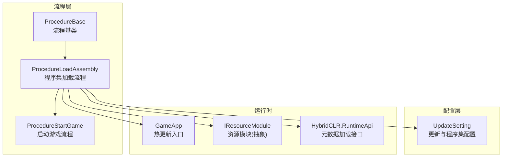
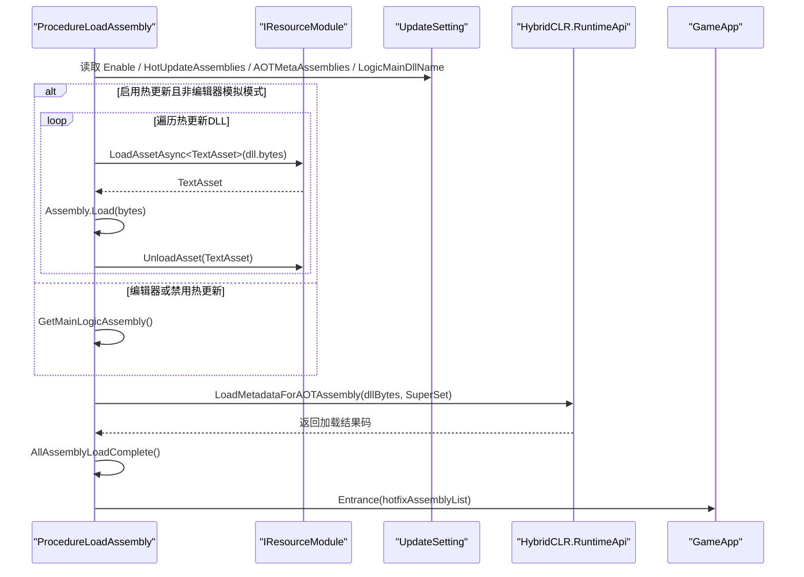
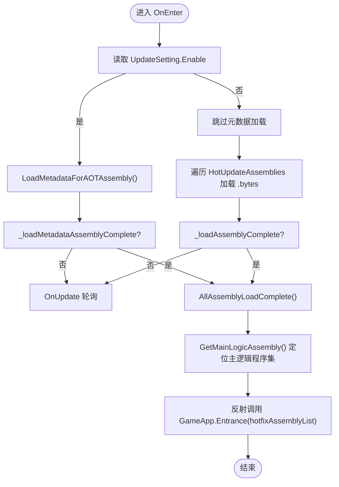
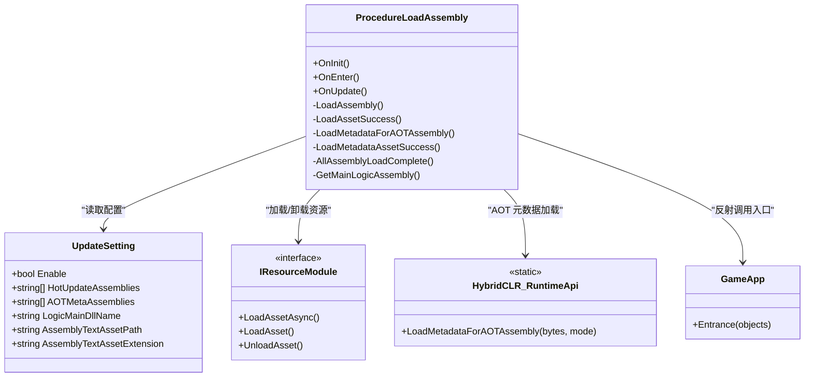

# 程序集加载流程 (ProcedureLoadAssembly)

<cite>
**本文引用的文件**   
- [ProcedureLoadAssembly.cs](file://UnityProject/Assets/GameScripts/Procedure/ProcedureLoadAssembly.cs)
- [ProcedureBase.cs](file://UnityProject/Assets/GameScripts/Procedure/ProcedureBase.cs)
- [UpdateSetting.cs](file://UnityProject/Assets/TEngine/Runtime/Core/UpdateSetting.cs)
- [ProcedureStartGame.cs](file://UnityProject/Assets/GameScripts/Procedure/ProcedureStartGame.cs)
- [GameApp.cs](file://UnityProject/Assets/GameScripts/HotFix/GameLogic/GameApp.cs)
</cite>

## 目录
1. [简介](#简介)
2. [项目结构](#项目结构)
3. [核心组件](#核心组件)
4. [架构总览](#架构总览)
5. [详细组件分析](#详细组件分析)
6. [依赖关系分析](#依赖关系分析)
7. [性能考量](#性能考量)
8. [故障排除指南](#故障排除指南)
9. [结论](#结论)
10. [附录](#附录)

## 简介
本文件聚焦于 TEngine 框架中的“程序集加载流程”（ProcedureLoadAssembly），系统性解析其在 Unity + HybridCLR 环境下的实现细节，包括：
- 动态 DLL 加载与资源获取路径选择
- AOT 程序集的元数据补充与解释执行回退
- 热更新程序集管理与主逻辑入口调用
- 版本与依赖的兼容性检查策略
- 卸载与内存泄漏防护机制
- 安全校验、错误处理与调试建议
- 最佳实践与常见问题排查

## 项目结构
该流程位于游戏启动流程中，负责在资源准备完成后加载主逻辑与热更新程序集，并触发热更新代码入口。

图表来源
- [ProcedureLoadAssembly.cs:19-48](file://UnityProject/Assets/GameScripts/Procedure/ProcedureLoadAssembly.cs#L19-L48)
- [ProcedureBase.cs:5-14](file://UnityProject/Assets/GameScripts/Procedure/ProcedureBase.cs#L5-L14)
- [UpdateSetting.cs:51-90](file://UnityProject/Assets/TEngine/Runtime/Core/UpdateSetting.cs#L51-L90)
- [ProcedureStartGame.cs:8-22](file://UnityProject/Assets/GameScripts/Procedure/ProcedureStartGame.cs#L8-L22)
- [GameApp.cs:17-34](file://UnityProject/Assets/GameScripts/HotFix/GameLogic/GameApp.cs#L17-L34)

章节来源
- [ProcedureLoadAssembly.cs:19-48](file://UnityProject/Assets/GameScripts/Procedure/ProcedureLoadAssembly.cs#L19-L48)
- [ProcedureBase.cs:5-14](file://UnityProject/Assets/GameScripts/Procedure/ProcedureBase.cs#L5-L14)
- [UpdateSetting.cs:51-90](file://UnityProject/Assets/TEngine/Runtime/Core/UpdateSetting.cs#L51-L90)
- [ProcedureStartGame.cs:8-22](file://UnityProject/Assets/GameScripts/Procedure/ProcedureStartGame.cs#L8-L22)
- [GameApp.cs:17-34](file://UnityProject/Assets/GameScripts/HotFix/GameLogic/GameApp.cs#L17-L34)

## 核心组件
- ProcedureLoadAssembly：负责加载主逻辑与热更新程序集，协调资源模块与 HybridCLR 元数据加载，最终调用 GameApp.Entrance。
- UpdateSetting：集中管理热更新开关、热更程序集列表、AOT 元数据程序集列表、主逻辑程序集名、资源路径等。
- ProcedureBase：流程基类，提供资源模块访问与原生对话框能力。
- ProcedureStartGame：承接加载完成后的游戏启动流程。
- GameApp：热更新域的主入口，接收已加载的热更新程序集集合并初始化业务逻辑。

章节来源
- [ProcedureLoadAssembly.cs:19-48](file://UnityProject/Assets/GameScripts/Procedure/ProcedureLoadAssembly.cs#L19-L48)
- [UpdateSetting.cs:51-90](file://UnityProject/Assets/TEngine/Runtime/Core/UpdateSetting.cs#L51-L90)
- [ProcedureBase.cs:5-14](file://UnityProject/Assets/GameScripts/Procedure/ProcedureBase.cs#L5-L14)
- [ProcedureStartGame.cs:8-22](file://UnityProject/Assets/GameScripts/Procedure/ProcedureStartGame.cs#L8-L22)
- [GameApp.cs:17-34](file://UnityProject/Assets/GameScripts/HotFix/GameLogic/GameApp.cs#L17-L34)

## 架构总览
下图展示从流程进入、资源加载、AOT 元数据补充到热更新入口调用的完整时序。

图表来源
- [ProcedureLoadAssembly.cs:50-108](file://UnityProject/Assets/GameScripts/Procedure/ProcedureLoadAssembly.cs#L50-L108)
- [ProcedureLoadAssembly.cs:185-218](file://UnityProject/Assets/GameScripts/Procedure/ProcedureLoadAssembly.cs#L185-L218)
- [ProcedureLoadAssembly.cs:224-292](file://UnityProject/Assets/GameScripts/Procedure/ProcedureLoadAssembly.cs#L224-L292)
- [UpdateSetting.cs:59-90](file://UnityProject/Assets/TEngine/Runtime/Core/UpdateSetting.cs#L59-L90)
- [GameApp.cs:25-34](file://UnityProject/Assets/GameScripts/HotFix/GameLogic/GameApp.cs#L25-L34)

## 详细组件分析

### 程序集加载流程（ProcedureLoadAssembly）
职责与关键点
- 生命周期：OnInit 读取配置；OnEnter 异步启动加载；OnUpdate 轮询完成状态并切换流程。
- 资源加载：根据 UpdateSetting.HotUpdateAssemblies 逐个加载 .bytes 文本资产，使用 Assembly.Load(byte[]) 载入程序集。
- AOT 元数据：通过 HybridCLR.RuntimeApi.LoadMetadataForAOTAssembly 为 AOT 程序集补充元数据，使缺失 native 实现的泛型方法回退至解释器执行。
- 主逻辑装配：在已加载的程序集中查找 LogicMainDllName 对应程序集，并通过反射调用 GameApp.Entrance，传入热更新程序集列表。
- 资源释放：每次加载成功后立即调用 IResourceModule.UnloadAsset 释放 TextAsset，避免内存堆积。

关键流程说明
- 条件分支：当 UpdateSetting.Enable 为真且非编辑器模拟模式时走热更新加载路径；否则直接扫描当前 AppDomain 获取主逻辑程序集。
- 并发控制：使用计数器 _loadAssetCount/_loadMetadataAssetCount 与等待标志位 _loadAssemblyWait/_loadMetadataAssemblyWait 确保所有资源加载完成后才推进流程。
- 错误处理：捕获异常并记录日志，同时递增失败计数；对缺失主逻辑程序集或缺少入口类型/方法给出致命日志提示。

图表来源
- [ProcedureLoadAssembly.cs:42-48](file://UnityProject/Assets/GameScripts/Procedure/ProcedureLoadAssembly.cs#L42-L48)
- [ProcedureLoadAssembly.cs:50-108](file://UnityProject/Assets/GameScripts/Procedure/ProcedureLoadAssembly.cs#L50-L108)
- [ProcedureLoadAssembly.cs:110-122](file://UnityProject/Assets/GameScripts/Procedure/ProcedureLoadAssembly.cs#L110-L122)
- [ProcedureLoadAssembly.cs:124-150](file://UnityProject/Assets/GameScripts/Procedure/ProcedureLoadAssembly.cs#L124-L150)
- [ProcedureLoadAssembly.cs:185-218](file://UnityProject/Assets/GameScripts/Procedure/ProcedureLoadAssembly.cs#L185-L218)
- [ProcedureLoadAssembly.cs:224-292](file://UnityProject/Assets/GameScripts/Procedure/ProcedureLoadAssembly.cs#L224-L292)

章节来源
- [ProcedureLoadAssembly.cs:36-48](file://UnityProject/Assets/GameScripts/Procedure/ProcedureLoadAssembly.cs#L36-L48)
- [ProcedureLoadAssembly.cs:50-108](file://UnityProject/Assets/GameScripts/Procedure/ProcedureLoadAssembly.cs#L50-L108)
- [ProcedureLoadAssembly.cs:110-150](file://UnityProject/Assets/GameScripts/Procedure/ProcedureLoadAssembly.cs#L110-L150)
- [ProcedureLoadAssembly.cs:185-218](file://UnityProject/Assets/GameScripts/Procedure/ProcedureLoadAssembly.cs#L185-L218)
- [ProcedureLoadAssembly.cs:224-292](file://UnityProject/Assets/GameScripts/Procedure/ProcedureLoadAssembly.cs#L224-L292)

### 配置中心（UpdateSetting）
作用
- 统一暴露热更新开关、热更新程序集列表、AOT 元数据程序集列表、主逻辑程序集名称、资源路径与扩展名等关键参数。
- 提供平台相关的路径计算与构建地址工具方法。

重点字段
- Enable：编译期宏 ENABLE_HYBRIDCLR 决定热更新是否启用。
- HotUpdateAssemblies：待加载的热更新 DLL 名称列表。
- AOTMetaAssemblies：需要补充元数据的 AOT 程序集列表。
- LogicMainDllName：主逻辑程序集名称（不含后缀）。
- AssemblyTextAssetPath / AssemblyTextAssetExtension：程序集作为 TextAsset 的资源路径与扩展名。

章节来源
- [UpdateSetting.cs:51-90](file://UnityProject/Assets/TEngine/Runtime/Core/UpdateSetting.cs#L51-L90)
- [UpdateSetting.cs:167-218](file://UnityProject/Assets/TEngine/Runtime/Core/UpdateSetting.cs#L167-L218)

### 热更新入口（GameApp）
作用
- 作为热更新域的主入口，接收已加载的热更新程序集列表，进行事件系统初始化、UI 展示等逻辑。
- 注册销毁监听，统一释放单例系统等资源。

章节来源
- [GameApp.cs:17-34](file://UnityProject/Assets/GameScripts/HotFix/GameLogic/GameApp.cs#L17-L34)
- [GameApp.cs:36-46](file://UnityProject/Assets/GameScripts/HotFix/GameLogic/GameApp.cs#L36-L46)

### 流程衔接（ProcedureStartGame）
作用
- 承接程序集加载完成后的流程，隐藏 UI 并继续后续游戏逻辑。

章节来源
- [ProcedureStartGame.cs:8-22](file://UnityProject/Assets/GameScripts/Procedure/ProcedureStartGame.cs#L8-L22)

## 依赖关系分析
- ProcedureLoadAssembly 依赖：
  - IResourceModule：用于加载/卸载 TextAsset 形式的程序集资源。
  - UpdateSetting：读取热更新与 AOT 元数据配置。
  - HybridCLR.RuntimeApi：为 AOT 程序集加载元数据。
  - System.Reflection.Assembly：动态加载程序集。
  - GameApp：反射调用热更新入口。

图表来源
- [ProcedureLoadAssembly.cs:19-48](file://UnityProject/Assets/GameScripts/Procedure/ProcedureLoadAssembly.cs#L19-L48)
- [ProcedureLoadAssembly.cs:185-218](file://UnityProject/Assets/GameScripts/Procedure/ProcedureLoadAssembly.cs#L185-L218)
- [ProcedureLoadAssembly.cs:224-292](file://UnityProject/Assets/GameScripts/Procedure/ProcedureLoadAssembly.cs#L224-L292)
- [UpdateSetting.cs:51-90](file://UnityProject/Assets/TEngine/Runtime/Core/UpdateSetting.cs#L51-L90)
- [GameApp.cs:25-34](file://UnityProject/Assets/GameScripts/HotFix/GameLogic/GameApp.cs#L25-L34)

章节来源
- [ProcedureLoadAssembly.cs:19-48](file://UnityProject/Assets/GameScripts/Procedure/ProcedureLoadAssembly.cs#L19-L48)
- [UpdateSetting.cs:51-90](file://UnityProject/Assets/TEngine/Runtime/Core/UpdateSetting.cs#L51-L90)
- [GameApp.cs:25-34](file://UnityProject/Assets/GameScripts/HotFix/GameLogic/GameApp.cs#L25-L34)

## 性能考量
- 资源加载优化
  - 使用异步加载（LoadAssetAsync）避免阻塞主线程。
  - 每加载一个 TextAsset 后立即 UnloadAsset，降低峰值内存占用。
- AOT 元数据加载
  - 仅在必要时加载 AOT 元数据，避免不必要的开销。
  - 使用 HomologousImageMode.SuperSet 以最小代价启用解释器回退。
- 程序集扫描
  - 在编辑器模式下可跳过远程下载，直接扫描 AppDomain 内已加载程序集，减少网络与 IO 开销。
- 建议
  - 合理拆分热更新程序集，避免单个 DLL 过大导致加载时间过长。
  - 将常用库放入 AOT 元数据列表，减少首次运行时的解释器开销。

[本节为通用指导，不直接分析具体文件]

## 故障排除指南
常见问题与定位要点
- 主逻辑程序集缺失
  - 现象：无法找到 LogicMainDllName 对应的程序集。
  - 排查：确认 Player Settings 中已定义 ENABLE_HYBRIDCLR；确认 LogicMainDllName.bytes 存在且路径正确。
- 入口类型或方法缺失
  - 现象：找不到 GameApp 类型或 Entrance 方法。
  - 排查：确认热更新程序集包含 GameApp 类型及静态 Entrance 方法，且未被混淆破坏。
- AOT 元数据加载失败
  - 现象：AOT 泛型方法在缺少 native 实现时报错。
  - 排查：确认 AOTMetaAssemblies 列表包含所需 AOT 程序集；确认打包产物与裁剪后 DLL 一致。
- 资源加载失败
  - 现象：TextAsset 为空或加载异常。
  - 排查：检查资源路径与扩展名；确认 Addressable 或 AssetRaw/DLL 路径配置正确；关注失败计数与日志。

章节来源
- [ProcedureLoadAssembly.cs:124-150](file://UnityProject/Assets/GameScripts/Procedure/ProcedureLoadAssembly.cs#L124-L150)
- [ProcedureLoadAssembly.cs:185-218](file://UnityProject/Assets/GameScripts/Procedure/ProcedureLoadAssembly.cs#L185-L218)
- [ProcedureLoadAssembly.cs:224-292](file://UnityProject/Assets/GameScripts/Procedure/ProcedureLoadAssembly.cs#L224-L292)

## 结论
ProcedureLoadAssembly 在 TEngine 中承担了热更新程序集加载与 AOT 元数据补充的关键职责。其设计通过配置驱动、异步加载、及时释放与严格的入口校验，确保了热更新流程的稳定与可控。结合 HybridCLR 的解释器回退机制，系统在保持性能的同时提供了灵活的运行时扩展能力。遵循本文的最佳实践与排障建议，可有效提升热更新的可靠性与可维护性。

[本节为总结性内容，不直接分析具体文件]

## 附录
- 热更新开发最佳实践
  - 将稳定公共库纳入 AOT 元数据，减少解释器开销。
  - 热更新程序集尽量小而精，按功能域拆分，便于增量更新。
  - 在入口方法中进行必要的版本与依赖校验，避免不兼容部署。
  - 使用统一的日志与错误上报机制，便于线上问题追踪。
- 调试与性能分析方法
  - 使用 Unity Profiler 观察程序集加载阶段的 CPU 与内存峰值。
  - 开启 HybridCLR 日志输出，定位解释器回退与元数据加载情况。
  - 针对大程序集进行分块加载与延迟初始化，降低首帧卡顿。

[本节为通用指导，不直接分析具体文件]