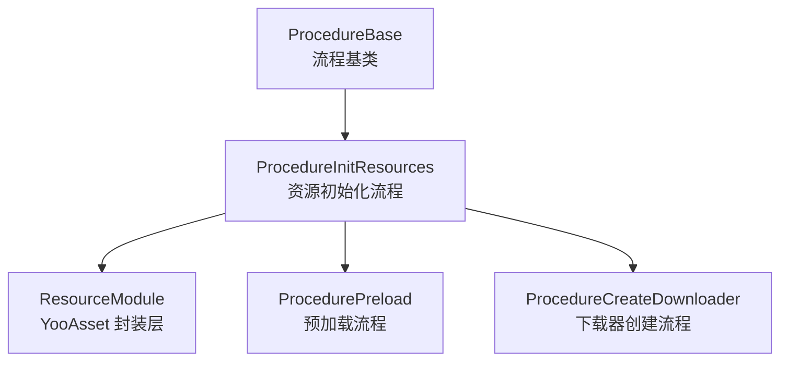
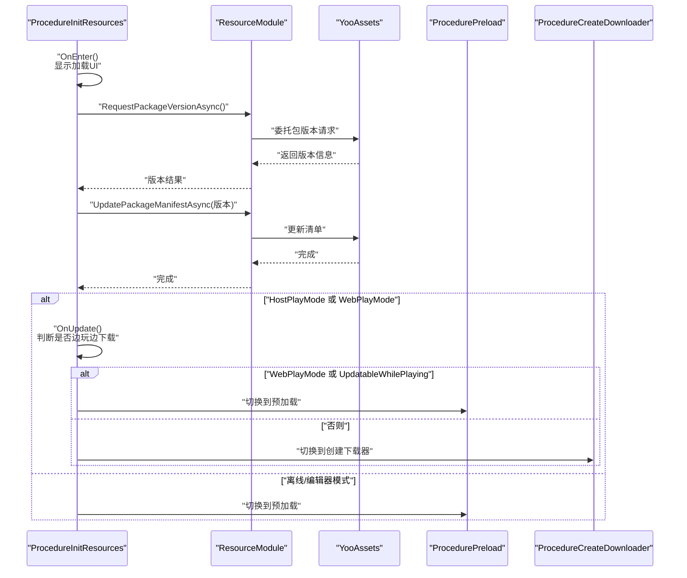
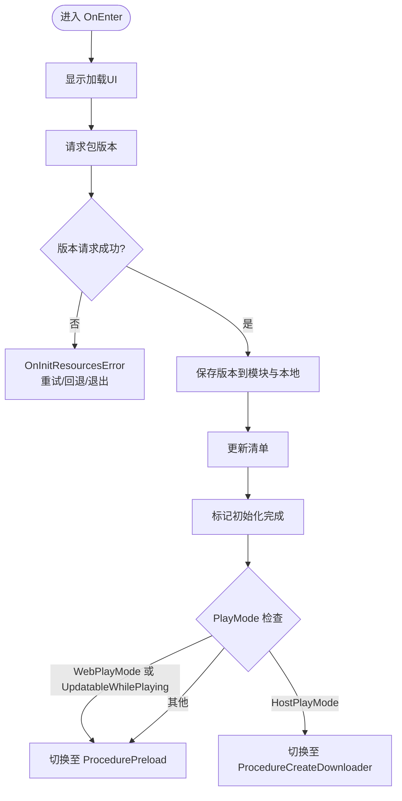
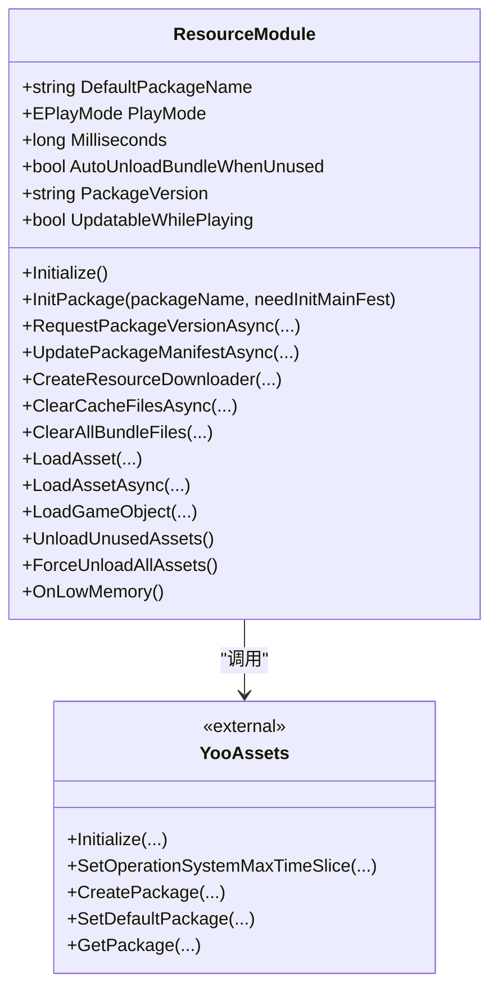
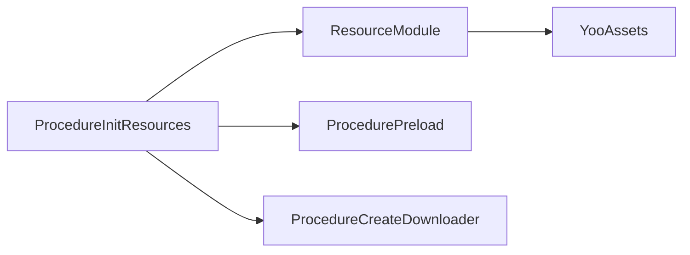

# 资源初始化流程 (ProcedureInitResources)

<cite>
**本文引用的文件**   
- [ProcedureInitResources.cs](file://UnityProject/Assets/GameScripts/Procedure/ProcedureInitResources.cs)
- [ResourceModule.cs](file://UnityProject/Assets/TEngine/Runtime/Module/ResourceModule/ResourceModule.cs)
- [ProcedureBase.cs](file://UnityProject/Assets/GameScripts/Procedure/ProcedureBase.cs)
- [ProcedurePreload.cs](file://UnityProject/Assets/GameScripts/Procedure/ProcedurePreload.cs)
- [ProcedureCreateDownloader.cs](file://UnityProject/Assets/GameScripts/Procedure/ProcedureCreateDownloader.cs)
</cite>

## 目录
1. [简介](#简介)
2. [项目结构](#项目结构)
3. [核心组件](#核心组件)
4. [架构总览](#架构总览)
5. [详细组件分析](#详细组件分析)
6. [依赖关系分析](#依赖关系分析)
7. [性能与内存管理](#性能与内存管理)
8. [故障排查指南](#故障排查指南)
9. [结论](#结论)
10. [附录：最佳实践与常见问题](#附录最佳实践与常见问题)

## 简介
本文围绕“资源初始化流程（ProcedureInitResources）”展开，系统性解析其在 TEngine + YooAsset 体系中的职责、实现细节与扩展点。重点覆盖：
- YooAsset 引擎初始化与资源包配置
- 缓存策略与下载器创建
- 资源组管理与预加载
- 初始化顺序与依赖处理
- 错误恢复机制与重试策略
- 多平台差异（Host/WebGL/Offline/Editor）
- 内存管理与异步优化
- 监控与调优建议、预加载最佳实践与常见问题

## 项目结构
本流程涉及的核心文件与角色如下：
- ProcedureInitResources：负责启动资源初始化、获取并更新清单版本、根据运行模式决定后续流程（下载或预加载）。
- ResourceModule：封装 YooAsset 的初始化、包管理、资源加载、缓存清理、低内存回收等能力。
- ProcedureBase：流程基类，提供 _resourceModule 访问入口。
- ProcedurePreload：预加载阶段，按标签批量加载资源。
- ProcedureCreateDownloader：创建补丁下载器，进入下载流程。

图表来源
- [ProcedureInitResources.cs:10-171](file://UnityProject/Assets/GameScripts/Procedure/ProcedureInitResources.cs#L10-L171)
- [ResourceModule.cs:119-261](file://UnityProject/Assets/TEngine/Runtime/Module/ResourceModule/ResourceModule.cs#L119-L261)
- [ProcedurePreload.cs:16-175](file://UnityProject/Assets/GameScripts/Procedure/ProcedurePreload.cs#L16-L175)
- [ProcedureCreateDownloader.cs:14-76](file://UnityProject/Assets/GameScripts/Procedure/ProcedureCreateDownloader.cs#L14-L76)
- [ProcedureBase.cs:5-14](file://UnityProject/Assets/GameScripts/Procedure/ProcedureBase.cs#L5-L14)

章节来源
- [ProcedureInitResources.cs:10-171](file://UnityProject/Assets/GameScripts/Procedure/ProcedureInitResources.cs#L10-L171)
- [ResourceModule.cs:119-261](file://UnityProject/Assets/TEngine/Runtime/Module/ResourceModule/ResourceModule.cs#L119-L261)
- [ProcedurePreload.cs:16-175](file://UnityProject/Assets/GameScripts/Procedure/ProcedurePreload.cs#L16-L175)
- [ProcedureCreateDownloader.cs:14-76](file://UnityProject/Assets/GameScripts/Procedure/ProcedureCreateDownloader.cs#L14-L76)
- [ProcedureBase.cs:5-14](file://UnityProject/Assets/GameScripts/Procedure/ProcedureBase.cs#L5-L14)

## 核心组件
- ProcedureInitResources
  - 职责：启动资源初始化；请求并更新清单版本；根据 PlayMode 决定进入下载或预加载；处理网络异常与可选更新策略。
  - 关键行为：
    - 显示加载 UI，协程执行 InitResources。
    - RequestPackageVersionAsync -> UpdatePackageManifestAsync。
    - OnUpdate 中根据 HostPlayMode/WebPlayMode/UpdatableWhilePlaying 分流。
    - 失败时弹窗重试或回退到本地版本继续游戏。
- ResourceModule
  - 职责：YooAsset 初始化、默认包创建、各运行模式参数装配、包清单操作、资源加载与缓存、下载器创建、缓存清理、低内存回收。
  - 关键行为：
    - Initialize() 调用 YooAssets.Initialize 并设置默认包。
    - InitPackage() 根据 EditorSimulateMode/OfflinePlayMode/HostPlayMode/WebPlayMode 装配不同参数。
    - CreateResourceDownloader() 创建下载器。
    - ClearCacheFilesAsync()/ClearAllBundleFiles() 清理缓存。
    - UnloadUnusedAssets()/ForceUnloadAllAssets()/OnLowMemory() 内存回收。
- ProcedurePreload
  - 职责：按标签（如 PRELOAD、WEBGL_PRELOAD）批量预加载资源，更新进度 UI，完成后进入程序集加载流程。
- ProcedureCreateDownloader
  - 职责：创建下载器，统计待下载数量与大小，弹出确认对话框后进入下载流程。

章节来源
- [ProcedureInitResources.cs:10-171](file://UnityProject/Assets/GameScripts/Procedure/ProcedureInitResources.cs#L10-L171)
- [ResourceModule.cs:119-261](file://UnityProject/Assets/TEngine/Runtime/Module/ResourceModule/ResourceModule.cs#L119-L261)
- [ResourceModule.cs:346-388](file://UnityProject/Assets/TEngine/Runtime/Module/ResourceModule/ResourceModule.cs#L346-L388)
- [ResourceModule.cs:392-447](file://UnityProject/Assets/TEngine/Runtime/Module/ResourceModule/ResourceModule.cs#L392-L447)
- [ProcedurePreload.cs:16-175](file://UnityProject/Assets/GameScripts/Procedure/ProcedurePreload.cs#L16-L175)
- [ProcedureCreateDownloader.cs:14-76](file://UnityProject/Assets/GameScripts/Procedure/ProcedureCreateDownloader.cs#L14-L76)

## 架构总览
下图展示从“资源初始化”到“预加载/下载”的整体时序与模块交互。

图表来源
- [ProcedureInitResources.cs:18-105](file://UnityProject/Assets/GameScripts/Procedure/ProcedureInitResources.cs#L18-L105)
- [ResourceModule.cs:314-341](file://UnityProject/Assets/TEngine/Runtime/Module/ResourceModule/ResourceModule.cs#L314-L341)
- [ProcedurePreload.cs:41-100](file://UnityProject/Assets/GameScripts/Procedure/ProcedurePreload.cs#L41-L100)
- [ProcedureCreateDownloader.cs:30-74](file://UnityProject/Assets/GameScripts/Procedure/ProcedureCreateDownloader.cs#L30-L74)

## 详细组件分析

### ProcedureInitResources：资源初始化流程
- 初始化入口
  - OnEnter 显示加载 UI，并通过协程启动 InitResources。
- 清单版本与更新
  - 先请求远程包版本，成功后保存至 ResourceModule.PackageVersion 与本地持久化键。
  - 使用版本调用 UpdatePackageManifestAsync 更新清单。
- 流程分支
  - OnUpdate 中根据 PlayMode 与 UpdatableWhilePlaying 决定：
    - WebPlayMode 或 UpdatableWhilePlaying：直接进入预加载。
    - HostPlayMode：进入下载器创建流程。
    - 其他模式：直接进入预加载。
- 错误恢复
  - OnInitResourcesError 区分 HostPlayMode 与非 HostPlayMode：
    - HostPlayMode：若无需强制更新，则尝试读取本地已记录版本继续；否则弹窗重试或退出。
    - 非 HostPlayMode：统一弹窗重试或退出。
  - IsNeedUpdate 处理可选更新场景：若无本地版本记录则提示需要更新；若为可选更新且用户选择跳过，则直接预加载。

图表来源
- [ProcedureInitResources.cs:18-105](file://UnityProject/Assets/GameScripts/Procedure/ProcedureInitResources.cs#L18-L105)
- [ProcedureInitResources.cs:112-170](file://UnityProject/Assets/GameScripts/Procedure/ProcedureInitResources.cs#L112-L170)

章节来源
- [ProcedureInitResources.cs:18-105](file://UnityProject/Assets/GameScripts/Procedure/ProcedureInitResources.cs#L18-L105)
- [ProcedureInitResources.cs:112-170](file://UnityProject/Assets/GameScripts/Procedure/ProcedureInitResources.cs#L112-L170)

### ResourceModule：YooAsset 封装与资源管理
- 引擎初始化
  - Initialize() 调用 YooAssets.Initialize，设置每帧最大时间切片，创建并设置默认包，注入对象池模块。
- 包初始化（InitPackage）
  - 根据运行模式装配不同参数：
    - EditorSimulateMode：编辑器模拟构建。
    - OfflinePlayMode：内置文件系统。
    - HostPlayMode：内置+缓存文件系统，远端服务。
    - WebPlayMode：WebRemote/WebServer 文件系统，支持微信小游戏特殊路径。
  - 可选择在初始化后自动请求并更新清单（needInitMainFest）。
- 清单与版本
  - RequestPackageVersionAsync / UpdatePackageManifestAsync 封装包级操作。
- 下载与缓存
  - CreateResourceDownloader 创建下载器，支持并发数与重试次数。
  - ClearCacheFilesAsync / ClearAllBundleFiles 清理缓存。
- 资源加载与缓存
  - 同步/异步加载接口，内部通过 AssetHandle 与对象池复用，避免重复加载。
  - TryWaitingLoading 防止同一资源的并发重复加载。
- 内存回收
  - OnLowMemory 触发强制卸载回调。
  - UnloadUnusedAssets / ForceUnloadAllAssets 释放未引用资源。

图表来源
- [ResourceModule.cs:119-138](file://UnityProject/Assets/TEngine/Runtime/Module/ResourceModule/ResourceModule.cs#L119-L138)
- [ResourceModule.cs:140-261](file://UnityProject/Assets/TEngine/Runtime/Module/ResourceModule/ResourceModule.cs#L140-L261)
- [ResourceModule.cs:314-341](file://UnityProject/Assets/TEngine/Runtime/Module/ResourceModule/ResourceModule.cs#L314-L341)
- [ResourceModule.cs:346-388](file://UnityProject/Assets/TEngine/Runtime/Module/ResourceModule/ResourceModule.cs#L346-L388)
- [ResourceModule.cs:692-870](file://UnityProject/Assets/TEngine/Runtime/Module/ResourceModule/ResourceModule.cs#L692-L870)
- [ResourceModule.cs:935-1129](file://UnityProject/Assets/TEngine/Runtime/Module/ResourceModule/ResourceModule.cs#L935-L1129)
- [ResourceModule.cs:1199-1221](file://UnityProject/Assets/TEngine/Runtime/Module/ResourceModule/ResourceModule.cs#L1199-L1221)
- [ResourceModule.cs:392-447](file://UnityProject/Assets/TEngine/Runtime/Module/ResourceModule/ResourceModule.cs#L392-L447)

章节来源
- [ResourceModule.cs:119-138](file://UnityProject/Assets/TEngine/Runtime/Module/ResourceModule/ResourceModule.cs#L119-L138)
- [ResourceModule.cs:140-261](file://UnityProject/Assets/TEngine/Runtime/Module/ResourceModule/ResourceModule.cs#L140-L261)
- [ResourceModule.cs:314-341](file://UnityProject/Assets/TEngine/Runtime/Module/ResourceModule/ResourceModule.cs#L314-L341)
- [ResourceModule.cs:346-388](file://UnityProject/Assets/TEngine/Runtime/Module/ResourceModule/ResourceModule.cs#L346-L388)
- [ResourceModule.cs:692-870](file://UnityProject/Assets/TEngine/Runtime/Module/ResourceModule/ResourceModule.cs#L692-L870)
- [ResourceModule.cs:935-1129](file://UnityProject/Assets/TEngine/Runtime/Module/ResourceModule/ResourceModule.cs#L935-L1129)
- [ResourceModule.cs:1199-1221](file://UnityProject/Assets/TEngine/Runtime/Module/ResourceModule/ResourceModule.cs#L1199-L1221)
- [ResourceModule.cs:392-447](file://UnityProject/Assets/TEngine/Runtime/Module/ResourceModule/ResourceModule.cs#L392-L447)

### ProcedurePreload：预加载流程
- 功能要点
  - 按标签（PRELOAD、WEBGL_PRELOAD）批量加载资源。
  - 维护加载状态字典，更新进度 UI。
  - 全部加载完成后切换到程序集加载流程。
- 关键点
  - 编辑器模拟模式下跳过配置预加载。
  - WebGL 平台额外加载 WEBGL_PRELOAD 标签资源。

章节来源
- [ProcedurePreload.cs:16-175](file://UnityProject/Assets/GameScripts/Procedure/ProcedurePreload.cs#L16-L175)

### ProcedureCreateDownloader：下载器创建流程
- 功能要点
  - 延迟创建下载器，统计待下载文件数与大小。
  - 弹出确认对话框，确认后进入下载流程。
- 关键点
  - 若无待下载文件，直接跳转到下载结束流程。

章节来源
- [ProcedureCreateDownloader.cs:14-76](file://UnityProject/Assets/GameScripts/Procedure/ProcedureCreateDownloader.cs#L14-L76)

## 依赖关系分析
- ProcedureInitResources 依赖 IResourceModule（通过 ProcedureBase._resourceModule）进行清单版本与清单更新。
- ResourceModule 依赖 YooAssets 进行引擎初始化、包创建、清单操作、资源加载与缓存管理。
- ProcedurePreload 与 ProcedureCreateDownloader 由 ProcedureInitResources 根据运行模式调度。

图表来源
- [ProcedureInitResources.cs:10-171](file://UnityProject/Assets/GameScripts/Procedure/ProcedureInitResources.cs#L10-L171)
- [ResourceModule.cs:119-261](file://UnityProject/Assets/TEngine/Runtime/Module/ResourceModule/ResourceModule.cs#L119-L261)
- [ProcedurePreload.cs:16-175](file://UnityProject/Assets/GameScripts/Procedure/ProcedurePreload.cs#L16-L175)
- [ProcedureCreateDownloader.cs:14-76](file://UnityProject/Assets/GameScripts/Procedure/ProcedureCreateDownloader.cs#L14-L76)

章节来源
- [ProcedureInitResources.cs:10-171](file://UnityProject/Assets/GameScripts/Procedure/ProcedureInitResources.cs#L10-L171)
- [ResourceModule.cs:119-261](file://UnityProject/Assets/TEngine/Runtime/Module/ResourceModule/ResourceModule.cs#L119-L261)
- [ProcedurePreload.cs:16-175](file://UnityProject/Assets/GameScripts/Procedure/ProcedurePreload.cs#L16-L175)
- [ProcedureCreateDownloader.cs:14-76](file://UnityProject/Assets/GameScripts/Procedure/ProcedureCreateDownloader.cs#L14-L76)

## 性能与内存管理
- 异步系统参数
  - ResourceModule.Milliseconds 控制 YooAsset 每帧最大时间切片，避免卡顿。
- 并发与去重
  - _assetLoadingList 防止同一资源被重复异步加载，TryWaitingLoading 等待已有加载完成。
- 对象池与缓存
  - 同步/异步加载均通过对象池复用 AssetObject，减少 GC 压力。
- 低内存回收
  - OnLowMemory 触发强制卸载回调；Unl oadUnusedAssets/ForceUnloadAllAssets 按需释放。
- 平台差异
  - WebGL 不支持 ForceUnloadAllAssets，需避免调用。
- 下载与缓存清理
  - CreateResourceDownloader 支持并发与重试；ClearCacheFilesAsync/ClearAllBundleFiles 清理无用缓存。

章节来源
- [ResourceModule.cs:119-138](file://UnityProject/Assets/TEngine/Runtime/Module/ResourceModule/ResourceModule.cs#L119-L138)
- [ResourceModule.cs:692-870](file://UnityProject/Assets/TEngine/Runtime/Module/ResourceModule/ResourceModule.cs#L692-L870)
- [ResourceModule.cs:935-1129](file://UnityProject/Assets/TEngine/Runtime/Module/ResourceModule/ResourceModule.cs#L935-L1129)
- [ResourceModule.cs:1199-1221](file://UnityProject/Assets/TEngine/Runtime/Module/ResourceModule/ResourceModule.cs#L1199-L1221)
- [ResourceModule.cs:346-388](file://UnityProject/Assets/TEngine/Runtime/Module/ResourceModule/ResourceModule.cs#L346-L388)
- [ResourceModule.cs:392-447](file://UnityProject/Assets/TEngine/Runtime/Module/ResourceModule/ResourceModule.cs#L392-L447)

## 故障排查指南
- 清单版本请求失败
  - 现象：OnInitResourcesError 弹窗提示“获取远程版本失败”。
  - 处理：HostPlayMode 下若为非强制更新，尝试读取本地 GAME_VERSION 继续；否则提示重试或退出。
- 可选更新策略
  - 现象：IsNeedUpdate 检测到可选更新但无本地版本记录。
  - 处理：提示需要更新；若 UpdateNotice=Notice，可引导用户完成更新或跳过进入游戏。
- WebGL 平台限制
  - 现象：ForceUnloadAllAssets 不可用。
  - 处理：避免调用，改用 UnloadUnusedAssets 与合理的资源生命周期管理。
- 重复加载与超时
  - 现象：TryWaitingLoading 在编辑器环境下有超时保护。
  - 处理：检查资源定位地址与包配置，确保清单正确。

章节来源
- [ProcedureInitResources.cs:112-170](file://UnityProject/Assets/GameScripts/Procedure/ProcedureInitResources.cs#L112-L170)
- [ResourceModule.cs:429-441](file://UnityProject/Assets/TEngine/Runtime/Module/ResourceModule/ResourceModule.cs#L429-L441)
- [ResourceModule.cs:1199-1221](file://UnityProject/Assets/TEngine/Runtime/Module/ResourceModule/ResourceModule.cs#L1199-L1221)

## 结论
ProcedureInitResources 作为资源初始化的入口，协调清单版本获取与更新，并根据运行模式智能分流至下载或预加载。ResourceModule 对 YooAsset 进行了全面封装，提供跨平台一致的初始化与加载体验，同时兼顾性能与内存管理。通过合理的预加载策略与缓存清理，可在保证用户体验的同时有效控制资源占用。

## 附录：最佳实践与常见问题
- 预加载最佳实践
  - 将首屏必需资源标记为 PRELOAD 标签，WebGL 平台额外使用 WEBGL_PRELOAD。
  - 合理划分资源包，避免单包过大导致首次加载耗时过长。
  - 使用 UpdatableWhilePlaying 实现边玩边下载，提升首开速度。
- 性能调优技巧
  - 调整 ResourceModule.Milliseconds 以平衡加载吞吐与帧率。
  - 启用 AutoUnloadBundleWhenUnused 自动卸载未使用的包。
  - 定期调用 UnloadUnusedAssets 或在低内存事件触发时强制卸载。
- 常见问题解决方案
  - HTTP 404：单机模式需确保 AssetBundle 已构建并复制到 StreamingAssets。
  - 网络异常：结合 IsNeedUpdate 与本地版本记录，提供降级方案。
  - WebGL 内存问题：避免强制全量卸载，采用增量卸载与对象池复用。

章节来源
- [ProcedurePreload.cs:118-156](file://UnityProject/Assets/GameScripts/Procedure/ProcedurePreload.cs#L118-L156)
- [ResourceModule.cs:119-138](file://UnityProject/Assets/TEngine/Runtime/Module/ResourceModule/ResourceModule.cs#L119-L138)
- [ResourceModule.cs:392-447](file://UnityProject/Assets/TEngine/Runtime/Module/ResourceModule/ResourceModule.cs#L392-L447)
- [ProcedureInitResources.cs:28-30](file://UnityProject/Assets/GameScripts/Procedure/ProcedureInitResources.cs#L28-L30)