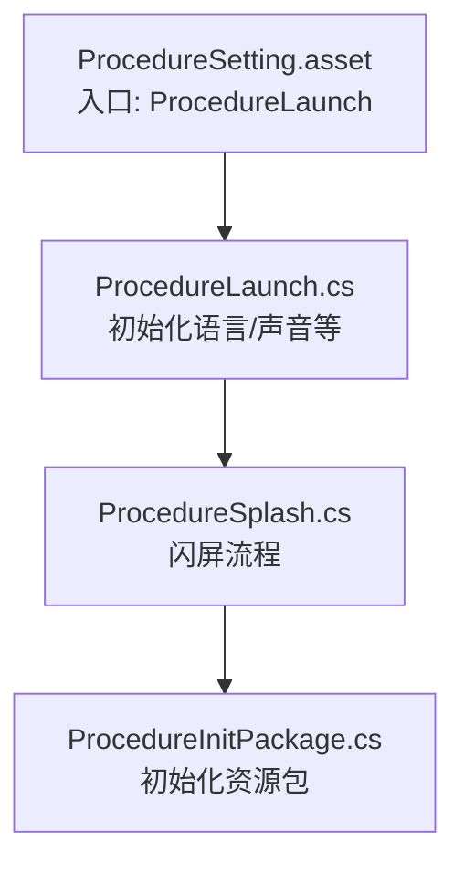
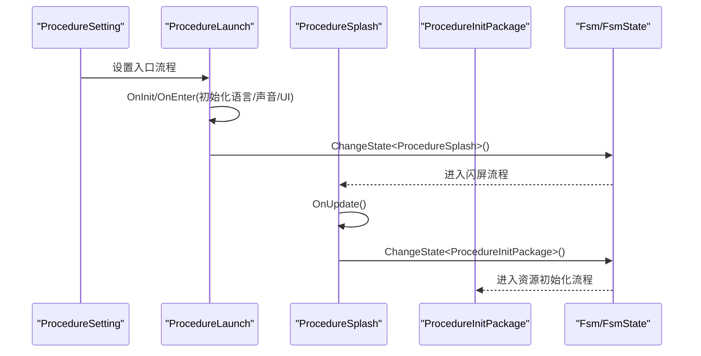
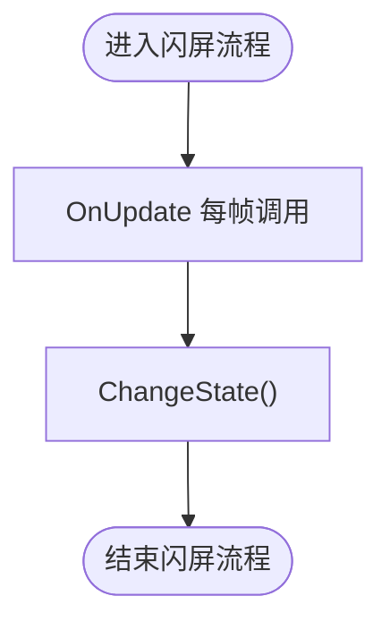
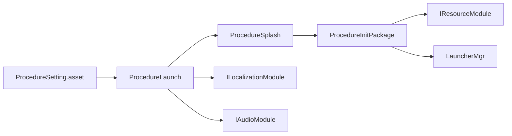

# 闪屏流程 (ProcedureSplash)

<cite>
**本文引用的文件**   
- [ProcedureSplash.cs](file://UnityProject/Assets/GameScripts/Procedure/ProcedureSplash.cs)
- [ProcedureBase.cs（游戏层）](file://UnityProject/Assets/GameScripts/Procedure/ProcedureBase.cs)
- [ProcedureBase.cs（框架层）](file://UnityProject/Assets/TEngine/Runtime/Module/ProcedureModule/ProcedureBase.cs)
- [FsmState.cs](file://UnityProject/Assets/TEngine/Runtime/Module/FsmModule/FsmState.cs)
- [Fsm.cs](file://UnityProject/Assets/TEngine/Runtime/Module/FsmModule/Fsm.cs)
- [ProcedureSetting.asset](file://UnityProject/Assets/TEngine/Settings/ProcedureSetting.asset)
- [ProcedureLaunch.cs](file://UnityProject/Assets/GameScripts/Procedure/ProcedureLaunch.cs)
- [ProcedureInitPackage.cs](file://UnityProject/Assets/GameScripts/Procedure/ProcedureInitPackage.cs)
</cite>

## 目录
1. [简介](#简介)
2. [项目结构](#项目结构)
3. [核心组件](#核心组件)
4. [架构总览](#架构总览)
5. [详细组件分析](#详细组件分析)
6. [依赖关系分析](#依赖关系分析)
7. [性能与体验优化](#性能与体验优化)
8. [故障排查指南](#故障排查指南)
9. [结论](#结论)
10. [附录：自定义与扩展指南](#附录自定义与扩展指南)

## 简介
本文件聚焦于 TEngine 中的“闪屏流程”（ProcedureSplash），系统性地梳理其实现细节、生命周期管理、资源加载衔接、状态转换条件与参数传递机制，并给出可操作的自定义配置方法与性能优化建议。同时提供流程图与时序图，帮助读者快速理解从启动到闪屏再到后续流程的完整链路。

## 项目结构
- 流程定义位于 Unity 项目的 GameScripts/Procedure 目录下，闪屏流程由 ProcedureSplash.cs 实现。
- 流程基类在两个层面存在：
  - 框架层：TEngine.Runtime.Module.ProcedureModule.ProcedureBase，定义了流程状态的生命周期钩子（OnInit/OnEnter/OnUpdate/OnLeave/OnDestroy）。
  - 游戏层：GameScripts/Procedure.ProcedureBase，为业务流程提供统一入口与资源模块访问能力。
- 流程注册与入口通过 ProcedureSetting.asset 配置，默认入口流程为 ProcedureLaunch，随后进入 ProcedureSplash。

图表来源
- [ProcedureSetting.asset:15-27](file://UnityProject/Assets/TEngine/Settings/ProcedureSetting.asset#L15-L27)
- [ProcedureLaunch.cs:37-43](file://UnityProject/Assets/GameScripts/Procedure/ProcedureLaunch.cs#L37-L43)
- [ProcedureSplash.cs:13-20](file://UnityProject/Assets/GameScripts/Procedure/ProcedureSplash.cs#L13-L20)
- [ProcedureInitPackage.cs:21-29](file://UnityProject/Assets/GameScripts/Procedure/ProcedureInitPackage.cs#L21-L29)

章节来源
- [ProcedureSetting.asset:15-27](file://UnityProject/Assets/TEngine/Settings/ProcedureSetting.asset#L15-L27)
- [ProcedureLaunch.cs:37-43](file://UnityProject/Assets/GameScripts/Procedure/ProcedureLaunch.cs#L37-L43)
- [ProcedureSplash.cs:13-20](file://UnityProject/Assets/GameScripts/Procedure/ProcedureSplash.cs#L13-L20)

## 核心组件
- ProcedureSplash：闪屏流程的具体实现，负责显示闪屏动画（预留接口）并在更新阶段切换到下一个流程。
- ProcedureBase（游戏层）：为业务流程提供 UseNativeDialog 抽象属性与 IResourceModule 便捷访问。
- ProcedureBase（框架层）：定义流程状态生命周期钩子，供子类重写。
- FsmState/Fsm：流程状态切换的基础设施，ChangeState<T>() 用于安全地切换至目标流程。

章节来源
- [ProcedureSplash.cs:6-20](file://UnityProject/Assets/GameScripts/Procedure/ProcedureSplash.cs#L6-L20)
- [ProcedureBase.cs（游戏层）:5-14](file://UnityProject/Assets/GameScripts/Procedure/ProcedureBase.cs#L5-L14)
- [ProcedureBase.cs（框架层）:8-57](file://UnityProject/Assets/TEngine/Runtime/Module/ProcedureModule/ProcedureBase.cs#L8-L57)
- [FsmState.cs:66-82](file://UnityProject/Assets/TEngine/Runtime/Module/FsmModule/FsmState.cs#L66-L82)
- [Fsm.cs:477-486](file://UnityProject/Assets/TEngine/Runtime/Module/FsmModule/Fsm.cs#L477-L486)

## 架构总览
下图展示了从应用启动到闪屏再到资源初始化的整体流程，以及关键的状态切换点。

图表来源
- [ProcedureSetting.asset:15-27](file://UnityProject/Assets/TEngine/Settings/ProcedureSetting.asset#L15-L27)
- [ProcedureLaunch.cs:37-43](file://UnityProject/Assets/GameScripts/Procedure/ProcedureLaunch.cs#L37-L43)
- [ProcedureSplash.cs:13-20](file://UnityProject/Assets/GameScripts/Procedure/ProcedureSplash.cs#L13-L20)
- [ProcedureInitPackage.cs:21-29](file://UnityProject/Assets/GameScripts/Procedure/ProcedureInitPackage.cs#L21-L29)
- [FsmState.cs:66-82](file://UnityProject/Assets/TEngine/Runtime/Module/FsmModule/FsmState.cs#L66-L82)

## 详细组件分析

### 闪屏流程（ProcedureSplash）
- 职责
  - 作为启动后的首个业务流程，承担闪屏展示与过渡职责。
  - 当前实现中，OnUpdate 直接调用 ChangeState 切换到 ProcedureInitPackage；注释保留了播放闪屏动画的占位代码，便于扩展。
- 生命周期
  - 继承自框架层 ProcedureBase，支持重写 OnInit/OnEnter/OnUpdate/OnLeave/OnDestroy。
  - 当前仅重写了 OnUpdate，未使用 OnEnter/OnLeave 进行额外清理或初始化。
- 原生对话框策略
  - 通过 UseNativeDialog = true 声明该流程可使用原生对话框（例如错误提示、重试确认等），避免依赖尚未就绪的游戏 UI。
- 状态切换
  - 在 OnUpdate 中立即切换到 ProcedureInitPackage，确保闪屏不阻塞后续资源初始化。

图表来源
- [ProcedureSplash.cs:13-20](file://UnityProject/Assets/GameScripts/Procedure/ProcedureSplash.cs#L13-L20)

章节来源
- [ProcedureSplash.cs:6-20](file://UnityProject/Assets/GameScripts/Procedure/ProcedureSplash.cs#L6-L20)

### 流程基类（游戏层与框架层）
- 游戏层 ProcedureBase
  - 暴露 UseNativeDialog 抽象属性，允许流程声明是否使用原生对话框。
  - 提供 _resourceModule 字段，简化对 IResourceModule 的访问。
- 框架层 ProcedureBase
  - 定义流程状态生命周期钩子：OnInit/OnEnter/OnUpdate/OnLeave/OnDestroy。
  - 所有流程均继承此基类，保证一致的生命周期行为。

章节来源
- [ProcedureBase.cs（游戏层）:5-14](file://UnityProject/Assets/GameScripts/Procedure/ProcedureBase.cs#L5-L14)
- [ProcedureBase.cs（框架层）:8-57](file://UnityProject/Assets/TEngine/Runtime/Module/ProcedureModule/ProcedureBase.cs#L8-L57)

### 流程状态切换基础设施（FsmState/Fsm）
- FsmState.ChangeState<T>()
  - 提供泛型方法，将当前流程安全切换到目标流程类型。
- Fsm.ChangeState(Type)
  - 内部根据类型创建并激活目标状态，触发目标状态的 OnInit/OnEnter 等生命周期。

章节来源
- [FsmState.cs:66-82](file://UnityProject/Assets/TEngine/Runtime/Module/FsmModule/FsmState.cs#L66-L82)
- [Fsm.cs:477-486](file://UnityProject/Assets/TEngine/Runtime/Module/FsmModule/Fsm.cs#L477-L486)

### 前置流程（ProcedureLaunch）
- 职责
  - 初始化热更新 UI、语言与声音设置。
  - 运行一帧后切换到闪屏流程。
- 与闪屏的关系
  - 作为闪屏的前置流程，确保在进入闪屏前完成基础环境准备。

章节来源
- [ProcedureLaunch.cs:23-43](file://UnityProject/Assets/GameScripts/Procedure/ProcedureLaunch.cs#L23-L43)

### 后续流程（ProcedureInitPackage）
- 职责
  - 异步初始化资源包，并根据运行模式（编辑器/离线/可更新）决定后续流程。
  - 失败时通过 LauncherMgr 展示错误信息并提供重试选项。
- 与闪屏的关系
  - 闪屏流程完成后立即进入资源初始化流程，保证用户体验流畅且资源尽早准备。

章节来源
- [ProcedureInitPackage.cs:21-29](file://UnityProject/Assets/GameScripts/Procedure/ProcedureInitPackage.cs#L21-L29)
- [ProcedureInitPackage.cs:31-89](file://UnityProject/Assets/GameScripts/Procedure/ProcedureInitPackage.cs#L31-L89)

## 依赖关系分析
- 流程注册
  - ProcedureSetting.asset 中声明了可用流程类型与入口流程。
- 流程间耦合
  - ProcedureLaunch -> ProcedureSplash -> ProcedureInitPackage，形成线性依赖链。
- 外部依赖
  - 资源模块 IResourceModule：用于初始化资源包。
  - 本地化与音频模块：在 Launch 流程中进行初始化。
  - Launcher 模块：用于显示启动 UI 与消息框。

图表来源
- [ProcedureSetting.asset:15-27](file://UnityProject/Assets/TEngine/Settings/ProcedureSetting.asset#L15-L27)
- [ProcedureLaunch.cs:17-35](file://UnityProject/Assets/GameScripts/Procedure/ProcedureLaunch.cs#L17-L35)
- [ProcedureSplash.cs:13-20](file://UnityProject/Assets/GameScripts/Procedure/ProcedureSplash.cs#L13-L20)
- [ProcedureInitPackage.cs:31-89](file://UnityProject/Assets/GameScripts/Procedure/ProcedureInitPackage.cs#L31-L89)

章节来源
- [ProcedureSetting.asset:15-27](file://UnityProject/Assets/TEngine/Settings/ProcedureSetting.asset#L15-L27)
- [ProcedureLaunch.cs:17-43](file://UnityProject/Assets/GameScripts/Procedure/ProcedureLaunch.cs#L17-L43)
- [ProcedureSplash.cs:13-20](file://UnityProject/Assets/GameScripts/Procedure/ProcedureSplash.cs#L13-L20)
- [ProcedureInitPackage.cs:31-89](file://UnityProject/Assets/GameScripts/Procedure/ProcedureInitPackage.cs#L31-L89)

## 性能与体验优化
- 闪屏动画与过渡时机
  - 当前实现直接在 OnUpdate 中切换流程，无等待逻辑。若需展示闪屏动画，建议在 OnEnter 中启动动画，并在动画回调或计时器结束后再执行 ChangeState，以避免卡顿或过早切换。
- 资源加载策略
  - 使用 UniTask 异步初始化资源包，避免阻塞主线程。
  - 根据运行模式分支处理，减少不必要的网络请求与 UI 开销。
- 用户体验优化
  - 使用 UseNativeDialog = true，在 UI 未就绪时使用原生对话框提示错误与重试。
  - 在资源初始化失败时，提供明确的错误信息与重试入口，提升容错性。
- 内存与对象池
  - 遵循 TEngine 的资源与对象池最佳实践，避免在闪屏期间创建大量临时对象。
- 日志与可观测性
  - 记录关键流程节点与异常信息，便于定位问题与性能分析。

[本节为通用指导，不直接分析具体文件]

## 故障排查指南
- 常见问题
  - 闪屏后立即跳转：检查是否在 OnUpdate 中无条件切换流程；如需动画，应在动画完成后切换。
  - 资源初始化失败：查看 ProcedureInitPackage 的错误分支，确认 PackageManifest 路径与网络可达性。
  - 语言/声音未生效：检查 ProcedureLaunch 的语言与声音初始化逻辑是否正确读取用户配置。
- 定位步骤
  - 确认 ProcedureSetting.asset 中入口流程与可用流程列表包含所需流程。
  - 在 OnEnter/OnUpdate 中添加日志，观察流程生命周期与切换时机。
  - 使用 LauncherMgr 的消息框与 UI 展示功能，获取更详细的错误上下文。

章节来源
- [ProcedureSplash.cs:13-20](file://UnityProject/Assets/GameScripts/Procedure/ProcedureSplash.cs#L13-L20)
- [ProcedureInitPackage.cs:71-118](file://UnityProject/Assets/GameScripts/Procedure/ProcedureInitPackage.cs#L71-L118)
- [ProcedureLaunch.cs:45-91](file://UnityProject/Assets/GameScripts/Procedure/ProcedureLaunch.cs#L45-L91)

## 结论
ProcedureSplash 作为启动后的首个业务流程，承担了闪屏展示与流程过渡的职责。当前实现简洁高效，直接切换到资源初始化流程，确保用户体验流畅。通过合理扩展动画与过渡时机，并结合资源异步加载与错误重试机制，可以进一步提升稳定性与用户体验。

[本节为总结性内容，不直接分析具体文件]

## 附录：自定义与扩展指南
- 自定义闪屏动画
  - 在 OnEnter 中启动动画，并在动画回调或计时器结束后调用 ChangeState 切换到下一流程。
  - 参考注释中的 Splash.Active(splashTime:) 占位代码，替换为实际动画逻辑。
- 配置流程顺序
  - 编辑 ProcedureSetting.asset，调整 availableProcedureTypeNames 与 entranceProcedureTypeName，确保流程注册正确。
- 参数传递
  - 通过流程持有者（IFsm<IProcedureModule>）与流程间共享数据（如 ModuleSystem 单例）传递必要参数。
- 错误处理与重试
  - 在资源初始化失败时，使用 LauncherMgr.ShowMessageBox 提供重试入口，并在重试回调中重新发起初始化。
- 性能调优
  - 避免在闪屏期间进行重型计算或同步 IO。
  - 合理使用异步任务与对象池，降低 GC 压力。

章节来源
- [ProcedureSplash.cs:13-20](file://UnityProject/Assets/GameScripts/Procedure/ProcedureSplash.cs#L13-L20)
- [ProcedureSetting.asset:15-27](file://UnityProject/Assets/TEngine/Settings/ProcedureSetting.asset#L15-L27)
- [ProcedureInitPackage.cs:71-118](file://UnityProject/Assets/GameScripts/Procedure/ProcedureInitPackage.cs#L71-L118)