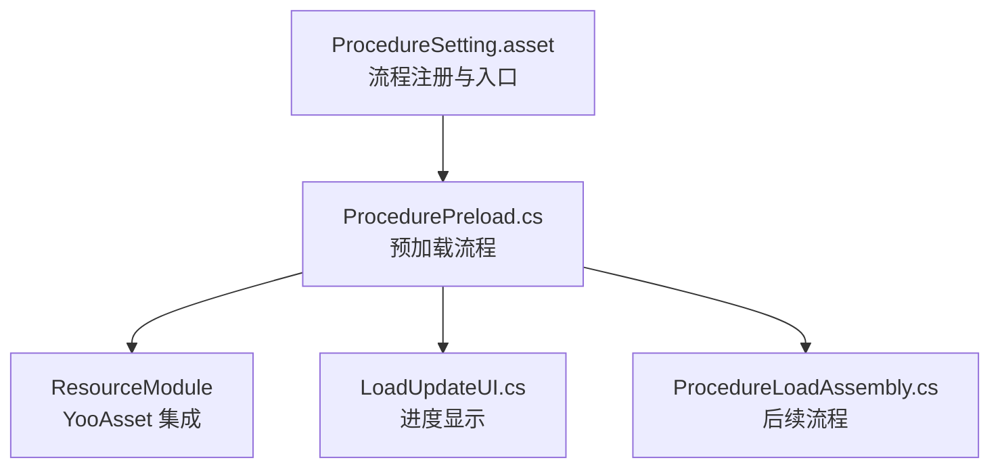
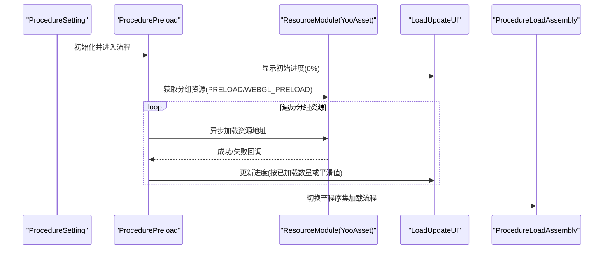
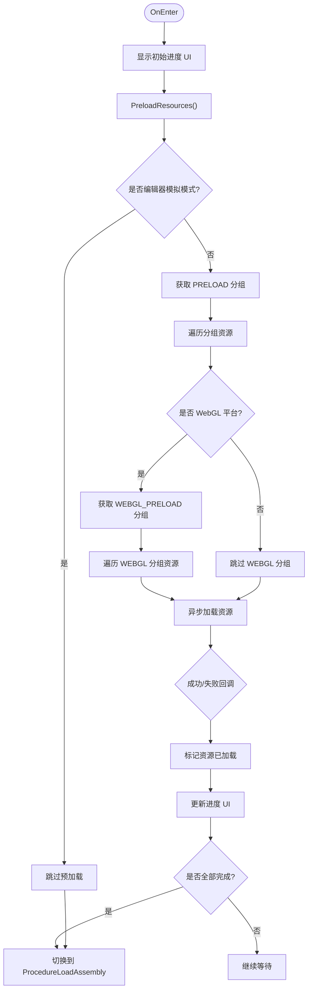
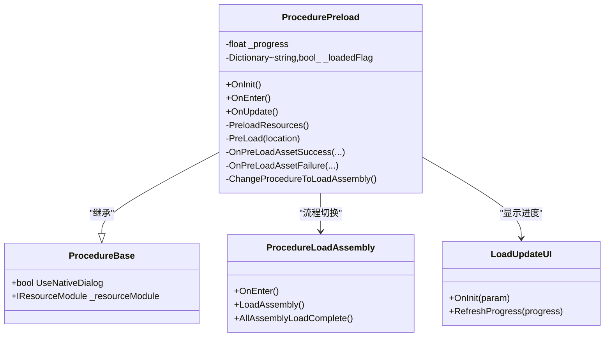

# 预加载流程 (ProcedurePreload)

<cite>
**本文引用的文件**   
- [ProcedurePreload.cs](file://UnityProject/Assets/GameScripts/Procedure/ProcedurePreload.cs)
- [ProcedureBase.cs](file://UnityProject/Assets/GameScripts/Procedure/ProcedureBase.cs)
- [ProcedureLoadAssembly.cs](file://UnityProject/Assets/GameScripts/Procedure/ProcedureLoadAssembly.cs)
- [ProcedureSetting.asset](file://UnityProject/Assets/TEngine/Settings/ProcedureSetting.asset)
- [LoadUpdateUI.cs](file://UnityProject/Assets/Launcher/Scripts/LoadUpdateUI.cs)
</cite>

## 目录
1. [简介](#简介)
2. [项目结构](#项目结构)
3. [核心组件](#核心组件)
4. [架构总览](#架构总览)
5. [详细组件分析](#详细组件分析)
6. [依赖关系分析](#依赖关系分析)
7. [性能与并发控制](#性能与并发控制)
8. [进度反馈与用户体验](#进度反馈与用户体验)
9. [错误处理与重试策略](#错误处理与重试策略)
10. [配置方法与最佳实践](#配置方法与最佳实践)
11. [故障排查指南](#故障排查指南)
12. [结论](#结论)

## 简介
本文件围绕 TEngine 的“预加载流程”（ProcedurePreload）进行系统化文档化，重点覆盖以下方面：
- 关键资源预加载机制与资源类型分类
- 场景资源准备与平台差异化处理
- 进度反馈与 UI 更新
- 与主流程的协调、状态切换与后续步骤衔接
- 取消策略与错误处理
- 性能优化建议与监控方法
- 不同游戏类型的预加载策略与最佳实践案例

## 项目结构
与 ProcedurePreload 直接相关的代码与配置分布如下：
- 流程实现：UnityProject/Assets/GameScripts/Procedure/ProcedurePreload.cs
- 流程基类：UnityProject/Assets/GameScripts/Procedure/ProcedureBase.cs
- 后续流程（程序集加载）：UnityProject/Assets/GameScripts/Procedure/ProcedureLoadAssembly.cs
- 流程注册与入口：UnityProject/Assets/TEngine/Settings/ProcedureSetting.asset
- 进度 UI：UnityProject/Assets/Launcher/Scripts/LoadUpdateUI.cs

图表来源
- [ProcedureSetting.asset:15-27](file://UnityProject/Assets/TEngine/Settings/ProcedureSetting.asset#L15-L27)
- [ProcedurePreload.cs:16-173](file://UnityProject/Assets/GameScripts/Procedure/ProcedurePreload.cs#L16-L173)
- [ProcedureLoadAssembly.cs:19-150](file://UnityProject/Assets/GameScripts/Procedure/ProcedureLoadAssembly.cs#L19-L150)
- [LoadUpdateUI.cs:9-53](file://UnityProject/Assets/Launcher/Scripts/LoadUpdateUI.cs#L9-L53)

章节来源
- [ProcedureSetting.asset:15-27](file://UnityProject/Assets/TEngine/Settings/ProcedureSetting.asset#L15-L27)
- [ProcedurePreload.cs:16-173](file://UnityProject/Assets/GameScripts/Procedure/ProcedurePreload.cs#L16-L173)

## 核心组件
- ProcedurePreload：负责在启动阶段预加载关键资源，提供进度反馈，完成后切换到程序集加载流程。
- ProcedureBase：为所有流程提供统一基类能力，包含资源模块访问与原生对话框开关。
- ProcedureLoadAssembly：在预加载完成后加载逻辑与热更程序集，并启动游戏入口。
- LoadUpdateUI：统一的进度展示界面，支持百分比进度条与文本描述刷新。
- ProcedureSetting.asset：声明可用流程类型及入口流程，确保流程系统可识别与调度。

章节来源
- [ProcedurePreload.cs:16-173](file://UnityProject/Assets/GameScripts/Procedure/ProcedurePreload.cs#L16-L173)
- [ProcedureBase.cs:5-14](file://UnityProject/Assets/GameScripts/Procedure/ProcedureBase.cs#L5-L14)
- [ProcedureLoadAssembly.cs:19-150](file://UnityProject/Assets/GameScripts/Procedure/ProcedureLoadAssembly.cs#L19-L150)
- [LoadUpdateUI.cs:9-53](file://UnityProject/Assets/Launcher/Scripts/LoadUpdateUI.cs#L9-L53)
- [ProcedureSetting.asset:15-27](file://UnityProject/Assets/TEngine/Settings/ProcedureSetting.asset#L15-L27)

## 架构总览
下图展示了从流程注册到预加载完成并进入程序集加载的整体时序。

图表来源
- [ProcedureSetting.asset:15-27](file://UnityProject/Assets/TEngine/Settings/ProcedureSetting.asset#L15-L27)
- [ProcedurePreload.cs:41-100](file://UnityProject/Assets/GameScripts/Procedure/ProcedurePreload.cs#L41-L100)
- [ProcedurePreload.cs:118-156](file://UnityProject/Assets/GameScripts/Procedure/ProcedurePreload.cs#L118-L156)
- [ProcedureLoadAssembly.cs:124-150](file://UnityProject/Assets/GameScripts/Procedure/ProcedureLoadAssembly.cs#L124-L150)
- [LoadUpdateUI.cs:32-43](file://UnityProject/Assets/Launcher/Scripts/LoadUpdateUI.cs#L32-L43)

## 详细组件分析

### ProcedurePreload 预加载流程
职责与行为要点：
- 生命周期
  - OnInit：注册回调、保存流程所有者引用。
  - OnEnter：清理已加载标记、显示初始进度 UI、触发版本刷新事件、开始预加载。
  - OnUpdate：计算并更新进度；当所有资源加载完成时切换到程序集加载流程。
- 资源分组与平台差异
  - 非编辑器模拟模式才执行预加载。
  - 通过 ResourceModule.GetAssetInfos("PRELOAD") 获取预加载资源列表。
  - WebGL 平台额外加载 "WEBGL_PRELOAD" 分组资源。
- 加载与进度
  - 使用 _loadedFlag 字典记录每个资源的加载结果。
  - 若存在未完成的资源，则按已完成数量占比更新 UI。
  - 若无待加载资源，则使用平滑过渡动画更新全局进度，并在接近 100% 时显示“完成”。
- 回调处理
  - 成功：记录日志并标记该资源为已加载。
  - 失败：记录警告日志并标记该资源为已加载（避免阻塞整体流程）。
- 流程切换
  - 全部完成后调用 ChangeState<ProcedureLoadAssembly> 进入下一步。

图表来源
- [ProcedurePreload.cs:41-100](file://UnityProject/Assets/GameScripts/Procedure/ProcedurePreload.cs#L41-L100)
- [ProcedurePreload.cs:118-156](file://UnityProject/Assets/GameScripts/Procedure/ProcedurePreload.cs#L118-L156)
- [ProcedurePreload.cs:158-168](file://UnityProject/Assets/GameScripts/Procedure/ProcedurePreload.cs#L158-L168)
- [ProcedurePreload.cs:170-173](file://UnityProject/Assets/GameScripts/Procedure/ProcedurePreload.cs#L170-L173)

章节来源
- [ProcedurePreload.cs:16-173](file://UnityProject/Assets/GameScripts/Procedure/ProcedurePreload.cs#L16-L173)

### ProcedureBase 基类
- 暴露 UseNativeDialog 抽象属性，用于特殊流程使用原生对话框。
- 提供 IResourceModule 实例，供子类直接使用资源模块接口。

章节来源
- [ProcedureBase.cs:5-14](file://UnityProject/Assets/GameScripts/Procedure/ProcedureBase.cs#L5-L14)

### ProcedureLoadAssembly 后续流程
- 在预加载完成后被调用，负责：
  - 根据配置加载热更新程序集与主逻辑程序集。
  - 为 AOT 程序集补充元数据（HybridCLR）。
  - 找到 GameApp.Entrance 并启动游戏。
- 与 ProcedurePreload 的关系：作为其下游流程，承接资源就绪后的逻辑装配与启动。

章节来源
- [ProcedureLoadAssembly.cs:19-150](file://UnityProject/Assets/GameScripts/Procedure/ProcedureLoadAssembly.cs#L19-L150)

### LoadUpdateUI 进度 UI
- 全屏加载界面，支持：
  - 初始化时设置描述文本与进度条初始值。
  - RefreshProgress 更新进度条大小。
  - RefreshVersion/RefreshAppid 等扩展字段更新。

章节来源
- [LoadUpdateUI.cs:9-53](file://UnityProject/Assets/Launcher/Scripts/LoadUpdateUI.cs#L9-L53)

## 依赖关系分析
- ProcedurePreload 依赖：
  - IResourceModule（通过 ProcedureBase 暴露）：用于获取分组资源与异步加载。
  - LauncherMgr/UI 层：用于显示进度与刷新版本信息。
  - GameEvent：用于触发版本刷新事件。
  - YooAsset：底层资源系统（通过 ResourceModule 封装）。
- 与 ProcedureLoadAssembly 的关系：
  - 通过 ChangeState 切换流程，形成顺序执行链。

图表来源
- [ProcedureBase.cs:5-14](file://UnityProject/Assets/GameScripts/Procedure/ProcedureBase.cs#L5-L14)
- [ProcedurePreload.cs:16-173](file://UnityProject/Assets/GameScripts/Procedure/ProcedurePreload.cs#L16-L173)
- [ProcedureLoadAssembly.cs:19-150](file://UnityProject/Assets/GameScripts/Procedure/ProcedureLoadAssembly.cs#L19-L150)
- [LoadUpdateUI.cs:9-53](file://UnityProject/Assets/Launcher/Scripts/LoadUpdateUI.cs#L9-L53)

章节来源
- [ProcedurePreload.cs:16-173](file://UnityProject/Assets/GameScripts/Procedure/ProcedurePreload.cs#L16-L173)
- [ProcedureLoadAssembly.cs:19-150](file://UnityProject/Assets/GameScripts/Procedure/ProcedureLoadAssembly.cs#L19-L150)

## 性能与并发控制
- 并发加载
  - 当前实现通过 ResourceModule.LoadAssetAsync 对每个资源发起异步加载，未显式限制并发数。
  - 建议在大规模预加载场景中引入并发上限（如线程池或任务队列），以避免网络与解码瓶颈。
- 资源分组
  - 使用 "PRELOAD" 与 "WEBGL_PRELOAD" 分组区分通用与平台特定资源，有助于减少无效加载。
- 进度平滑
  - 使用 SmoothValue 将进度值在指定时间内线性插值，提升视觉体验。
- 内存与卸载
  - 预加载成功后资源会保留在缓存中，便于后续快速使用；注意避免重复加载相同资源。
- 编辑器模式
  - 在 EditorSimulateMode 下跳过预加载，加速编辑期迭代。

优化建议
- 增加并发控制参数，按设备性能动态调整。
- 对大体积资源采用分片或流式加载。
- 针对 WebGL 平台考虑压缩与按需加载策略。
- 统计加载耗时与失败率，接入性能监控。

[本节为通用性能讨论，不直接分析具体文件]

## 进度反馈与用户体验
- 初始进度：进入流程即显示 0% 进度。
- 资源级进度：按已加载资源数量 / 总数计算百分比。
- 全局进度：若无待加载资源，使用平滑动画更新全局进度，并在接近 100% 时显示“完成”。
- 版本刷新：通过 GameEvent 触发 UI 侧版本信息刷新。

章节来源
- [ProcedurePreload.cs:41-100](file://UnityProject/Assets/GameScripts/Procedure/ProcedurePreload.cs#L41-L100)
- [LoadUpdateUI.cs:32-43](file://UnityProject/Assets/Launcher/Scripts/LoadUpdateUI.cs#L32-L43)

## 错误处理与重试策略
- 失败回调
  - 记录警告日志，并将对应资源标记为已加载，避免阻塞整体流程。
- 重试策略
  - 当前未实现自动重试；可在失败回调中根据错误码或消息决定是否重试。
- 取消策略
  - 当前未实现取消机制；可通过外部信号中断 OnUpdate 循环并提前切换流程。

章节来源
- [ProcedurePreload.cs:158-168](file://UnityProject/Assets/GameScripts/Procedure/ProcedurePreload.cs#L158-L168)

## 配置方法与最佳实践
- 流程注册
  - 在 ProcedureSetting.asset 中声明可用流程类型与入口流程，确保流程系统能正确调度。
- 资源分组配置
  - 在资源打包或清单中将需要预加载的资源分配到 "PRELOAD" 分组。
  - WebGL 平台相关资源放入 "WEBGL_PRELOAD" 分组。
- 优先级排序
  - 建议将核心 UI、字体、首屏场景资源放入预加载分组，保证首次交互流畅。
- 平台差异化
  - 利用 WebGL 专属分组减少不必要的资源下载。
- 不同游戏类型策略
  - 重度 3D 游戏：优先预加载材质、贴图、模型与音频，结合 LOD 与流式加载。
  - 2D 卡牌/休闲：优先预加载 UI 图集、音效与基础场景。
  - 多人对战：优先预加载网络协议、基础 UI 与战斗必要资源。
- 监控与度量
  - 统计各分组加载耗时、成功率与峰值并发，持续优化分组与并发策略。

章节来源
- [ProcedureSetting.asset:15-27](file://UnityProject/Assets/TEngine/Settings/ProcedureSetting.asset#L15-L27)
- [ProcedurePreload.cs:118-156](file://UnityProject/Assets/GameScripts/Procedure/ProcedurePreload.cs#L118-L156)

## 故障排查指南
常见问题与定位思路
- 预加载未生效
  - 检查是否在 EditorSimulateMode 下运行（会跳过预加载）。
  - 确认资源是否正确分配至 "PRELOAD" 或 "WEBGL_PRELOAD" 分组。
- 进度不更新
  - 检查 _loadedFlag 计数逻辑与 UI 刷新调用路径。
- 流程无法切换到程序集加载
  - 确认所有资源均已标记为已加载（包括失败项）。
- 资源加载失败
  - 查看警告日志中的错误信息，必要时添加重试逻辑。

章节来源
- [ProcedurePreload.cs:118-156](file://UnityProject/Assets/GameScripts/Procedure/ProcedurePreload.cs#L118-L156)
- [ProcedurePreload.cs:158-168](file://UnityProject/Assets/GameScripts/Procedure/ProcedurePreload.cs#L158-L168)

## 结论
ProcedurePreload 以简洁的流程实现了关键资源的预加载与进度反馈，并通过流程切换无缝衔接至程序集加载阶段。其优势在于：
- 清晰的流程边界与职责分离
- 基于资源分组的灵活配置
- 良好的进度可视化与用户体验

为进一步增强鲁棒性与性能，建议：
- 引入并发控制与重试机制
- 完善取消与异常恢复策略
- 建立性能监控与数据分析闭环

[本节为总结性内容，不直接分析具体文件]