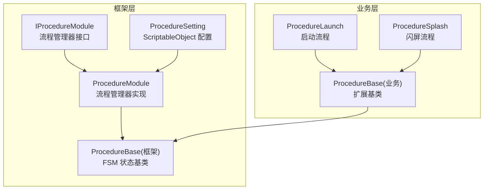
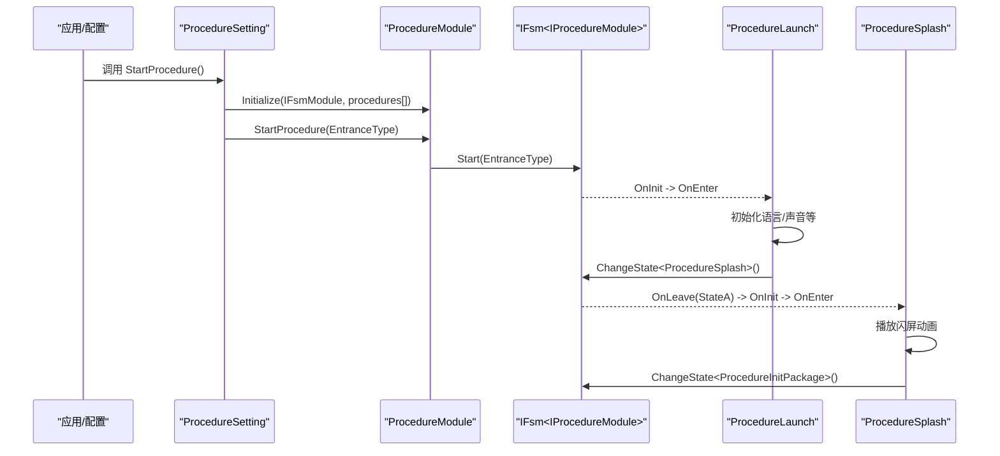
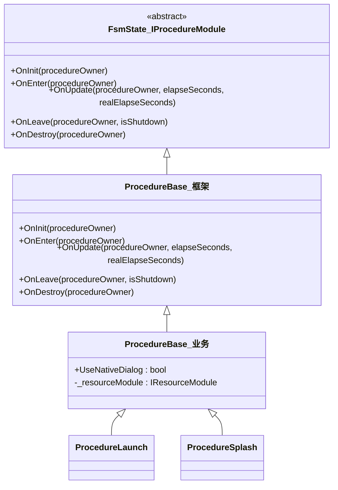
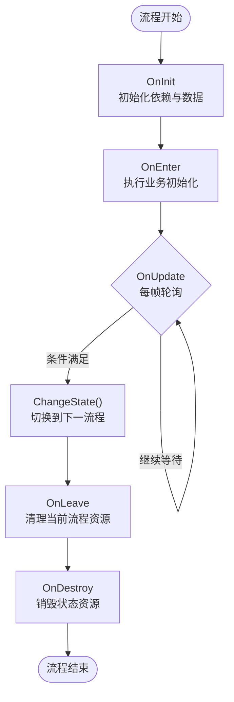
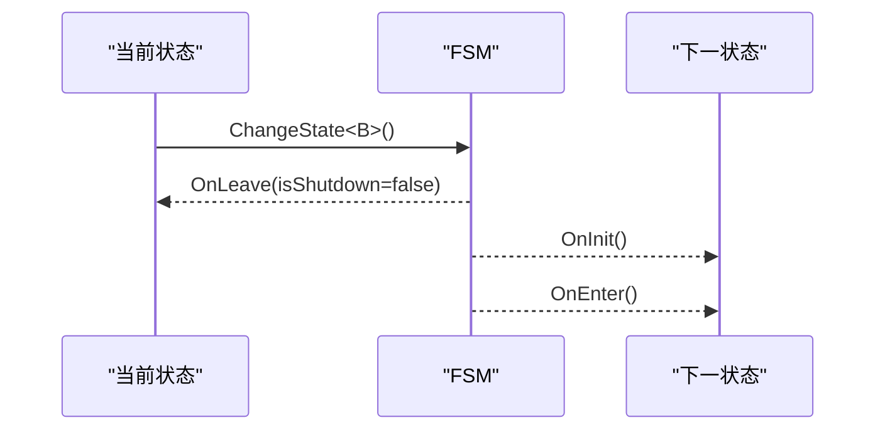
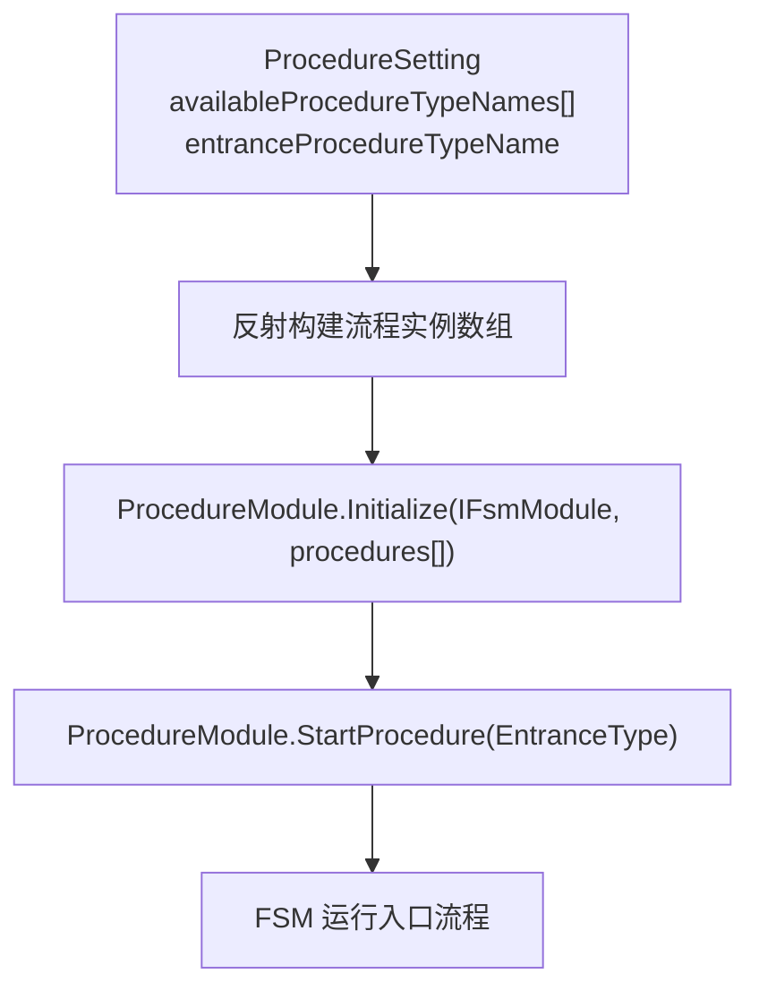
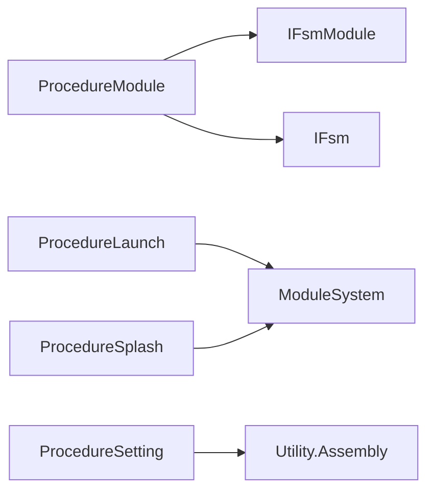

# 流程基础概念

<cite>
**本文引用的文件**   
- [ProcedureBase.cs](file://UnityProject/Assets/GameScripts/Procedure/ProcedureBase.cs)
- [ProcedureBase.cs](file://UnityProject/Assets/TEngine/Runtime/Module/ProcedureModule/ProcedureBase.cs)
- [IProcedureModule.cs](file://UnityProject/Assets/TEngine/Runtime/Module/ProcedureModule/IProcedureModule.cs)
- [ProcedureModule.cs](file://UnityProject/Assets/TEngine/Runtime/Module/ProcedureModule/ProcedureModule.cs)
- [ProcedureSetting.cs](file://UnityProject/Assets/TEngine/Runtime/Module/ProcedureModule/ProcedureSetting.cs)
- [ProcedureLaunch.cs](file://UnityProject/Assets/GameScripts/Procedure/ProcedureLaunch.cs)
- [ProcedureSplash.cs](file://UnityProject/Assets/GameScripts/Procedure/ProcedureSplash.cs)
- [3-7-流程模块.md](file://Books/3-7-流程模块.md)
</cite>

## 目录
1. [简介](#简介)
2. [项目结构](#项目结构)
3. [核心组件](#核心组件)
4. [架构总览](#架构总览)
5. [详细组件分析](#详细组件分析)
6. [依赖关系分析](#依赖关系分析)
7. [性能与异步特性](#性能与异步特性)
8. [故障排查指南](#故障排查指南)
9. [结论](#结论)
10. [附录：常用 API 速查](#附录常用-api-速查)

## 简介
本文件面向 TEngine 的流程控制系统，聚焦以下目标：
- 解释 FSM（有限状态机）在流程控制中的应用原理
- 说明 ProcedureBase 基类的设计思想与生命周期方法
- 阐述流程的生命周期管理：初始化、进入、更新、离开、销毁
- 解释流程状态转换机制、流程间通信方式、错误处理策略
- 提供流程配置与注册的基本方法，包括如何在 ModuleSystem 中注册自定义流程
- 通过图示与代码路径帮助开发者理解流程系统的工作原理

## 项目结构
流程相关代码主要分布在两个位置：
- 框架层：位于 Runtime/Module/ProcedureModule，包含流程模块接口、实现、设置对象以及流程基类
- 业务层：位于 GameScripts/Procedure，包含具体流程节点（如启动、闪屏等）

图表来源
- [IProcedureModule.cs:5-81](file://UnityProject/Assets/TEngine/Runtime/Module/ProcedureModule/IProcedureModule.cs#L5-L81)
- [ProcedureModule.cs:5-209](file://UnityProject/Assets/TEngine/Runtime/Module/ProcedureModule/ProcedureModule.cs#L5-L209)
- [ProcedureBase.cs:1-59](file://UnityProject/Assets/TEngine/Runtime/Module/ProcedureModule/ProcedureBase.cs#L1-L59)
- [ProcedureSetting.cs:8-102](file://UnityProject/Assets/TEngine/Runtime/Module/ProcedureModule/ProcedureSetting.cs#L8-L102)
- [ProcedureLaunch.cs:1-95](file://UnityProject/Assets/GameScripts/Procedure/ProcedureLaunch.cs#L1-L95)
- [ProcedureSplash.cs:1-23](file://UnityProject/Assets/GameScripts/Procedure/ProcedureSplash.cs#L1-L23)
- [ProcedureBase.cs:1-15](file://UnityProject/Assets/GameScripts/Procedure/ProcedureBase.cs#L1-L15)

章节来源
- [3-7-流程模块.md:1-108](file://Books/3-7-流程模块.md#L1-L108)

## 核心组件
- IProcedureModule：流程管理器的对外接口，定义初始化、开始、查询、重启等能力
- ProcedureModule：流程管理器的内部实现，封装 IFsm<IProcedureModule> 的创建、销毁与调度
- ProcedureBase（框架）：继承自 FsmState<IProcedureModule>，统一暴露 OnInit/OnEnter/OnUpdate/OnLeave/OnDestroy 生命周期钩子
- ProcedureBase（业务）：对框架基类的轻量扩展，提供 UseNativeDialog 属性与资源模块访问
- ProcedureSetting：基于 ScriptableObject 的配置入口，负责从配置中反射构造流程实例并启动入口流程
- 具体流程节点：如 ProcedureLaunch、ProcedureSplash，演示如何重写生命周期与切换下一个流程

章节来源
- [IProcedureModule.cs:5-81](file://UnityProject/Assets/TEngine/Runtime/Module/ProcedureModule/IProcedureModule.cs#L5-L81)
- [ProcedureModule.cs:5-209](file://UnityProject/Assets/TEngine/Runtime/Module/ProcedureModule/ProcedureModule.cs#L5-L209)
- [ProcedureBase.cs:1-59](file://UnityProject/Assets/TEngine/Runtime/Module/ProcedureModule/ProcedureBase.cs#L1-L59)
- [ProcedureBase.cs:1-15](file://UnityProject/Assets/GameScripts/Procedure/ProcedureBase.cs#L1-L15)
- [ProcedureSetting.cs:8-102](file://UnityProject/Assets/TEngine/Runtime/Module/ProcedureModule/ProcedureSetting.cs#L8-L102)
- [ProcedureLaunch.cs:1-95](file://UnityProject/Assets/GameScripts/Procedure/ProcedureLaunch.cs#L1-L95)
- [ProcedureSplash.cs:1-23](file://UnityProject/Assets/GameScripts/Procedure/ProcedureSplash.cs#L1-L23)

## 架构总览
流程系统以 FSM 为核心，ProcedureModule 作为“状态机持有者”，将一组 ProcedureBase 子类作为状态节点进行编排。流程之间通过 ChangeState<T>() 进行状态切换；流程内可访问 ModuleSystem 提供的其他模块（如资源、音频、本地化等）。

图表来源
- [ProcedureSetting.cs:55-102](file://UnityProject/Assets/TEngine/Runtime/Module/ProcedureModule/ProcedureSetting.cs#L55-L102)
- [ProcedureModule.cs:86-123](file://UnityProject/Assets/TEngine/Runtime/Module/ProcedureModule/ProcedureModule.cs#L86-L123)
- [ProcedureLaunch.cs:17-43](file://UnityProject/Assets/GameScripts/Procedure/ProcedureLaunch.cs#L17-L43)
- [ProcedureSplash.cs:13-20](file://UnityProject/Assets/GameScripts/Procedure/ProcedureSplash.cs#L13-L20)

## 详细组件分析

### FSM（有限状态机）在流程控制中的应用原理
- 每个流程节点是 FSM 的一个状态，由 ProcedureBase（框架）继承自 FsmState<IProcedureModule> 提供统一生命周期
- 流程管理器 ProcedureModule 持有 IFsm<IProcedureModule>，负责状态的创建、切换与销毁
- 流程切换通过 ChangeState<T>() 触发，底层由 FSM 完成状态退出、新状态初始化与进入的顺序保证
- 流程执行顺序由业务侧在 OnEnter/OnUpdate 中显式调用 ChangeState<T>() 驱动

章节来源
- [ProcedureBase.cs:1-59](file://UnityProject/Assets/TEngine/Runtime/Module/ProcedureModule/ProcedureBase.cs#L1-L59)
- [ProcedureModule.cs:86-123](file://UnityProject/Assets/TEngine/Runtime/Module/ProcedureModule/ProcedureModule.cs#L86-L123)
- [3-7-流程模块.md:84-108](file://Books/3-7-流程模块.md#L84-L108)

### ProcedureBase 基类设计思想与核心方法
- 框架层 ProcedureBase：
  - 继承自 FsmState<IProcedureModule>，暴露 OnInit/OnEnter/OnUpdate/OnLeave/OnDestroy 五个生命周期钩子
  - 所有流程节点应重写这些钩子以实现各自逻辑，并通过 ChangeState<T>() 切换到下一状态
- 业务层 ProcedureBase：
  - 提供 UseNativeDialog 抽象属性，用于指示是否使用原生对话框
  - 提供 _resourceModule 字段，便于流程直接访问资源模块

图表来源
- [ProcedureBase.cs:1-59](file://UnityProject/Assets/TEngine/Runtime/Module/ProcedureModule/ProcedureBase.cs#L1-L59)
- [ProcedureBase.cs:1-15](file://UnityProject/Assets/GameScripts/Procedure/ProcedureBase.cs#L1-L15)
- [ProcedureLaunch.cs:1-95](file://UnityProject/Assets/GameScripts/Procedure/ProcedureLaunch.cs#L1-L95)
- [ProcedureSplash.cs:1-23](file://UnityProject/Assets/GameScripts/Procedure/ProcedureSplash.cs#L1-L23)

章节来源
- [ProcedureBase.cs:1-59](file://UnityProject/Assets/TEngine/Runtime/Module/ProcedureModule/ProcedureBase.cs#L1-L59)
- [ProcedureBase.cs:1-15](file://UnityProject/Assets/GameScripts/Procedure/ProcedureBase.cs#L1-L15)

### 流程生命周期管理
- 初始化（OnInit）：获取依赖模块、准备数据
- 进入（OnEnter）：执行业务初始化逻辑，通常在此处启动异步任务
- 更新（OnUpdate）：每帧轮询，适合做进度检查或条件判断后切换状态
- 离开（OnLeave）：清理当前流程资源，必要时根据 isShutdown 区分关闭场景
- 销毁（OnDestroy）：释放状态机持有的状态资源

图表来源
- [ProcedureBase.cs:1-59](file://UnityProject/Assets/TEngine/Runtime/Module/ProcedureModule/ProcedureBase.cs#L1-L59)
- [ProcedureLaunch.cs:17-43](file://UnityProject/Assets/GameScripts/Procedure/ProcedureLaunch.cs#L17-L43)
- [ProcedureSplash.cs:13-20](file://UnityProject/Assets/GameScripts/Procedure/ProcedureSplash.cs#L13-L20)

章节来源
- [ProcedureBase.cs:1-59](file://UnityProject/Assets/TEngine/Runtime/Module/ProcedureModule/ProcedureBase.cs#L1-L59)

### 流程状态转换机制
- 状态切换通过 ChangeState<T>() 触发，FSM 会先调用旧状态的 OnLeave，再对新状态执行 OnInit 与 OnEnter
- 典型模式：在 OnEnter 中启动异步任务，完成后调用 ChangeState<T>() 进入下一流程；或在 OnUpdate 中轮询条件满足后切换

图表来源
- [ProcedureLaunch.cs:37-43](file://UnityProject/Assets/GameScripts/Procedure/ProcedureLaunch.cs#L37-L43)
- [ProcedureSplash.cs:13-20](file://UnityProject/Assets/GameScripts/Procedure/ProcedureSplash.cs#L13-L20)

章节来源
- [ProcedureLaunch.cs:37-43](file://UnityProject/Assets/GameScripts/Procedure/ProcedureLaunch.cs#L37-L43)
- [ProcedureSplash.cs:13-20](file://UnityProject/Assets/GameScripts/Procedure/ProcedureSplash.cs#L13-L20)

### 流程间通信方式
- 通过 ModuleSystem 访问全局模块（如 IResourceModule、IAudioModule、ILocalizationModule），流程之间不直接耦合
- 流程可通过共享模块的状态或事件系统进行间接通信
- 示例：ProcedureLaunch 中通过 ModuleSystem 获取 IAudioModule 与 ILocalizationModule 进行设置

章节来源
- [ProcedureLaunch.cs:17-43](file://UnityProject/Assets/GameScripts/Procedure/ProcedureLaunch.cs#L17-L43)
- [ProcedureLaunch.cs:45-92](file://UnityProject/Assets/GameScripts/Procedure/ProcedureLaunch.cs#L45-L92)

### 错误处理策略
- 未初始化流程管理器时访问 CurrentProcedure/CurrentProcedureTime 会抛出异常
- 重启流程时若参数无效或 FSM 销毁失败会抛出异常
- 配置加载流程类型不存在或实例化失败会记录错误日志并中止启动

章节来源
- [ProcedureModule.cs:31-58](file://UnityProject/Assets/TEngine/Runtime/Module/ProcedureModule/ProcedureModule.cs#L31-L58)
- [ProcedureModule.cs:192-206](file://UnityProject/Assets/TEngine/Runtime/Module/ProcedureModule/ProcedureModule.cs#L192-L206)
- [ProcedureSetting.cs:68-101](file://UnityProject/Assets/TEngine/Runtime/Module/ProcedureModule/ProcedureSetting.cs#L68-L101)

### 流程配置与注册（含 ModuleSystem 集成）
- 使用 ProcedureSetting（ScriptableObject）声明可用流程类型名称与入口流程类型名称
- 启动时 ProcedureSetting 通过反射构建流程实例数组，并调用 ProcedureModule.Initialize(IFsmModule, procedures[])
- 随后调用 ProcedureModule.StartProcedure(EntranceType) 启动入口流程
- 业务侧也可通过 ModuleSystem.GetModule<IProcedureModule>() 获取流程管理器并进行操作

图表来源
- [ProcedureSetting.cs:14-18](file://UnityProject/Assets/TEngine/Runtime/Module/ProcedureModule/ProcedureSetting.cs#L14-L18)
- [ProcedureSetting.cs:55-102](file://UnityProject/Assets/TEngine/Runtime/Module/ProcedureModule/ProcedureSetting.cs#L55-L102)
- [ProcedureModule.cs:86-123](file://UnityProject/Assets/TEngine/Runtime/Module/ProcedureModule/ProcedureModule.cs#L86-L123)

章节来源
- [ProcedureSetting.cs:8-102](file://UnityProject/Assets/TEngine/Runtime/Module/ProcedureModule/ProcedureSetting.cs#L8-L102)
- [ProcedureModule.cs:86-123](file://UnityProject/Assets/TEngine/Runtime/Module/ProcedureModule/ProcedureModule.cs#L86-L123)

## 依赖关系分析
- ProcedureModule 依赖 IFsmModule 来创建和管理 IFsm<IProcedureModule>
- 流程节点依赖 ModuleSystem 提供的各子系统模块（资源、音频、本地化等）
- ProcedureSetting 依赖 Assembly 工具类进行类型反射与实例化

图表来源
- [ProcedureModule.cs:10-12](file://UnityProject/Assets/TEngine/Runtime/Module/ProcedureModule/ProcedureModule.cs#L10-L12)
- [ProcedureLaunch.cs:17-43](file://UnityProject/Assets/GameScripts/Procedure/ProcedureLaunch.cs#L17-L43)
- [ProcedureSplash.cs:13-20](file://UnityProject/Assets/GameScripts/Procedure/ProcedureSplash.cs#L13-L20)
- [ProcedureSetting.cs:68-101](file://UnityProject/Assets/TEngine/Runtime/Module/ProcedureModule/ProcedureSetting.cs#L68-L101)

章节来源
- [ProcedureModule.cs:10-12](file://UnityProject/Assets/TEngine/Runtime/Module/ProcedureModule/ProcedureModule.cs#L10-L12)
- [ProcedureSetting.cs:68-101](file://UnityProject/Assets/TEngine/Runtime/Module/ProcedureModule/ProcedureSetting.cs#L68-L101)

## 性能与异步特性
- 流程更新采用每帧轮询（OnUpdate），应避免在 OnUpdate 中进行重计算或阻塞 IO
- 耗时操作推荐使用 UniTask 异步方式，在 OnEnter 中启动并在完成后切换状态
- 标准流程执行顺序支持离线/模拟模式直通预加载，联机模式则走版本更新与下载流程，减少不必要的网络开销

章节来源
- [3-7-流程模块.md:84-108](file://Books/3-7-流程模块.md#L84-L108)
- [3-7-流程模块.md:243-265](file://Books/3-7-流程模块.md#L243-L265)

## 故障排查指南
- 现象：访问 CurrentProcedure 或 CurrentProcedureTime 时报错
  - 原因：流程管理器未初始化
  - 解决：确保先调用 ProcedureModule.Initialize(...)
- 现象：重启流程失败
  - 原因：传入流程数组为空或 FSM 销毁失败
  - 解决：检查 RestartProcedure 的参数与 FSM 状态
- 现象：流程启动失败且日志提示找不到流程类型
  - 原因：ProcedureSetting 中 availableProcedureTypeNames 配置的类型名不存在
  - 解决：核对程序集与类型命名空间，确保可被反射找到

章节来源
- [ProcedureModule.cs:31-58](file://UnityProject/Assets/TEngine/Runtime/Module/ProcedureModule/ProcedureModule.cs#L31-L58)
- [ProcedureModule.cs:192-206](file://UnityProject/Assets/TEngine/Runtime/Module/ProcedureModule/ProcedureModule.cs#L192-L206)
- [ProcedureSetting.cs:68-101](file://UnityProject/Assets/TEngine/Runtime/Module/ProcedureModule/ProcedureSetting.cs#L68-L101)

## 结论
TEngine 的流程系统以 FSM 为核心，通过 ProcedureModule 统一管理流程状态，配合 ProcedureBase 生命周期钩子与 ModuleSystem 模块体系，实现了清晰、可扩展且稳定的流程控制。开发者只需关注业务流程本身，借助 ChangeState<T>() 与异步编程模型即可构建健壮的商业化启动流程。

## 附录：常用 API 速查
- 流程管理器接口（IProcedureModule）
  - Initialize(IFsmModule, procedures[])
  - StartProcedure<T>() / StartProcedure(Type)
  - HasProcedure<T>() / HasProcedure(Type)
  - GetProcedure<T>() / GetProcedure(Type)
  - RestartProcedure(params ProcedureBase[])
  - CurrentProcedure / CurrentProcedureTime
- 流程基类（ProcedureBase，框架）
  - OnInit / OnEnter / OnUpdate / OnLeave / OnDestroy
- 流程基类（ProcedureBase，业务）
  - UseNativeDialog
  - _resourceModule（IResourceModule）
- 流程配置（ProcedureSetting）
  - StartProcedure()（异步启动入口流程）

章节来源
- [IProcedureModule.cs:5-81](file://UnityProject/Assets/TEngine/Runtime/Module/ProcedureModule/IProcedureModule.cs#L5-L81)
- [ProcedureBase.cs:1-59](file://UnityProject/Assets/TEngine/Runtime/Module/ProcedureModule/ProcedureBase.cs#L1-L59)
- [ProcedureBase.cs:1-15](file://UnityProject/Assets/GameScripts/Procedure/ProcedureBase.cs#L1-L15)
- [ProcedureSetting.cs:55-102](file://UnityProject/Assets/TEngine/Runtime/Module/ProcedureModule/ProcedureSetting.cs#L55-L102)