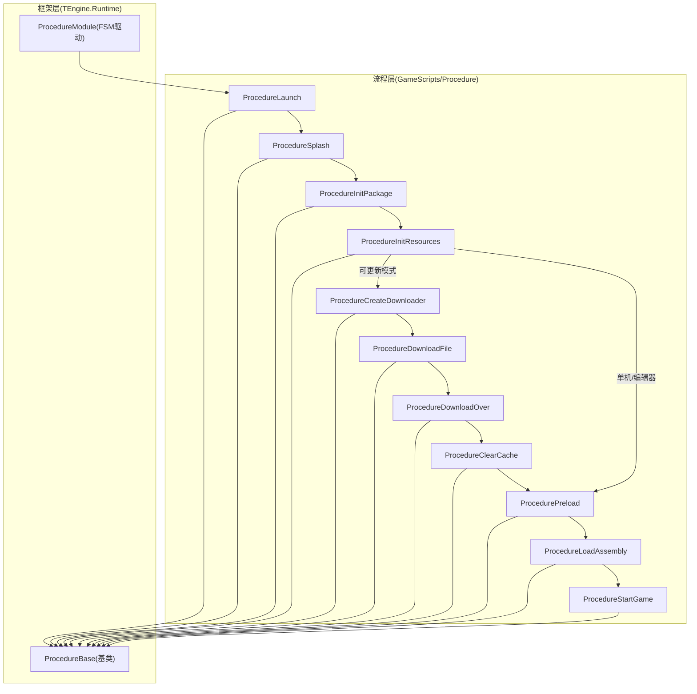
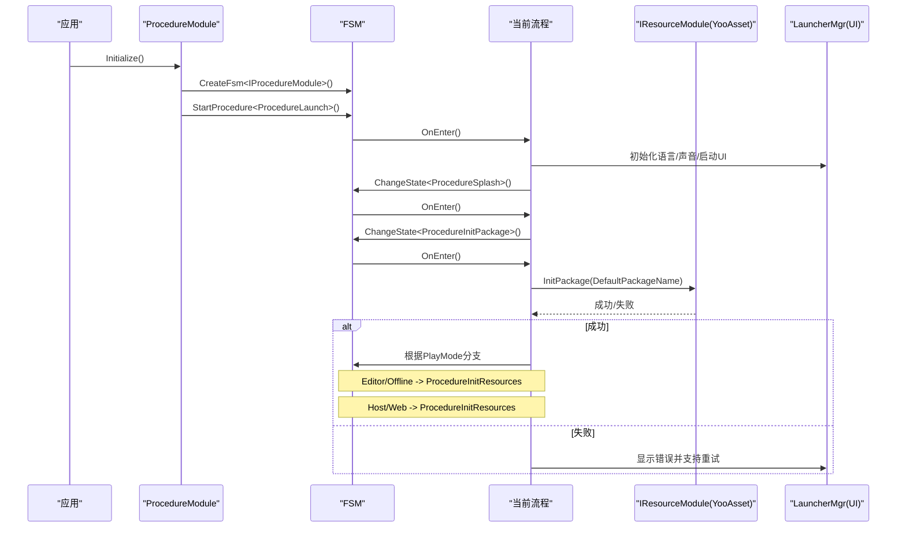
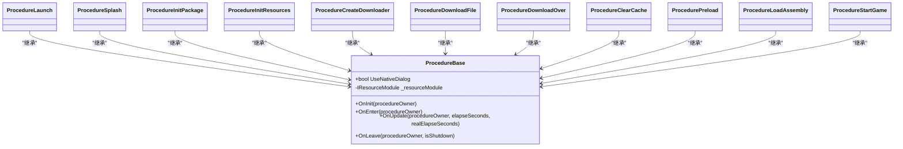
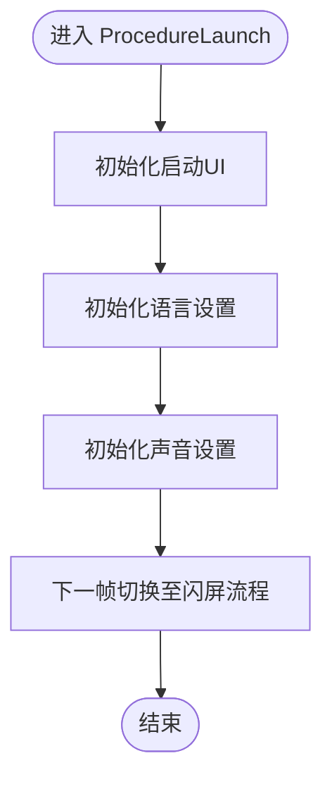
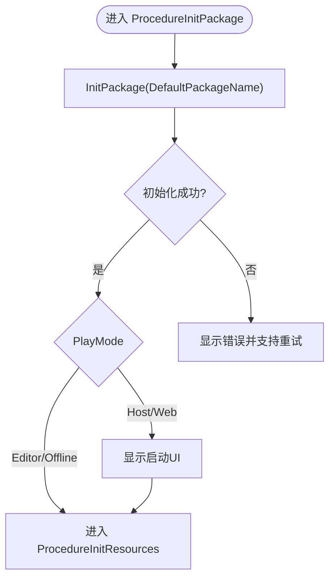
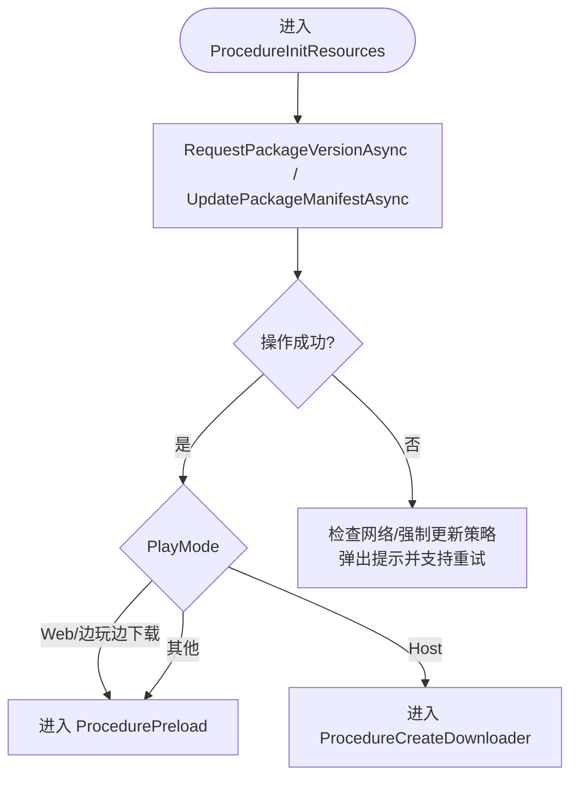
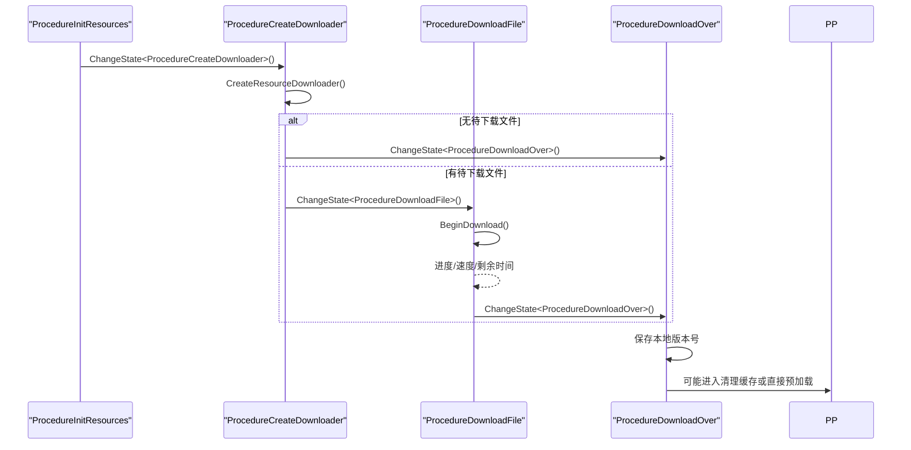
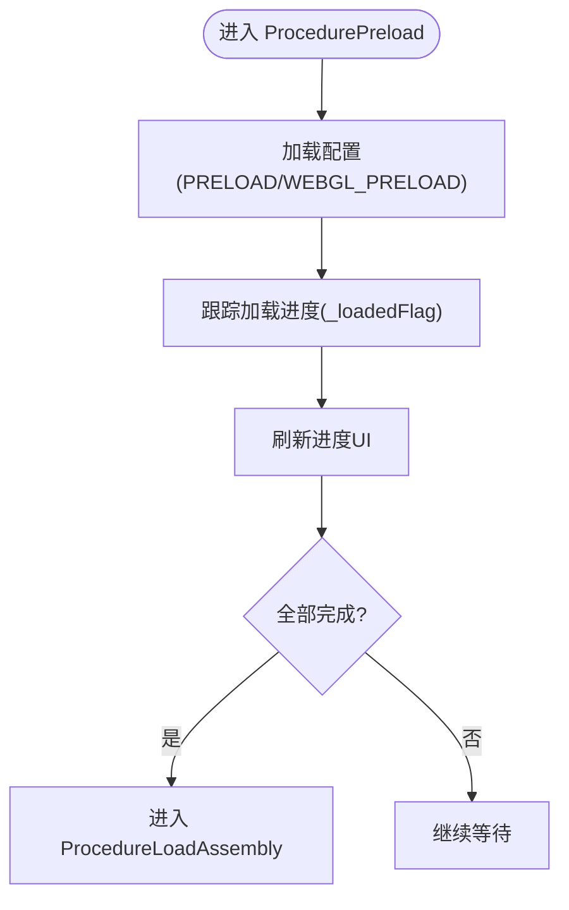
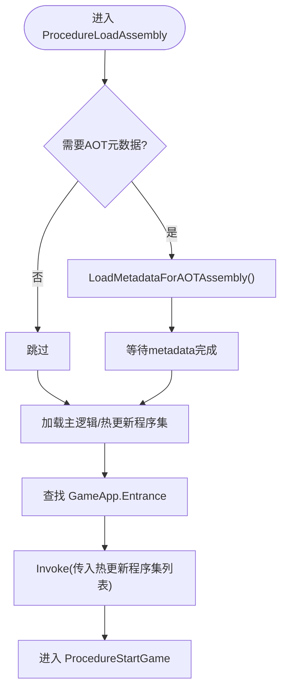
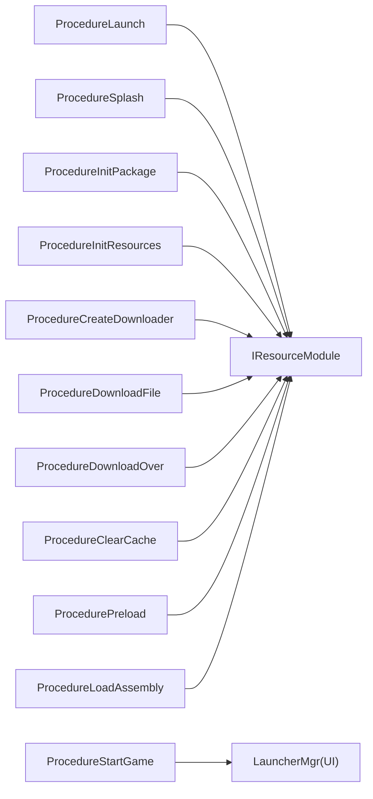

# 流程控制系统

<cite>
**本文引用的文件**   
- [ProcedureBase.cs](file://UnityProject/Assets/GameScripts/Procedure/ProcedureBase.cs)
- [ProcedureLaunch.cs](file://UnityProject/Assets/GameScripts/Procedure/ProcedureLaunch.cs)
- [ProcedureSplash.cs](file://UnityProject/Assets/GameScripts/Procedure/ProcedureSplash.cs)
- [ProcedureInitPackage.cs](file://UnityProject/Assets/GameScripts/Procedure/ProcedureInitPackage.cs)
- [ProcedureInitResources.cs](file://UnityProject/Assets/GameScripts/Procedure/ProcedureInitResources.cs)
- [ProcedureCreateDownloader.cs](file://UnityProject/Assets/GameScripts/Procedure/ProcedureCreateDownloader.cs)
- [ProcedureDownloadFile.cs](file://UnityProject/Assets/GameScripts/Procedure/ProcedureDownloadFile.cs)
- [ProcedureDownloadOver.cs](file://UnityProject/Assets/GameScripts/Procedure/ProcedureDownloadOver.cs)
- [ProcedureClearCache.cs](file://UnityProject/Assets/GameScripts/Procedure/ProcedureClearCache.cs)
- [ProcedurePreload.cs](file://UnityProject/Assets/GameScripts/Procedure/ProcedurePreload.cs)
- [ProcedureLoadAssembly.cs](file://UnityProject/Assets/GameScripts/Procedure/ProcedureLoadAssembly.cs)
- [ProcedureStartGame.cs](file://UnityProject/Assets/GameScripts/Procedure/ProcedureStartGame.cs)
- [3-7-流程模块.md](file://Books/3-7-流程模块.md)
</cite>

## 目录
1. [简介](#简介)
2. [项目结构](#项目结构)
3. [核心组件](#核心组件)
4. [架构总览](#架构总览)
5. [详细组件分析](#详细组件分析)
6. [依赖关系分析](#依赖关系分析)
7. [性能与监控](#性能与监控)
8. [故障排查指南](#故障排查指南)
9. [结论](#结论)
10. [附录：自定义流程开发指南](#附录自定义流程开发指南)

## 简介
本文件系统性梳理 TEngine 的流程控制系统，围绕基于 FSM（有限状态机）的流程管理架构展开，解释 ProcedureBase 基类的设计思想与生命周期管理，详解内置流程（启动、闪屏、资源包初始化、资源初始化、热更新下载、预加载、程序集加载、游戏启动等）的实现与流转机制。同时提供流程间状态转换、错误处理、中断恢复的实践方法，并给出自定义流程开发的完整指南与调试、性能监控、异常处理的实用技巧。

## 项目结构
流程相关代码主要位于 UnityProject/Assets/GameScripts/Procedure 目录下，每个流程以独立类实现，统一继承自框架提供的基类；运行时由 TEngine 的 ProcedureModule 驱动 FSM 调度。

图表来源
- [3-7-流程模块.md:84-107](file://Books/3-7-流程模块.md#L84-L107)

章节来源
- [3-7-流程模块.md:84-107](file://Books/3-7-流程模块.md#L84-L107)

## 核心组件
- ProcedureBase（游戏侧基类）
  - 暴露 UseNativeDialog 属性，用于在特定流程中启用原生对话框提示。
  - 持有 IResourceModule 引用，便于流程内访问资源系统。
- 流程节点
  - 启动流程：ProcedureLaunch
  - 闪屏流程：ProcedureSplash
  - 资源包初始化：ProcedureInitPackage
  - 资源初始化：ProcedureInitResources
  - 创建下载器：ProcedureCreateDownloader
  - 下载文件：ProcedureDownloadFile
  - 下载完成：ProcedureDownloadOver
  - 清理缓存：ProcedureClearCache
  - 预加载：ProcedurePreload
  - 加载程序集：ProcedureLoadAssembly
  - 开始游戏：ProcedureStartGame

章节来源
- [ProcedureBase.cs:1-15](file://UnityProject/Assets/GameScripts/Procedure/ProcedureBase.cs#L1-L15)
- [ProcedureLaunch.cs:1-95](file://UnityProject/Assets/GameScripts/Procedure/ProcedureLaunch.cs#L1-L95)
- [ProcedureSplash.cs:1-23](file://UnityProject/Assets/GameScripts/Procedure/ProcedureSplash.cs#L1-L23)
- [ProcedureInitPackage.cs:1-120](file://UnityProject/Assets/GameScripts/Procedure/ProcedureInitPackage.cs#L1-L120)
- [ProcedureInitResources.cs:1-172](file://UnityProject/Assets/GameScripts/Procedure/ProcedureInitResources.cs#L1-L172)
- [ProcedureCreateDownloader.cs:1-76](file://UnityProject/Assets/GameScripts/Procedure/ProcedureCreateDownloader.cs#L1-L76)
- [ProcedureDownloadFile.cs:1-104](file://UnityProject/Assets/GameScripts/Procedure/ProcedureDownloadFile.cs#L1-L104)
- [ProcedureDownloadOver.cs:1-36](file://UnityProject/Assets/GameScripts/Procedure/ProcedureDownloadOver.cs#L1-L36)
- [ProcedureClearCache.cs:1-35](file://UnityProject/Assets/GameScripts/Procedure/ProcedureClearCache.cs#L1-L35)
- [ProcedurePreload.cs:1-175](file://UnityProject/Assets/GameScripts/Procedure/ProcedurePreload.cs#L1-L175)
- [ProcedureLoadAssembly.cs:1-294](file://UnityProject/Assets/GameScripts/Procedure/ProcedureLoadAssembly.cs#L1-L294)
- [ProcedureStartGame.cs:1-24](file://UnityProject/Assets/GameScripts/Procedure/ProcedureStartGame.cs#L1-L24)

## 架构总览
TEngine 的流程控制采用“模块 + FSM”的架构：
- ProcedureModule 负责 FSM 的创建、流程注册、切换与生命周期管理。
- 各流程继承自框架基类，通过 ChangeState<T>() 进行状态切换。
- 流程内部使用 UniTask 异步执行耗时任务，避免阻塞主线程。
- 资源系统通过 YooAsset 集成，流程根据运行模式（编辑器模拟、单机、可更新）选择不同分支。

图表来源
- [ProcedureLaunch.cs:17-43](file://UnityProject/Assets/GameScripts/Procedure/ProcedureLaunch.cs#L17-L43)
- [ProcedureSplash.cs:13-20](file://UnityProject/Assets/GameScripts/Procedure/ProcedureSplash.cs#L13-L20)
- [ProcedureInitPackage.cs:31-69](file://UnityProject/Assets/GameScripts/Procedure/ProcedureInitPackage.cs#L31-L69)
- [ProcedureInitResources.cs:18-66](file://UnityProject/Assets/GameScripts/Procedure/ProcedureInitResources.cs#L18-L66)

## 详细组件分析

### 基类与生命周期
- 设计要点
  - UseNativeDialog：允许在关键流程中使用原生对话框进行强提示。
  - IResourceModule：流程内直接访问资源系统，简化调用路径。
- 生命周期钩子
  - OnInit：流程初始化，获取依赖模块。
  - OnEnter：进入流程时的业务逻辑入口。
  - OnUpdate：每帧更新，常用于轮询或进度刷新。
  - OnLeave：离开流程时的清理逻辑（由框架基类提供）。

图表来源
- [ProcedureBase.cs:1-15](file://UnityProject/Assets/GameScripts/Procedure/ProcedureBase.cs#L1-L15)

章节来源
- [ProcedureBase.cs:1-15](file://UnityProject/Assets/GameScripts/Procedure/ProcedureBase.cs#L1-L15)

### 启动流程（ProcedureLaunch）
- 职责
  - 初始化 Launcher UI、语言设置、声音设置。
  - 一帧后切换到闪屏流程。
- 关键点
  - 语言设置读取 PlayerPrefs，校验并回退到默认语言。
  - 声音设置从持久化配置恢复。

图表来源
- [ProcedureLaunch.cs:17-43](file://UnityProject/Assets/GameScripts/Procedure/ProcedureLaunch.cs#L17-L43)
- [ProcedureLaunch.cs:45-92](file://UnityProject/Assets/GameScripts/Procedure/ProcedureLaunch.cs#L45-L92)

章节来源
- [ProcedureLaunch.cs:17-92](file://UnityProject/Assets/GameScripts/Procedure/ProcedureLaunch.cs#L17-L92)

### 闪屏流程（ProcedureSplash）
- 职责
  - 播放闪屏动画（预留），随后进入资源包初始化流程。
- 关键点
  - 使用原生对话框能力（UseNativeDialog=true）。

章节来源
- [ProcedureSplash.cs:1-23](file://UnityProject/Assets/GameScripts/Procedure/ProcedureSplash.cs#L1-L23)

### 资源包初始化（ProcedureInitPackage）
- 职责
  - 初始化 YooAsset Package，并根据 PlayMode 决定后续流程。
- 关键点
  - 编辑器/单机模式直接进入资源初始化。
  - 可更新模式打开启动 UI 并进入资源初始化。
  - 失败时弹出错误对话框并提供重试。

图表来源
- [ProcedureInitPackage.cs:31-84](file://UnityProject/Assets/GameScripts/Procedure/ProcedureInitPackage.cs#L31-L84)

章节来源
- [ProcedureInitPackage.cs:31-118](file://UnityProject/Assets/GameScripts/Procedure/ProcedureInitPackage.cs#L31-L118)

### 资源初始化（ProcedureInitResources）
- 职责
  - 更新资源清单版本，保存本地版本号。
  - 根据运行模式决定是否进入下载流程或直接预加载。
- 关键点
  - 网络不可达或强制更新时，弹出提示并支持重试。
  - 可选更新模式下，可选择跳过更新进入游戏。

图表来源
- [ProcedureInitResources.cs:18-66](file://UnityProject/Assets/GameScripts/Procedure/ProcedureInitResources.cs#L18-L66)
- [ProcedureInitResources.cs:71-105](file://UnityProject/Assets/GameScripts/Procedure/ProcedureInitResources.cs#L71-L105)
- [ProcedureInitResources.cs:112-170](file://UnityProject/Assets/GameScripts/Procedure/ProcedureInitResources.cs#L112-L170)

章节来源
- [ProcedureInitResources.cs:18-170](file://UnityProject/Assets/GameScripts/Procedure/ProcedureInitResources.cs#L18-L170)

### 热更新下载流程（ProcedureCreateDownloader → ProcedureDownloadFile → ProcedureDownloadOver）
- 创建下载器（ProcedureCreateDownloader）
  - 计算待下载文件数量与大小，弹出确认对话框。
  - 确认后进入下载流程。
- 下载文件（ProcedureDownloadFile）
  - 注册下载回调，展示进度、速度、剩余时间。
  - 下载成功后进入下载完成流程。
- 下载完成（ProcedureDownloadOver）
  - 保存本地版本号，必要时进入清理缓存流程，否则进入预加载。

图表来源
- [ProcedureCreateDownloader.cs:30-74](file://UnityProject/Assets/GameScripts/Procedure/ProcedureCreateDownloader.cs#L30-L74)
- [ProcedureDownloadFile.cs:38-64](file://UnityProject/Assets/GameScripts/Procedure/ProcedureDownloadFile.cs#L38-L64)
- [ProcedureDownloadFile.cs:66-102](file://UnityProject/Assets/GameScripts/Procedure/ProcedureDownloadFile.cs#L66-L102)
- [ProcedureDownloadOver.cs:14-33](file://UnityProject/Assets/GameScripts/Procedure/ProcedureDownloadOver.cs#L14-L33)

章节来源
- [ProcedureCreateDownloader.cs:30-74](file://UnityProject/Assets/GameScripts/Procedure/ProcedureCreateDownloader.cs#L30-L74)
- [ProcedureDownloadFile.cs:38-102](file://UnityProject/Assets/GameScripts/Procedure/ProcedureDownloadFile.cs#L38-L102)
- [ProcedureDownloadOver.cs:14-33](file://UnityProject/Assets/GameScripts/Procedure/ProcedureDownloadOver.cs#L14-L33)

### 清理缓存（ProcedureClearCache）
- 职责
  - 清理未使用的缓存文件，完成后进入预加载流程。
- 关键点
  - 使用异步清理接口，完成后刷新 UI 并切换流程。

章节来源
- [ProcedureClearCache.cs:16-33](file://UnityProject/Assets/GameScripts/Procedure/ProcedureClearCache.cs#L16-L33)

### 预加载（ProcedurePreload）
- 职责
  - 预加载配置与必要资源，更新进度 UI。
  - 完成后进入程序集加载流程。
- 关键点
  - 使用字典记录已加载资源标志位，统计进度。
  - 平滑过渡进度条，提升用户体验。

图表来源
- [ProcedurePreload.cs:41-100](file://UnityProject/Assets/GameScripts/Procedure/ProcedurePreload.cs#L41-L100)
- [ProcedurePreload.cs:118-173](file://UnityProject/Assets/GameScripts/Procedure/ProcedurePreload.cs#L118-L173)

章节来源
- [ProcedurePreload.cs:41-173](file://UnityProject/Assets/GameScripts/Procedure/ProcedurePreload.cs#L41-L173)

### 程序集加载（ProcedureLoadAssembly）
- 职责
  - 加载主逻辑程序集与热更新程序集（HybridCLR）。
  - 为 AOT 程序集补充元数据，确保泛型函数可用。
  - 找到 GameApp.Entrance 并传入热更新程序集列表，启动游戏。
- 关键点
  - 区分编辑器与构建环境，按需加载 metadata。
  - 使用异步加载 TextAsset 并 Assembly.Load。
  - 所有程序集加载完成后才进入下一步。

图表来源
- [ProcedureLoadAssembly.cs:50-108](file://UnityProject/Assets/GameScripts/Procedure/ProcedureLoadAssembly.cs#L50-L108)
- [ProcedureLoadAssembly.cs:124-150](file://UnityProject/Assets/GameScripts/Procedure/ProcedureLoadAssembly.cs#L124-L150)
- [ProcedureLoadAssembly.cs:224-292](file://UnityProject/Assets/GameScripts/Procedure/ProcedureLoadAssembly.cs#L224-L292)

章节来源
- [ProcedureLoadAssembly.cs:50-150](file://UnityProject/Assets/GameScripts/Procedure/ProcedureLoadAssembly.cs#L50-L150)
- [ProcedureLoadAssembly.cs:224-292](file://UnityProject/Assets/GameScripts/Procedure/ProcedureLoadAssembly.cs#L224-L292)

### 开始游戏（ProcedureStartGame）
- 职责
  - 隐藏所有启动 UI，进入游戏主流程。
- 关键点
  - 使用 UniTask 异步隐藏 UI，避免阻塞。

章节来源
- [ProcedureStartGame.cs:12-22](file://UnityProject/Assets/GameScripts/Procedure/ProcedureStartGame.cs#L12-L22)

## 依赖关系分析
- 流程对资源系统的依赖
  - 所有流程通过 IResourceModule 访问 YooAsset 的能力（InitPackage、UpdatePackageManifestAsync、CreateResourceDownloader、LoadAssetAsync 等）。
- 流程对 UI 的依赖
  - 通过 LauncherMgr 显示/隐藏 UI、刷新进度、弹出消息框。
- 流程间的耦合
  - 通过 ChangeState<T>() 进行松耦合的状态切换，流程之间不直接引用彼此实例。

图表来源
- [ProcedureInitPackage.cs:31-69](file://UnityProject/Assets/GameScripts/Procedure/ProcedureInitPackage.cs#L31-L69)
- [ProcedureInitResources.cs:71-105](file://UnityProject/Assets/GameScripts/Procedure/ProcedureInitResources.cs#L71-L105)
- [ProcedureCreateDownloader.cs:41-68](file://UnityProject/Assets/GameScripts/Procedure/ProcedureCreateDownloader.cs#L41-L68)
- [ProcedureDownloadFile.cs:49-64](file://UnityProject/Assets/GameScripts/Procedure/ProcedureDownloadFile.cs#L49-L64)
- [ProcedurePreload.cs:118-156](file://UnityProject/Assets/GameScripts/Procedure/ProcedurePreload.cs#L118-L156)
- [ProcedureLoadAssembly.cs:90-108](file://UnityProject/Assets/GameScripts/Procedure/ProcedureLoadAssembly.cs#L90-L108)
- [ProcedureStartGame.cs:18-22](file://UnityProject/Assets/GameScripts/Procedure/ProcedureStartGame.cs#L18-L22)

章节来源
- [ProcedureInitPackage.cs:31-69](file://UnityProject/Assets/GameScripts/Procedure/ProcedureInitPackage.cs#L31-L69)
- [ProcedureInitResources.cs:71-105](file://UnityProject/Assets/GameScripts/Procedure/ProcedureInitResources.cs#L71-L105)
- [ProcedureCreateDownloader.cs:41-68](file://UnityProject/Assets/GameScripts/Procedure/ProcedureCreateDownloader.cs#L41-L68)
- [ProcedureDownloadFile.cs:49-64](file://UnityProject/Assets/GameScripts/Procedure/ProcedureDownloadFile.cs#L49-L64)
- [ProcedurePreload.cs:118-156](file://UnityProject/Assets/GameScripts/Procedure/ProcedurePreload.cs#L118-L156)
- [ProcedureLoadAssembly.cs:90-108](file://UnityProject/Assets/GameScripts/Procedure/ProcedureLoadAssembly.cs#L90-L108)
- [ProcedureStartGame.cs:18-22](file://UnityProject/Assets/GameScripts/Procedure/ProcedureStartGame.cs#L18-L22)

## 性能与监控
- 异步优先
  - 使用 UniTask 进行异步操作，避免阻塞主线程，保证 UI 流畅。
- 进度反馈
  - 在下载与预加载阶段持续刷新 UI 进度，提升用户感知。
- 资源卸载
  - 程序集加载完成后及时 UnloadAsset，减少内存占用。
- 日志与统计
  - 关键步骤输出日志，便于定位问题与统计耗时。

[本节为通用指导，无需具体文件引用]

## 故障排查指南
- 资源初始化失败
  - 检查 StreamingAssets/package/DefaultPackage/PackageManifest_DefaultPackage.version 是否存在。
  - 网络不可达时，根据 UpdateStyle 与 UpdatableWhilePlaying 策略弹出提示并支持重试。
- 下载失败
  - 捕获 DownloadErrorCallback，提示文件名并支持重试或退出。
- 程序集加载失败
  - 检查 ENABLE_HYBRCLR 宏定义与 LogicMainDllName 对应文件是否存在。
  - 若找不到 GameApp.Entrance，检查类型与方法名是否正确。

章节来源
- [ProcedureInitPackage.cs:102-118](file://UnityProject/Assets/GameScripts/Procedure/ProcedureInitPackage.cs#L102-L118)
- [ProcedureInitResources.cs:112-170](file://UnityProject/Assets/GameScripts/Procedure/ProcedureInitResources.cs#L112-L170)
- [ProcedureDownloadFile.cs:66-70](file://UnityProject/Assets/GameScripts/Procedure/ProcedureDownloadFile.cs#L66-L70)
- [ProcedureLoadAssembly.cs:124-150](file://UnityProject/Assets/GameScripts/Procedure/ProcedureLoadAssembly.cs#L124-L150)

## 结论
TEngine 的流程控制系统以 FSM 为核心，将游戏启动、资源更新、热更新、预加载、程序集加载等复杂过程拆分为多个职责单一的流程节点，通过统一的基类与状态切换机制实现高内聚、低耦合的可维护架构。结合 YooAsset 与 HybridCLR，提供了完整的商业化启动体验，并通过丰富的错误处理与进度反馈保障用户体验。

[本节为总结性内容，无需具体文件引用]

## 附录：自定义流程开发指南
- 创建流程
  - 新建类继承 ProcedureBase，实现 UseNativeDialog 与生命周期方法（OnEnter/OnUpdate/OnLeave）。
  - 在流程中通过 ChangeState<T>() 切换到下一个流程。
- 参数传递
  - 通过流程类的字段或属性在流程间传递数据；如需跨流程共享，可使用 ModuleSystem 提供的单例模块。
- 通信机制
  - 使用 TEngine 的事件系统（GameEvent）进行流程间解耦通信。
- 调试与监控
  - 在关键步骤输出日志，记录流程切换时间与耗时。
  - 使用 LauncherMgr 显示临时提示与进度，辅助调试。
- 最佳实践
  - 流程职责单一，避免在一个流程中做过多事情。
  - 使用 UniTask 进行异步操作，禁止使用 Coroutine。
  - 对耗时操作提供进度反馈，提升用户体验。

章节来源
- [3-7-流程模块.md:111-175](file://Books/3-7-流程模块.md#L111-L175)
- [3-7-流程模块.md:223-293](file://Books/3-7-流程模块.md#L223-L293)