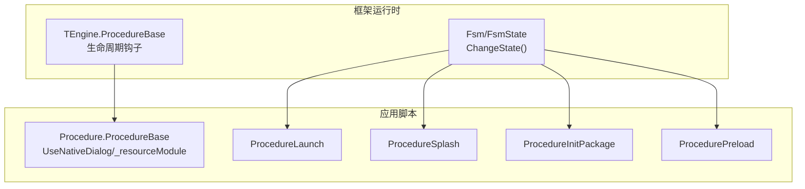
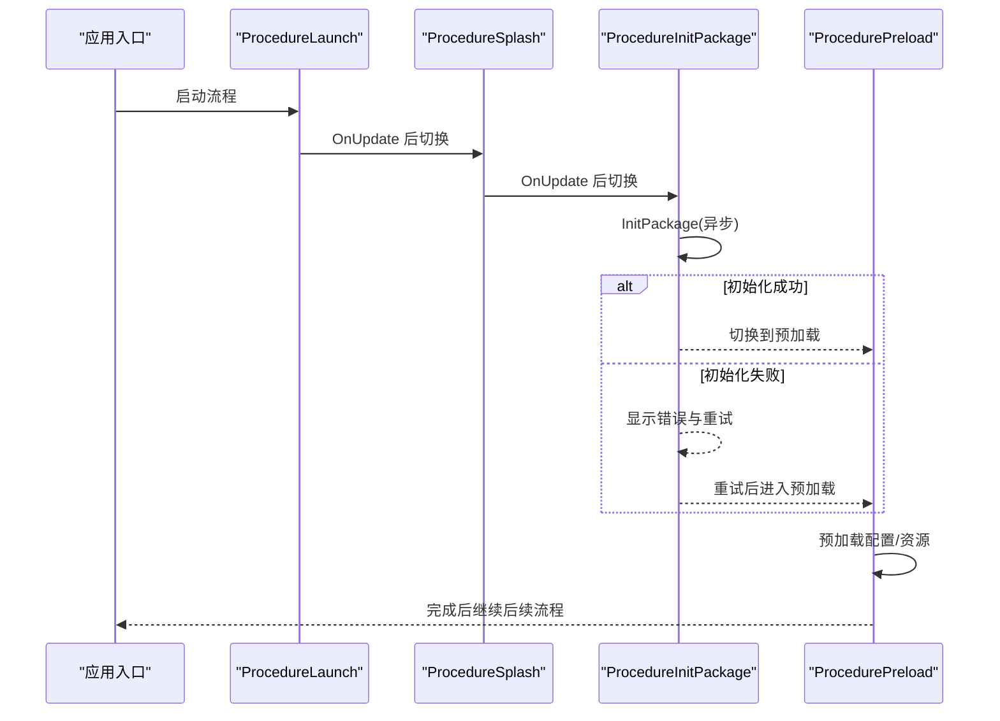
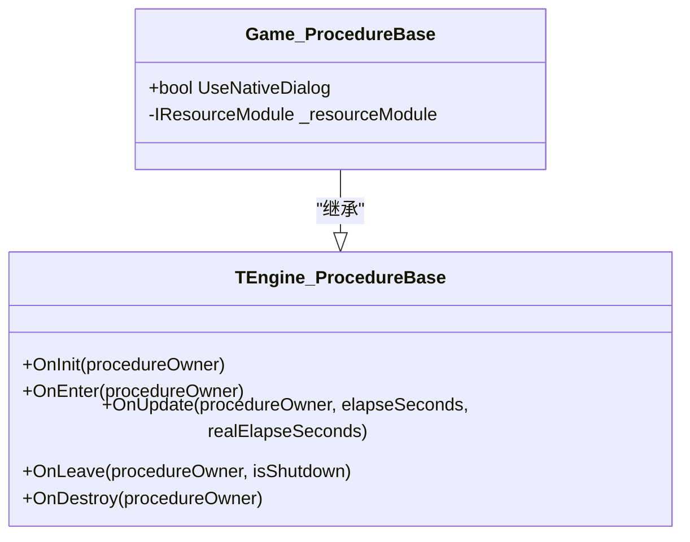
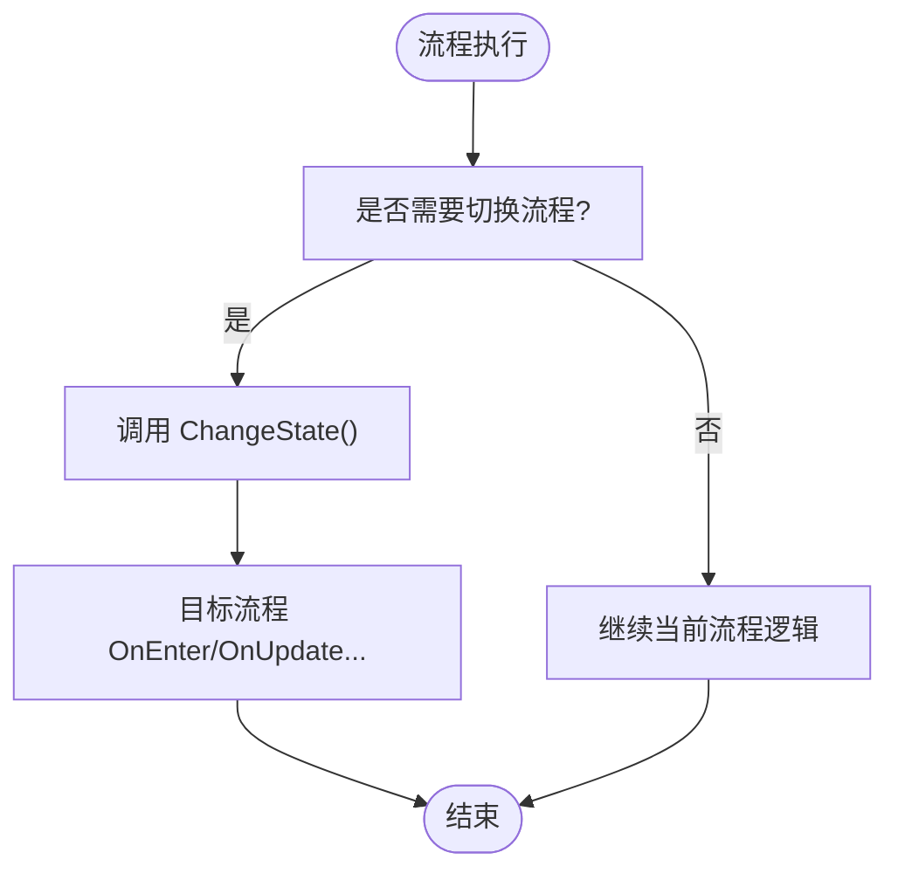
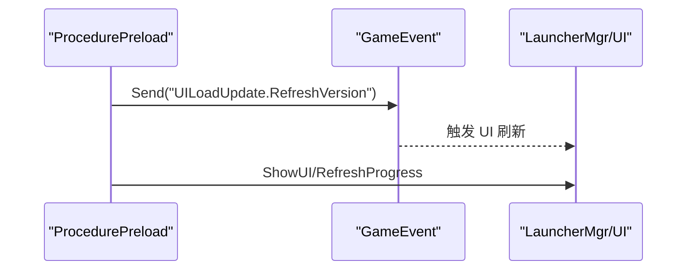
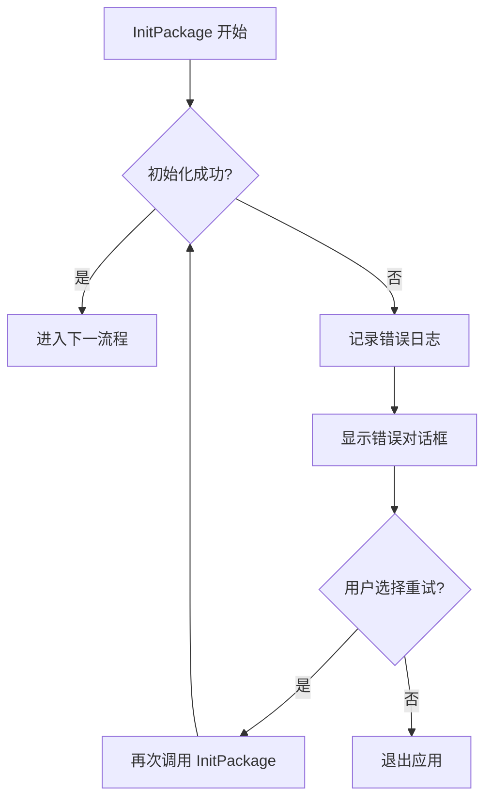
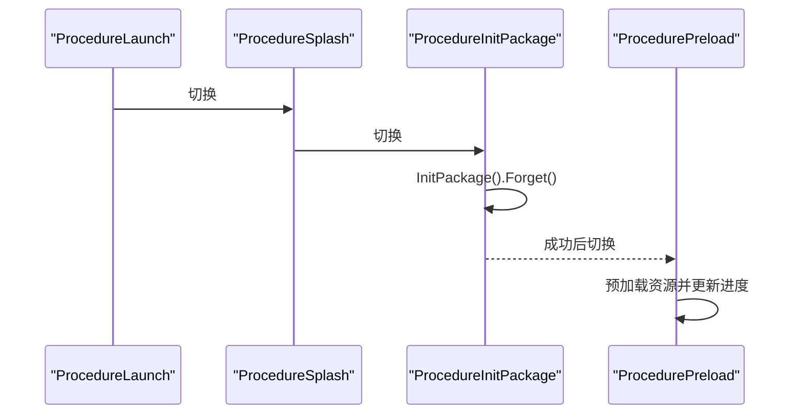
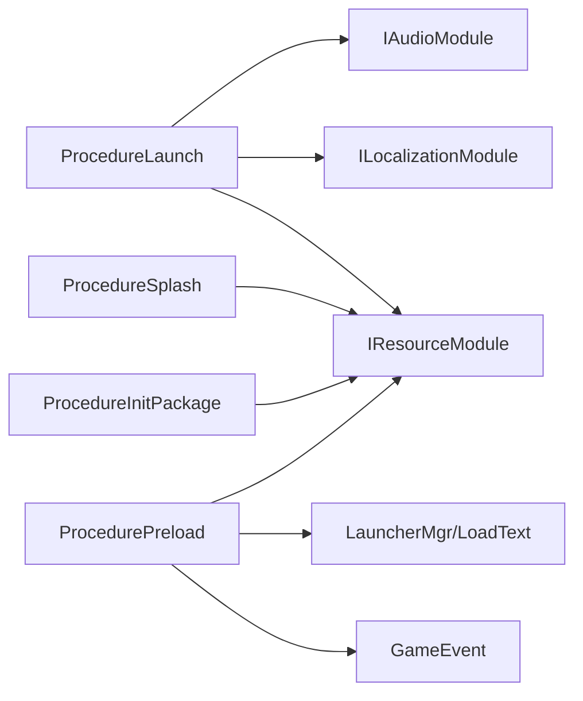

# 自定义流程开发

<cite>
**本文引用的文件**   
- [TEngine/ProcedureBase.cs](file://UnityProject\Assets\TEngine\Runtime\Module\ProcedureModule\ProcedureBase.cs)
- [GameScripts/ProcedureBase.cs](file://UnityProject\Assets\GameScripts\Procedure\ProcedureBase.cs)
- [Books/3-7-流程模块.md](file://Books\3-7-流程模块.md)
- [GameScripts/ProcedureLaunch.cs](file://UnityProject\Assets\GameScripts\Procedure\ProcedureLaunch.cs)
- [GameScripts/ProcedureSplash.cs](file://UnityProject\Assets\GameScripts\Procedure\ProcedureSplash.cs)
- [GameScripts/ProcedureInitPackage.cs](file://UnityProject\Assets\GameScripts\Procedure\ProcedureInitPackage.cs)
- [GameScripts/ProcedurePreload.cs](file://UnityProject\Assets\GameScripts\Procedure\ProcedurePreload.cs)
- [FsmState.cs](file://UnityProject\Assets\TEngine\Runtime\Module\FsmModule\FsmState.cs)
</cite>

## 目录
1. [简介](#简介)
2. [项目结构](#项目结构)
3. [核心组件](#核心组件)
4. [架构总览](#架构总览)
5. [详细组件分析](#详细组件分析)
6. [依赖关系分析](#依赖关系分析)
7. [性能与优化](#性能与优化)
8. [故障排查指南](#故障排查指南)
9. [结论](#结论)
10. [附录：完整示例与最佳实践](#附录完整示例与最佳实践)

## 简介
本指南面向希望在 TEngine 中开发“自定义流程”的开发者，围绕 ProcedureBase 基类、流程生命周期、参数传递、流程间通信（事件发布订阅、模块调用、数据共享）、错误处理与异常恢复、重试与降级策略、进度反馈、性能优化与调试方法进行系统化说明。文档同时提供从简单业务逻辑到复杂异步操作流程的完整示例路径，帮助快速上手并构建可维护的商业化启动流程。

## 项目结构
- 流程基类定义位于框架运行时模块中，应用层通过继承扩展自身流程。
- 游戏脚本侧提供应用级流程基类，封装常用能力（如资源模块访问、原生对话框开关）。
- 内置流程节点覆盖启动、闪屏、包初始化、预加载、热更新下载等关键阶段。
- 流程状态机由 Fsm 驱动，流程切换统一通过 ChangeState 完成。

**图表来源**
- [TEngine/ProcedureBase.cs:1-59](file://UnityProject\Assets\TEngine\Runtime\Module\ProcedureModule\ProcedureBase.cs#L1-L59)
- [GameScripts/ProcedureBase.cs:1-15](file://UnityProject\Assets\GameScripts\Procedure\ProcedureBase.cs#L1-L15)
- [FsmState.cs:66-74](file://UnityProject\Assets\TEngine\Runtime\Module\FsmModule\FsmState.cs#L66-L74)

**章节来源**
- [TEngine/ProcedureBase.cs:1-59](file://UnityProject\Assets\TEngine\Runtime\Module\ProcedureModule\ProcedureBase.cs#L1-L59)
- [GameScripts/ProcedureBase.cs:1-15](file://UnityProject\Assets\GameScripts\Procedure\ProcedureBase.cs#L1-L15)

## 核心组件
- 流程基类（框架）：定义 OnInit/OnEnter/OnUpdate/OnLeave/OnDestroy 生命周期钩子，作为所有流程的抽象基础。
- 应用流程基类：在框架基类之上，暴露 UseNativeDialog 属性与 _resourceModule 字段，便于流程使用资源模块与原生对话框。
- 流程状态机：通过 FsmState.ChangeState<T>() 实现流程切换，保证状态流转清晰可控。
- 内置流程节点：ProcedureLaunch、ProcedureSplash、ProcedureInitPackage、ProcedurePreload 等，构成标准启动链路。

**章节来源**
- [TEngine/ProcedureBase.cs:1-59](file://UnityProject\Assets\TEngine\Runtime\Module\ProcedureModule\ProcedureBase.cs#L1-L59)
- [GameScripts/ProcedureBase.cs:1-15](file://UnityProject\Assets\GameScripts\Procedure\ProcedureBase.cs#L1-L15)
- [FsmState.cs:66-74](file://UnityProject\Assets\TEngine\Runtime\Module\FsmModule\FsmState.cs#L66-L74)

## 架构总览
下图展示从启动到预加载的核心流程顺序与交互关系。

**图表来源**
- [GameScripts/ProcedureLaunch.cs:17-43](file://UnityProject\Assets\GameScripts\Procedure\ProcedureLaunch.cs#L17-L43)
- [GameScripts/ProcedureSplash.cs:13-20](file://UnityProject\Assets\GameScripts\Procedure\ProcedureSplash.cs#L13-L20)
- [GameScripts/ProcedureInitPackage.cs:21-118](file://UnityProject\Assets\GameScripts\Procedure\ProcedureInitPackage.cs#L21-L118)
- [GameScripts/ProcedurePreload.cs:41-100](file://UnityProject\Assets\GameScripts\Procedure\ProcedurePreload.cs#L41-L100)

## 详细组件分析

### 流程基类与生命周期
- 框架基类 ProcedureBase 定义了完整的生命周期钩子：OnInit、OnEnter、OnUpdate、OnLeave、OnDestroy。
- 应用基类 ProcedureBase 扩展了 UseNativeDialog 与 _resourceModule，方便流程判断是否使用原生对话框以及访问资源模块。

**图表来源**
- [TEngine/ProcedureBase.cs:1-59](file://UnityProject\Assets\TEngine\Runtime\Module\ProcedureModule\ProcedureBase.cs#L1-L59)
- [GameScripts/ProcedureBase.cs:1-15](file://UnityProject\Assets\GameScripts\Procedure\ProcedureBase.cs#L1-L15)

**章节来源**
- [TEngine/ProcedureBase.cs:1-59](file://UnityProject\Assets\TEngine\Runtime\Module\ProcedureModule\ProcedureBase.cs#L1-L59)
- [GameScripts/ProcedureBase.cs:1-15](file://UnityProject\Assets\GameScripts\Procedure\ProcedureBase.cs#L1-L15)

### 流程切换机制
- 所有流程切换通过 FsmState.ChangeState<T>() 完成，确保状态机内部一致性。
- 典型用法：在 OnEnter/OnUpdate 或异步回调中调用 ChangeState 切换到下一个流程。

**图表来源**
- [FsmState.cs:66-74](file://UnityProject\Assets\TEngine\Runtime\Module\FsmModule\FsmState.cs#L66-L74)

**章节来源**
- [FsmState.cs:66-74](file://UnityProject\Assets\TEngine\Runtime\Module\FsmModule\FsmState.cs#L66-L74)

### 流程参数定义与传递
- 流程参数通常通过流程上下文或模块系统传递。常见方式：
  - 在流程 OnEnter 中从 ModuleSystem 获取所需模块（如 IAudioModule、ILocalizationModule）。
  - 将需要跨流程共享的数据放入全局配置或模块单例中。
  - 对于 UI 相关提示，可通过 LauncherMgr 等工具类进行消息展示。
- 建议：避免在流程之间直接耦合具体类型，尽量通过接口或事件解耦。

**章节来源**
- [GameScripts/ProcedureLaunch.cs:17-35](file://UnityProject\Assets\GameScripts\Procedure\ProcedureLaunch.cs#L17-L35)

### 流程间通信机制
- 事件发布订阅：通过 GameEvent.Send 发送事件，其他模块监听响应。例如在预加载流程中刷新版本 UI。
- 模块间调用：通过 ModuleSystem.GetModule 获取模块实例，调用其 API（如音频、本地化、资源模块）。
- 数据共享：利用 LauncherMgr、LoadText 等工具类进行 UI 与文本配置的统一管理。

**图表来源**
- [GameScripts/ProcedurePreload.cs:47-51](file://UnityProject\Assets\GameScripts\Procedure\ProcedurePreload.cs#L47-L51)

**章节来源**
- [GameScripts/ProcedurePreload.cs:47-51](file://UnityProject\Assets\GameScripts\Procedure\ProcedurePreload.cs#L47-L51)

### 错误处理与异常恢复
- 初始化失败时显示错误信息并提供重试按钮；若网络或清单缺失，给出明确原因提示。
- 重试逻辑：捕获异常后记录日志，弹出对话框，用户确认后重新执行初始化。
- 降级处理：当某些资源无法预加载时，跳过并继续后续流程，保证主流程不阻塞。

**图表来源**
- [GameScripts/ProcedureInitPackage.cs:31-118](file://UnityProject\Assets\GameScripts\Procedure\ProcedureInitPackage.cs#L31-L118)

**章节来源**
- [GameScripts/ProcedureInitPackage.cs:31-118](file://UnityProject\Assets\GameScripts\Procedure\ProcedureInitPackage.cs#L31-L118)

### 异步流程与进度反馈
- 推荐使用 UniTaskVoid 进行异步操作，并在 OnEnter 中启动 Forget()，避免阻塞主线程。
- 进度反馈：在预加载流程中根据已加载资源数量与整体进度平滑更新 UI。

**图表来源**
- [GameScripts/ProcedureLaunch.cs:23-43](file://UnityProject\Assets\GameScripts\Procedure\ProcedureLaunch.cs#L23-L43)
- [GameScripts/ProcedureSplash.cs:13-20](file://UnityProject\Assets\GameScripts\Procedure\ProcedureSplash.cs#L13-L20)
- [GameScripts/ProcedureInitPackage.cs:21-65](file://UnityProject\Assets\GameScripts\Procedure\ProcedureInitPackage.cs#L21-L65)
- [GameScripts/ProcedurePreload.cs:41-100](file://UnityProject\Assets\GameScripts\Procedure\ProcedurePreload.cs#L41-L100)

**章节来源**
- [GameScripts/ProcedurePreload.cs:41-100](file://UnityProject\Assets\GameScripts\Procedure\ProcedurePreload.cs#L41-L100)

## 依赖关系分析
- 流程对资源模块的依赖：通过 _resourceModule 访问 YooAsset 初始化与资源加载。
- 流程对 UI 工具的依赖：通过 LauncherMgr 与 LoadText 进行 UI 与文本配置管理。
- 流程对事件系统的依赖：通过 GameEvent 进行跨模块通知。

**图表来源**
- [GameScripts/ProcedureLaunch.cs:17-35](file://UnityProject\Assets\GameScripts\Procedure\ProcedureLaunch.cs#L17-L35)
- [GameScripts/ProcedurePreload.cs:47-51](file://UnityProject\Assets\GameScripts\Procedure\ProcedurePreload.cs#L47-L51)

**章节来源**
- [GameScripts/ProcedureLaunch.cs:17-35](file://UnityProject\Assets\GameScripts\Procedure\ProcedureLaunch.cs#L17-L35)
- [GameScripts/ProcedurePreload.cs:47-51](file://UnityProject\Assets\GameScripts\Procedure\ProcedurePreload.cs#L47-L51)

## 性能与优化
- 异步优先：所有耗时操作使用 UniTask，避免阻塞主线程。
- 进度平滑：使用插值动画平滑更新进度条，提升用户体验。
- 资源预加载：按地址分组（如 PRELOAD、WEBGL_PRELOAD）分批加载，减少峰值压力。
- 失败降级：单个资源预加载失败不影响整体流程，继续推进。

**章节来源**
- [GameScripts/ProcedurePreload.cs:103-116](file://UnityProject\Assets\GameScripts\Procedure\ProcedurePreload.cs#L103-L116)
- [GameScripts/ProcedurePreload.cs:126-168](file://UnityProject\Assets\GameScripts\Procedure\ProcedurePreload.cs#L126-L168)

## 故障排查指南
- 初始化失败：检查 PackageManifest 是否存在及网络可达性；查看日志中的错误信息。
- 语言设置异常：确认 PlayerPrefs 中语言键值是否正确，支持的语言枚举是否匹配。
- 声音配置异常：核对 PlayerPrefs 中音量与静音开关键值。
- 预加载失败：查看 LoadAssetCallbacks 的失败回调，定位具体资源地址与错误信息。

**章节来源**
- [GameScripts/ProcedureInitPackage.cs:92-118](file://UnityProject\Assets\GameScripts\Procedure\ProcedureInitPackage.cs#L92-L118)
- [GameScripts/ProcedureLaunch.cs:45-91](file://UnityProject\Assets\GameScripts\Procedure\ProcedureLaunch.cs#L45-L91)
- [GameScripts/ProcedurePreload.cs:158-168](file://UnityProject\Assets\GameScripts\Procedure\ProcedurePreload.cs#L158-L168)

## 结论
通过继承 TEngine.ProcedureBase 与应用层 ProcedureBase，结合 Fsm 状态机与 UniTask 异步模型，可以构建稳定、可扩展且易于维护的自定义流程。遵循职责单一、异步优先、进度反馈与错误降级的最佳实践，能够显著提升启动体验与系统健壮性。

## 附录：完整示例与最佳实践
- 创建自定义流程：
  - 继承应用层 ProcedureBase，实现 UseNativeDialog 与生命周期方法。
  - 在 OnEnter 中启动异步任务并使用 Forget()。
  - 在异步回调中调用 ChangeState 切换到下一流程。
- 注册自定义流程：
  - 在流程模块初始化时加入自定义流程节点数组。
- 参考内置流程：
  - ProcedureLaunch：初始化 UI、语言与声音设置，随后切换到闪屏。
  - ProcedureSplash：播放闪屏动画后切换到包初始化。
  - ProcedureInitPackage：初始化资源包，根据运行模式分支处理，失败时提供重试。
  - ProcedurePreload：预加载配置与资源，平滑更新进度，完成后切换到程序集加载。

**章节来源**
- [Books/3-7-流程模块.md:111-175](file://Books\3-7-流程模块.md#L111-L175)
- [GameScripts/ProcedureLaunch.cs:17-43](file://UnityProject\Assets\GameScripts\Procedure\ProcedureLaunch.cs#L17-L43)
- [GameScripts/ProcedureSplash.cs:13-20](file://UnityProject\Assets\GameScripts\Procedure\ProcedureSplash.cs#L13-L20)
- [GameScripts/ProcedureInitPackage.cs:21-118](file://UnityProject\Assets\GameScripts\Procedure\ProcedureInitPackage.cs#L21-L118)
- [GameScripts/ProcedurePreload.cs:41-100](file://UnityProject\Assets\GameScripts\Procedure\ProcedurePreload.cs#L41-L100)