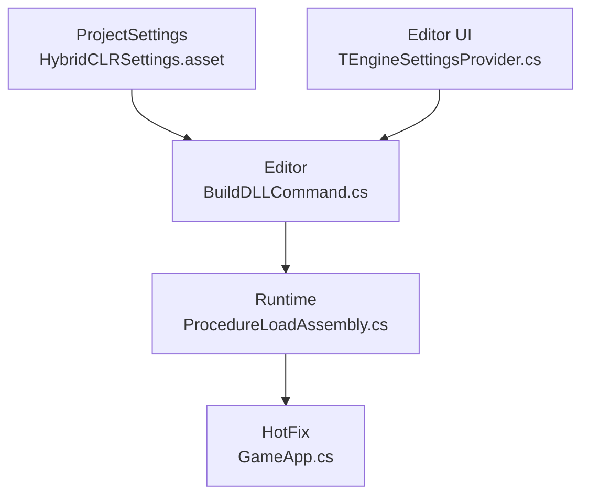
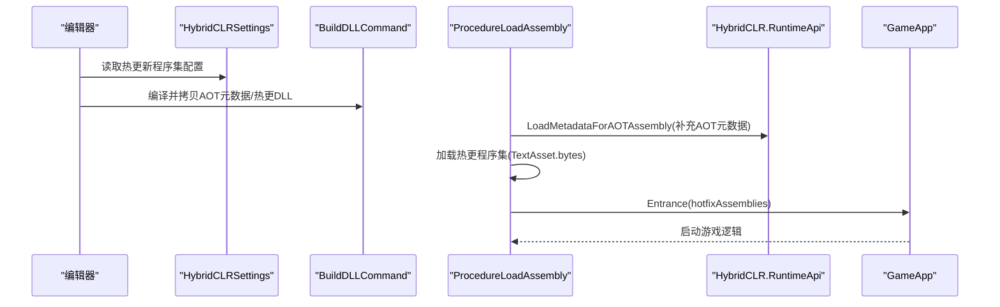
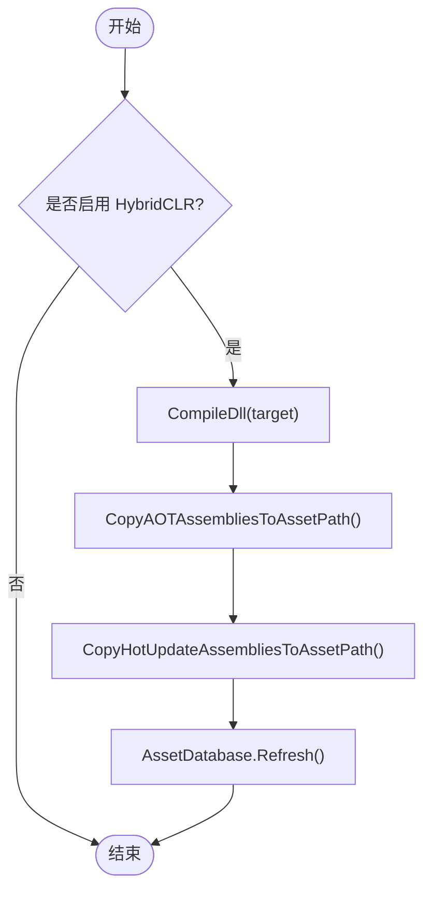
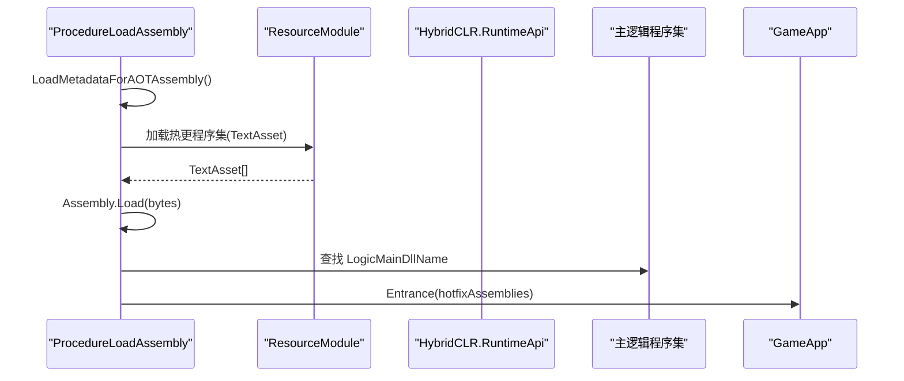
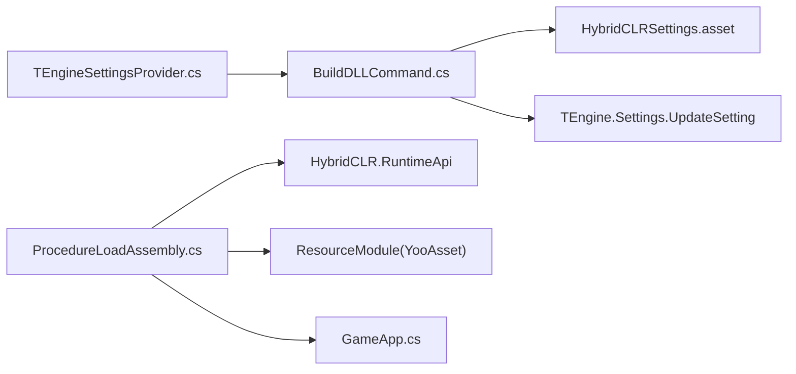

# HybridCLR 集成

<cite>
**本文引用的文件**   
- [HybridCLRSettings.asset](file://UnityProject/ProjectSettings/HybridCLRSettings.asset)
- [BuildDLLCommand.cs](file://UnityProject/Assets/TEngine/Editor/HybridCLR/BuildDLLCommand.cs)
- [ProcedureLoadAssembly.cs](file://UnityProject/Assets/GameScripts/Procedure/ProcedureLoadAssembly.cs)
- [GameApp.cs](file://UnityProject/Assets/GameScripts/HotFix/GameLogic/GameApp.cs)
- [TEngineSettingsProvider.cs](file://UnityProject/Assets/Editor/TEngineSettingsProvider/TEngineSettingsProvider.cs)
</cite>

## 目录
1. [简介](#简介)
2. [项目结构](#项目结构)
3. [核心组件](#核心组件)
4. [架构总览](#架构总览)
5. [详细组件分析](#详细组件分析)
6. [依赖关系分析](#依赖关系分析)
7. [性能与优化](#性能与优化)
8. [故障排查](#故障排查)
9. [结论](#结论)
10. [附录：平台适配与发布流程](#附录平台适配与发布流程)

## 简介
本文件面向在 TEngine 中集成 HybridCLR 的开发者，系统性说明 HybridCLR 的工作原理、零成本热更新机制、主域与热更域的隔离方式、程序集加载与管理流程，以及在 TEngine 中的安装配置、编译设置、运行时环境配置。同时提供不同平台的适配建议与性能优化实践，帮助读者快速落地并稳定运行。

## 项目结构
TEngine 对 HybridCLR 的集成主要分布在以下位置：
- 项目级配置：ProjectSettings/HybridCLRSettings.asset
- 编辑器工具：Assets/TEngine/Editor/HybridCLR/BuildDLLCommand.cs
- 运行时流程：Assets/GameScripts/Procedure/ProcedureLoadAssembly.cs
- 热更入口：Assets/GameScripts/HotFix/GameLogic/GameApp.cs
- 编辑器设置面板：Assets/Editor/TEngineSettingsProvider/TEngineSettingsProvider.cs

图示来源
- [HybridCLRSettings.asset:1-30](file://UnityProject/ProjectSettings/HybridCLRSettings.asset#L1-L30)
- [BuildDLLCommand.cs:1-174](file://UnityProject/Assets/TEngine/Editor/HybridCLR/BuildDLLCommand.cs#L1-L174)
- [ProcedureLoadAssembly.cs:1-294](file://UnityProject/Assets/GameScripts/Procedure/ProcedureLoadAssembly.cs#L1-L294)
- [GameApp.cs:1-47](file://UnityProject/Assets/GameScripts/HotFix/GameLogic/GameApp.cs#L1-L47)
- [TEngineSettingsProvider.cs:20-85](file://UnityProject/Assets/Editor/TEngineSettingsProvider/TEngineSettingsProvider.cs#L20-L85)

章节来源
- [HybridCLRSettings.asset:1-30](file://UnityProject/ProjectSettings/HybridCLRSettings.asset#L1-L30)
- [BuildDLLCommand.cs:1-174](file://UnityProject/Assets/TEngine/Editor/HybridCLR/BuildDLLCommand.cs#L1-L174)
- [ProcedureLoadAssembly.cs:1-294](file://UnityProject/Assets/GameScripts/Procedure/ProcedureLoadAssembly.cs#L1-L294)
- [GameApp.cs:1-47](file://UnityProject/Assets/GameScripts/HotFix/GameLogic/GameApp.cs#L1-L47)
- [TEngineSettingsProvider.cs:20-85](file://UnityProject/Assets/Editor/TEngineSettingsProvider/TEngineSettingsProvider.cs#L20-L85)

## 核心组件
- HybridCLR 项目配置（HybridCLRSettings.asset）
  - 启用开关、仓库地址、热更新程序集列表、链接器保留级别、输出路径等。
- 编辑器构建命令（BuildDLLCommand.cs）
  - 提供启用/禁用 HybridCLR、编译热更 DLL、复制 AOT 元数据与热更 DLL 到资源目录的工具方法。
- 运行时装配加载流程（ProcedureLoadAssembly.cs）
  - 负责加载 AOT 元数据、下载/加载热更程序集、解析主逻辑程序集并调用热更入口。
- 热更入口（GameApp.cs）
  - 热更域的主入口，接收热更程序集列表并启动游戏逻辑。
- 编辑器设置面板（TEngineSettingsProvider.cs）
  - 提供一键启用/禁用 HybridCLR 的 UI 入口，内部调用 BuildDLLCommand。

章节来源
- [HybridCLRSettings.asset:1-30](file://UnityProject/ProjectSettings/HybridCLRSettings.asset#L1-L30)
- [BuildDLLCommand.cs:1-174](file://UnityProject/Assets/TEngine/Editor/HybridCLR/BuildDLLCommand.cs#L1-L174)
- [ProcedureLoadAssembly.cs:1-294](file://UnityProject/Assets/GameScripts/Procedure/ProcedureLoadAssembly.cs#L1-L294)
- [GameApp.cs:1-47](file://UnityProject/Assets/GameScripts/HotFix/GameLogic/GameApp.cs#L1-L47)
- [TEngineSettingsProvider.cs:20-85](file://UnityProject/Assets/Editor/TEngineSettingsProvider/TEngineSettingsProvider.cs#L20-L85)

## 架构总览
HybridCLR 在 TEngine 中的整体工作流如下：
- 编辑器阶段：通过 HybridCLRSettings 定义热更新程序集；使用 BuildDLLCommand 编译并拷贝 AOT 元数据与热更 DLL 到资源目录。
- 运行时阶段：ProcedureLoadAssembly 先为 AOT 程序集补充元数据，再加载热更程序集，最后定位主逻辑程序集并调用热更入口 GameApp.Entrance。
- 隔离机制：主域由 Unity/IL2CPP 原生编译，热更域由 HybridCLR 解释执行或 JIT/AOT 桥接，二者通过程序集边界隔离。

图示来源
- [HybridCLRSettings.asset:1-30](file://UnityProject/ProjectSettings/HybridCLRSettings.asset#L1-L30)
- [BuildDLLCommand.cs:86-174](file://UnityProject/Assets/TEngine/Editor/HybridCLR/BuildDLLCommand.cs#L86-L174)
- [ProcedureLoadAssembly.cs:50-150](file://UnityProject/Assets/GameScripts/Procedure/ProcedureLoadAssembly.cs#L50-L150)
- [ProcedureLoadAssembly.cs:224-292](file://UnityProject/Assets/GameScripts/Procedure/ProcedureLoadAssembly.cs#L224-L292)
- [GameApp.cs:21-40](file://UnityProject/Assets/GameScripts/HotFix/GameLogic/GameApp.cs#L21-L40)

## 详细组件分析

### HybridCLR 项目配置（HybridCLRSettings.asset）
- 关键配置项
  - enable: 是否启用 HybridCLR
  - useGlobalIl2cpp: 是否使用全局 IL2CPP
  - hybridclrRepoURL/il2cppPlusRepoURL: 仓库地址
  - hotUpdateAssemblies: 热更新程序集名称列表（如 GameProto、GameLogic）
  - linkPreserveLevel: 链接器保留级别
  - outputLinkFile/outputAOTGenericReferenceFile: 生成 link.xml 与 AOT 泛型引用文件路径
  - maxGenericReferenceIteration/maxMethodBridgeGenericIteration: 泛型桥接迭代上限
- 作用
  - 控制哪些程序集会参与热更新与 AOT 元数据生成
  - 影响打包产物与运行时行为

章节来源
- [HybridCLRSettings.asset:1-30](file://UnityProject/ProjectSettings/HybridCLRSettings.asset#L1-L30)

### 编辑器构建命令（BuildDLLCommand.cs）
- 功能要点
  - EnableHybridCLR/DisableHybridCLR：切换宏定义与 HybridCLR 开关，必要时触发程序集刷新
  - BuildAndCopyDlls/CopyAOTHotUpdateDlls：编译热更 DLL，并将 AOT 元数据与热更 DLL 复制到资源目录
  - CopyAOTAssembliesToAssetPath/CopyHotUpdateAssembliesToAssetPath：按目标平台拷贝裁剪后的 AOT dll 与热更 dll
- 注意事项
  - 仅在 ENABLE_HYBRIDCLR 宏开启时生效
  - 若启用 Obfuz，会额外进行混淆与拷贝

图示来源
- [BuildDLLCommand.cs:86-174](file://UnityProject/Assets/TEngine/Editor/HybridCLR/BuildDLLCommand.cs#L86-L174)

章节来源
- [BuildDLLCommand.cs:1-174](file://UnityProject/Assets/TEngine/Editor/HybridCLR/BuildDLLCommand.cs#L1-L174)

### 运行时装配加载流程（ProcedureLoadAssembly.cs）
- 加载顺序
  1) 非编辑器环境下，优先为 AOT 程序集加载原始元数据（LoadMetadataForAOTAssembly），使 AOT 泛型函数在缺失 native 实现时回退到解释模式。
  2) 根据 UpdateSetting 决定是否从资源系统加载热更程序集（TextAsset）。
  3) 解析主逻辑程序集（LogicMainDllName），收集热更程序集列表。
  4) 调用主逻辑类型 GameApp 的 Entrance 方法，传入热更程序集列表。
- 错误处理
  - 资源加载失败、程序集缺失、入口方法不存在等情况均有日志与异常抛出。

图示来源
- [ProcedureLoadAssembly.cs:50-150](file://UnityProject/Assets/GameScripts/Procedure/ProcedureLoadAssembly.cs#L50-L150)
- [ProcedureLoadAssembly.cs:224-292](file://UnityProject/Assets/GameScripts/Procedure/ProcedureLoadAssembly.cs#L224-L292)

章节来源
- [ProcedureLoadAssembly.cs:1-294](file://UnityProject/Assets/GameScripts/Procedure/ProcedureLoadAssembly.cs#L1-L294)

### 热更入口（GameApp.cs）
- 职责
  - 作为热更域主入口，初始化事件系统，保存热更程序集列表，启动游戏逻辑。
- 设计要点
  - 使用静态入口方法 Entrance，便于 ProcedureLoadAssembly 反射调用。
  - 可结合 ObfuzIgnore 避免被混淆破坏入口。

章节来源
- [GameApp.cs:1-47](file://UnityProject/Assets/GameScripts/HotFix/GameLogic/GameApp.cs#L1-L47)

### 编辑器设置面板（TEngineSettingsProvider.cs）
- 功能
  - 提供“启用/禁用 HybridCLR”按钮，内部调用 BuildDLLCommand 完成宏定义与开关切换。
- 交互
  - 点击后弹出确认对话框，确认后执行相应操作并打印状态日志。

章节来源
- [TEngineSettingsProvider.cs:20-85](file://UnityProject/Assets/Editor/TEngineSettingsProvider/TEngineSettingsProvider.cs#L20-L85)

## 依赖关系分析
- 编辑器层
  - TEngineSettingsProvider 依赖 BuildDLLCommand 以启用/禁用 HybridCLR。
  - BuildDLLCommand 依赖 HybridCLR.SettingsUtil、InstallerController、Obfuz（可选）以及 TEngine.Settings.UpdateSetting。
- 运行时层
  - ProcedureLoadAssembly 依赖 ResourceModule（YooAsset）、HybridCLR.RuntimeApi、Reflection API。
  - GameApp 依赖 TEngine 模块（UI、Event、Log 等）。

图示来源
- [TEngineSettingsProvider.cs:20-85](file://UnityProject/Assets/Editor/TEngineSettingsProvider/TEngineSettingsProvider.cs#L20-L85)
- [BuildDLLCommand.cs:1-174](file://UnityProject/Assets/TEngine/Editor/HybridCLR/BuildDLLCommand.cs#L1-L174)
- [ProcedureLoadAssembly.cs:1-294](file://UnityProject/Assets/GameScripts/Procedure/ProcedureLoadAssembly.cs#L1-L294)
- [GameApp.cs:1-47](file://UnityProject/Assets/GameScripts/HotFix/GameLogic/GameApp.cs#L1-L47)

章节来源
- [TEngineSettingsProvider.cs:20-85](file://UnityProject/Assets/Editor/TEngineSettingsProvider/TEngineSettingsProvider.cs#L20-L85)
- [BuildDLLCommand.cs:1-174](file://UnityProject/Assets/TEngine/Editor/HybridCLR/BuildDLLCommand.cs#L1-L174)
- [ProcedureLoadAssembly.cs:1-294](file://UnityProject/Assets/GameScripts/Procedure/ProcedureLoadAssembly.cs#L1-L294)
- [GameApp.cs:1-47](file://UnityProject/Assets/GameScripts/HotFix/GameLogic/GameApp.cs#L1-L47)

## 性能与优化
- AOT 元数据补充
  - 通过 LoadMetadataForAOTAssembly 为 AOT 程序集补充元数据，避免泛型方法在 AOT 下缺失 native 实现导致的性能回退或崩溃。
- 程序集体积与加载时间
  - 合理划分热更新程序集，避免单个热更 DLL 过大导致首次加载耗时过长。
  - 使用 UpdateSetting.AssemblyTextAssetPath 与 YooAsset 异步加载，减少主线程阻塞。
- 链接器与保留策略
  - 调整 linkPreserveLevel 与 preserveHotUpdateAssemblies，确保必要的类型与方法不被裁剪。
- 泛型桥接与迭代上限
  - 调整 maxGenericReferenceIteration 与 maxMethodBridgeGenericIteration，平衡代码体积与运行效率。

[本节为通用指导，不直接分析具体文件]

## 故障排查
- 无法启用 HybridCLR
  - 检查 TEngineSettingsProvider 的启用按钮是否成功调用 BuildDLLCommand.EnableHybridCLR。
  - 确认 ProjectSettings/HybridCLRSettings.asset 中 enable 已设置为 true。
- 热更程序集未加载
  - 检查 UpdateSetting.HotUpdateAssemblies 是否包含目标程序集名称。
  - 确认资源系统中存在对应 .bytes 文件（或通过 Addressable/YooAsset 可访问）。
- AOT 泛型报错
  - 确认已正确加载 AOT 元数据（LoadMetadataForAOTAssembly），且对应的 dll 来自 IL2CPP 裁剪后的输出目录。
- 主逻辑入口找不到
  - 检查 LogicMainDllName 是否与主程序集名称一致，且 GameApp.Entrance 方法存在并可反射调用。

章节来源
- [TEngineSettingsProvider.cs:20-85](file://UnityProject/Assets/Editor/TEngineSettingsProvider/TEngineSettingsProvider.cs#L20-L85)
- [BuildDLLCommand.cs:86-174](file://UnityProject/Assets/TEngine/Editor/HybridCLR/BuildDLLCommand.cs#L86-L174)
- [ProcedureLoadAssembly.cs:124-150](file://UnityProject/Assets/GameScripts/Procedure/ProcedureLoadAssembly.cs#L124-L150)
- [ProcedureLoadAssembly.cs:224-292](file://UnityProject/Assets/GameScripts/Procedure/ProcedureLoadAssembly.cs#L224-L292)

## 结论
通过在 TEngine 中集成 HybridCLR，可以实现主域与热更域的安全隔离与零成本热更新。编辑器侧通过 HybridCLRSettings 与 BuildDLLCommand 完成程序集管理与资源准备；运行时通过 ProcedureLoadAssembly 完成 AOT 元数据补充与热更程序集加载，最终由 GameApp 统一接管热更域逻辑。遵循本文的配置与流程，可在多平台上稳定运行并持续优化性能。

[本节为总结性内容，不直接分析具体文件]

## 附录：平台适配与发布流程
- 编辑器阶段
  - 使用 BuildDLLCommand.BuildAndCopyDlls 或指定目标平台的重载方法，编译并拷贝 AOT 元数据与热更 DLL。
  - 若启用 Obfuz，将自动混淆并按需拷贝混淆后的程序集。
- 运行时阶段
  - 在非编辑器环境下，ProcedureLoadAssembly 会先加载 AOT 元数据，再加载热更程序集，最后调用 GameApp.Entrance。
- 常见问题
  - 裁剪后的 AOT dll 需在构建 Player 后才生成，因此需要先构建一次应用，再进行资源打包。
  - 确保 AOT 元数据与 IL2CPP 输出的 dll 一一对应，否则 LoadMetadataForAOTAssembly 可能返回错误。

章节来源
- [BuildDLLCommand.cs:86-174](file://UnityProject/Assets/TEngine/Editor/HybridCLR/BuildDLLCommand.cs#L86-L174)
- [ProcedureLoadAssembly.cs:224-292](file://UnityProject/Assets/GameScripts/Procedure/ProcedureLoadAssembly.cs#L224-L292)