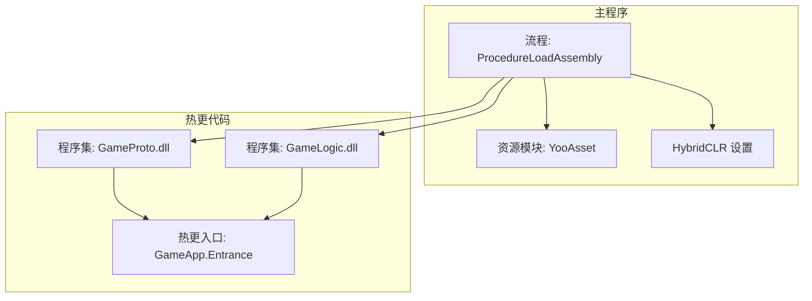
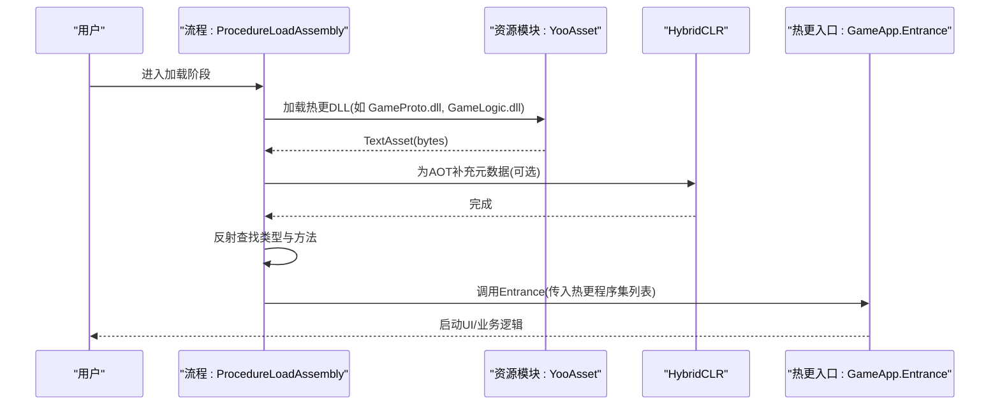
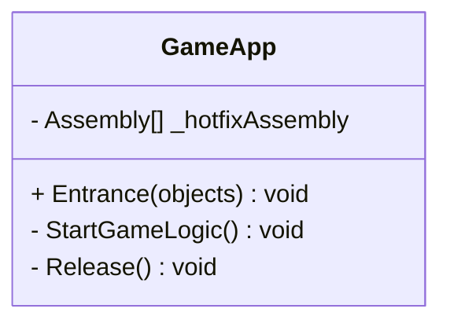
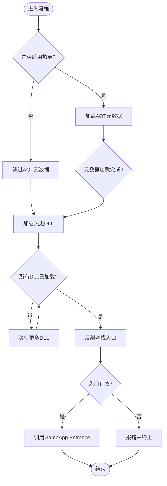
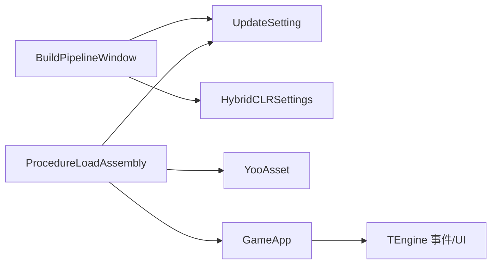

# 热更新开发指南

<cite>
**本文引用的文件**   
- [README.md](file://README.md)
- [GameApp.cs](file://UnityProject/Assets/GameScripts/HotFix/GameLogic/GameApp.cs)
- [ProcedureLoadAssembly.cs](file://UnityProject/Assets/GameScripts/Procedure/ProcedureLoadAssembly.cs)
- [HybridCLRSettings.asset](file://UnityProject/ProjectSettings/HybridCLRSettings.asset)
- [UpdateSetting.asset](file://UnityProject/Assets/TEngine/Settings/UpdateSetting.asset)
- [BuildPipelineWindow.cs](file://UnityProject/Assets/TEngine/Editor/ReleaseTools/BuildPipelineWindow.cs)
</cite>

## 目录
1. [简介](#简介)
2. [项目结构](#项目结构)
3. [核心组件](#核心组件)
4. [架构总览](#架构总览)
5. [详细组件分析](#详细组件分析)
6. [依赖关系分析](#依赖关系分析)
7. [性能与内存优化](#性能与内存优化)
8. [调试、日志与错误处理](#调试日志与错误处理)
9. [测试、灰度发布与回滚](#测试灰度发布与回滚)
10. [常见问题与排错](#常见问题与排错)
11. [结论](#结论)

## 简介
本指南面向使用 TEngine 进行热更新开发的团队与个人开发者，系统说明热更新代码的组织方式、模块划分、接口设计、构建配置、发布流程，以及与主程序的交互机制（数据传递、事件通信、回调）。同时提供调试技巧、日志记录、错误处理、测试方法、灰度发布与回滚策略，以及常见问题的解决方案和性能优化建议。

## 项目结构
TEngine 将“主程序”与“热更代码”解耦：
- 主程序负责启动器、流程控制、资源加载、AOT 元数据准备等；
- 热更代码以程序集形式存在，运行时动态加载并执行入口。

图示来源
- [ProcedureLoadAssembly.cs:50-149](file://UnityProject/Assets/GameScripts/Procedure/ProcedureLoadAssembly.cs#L50-L149)
- [HybridCLRSettings.asset:19-23](file://UnityProject/ProjectSettings/HybridCLRSettings.asset#L19-L23)
- [UpdateSetting.asset:16-28](file://UnityProject/Assets/TEngine/Settings/UpdateSetting.asset#L16-L28)

章节来源
- [README.md:173-201](file://README.md#L173-L201)

## 核心组件
- 热更新入口：GameApp.Entrance，负责初始化事件系统、接收热更程序集列表、启动游戏逻辑、释放资源。
- 程序集加载流程：ProcedureLoadAssembly 负责从资源中加载热更 DLL、为 AOT 补充元数据、反射调用热更入口。
- HybridCLR 配置：定义哪些程序集参与热更、输出链接文件与 AOT 泛型引用。
- 更新配置：定义热更程序集、AOT 元数据程序集、主逻辑程序集名、资源下载路径等。
- 打包工具：BuildPipelineWindow 提供 AB 构建、Player 构建、一键构建等能力，支持最小包模式与共享打包。

章节来源
- [GameApp.cs:17-46](file://UnityProject/Assets/GameScripts/HotFix/GameLogic/GameApp.cs#L17-L46)
- [ProcedureLoadAssembly.cs:19-149](file://UnityProject/Assets/GameScripts/Procedure/ProcedureLoadAssembly.cs#L19-L149)
- [HybridCLRSettings.asset:15-26](file://UnityProject/ProjectSettings/HybridCLRSettings.asset#L15-L26)
- [UpdateSetting.asset:15-36](file://UnityProject/Assets/TEngine/Settings/UpdateSetting.asset#L15-L36)
- [BuildPipelineWindow.cs:86-116](file://UnityProject/Assets/TEngine/Editor/ReleaseTools/BuildPipelineWindow.cs#L86-L116)

## 架构总览
下图展示热更新从“资源加载 → 程序集加载 → 入口调用 → 业务启动”的完整链路。

图示来源
- [ProcedureLoadAssembly.cs:50-149](file://UnityProject/Assets/GameScripts/Procedure/ProcedureLoadAssembly.cs#L50-L149)
- [GameApp.cs:25-40](file://UnityProject/Assets/GameScripts/HotFix/GameLogic/GameApp.cs#L25-L40)

## 详细组件分析

### 热更新入口：GameApp
职责
- 初始化事件系统；
- 接收并保存热更程序集列表；
- 注册销毁监听，统一释放单例系统；
- 启动具体 UI/业务逻辑。

关键要点
- Entrance 作为反射调用的目标，必须保持稳定的签名；
- 通过事件系统与框架其他模块解耦；
- Release 中释放全局状态，避免内存泄漏。

图示来源
- [GameApp.cs:17-46](file://UnityProject/Assets/GameScripts/HotFix/GameLogic/GameApp.cs#L17-L46)

章节来源
- [GameApp.cs:17-46](file://UnityProject/Assets/GameScripts/HotFix/GameLogic/GameApp.cs#L17-L46)

### 程序集加载流程：ProcedureLoadAssembly
职责
- 根据 UpdateSetting 配置，加载热更 DLL 与 AOT 元数据；
- 在编辑器与真机环境下差异化处理；
- 反射定位热更入口并调用；
- 管理加载计数与等待状态，确保所有资源就绪后继续流程。

关键流程
- OnEnter 触发异步加载；
- LoadMetadataForAOTAssembly 为 AOT 程序集补充元数据；
- LoadAssetSuccess 解析 TextAsset 字节并 Assembly.Load；
- AllAssemblyLoadComplete 校验主逻辑程序集与入口方法，调用 GameApp.Entrance。

图示来源
- [ProcedureLoadAssembly.cs:50-149](file://UnityProject/Assets/GameScripts/Procedure/ProcedureLoadAssembly.cs#L50-L149)
- [ProcedureLoadAssembly.cs:224-292](file://UnityProject/Assets/GameScripts/Procedure/ProcedureLoadAssembly.cs#L224-L292)

章节来源
- [ProcedureLoadAssembly.cs:36-149](file://UnityProject/Assets/GameScripts/Procedure/ProcedureLoadAssembly.cs#L36-L149)
- [ProcedureLoadAssembly.cs:181-218](file://UnityProject/Assets/GameScripts/Procedure/ProcedureLoadAssembly.cs#L181-L218)
- [ProcedureLoadAssembly.cs:224-292](file://UnityProject/Assets/GameScripts/Procedure/ProcedureLoadAssembly.cs#L224-L292)

### HybridCLR 配置
作用
- 声明参与热更的程序集；
- 控制链接级别与输出文件；
- 指定 AOT 泛型引用生成参数。

关键字段
- enable: 是否启用 HybridCLR；
- hotUpdateAssemblies: 热更程序集列表；
- outputLinkFile / outputAOTGenericReferenceFile: 生成产物路径；
- linkPreserveLevel: 裁剪保留级别。

章节来源
- [HybridCLRSettings.asset:15-26](file://UnityProject/ProjectSettings/HybridCLRSettings.asset#L15-L26)

### 更新配置：UpdateSetting
作用
- 定义热更程序集、AOT 元数据程序集；
- 指定主逻辑程序集名称；
- 配置资源下载地址、AB 扩展名与路径；
- 控制更新样式与提示。

关键字段
- HotUpdateAssemblies: 热更程序集；
- AOTMetaAssemblies: AOT 元数据程序集；
- LogicMainDllName: 主逻辑程序集名；
- AssemblyTextAssetPath / AssemblyTextAssetExtension: 程序集资源路径与扩展名；
- ResDownLoadPath / FallbackResDownLoadPath: 主备资源服务器地址。

章节来源
- [UpdateSetting.asset:15-36](file://UnityProject/Assets/TEngine/Settings/UpdateSetting.asset#L15-L36)

### 打包工具：BuildPipelineWindow
作用
- 提供可视化打包界面；
- 支持 AB 构建、Player 构建、一键构建；
- 支持最小包模式、共享打包、压缩与加密选项；
- 集成“构建前编译热更DLL”开关。

关键功能
- DrawBasicSettings: 平台、管线、压缩、加密、版本号、输出目录；
- DrawMinimalPackageSettings: 最小包模式与保留标签；
- DrawAdvancedSettings: 共享打包、依赖数据库、增量构建、结果验证；
- DrawDllSettings: 构建前编译热更 DLL；
- ExecuteBuild / ExecuteBuildPlayerOnly: 执行构建与 Player 构建；
- 日志收集与滚动显示。

章节来源
- [BuildPipelineWindow.cs:86-116](file://UnityProject/Assets/TEngine/Editor/ReleaseTools/BuildPipelineWindow.cs#L86-L116)
- [BuildPipelineWindow.cs:163-225](file://UnityProject/Assets/TEngine/Editor/ReleaseTools/BuildPipelineWindow.cs#L163-L225)
- [BuildPipelineWindow.cs:231-268](file://UnityProject/Assets/TEngine/Editor/ReleaseTools/BuildPipelineWindow.cs#L231-L268)
- [BuildPipelineWindow.cs:274-311](file://UnityProject/Assets/TEngine/Editor/ReleaseTools/BuildPipelineWindow.cs#L274-L311)
- [BuildPipelineWindow.cs:317-334](file://UnityProject/Assets/TEngine/Editor/ReleaseTools/BuildPipelineWindow.cs#L317-L334)
- [BuildPipelineWindow.cs:385-429](file://UnityProject/Assets/TEngine/Editor/ReleaseTools/BuildPipelineWindow.cs#L385-L429)
- [BuildPipelineWindow.cs:468-512](file://UnityProject/Assets/TEngine/Editor/ReleaseTools/BuildPipelineWindow.cs#L468-L512)
- [BuildPipelineWindow.cs:514-542](file://UnityProject/Assets/TEngine/Editor/ReleaseTools/BuildPipelineWindow.cs#L514-L542)

## 依赖关系分析
- ProcedureLoadAssembly 依赖 UpdateSetting 与 YooAsset 资源模块；
- GameApp 依赖 TEngine 的事件系统与 UI 模块；
- HybridCLR 设置影响程序集裁剪与 AOT 泛型行为；
- BuildPipelineWindow 驱动 AB 与 Player 构建，并可触发热更 DLL 预编译。

图示来源
- [BuildPipelineWindow.cs:317-334](file://UnityProject/Assets/TEngine/Editor/ReleaseTools/BuildPipelineWindow.cs#L317-L334)
- [ProcedureLoadAssembly.cs:50-149](file://UnityProject/Assets/GameScripts/Procedure/ProcedureLoadAssembly.cs#L50-L149)
- [GameApp.cs:25-40](file://UnityProject/Assets/GameScripts/HotFix/GameLogic/GameApp.cs#L25-L40)

章节来源
- [BuildPipelineWindow.cs:317-334](file://UnityProject/Assets/TEngine/Editor/ReleaseTools/BuildPipelineWindow.cs#L317-L334)
- [ProcedureLoadAssembly.cs:50-149](file://UnityProject/Assets/GameScripts/Procedure/ProcedureLoadAssembly.cs#L50-L149)
- [GameApp.cs:25-40](file://UnityProject/Assets/GameScripts/HotFix/GameLogic/GameApp.cs#L25-L40)

## 性能与内存优化
- 使用 YooAsset 的 LRU/ARC 缓存策略，避免频繁 GC；
- 合理拆分热更程序集，减少首次加载体积；
- 对 AOT 泛型函数提前补充元数据，避免解释模式回退带来的性能损失；
- 在 Release 中释放单例与全局对象，防止内存泄漏；
- 利用最小包模式移除 StreamingAssets 中的 .bundle，降低首包体积；
- 开启共享打包规则，提取公共资源到独立 bundle，提升复用率。

[本节为通用指导，不直接分析具体文件]

## 调试、日志与错误处理
- 日志
  - 使用框架 Log 输出关键节点信息，便于追踪加载与启动过程；
  - 构建窗口内置日志收集，自动过滤错误与警告，方便定位问题。
- 错误处理
  - 程序集加载失败时记录异常并终止流程；
  - 入口方法缺失或类型不存在时给出明确错误提示；
  - AOT 元数据加载失败时统计失败数量并抛出异常。
- 调试技巧
  - 在编辑器下优先使用 EditorSimulateMode 快速验证；
  - 通过 UpdateSetting 切换资源服务器地址，模拟不同网络环境；
  - 使用最小包模式验证在线下载流程。

章节来源
- [ProcedureLoadAssembly.cs:181-218](file://UnityProject/Assets/GameScripts/Procedure/ProcedureLoadAssembly.cs#L181-L218)
- [ProcedureLoadAssembly.cs:224-292](file://UnityProject/Assets/GameScripts/Procedure/ProcedureLoadAssembly.cs#L224-L292)
- [BuildPipelineWindow.cs:444-462](file://UnityProject/Assets/TEngine/Editor/ReleaseTools/BuildPipelineWindow.cs#L444-L462)

## 测试、灰度发布与回滚
- 单元测试与集成测试
  - 针对热更入口与关键模块编写单元测试；
  - 在编辑器模式下模拟资源加载与程序集加载流程；
  - 使用 YooAsset 的 PlayMode 进行测试。
- 灰度发布
  - 通过 UpdateSetting 的 ResDownLoadPath/FallbackResDownLoadPath 区分灰度与全量服务器；
  - 结合服务端版本控制，按用户 ID 或渠道下发不同资源包；
  - 使用最小包模式先上线基础包，再按需拉取增量。
- 回滚策略
  - 服务端保留历史版本资源清单与二进制；
  - 客户端检测到新版本异常时，自动回退至上一稳定版本；
  - 通过 FallbackResDownLoadPath 提供备用资源源，保障回滚可用性。

[本节为通用指导，不直接分析具体文件]

## 常见问题与排错
- 无法找到主逻辑程序集或入口方法
  - 检查 UpdateSetting.LogicMainDllName 与程序集命名一致；
  - 确认 ProcedureLoadAssembly 能正确反射到 GameApp.Entrance。
- AOT 泛型运行异常
  - 确保 AOTMetaAssemblies 包含必要库；
  - 检查 HybridCLR 生成的 AOT 泛型引用是否正确。
- 资源加载失败
  - 核对 UpdateSetting.AssemblyTextAssetPath 与 AssemblyTextAssetExtension；
  - 确认资源服务器可访问且清单与哈希匹配。
- 构建失败
  - 检查 BuildPipelineWindow 的平台与管线配置；
  - 若启用“构建前编译热更DLL”，确认 HybridCLR 已正确安装与生成。

章节来源
- [ProcedureLoadAssembly.cs:124-149](file://UnityProject/Assets/GameScripts/Procedure/ProcedureLoadAssembly.cs#L124-L149)
- [UpdateSetting.asset:16-28](file://UnityProject/Assets/TEngine/Settings/UpdateSetting.asset#L16-L28)
- [HybridCLRSettings.asset:19-26](file://UnityProject/ProjectSettings/HybridCLRSettings.asset#L19-L26)
- [BuildPipelineWindow.cs:317-334](file://UnityProject/Assets/TEngine/Editor/ReleaseTools/BuildPipelineWindow.cs#L317-L334)

## 结论
TEngine 提供了完善的热更新基础设施：以 HybridCLR 为核心的程序集热更、YooAsset 的资源管理、流程化的启动与加载、可视化的打包工具。遵循本文的组织规范、接口约定与最佳实践，可显著提升热更新的稳定性、可维护性与交付效率。建议在团队内统一配置与流程，配合自动化构建与灰度发布，持续优化用户体验与性能表现。