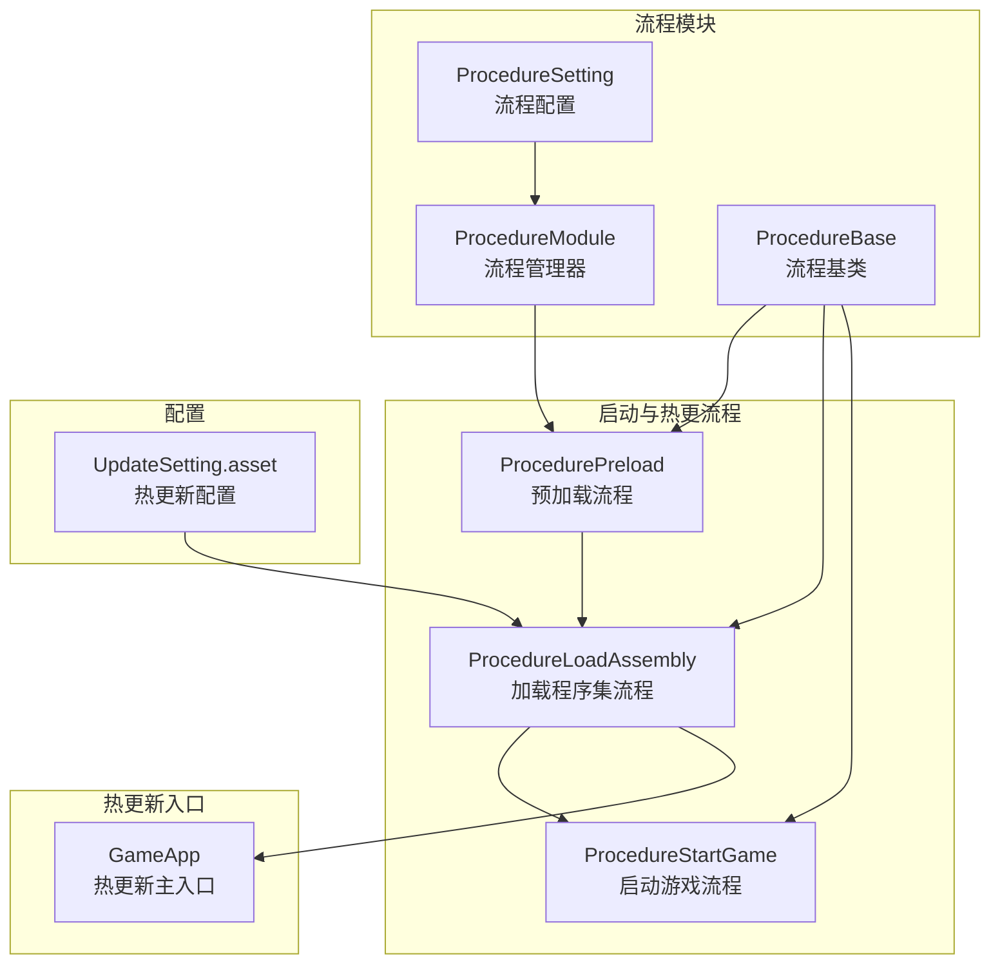
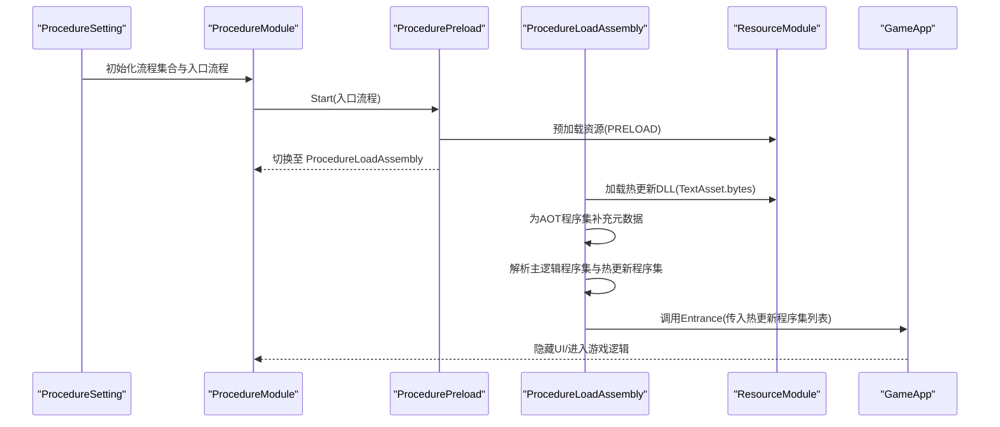
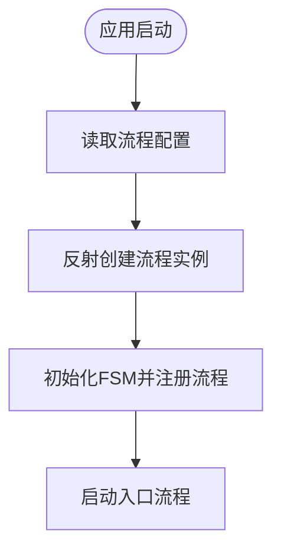
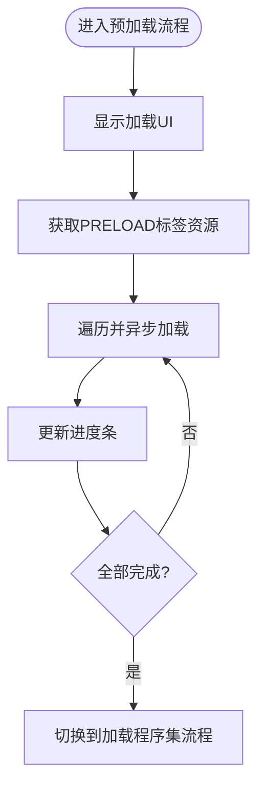
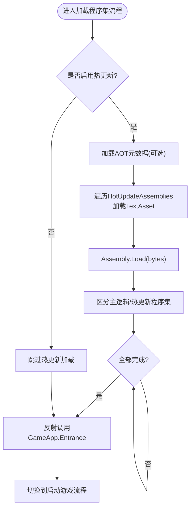
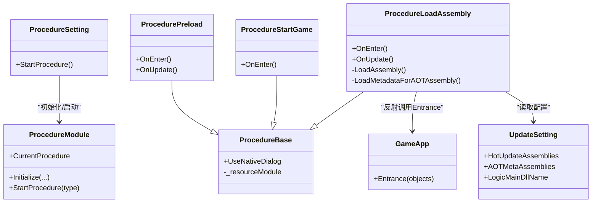

# 热更新流程

<cite>
**本文引用的文件**   
- [ProcedureLoadAssembly.cs](file://UnityProject/Assets/GameScripts/Procedure/ProcedureLoadAssembly.cs)
- [GameApp.cs](file://UnityProject/Assets/GameScripts/HotFix/GameLogic/GameApp.cs)
- [ProcedureBase.cs](file://UnityProject/Assets/GameScripts/Procedure/ProcedureBase.cs)
- [ProcedurePreload.cs](file://UnityProject/Assets/GameScripts/Procedure/ProcedurePreload.cs)
- [ProcedureModule.cs](file://UnityProject/Assets/TEngine/Runtime/Module/ProcedureModule/ProcedureModule.cs)
- [ProcedureSetting.cs](file://UnityProject/Assets/TEngine/Runtime/Module/ProcedureModule/ProcedureSetting.cs)
- [UpdateSetting.asset](file://UnityProject/Assets/TEngine/Settings/UpdateSetting.asset)
- [ProcedureStartGame.cs](file://UnityProject/Assets/GameScripts/Procedure/ProcedureStartGame.cs)
</cite>

## 目录
1. [简介](#简介)
2. [项目结构](#项目结构)
3. [核心组件](#核心组件)
4. [架构总览](#架构总览)
5. [详细组件分析](#详细组件分析)
6. [依赖关系分析](#依赖关系分析)
7. [性能与资源协作](#性能与资源协作)
8. [自定义扩展点](#自定义扩展点)
9. [故障恢复与排错](#故障恢复与排错)
10. [结论](#结论)

## 简介
本文面向 TEngine 的热更新体系，系统性梳理从启动到热更新代码执行的完整流程。重点包括：
- 程序集下载、校验、加载与初始化
- ProcedureLoadAssembly 的实现原理与状态机流转
- 热更新 DLL 的生命周期管理
- 与资源管理的协作机制（含依赖资源的预加载策略）
- 可插拔的扩展方法与故障恢复机制
- 通过流程图和状态图直观展示整体过程

## 项目结构
本仓库采用 Unity + TEngine 框架组织，热更新相关逻辑主要位于 GameScripts/Procedure 与 HotFix 目录，配置集中在 Settings/UpdateSetting.asset，流程引擎在 TEngine/Runtime/Module/ProcedureModule。

图表来源
- [ProcedureSetting.cs:55-102](file://UnityProject/Assets/TEngine/Runtime/Module/ProcedureModule/ProcedureSetting.cs#L55-L102)
- [ProcedureModule.cs:86-109](file://UnityProject/Assets/TEngine/Runtime/Module/ProcedureModule/ProcedureModule.cs#L86-L109)
- [ProcedurePreload.cs:170-173](file://UnityProject/Assets/GameScripts/Procedure/ProcedurePreload.cs#L170-L173)
- [ProcedureLoadAssembly.cs:124-150](file://UnityProject/Assets/GameScripts/Procedure/ProcedureLoadAssembly.cs#L124-L150)
- [ProcedureStartGame.cs:12-22](file://UnityProject/Assets/GameScripts/Procedure/ProcedureStartGame.cs#L12-L22)
- [GameApp.cs:25-40](file://UnityProject/Assets/GameScripts/HotFix/GameLogic/GameApp.cs#L25-L40)
- [UpdateSetting.asset:16-29](file://UnityProject/Assets/TEngine/Settings/UpdateSetting.asset#L16-L29)

章节来源
- [ProcedureSetting.cs:55-102](file://UnityProject/Assets/TEngine/Runtime/Module/ProcedureModule/ProcedureSetting.cs#L55-L102)
- [ProcedureModule.cs:86-109](file://UnityProject/Assets/TEngine/Runtime/Module/ProcedureModule/ProcedureModule.cs#L86-L109)
- [ProcedurePreload.cs:170-173](file://UnityProject/Assets/GameScripts/Procedure/ProcedurePreload.cs#L170-L173)
- [ProcedureLoadAssembly.cs:124-150](file://UnityProject/Assets/GameScripts/Procedure/ProcedureLoadAssembly.cs#L124-L150)
- [ProcedureStartGame.cs:12-22](file://UnityProject/Assets/GameScripts/Procedure/ProcedureStartGame.cs#L12-L22)
- [GameApp.cs:25-40](file://UnityProject/Assets/GameScripts/HotFix/GameLogic/GameApp.cs#L25-L40)
- [UpdateSetting.asset:16-29](file://UnityProject/Assets/TEngine/Settings/UpdateSetting.asset#L16-L29)

## 核心组件
- 流程配置与启动
  - ProcedureSetting：从 ScriptableObject 中读取可用流程类型与入口流程，反射创建并交由 ProcedureModule 管理。
  - ProcedureModule：封装 FSM，提供 Start/Has/Get/Restart 等能力，维护当前流程与生命周期。
- 预加载流程
  - ProcedurePreload：负责资源预加载（如 PRELOAD 标签），完成后切换到加载程序集流程。
- 程序集加载流程
  - ProcedureLoadAssembly：核心热更新流程，负责 AOT 元数据补充、热更新程序集下载/加载、验证与调用 GameApp.Entrance。
- 热更新入口
  - GameApp：热更新域的主入口，接收已加载的热更新程序集列表，启动游戏逻辑。

章节来源
- [ProcedureSetting.cs:55-102](file://UnityProject/Assets/TEngine/Runtime/Module/ProcedureModule/ProcedureSetting.cs#L55-L102)
- [ProcedureModule.cs:86-109](file://UnityProject/Assets/TEngine/Runtime/Module/ProcedureModule/ProcedureModule.cs#L86-L109)
- [ProcedurePreload.cs:118-173](file://UnityProject/Assets/GameScripts/Procedure/ProcedurePreload.cs#L118-L173)
- [ProcedureLoadAssembly.cs:36-150](file://UnityProject/Assets/GameScripts/Procedure/ProcedureLoadAssembly.cs#L36-L150)
- [GameApp.cs:25-40](file://UnityProject/Assets/GameScripts/HotFix/GameLogic/GameApp.cs#L25-L40)

## 架构总览
下图展示了从流程系统启动到热更新代码执行的关键交互路径。

图表来源
- [ProcedureSetting.cs:55-102](file://UnityProject/Assets/TEngine/Runtime/Module/ProcedureModule/ProcedureSetting.cs#L55-L102)
- [ProcedureModule.cs:86-109](file://UnityProject/Assets/TEngine/Runtime/Module/ProcedureModule/ProcedureModule.cs#L86-L109)
- [ProcedurePreload.cs:118-173](file://UnityProject/Assets/GameScripts/Procedure/ProcedurePreload.cs#L118-L173)
- [ProcedureLoadAssembly.cs:50-150](file://UnityProject/Assets/GameScripts/Procedure/ProcedureLoadAssembly.cs#L50-L150)
- [GameApp.cs:25-40](file://UnityProject/Assets/GameScripts/HotFix/GameLogic/GameApp.cs#L25-L40)

## 详细组件分析

### 流程系统与入口
- ProcedureSetting 根据配置的可用流程类型名数组，反射创建流程实例，并选择入口流程；随后交给 ProcedureModule 初始化并启动。
- ProcedureModule 基于 FSM 管理流程生命周期，对外暴露 Start/Has/Get/Restart 等方法。

图表来源
- [ProcedureSetting.cs:55-102](file://UnityProject/Assets/TEngine/Runtime/Module/ProcedureModule/ProcedureSetting.cs#L55-L102)
- [ProcedureModule.cs:86-109](file://UnityProject/Assets/TEngine/Runtime/Module/ProcedureModule/ProcedureModule.cs#L86-L109)

章节来源
- [ProcedureSetting.cs:55-102](file://UnityProject/Assets/TEngine/Runtime/Module/ProcedureModule/ProcedureSetting.cs#L55-L102)
- [ProcedureModule.cs:86-109](file://UnityProject/Assets/TEngine/Runtime/Module/ProcedureModule/ProcedureModule.cs#L86-L109)

### 预加载流程（ProcedurePreload）
- 职责：按标签（如 PRELOAD）批量预加载资源，并在全部完成或失败后切换到加载程序集流程。
- 关键点：
  - 使用 ResourceModule 异步加载资源，统计成功/失败项并更新 UI 进度。
  - 当所有预加载任务完成，调用 ChangeState 切换到 ProcedureLoadAssembly。

图表来源
- [ProcedurePreload.cs:41-100](file://UnityProject/Assets/GameScripts/Procedure/ProcedurePreload.cs#L41-L100)
- [ProcedurePreload.cs:118-173](file://UnityProject/Assets/GameScripts/Procedure/ProcedurePreload.cs#L118-L173)

章节来源
- [ProcedurePreload.cs:41-100](file://UnityProject/Assets/GameScripts/Procedure/ProcedurePreload.cs#L41-L100)
- [ProcedurePreload.cs:118-173](file://UnityProject/Assets/GameScripts/Procedure/ProcedurePreload.cs#L118-L173)

### 程序集加载流程（ProcedureLoadAssembly）
- 职责：
  - 可选地为 AOT 程序集加载元数据，避免 AOT 泛型方法在无 native 实现时崩溃。
  - 根据 UpdateSetting 中的 HotUpdateAssemblies 列表，通过 ResourceModule 加载 TextAsset 形式的 DLL。
  - 将主逻辑程序集与热更新程序集分别识别，最终反射调用 GameApp.Entrance。
- 关键步骤：
  - OnEnter 触发 LoadAssembly 异步流程。
  - 若启用热更新且非编辑器模拟模式，则遍历 HotUpdateAssemblies，逐个加载 TextAsset。
  - 加载成功后通过 Assembly.Load(bytes) 载入程序集，区分主逻辑与热更新程序集。
  - 等待所有程序集与 AOT 元数据加载完成，再调用 AllAssemblyLoadComplete。
  - AllAssemblyLoadComplete 中查找主逻辑程序集的 GameApp 类型与 Entrance 方法，并传入热更新程序集列表。
  - 完成后切换到 ProcedureStartGame，隐藏 UI 进入游戏。

图表来源
- [ProcedureLoadAssembly.cs:42-150](file://UnityProject/Assets/GameScripts/Procedure/ProcedureLoadAssembly.cs#L42-L150)
- [ProcedureLoadAssembly.cs:181-218](file://UnityProject/Assets/GameScripts/Procedure/ProcedureLoadAssembly.cs#L181-L218)
- [ProcedureLoadAssembly.cs:220-292](file://UnityProject/Assets/GameScripts/Procedure/ProcedureLoadAssembly.cs#L220-L292)
- [GameApp.cs:25-40](file://UnityProject/Assets/GameScripts/HotFix/GameLogic/GameApp.cs#L25-L40)

章节来源
- [ProcedureLoadAssembly.cs:42-150](file://UnityProject/Assets/GameScripts/Procedure/ProcedureLoadAssembly.cs#L42-L150)
- [ProcedureLoadAssembly.cs:181-218](file://UnityProject/Assets/GameScripts/Procedure/ProcedureLoadAssembly.cs#L181-L218)
- [ProcedureLoadAssembly.cs:220-292](file://UnityProject/Assets/GameScripts/Procedure/ProcedureLoadAssembly.cs#L220-L292)
- [GameApp.cs:25-40](file://UnityProject/Assets/GameScripts/HotFix/GameLogic/GameApp.cs#L25-L40)

### 启动游戏流程（ProcedureStartGame）
- 职责：隐藏加载 UI，过渡到实际游戏逻辑阶段。
- 行为：OnEnter 中异步隐藏所有 UI，结束加载阶段。

章节来源
- [ProcedureStartGame.cs:12-22](file://UnityProject/Assets/GameScripts/Procedure/ProcedureStartGame.cs#L12-L22)

### 热更新入口（GameApp）
- 职责：作为热更新域的主入口，接收热更新程序集列表，初始化事件系统，启动游戏逻辑。
- 行为：Entrance 中记录热更新程序集，注册销毁回调，调用 StartGameLogic 展示 UI 或执行业务逻辑。

章节来源
- [GameApp.cs:25-40](file://UnityProject/Assets/GameScripts/HotFix/GameLogic/GameApp.cs#L25-L40)

## 依赖关系分析
- 流程层依赖
  - ProcedureSetting 依赖 ProcedureModule 进行流程管理与启动。
  - 各流程继承自 ProcedureBase，统一访问 ResourceModule。
- 热更新层依赖
  - ProcedureLoadAssembly 依赖 ResourceModule 加载 TextAsset 形式的 DLL。
  - 通过 UpdateSetting 配置热更新程序集名称、AOT 元数据程序集、主逻辑程序集名称等。
  - 通过反射调用 GameApp.Entrance，传递热更新程序集列表。

图表来源
- [ProcedureSetting.cs:55-102](file://UnityProject/Assets/TEngine/Runtime/Module/ProcedureModule/ProcedureSetting.cs#L55-L102)
- [ProcedureModule.cs:86-109](file://UnityProject/Assets/TEngine/Runtime/Module/ProcedureModule/ProcedureModule.cs#L86-L109)
- [ProcedureBase.cs:5-14](file://UnityProject/Assets/GameScripts/Procedure/ProcedureBase.cs#L5-L14)
- [ProcedurePreload.cs:16-173](file://UnityProject/Assets/GameScripts/Procedure/ProcedurePreload.cs#L16-L173)
- [ProcedureLoadAssembly.cs:19-150](file://UnityProject/Assets/GameScripts/Procedure/ProcedureLoadAssembly.cs#L19-L150)
- [ProcedureStartGame.cs:8-22](file://UnityProject/Assets/GameScripts/Procedure/ProcedureStartGame.cs#L8-L22)
- [GameApp.cs:17-40](file://UnityProject/Assets/GameScripts/HotFix/GameLogic/GameApp.cs#L17-L40)
- [UpdateSetting.asset:16-29](file://UnityProject/Assets/TEngine/Settings/UpdateSetting.asset#L16-L29)

章节来源
- [ProcedureSetting.cs:55-102](file://UnityProject/Assets/TEngine/Runtime/Module/ProcedureModule/ProcedureSetting.cs#L55-L102)
- [ProcedureModule.cs:86-109](file://UnityProject/Assets/TEngine/Runtime/Module/ProcedureModule/ProcedureModule.cs#L86-L109)
- [ProcedureBase.cs:5-14](file://UnityProject/Assets/GameScripts/Procedure/ProcedureBase.cs#L5-L14)
- [ProcedurePreload.cs:16-173](file://UnityProject/Assets/GameScripts/Procedure/ProcedurePreload.cs#L16-L173)
- [ProcedureLoadAssembly.cs:19-150](file://UnityProject/Assets/GameScripts/Procedure/ProcedureLoadAssembly.cs#L19-L150)
- [ProcedureStartGame.cs:8-22](file://UnityProject/Assets/GameScripts/Procedure/ProcedureStartGame.cs#L8-L22)
- [GameApp.cs:17-40](file://UnityProject/Assets/GameScripts/HotFix/GameLogic/GameApp.cs#L17-L40)
- [UpdateSetting.asset:16-29](file://UnityProject/Assets/TEngine/Settings/UpdateSetting.asset#L16-L29)

## 性能与资源协作
- 预加载策略
  - ProcedurePreload 通过 ResourceModule.GetAssetInfos("PRELOAD") 批量拉取需要预热的资源，减少首次运行时卡顿。
  - WebGL 平台额外支持 WEBGL_PRELOAD 标签，适配不同平台的资源加载差异。
- 程序集加载优化
  - ProcedureLoadAssembly 使用异步加载 TextAsset，避免阻塞主线程。
  - 对 AOT 程序集提前补充元数据，降低运行期解释器分支带来的抖动。
- 内存管理
  - 每次加载 TextAsset 成功后立即 UnloadAsset，避免长时间持有二进制数据。
  - 热更新程序集以 Assembly 形式驻留，由 AppDomain 管理生命周期。

章节来源
- [ProcedurePreload.cs:118-173](file://UnityProject/Assets/GameScripts/Procedure/ProcedurePreload.cs#L118-L173)
- [ProcedureLoadAssembly.cs:181-218](file://UnityProject/Assets/GameScripts/Procedure/ProcedureLoadAssembly.cs#L181-L218)
- [ProcedureLoadAssembly.cs:220-292](file://UnityProject/Assets/GameScripts/Procedure/ProcedureLoadAssembly.cs#L220-L292)

## 自定义扩展点
- 扩展热更新程序集清单
  - 修改 UpdateSetting.asset 中的 HotUpdateAssemblies，添加新的热更新 DLL 名称。
- 扩展 AOT 元数据
  - 在 UpdateSetting.asset 的 AOTMetaAssemblies 中添加需要补充元数据的程序集名称。
- 自定义预加载资源
  - 在资源系统中为需要预热的资源打上 PRELOAD 标签（WebGL 可使用 WEBGL_PRELOAD）。
- 替换入口逻辑
  - 保持主逻辑程序集中存在 GameApp 类型与 Entrance 静态方法，可在其中注入自定义初始化逻辑。
- 流程扩展
  - 新增流程类继承 ProcedureBase，并在 ProcedureSetting 中注册，即可接入流程系统。

章节来源
- [UpdateSetting.asset:16-29](file://UnityProject/Assets/TEngine/Settings/UpdateSetting.asset#L16-L29)
- [ProcedureSetting.cs:55-102](file://UnityProject/Assets/TEngine/Runtime/Module/ProcedureModule/ProcedureSetting.cs#L55-L102)
- [ProcedureBase.cs:5-14](file://UnityProject/Assets/GameScripts/Procedure/ProcedureBase.cs#L5-L14)
- [GameApp.cs:25-40](file://UnityProject/Assets/GameScripts/HotFix/GameLogic/GameApp.cs#L25-L40)

## 故障恢复与排错
- 常见错误与定位
  - 主逻辑程序集缺失：检查 LogicMainDllName 与 ENABLE_HYBRIDCLR 定义，确认对应 .bytes 文件存在。
  - 主逻辑类型或入口方法缺失：确保主逻辑程序集中包含 GameApp 类型与 Entrance 方法。
  - 热更新程序集加载失败：检查 HotUpdateAssemblies 列表与资源地址是否正确，查看日志中的异常信息。
  - AOT 元数据加载失败：核对 AOTMetaAssemblies 列表与对应 .bytes 文件是否存在。
- 恢复建议
  - 回滚到上一个稳定版本的热更新包，重新触发预加载与程序集加载。
  - 在编辑器模式下，先验证资源地址与程序集名称是否与 UpdateSetting 一致。
  - 增加日志输出，定位具体失败的程序集或资源位置。

章节来源
- [ProcedureLoadAssembly.cs:124-150](file://UnityProject/Assets/GameScripts/Procedure/ProcedureLoadAssembly.cs#L124-L150)
- [ProcedureLoadAssembly.cs:181-218](file://UnityProject/Assets/GameScripts/Procedure/ProcedureLoadAssembly.cs#L181-L218)
- [ProcedureLoadAssembly.cs:220-292](file://UnityProject/Assets/GameScripts/Procedure/ProcedureLoadAssembly.cs#L220-L292)

## 结论
TEngine 的热更新流程通过流程系统驱动，结合 ResourceModule 与 HybridCLR 的能力，实现了从资源预加载、程序集下载与校验、AOT 元数据补充到热更新入口调用的完整闭环。开发者可通过 UpdateSetting 与流程配置灵活扩展热更新内容，同时借助异步加载与资源卸载策略保障性能与稳定性。建议在发布前充分验证配置与资源完整性，并在异常场景下具备回滚与日志追踪能力。