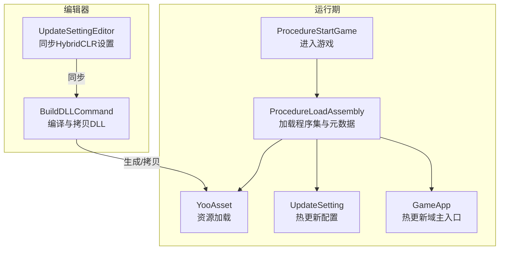
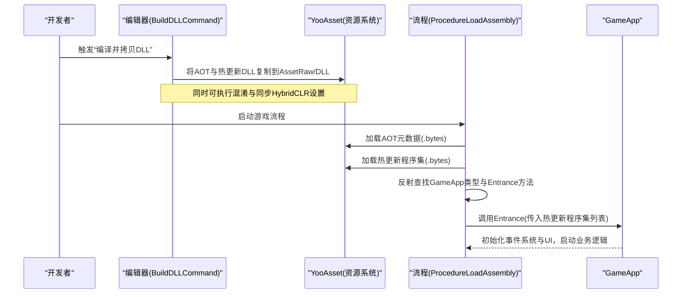
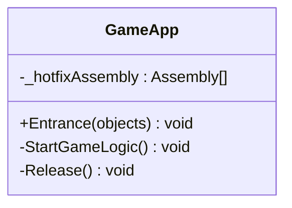
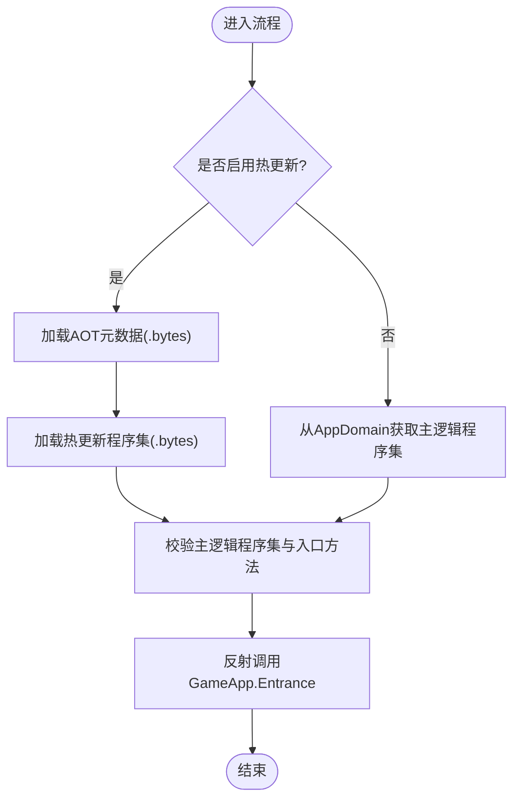
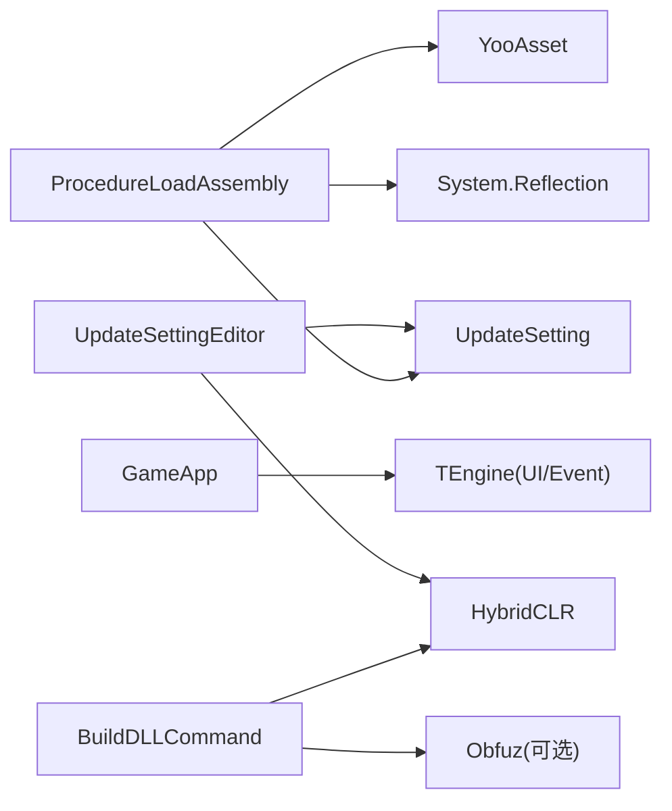

# 热更新系统

<cite>
**本文引用的文件**   
- [GameApp.cs](file://UnityProject/Assets/GameScripts/HotFix/GameLogic/GameApp.cs)
- [ProcedureLoadAssembly.cs](file://UnityProject/Assets/GameScripts/Procedure/ProcedureLoadAssembly.cs)
- [ProcedureStartGame.cs](file://UnityProject/Assets/GameScripts/Procedure/ProcedureStartGame.cs)
- [UpdateSetting.asset](file://UnityProject/Assets/TEngine/Settings/UpdateSetting.asset)
- [BuildDLLCommand.cs](file://UnityProject/Assets/TEngine/Editor/HybridCLR/BuildDLLCommand.cs)
- [UpdateSettingEditor.cs](file://UnityProject/Assets/TEngine/Editor/Utility/UpdateSettingEditor.cs)
</cite>

## 目录
1. [简介](#简介)
2. [项目结构](#项目结构)
3. [核心组件](#核心组件)
4. [架构总览](#架构总览)
5. [详细组件分析](#详细组件分析)
6. [依赖关系分析](#依赖关系分析)
7. [性能与资源集成](#性能与资源集成)
8. [版本控制与回滚](#版本控制与回滚)
9. [开发最佳实践](#开发最佳实践)
10. [调试与问题排查](#调试与问题排查)
11. [平台注意事项](#平台注意事项)
12. [结论](#结论)

## 简介
本文件系统性梳理 TEngine 基于 HybridCLR 的热更新方案，重点解释以下方面：
- 以 GameApp 作为热更新域主入口的设计思想与控制流。
- 程序集加载、热更新 DLL 管理、AOT 元数据补充的完整流程。
- 与 YooAsset 资源系统的集成方式及打包部署路径。
- 版本控制机制、兼容性处理与回滚策略。
- 开发组织、依赖管理与多平台注意事项。
- 调试、排障与回滚的实用指南。

## 项目结构
围绕热更新的关键代码与配置集中在以下位置：
- 运行时入口与流程：
  - Unity 启动后通过流程模块逐步初始化资源、下载更新、加载热更程序集，最终进入游戏逻辑。
- 热更新程序集与 AOT 元数据：
  - 编辑器侧负责编译、拷贝 AOT 与热更新 DLL 到指定目录，并同步 HybridCLR 设置。
  - 运行期通过 YooAsset 加载 .bytes 形式的程序集与元数据，完成加载与 Hook。
- 配置中心：
  - UpdateSetting.asset 集中管理热更新程序集列表、AOT 元数据列表、主逻辑程序集名称、资源下载地址等。

图表来源
- [BuildDLLCommand.cs:86-174](file://UnityProject/Assets/TEngine/Editor/HybridCLR/BuildDLLCommand.cs#L86-L174)
- [UpdateSettingEditor.cs:48-98](file://UnityProject/Assets/TEngine/Editor/Utility/UpdateSettingEditor.cs#L48-L98)
- [ProcedureLoadAssembly.cs:50-150](file://UnityProject/Assets/GameScripts/Procedure/ProcedureLoadAssembly.cs#L50-L150)
- [UpdateSetting.asset:16-36](file://UnityProject/Assets/TEngine/Settings/UpdateSetting.asset#L16-L36)

章节来源
- [BuildDLLCommand.cs:86-174](file://UnityProject/Assets/TEngine/Editor/HybridCLR/BuildDLLCommand.cs#L86-L174)
- [UpdateSettingEditor.cs:48-98](file://UnityProject/Assets/TEngine/Editor/Utility/UpdateSettingEditor.cs#L48-L98)
- [ProcedureLoadAssembly.cs:50-150](file://UnityProject/Assets/GameScripts/Procedure/ProcedureLoadAssembly.cs#L50-L150)
- [UpdateSetting.asset:16-36](file://UnityProject/Assets/TEngine/Settings/UpdateSetting.asset#L16-L36)

## 核心组件
- GameApp：热更新域的主入口，负责事件系统初始化、接收热更新程序集集合、启动业务逻辑与释放资源。
- ProcedureLoadAssembly：流程阶段，负责加载 AOT 元数据、热更新程序集（.bytes），并通过反射调用 GameApp.Entrance。
- UpdateSetting：热更新配置，包含热更新程序集列表、AOT 元数据列表、主逻辑程序集名、资源下载路径等。
- BuildDLLCommand：编辑器命令，负责编译 DLL、拷贝 AOT 与热更新 DLL 到 AssetRaw/DLL，并在启用混淆时执行混淆与复制。
- UpdateSettingEditor：编辑器工具，将 UpdateSetting 中的热更新程序集列表同步到 HybridCLRSettings，确保构建管线识别正确的热更新程序集。

章节来源
- [GameApp.cs:17-47](file://UnityProject/Assets/GameScripts/HotFix/GameLogic/GameApp.cs#L17-L47)
- [ProcedureLoadAssembly.cs:19-150](file://UnityProject/Assets/GameScripts/Procedure/ProcedureLoadAssembly.cs#L19-L150)
- [UpdateSetting.asset:16-36](file://UnityProject/Assets/TEngine/Settings/UpdateSetting.asset#L16-L36)
- [BuildDLLCommand.cs:86-174](file://UnityProject/Assets/TEngine/Editor/HybridCLR/BuildDLLCommand.cs#L86-L174)
- [UpdateSettingEditor.cs:48-98](file://UnityProject/Assets/TEngine/Editor/Utility/UpdateSettingEditor.cs#L48-L98)

## 架构总览
下图展示从编辑器构建到运行期加载热更新程序的端到端流程：

图表来源
- [BuildDLLCommand.cs:86-174](file://UnityProject/Assets/TEngine/Editor/HybridCLR/BuildDLLCommand.cs#L86-L174)
- [ProcedureLoadAssembly.cs:50-150](file://UnityProject/Assets/GameScripts/Procedure/ProcedureLoadAssembly.cs#L50-L150)
- [GameApp.cs:25-40](file://UnityProject/Assets/GameScripts/HotFix/GameLogic/GameApp.cs#L25-L40)

## 详细组件分析

### GameApp：热更新域主入口
- 设计要点：
  - Entrance 是热更新域的固定入口点，由流程阶段通过反射调用。
  - 接收热更新程序集列表，用于后续按需加载或注册。
  - 初始化事件系统，挂载销毁监听，启动 UI 与业务逻辑。
  - Release 统一释放单例系统，避免内存泄漏。
- 关键行为：
  - 入口参数为 object[]，内部解析出 List<Assembly>。
  - 启动 UI 示例展示了与 TEngine UI 模块的集成。

图表来源
- [GameApp.cs:17-47](file://UnityProject/Assets/GameScripts/HotFix/GameLogic/GameApp.cs#L17-L47)

章节来源
- [GameApp.cs:17-47](file://UnityProject/Assets/GameScripts/HotFix/GameLogic/GameApp.cs#L17-L47)

### ProcedureLoadAssembly：程序集加载流程
- 职责：
  - 根据 UpdateSetting 决定是否启用热更新。
  - 在非编辑器模式且启用热更新时，通过 YooAsset 加载 AOT 元数据与热更新程序集。
  - 在编辑器模拟模式下，直接从当前 AppDomain 中获取已加载的程序集。
  - 加载完成后，反射查找 GameApp 类型与 Entrance 方法，并调用之。
- 关键点：
  - LoadMetadataForAOTAssembly：为 AOT 程序集补充元数据，使缺失 native 实现的泛型函数回退到解释器执行。
  - LoadAssetSuccess：将 TextAsset.bytes 转换为 Assembly，区分主逻辑程序集与热更新程序集。
  - AllAssemblyLoadComplete：校验主逻辑程序集与入口方法存在，然后调用入口。

图表来源
- [ProcedureLoadAssembly.cs:50-150](file://UnityProject/Assets/GameScripts/Procedure/ProcedureLoadAssembly.cs#L50-L150)
- [ProcedureLoadAssembly.cs:224-292](file://UnityProject/Assets/GameScripts/Procedure/ProcedureLoadAssembly.cs#L224-L292)

章节来源
- [ProcedureLoadAssembly.cs:50-150](file://UnityProject/Assets/GameScripts/Procedure/ProcedureLoadAssembly.cs#L50-L150)
- [ProcedureLoadAssembly.cs:224-292](file://UnityProject/Assets/GameScripts/Procedure/ProcedureLoadAssembly.cs#L224-L292)

### UpdateSetting：热更新配置
- 关键字段：
  - HotUpdateAssemblies：热更新程序集列表，如 GameProto.dll、GameLogic.dll。
  - AOTMetaAssemblies：需要补充元数据的 AOT 程序集列表。
  - LogicMainDllName：主逻辑程序集名称，用于定位 GameApp 所在程序集。
  - AssemblyTextAssetExtension / AssemblyTextAssetPath：程序集资源扩展名与路径。
  - ResDownLoadPath / FallbackResDownLoadPath：资源下载主备地址。
- 作用：
  - 驱动 ProcedureLoadAssembly 的加载行为。
  - 指导编辑器脚本与发布流程的资源组织。

章节来源
- [UpdateSetting.asset:16-36](file://UnityProject/Assets/TEngine/Settings/UpdateSetting.asset#L16-L36)

### BuildDLLCommand：编辑器构建与拷贝
- 功能：
  - 提供菜单命令“编译并拷贝DLL”，调用 CompileDllCommand 编译热更新程序集。
  - 将裁剪后的 AOT 程序集与热更新程序集复制到 AssetRaw/DLL，并以 .bytes 形式供 YooAsset 加载。
  - 在启用 Obfuz 时，对热更新程序集进行混淆，并将混淆产物复制到目标路径。
- 关键点：
  - CopyAOTAssembliesToAssetPath：按 UpdateSetting.AOTMetaAssemblies 拷贝 AOT 元数据 DLL。
  - CopyHotUpdateAssembliesToAssetPath：按 SettingsUtil.HotUpdateAssemblyFilesExcludePreserved 拷贝热更新 DLL。
  - 支持混淆流水线，保持热更新程序集名称与保留规则一致。

章节来源
- [BuildDLLCommand.cs:86-174](file://UnityProject/Assets/TEngine/Editor/HybridCLR/BuildDLLCommand.cs#L86-L174)

### UpdateSettingEditor：设置同步
- 功能：
  - 将 UpdateSetting.HotUpdateAssemblies 同步到 HybridCLRSettings.instance.hotUpdateAssemblies。
  - 在修改后保存 HybridCLRSettings，确保构建管线正确识别热更新程序集。
- 价值：
  - 保证编辑器与运行期对热更新程序集的认知一致，减少构建错误。

章节来源
- [UpdateSettingEditor.cs:48-98](file://UnityProject/Assets/TEngine/Editor/Utility/UpdateSettingEditor.cs#L48-L98)

## 依赖关系分析
- 运行时依赖：
  - ProcedureLoadAssembly 依赖 YooAsset 加载 .bytes 资源，依赖 UpdateSetting 获取配置，依赖 System.Reflection 进行类型与方法查找。
  - GameApp 依赖 TEngine 的事件系统与 UI 模块。
- 编辑器依赖：
  - BuildDLLCommand 依赖 HybridCLR 的命令与设置工具，以及可能的 Obfuz 混淆工具。
  - UpdateSettingEditor 依赖 HybridCLRSettings 与 UpdateSetting。

图表来源
- [ProcedureLoadAssembly.cs:50-150](file://UnityProject/Assets/GameScripts/Procedure/ProcedureLoadAssembly.cs#L50-L150)
- [GameApp.cs:25-40](file://UnityProject/Assets/GameScripts/HotFix/GameLogic/GameApp.cs#L25-L40)
- [BuildDLLCommand.cs:86-174](file://UnityProject/Assets/TEngine/Editor/HybridCLR/BuildDLLCommand.cs#L86-L174)
- [UpdateSettingEditor.cs:48-98](file://UnityProject/Assets/TEngine/Editor/Utility/UpdateSettingEditor.cs#L48-L98)

章节来源
- [ProcedureLoadAssembly.cs:50-150](file://UnityProject/Assets/GameScripts/Procedure/ProcedureLoadAssembly.cs#L50-L150)
- [GameApp.cs:25-40](file://UnityProject/Assets/GameScripts/HotFix/GameLogic/GameApp.cs#L25-L40)
- [BuildDLLCommand.cs:86-174](file://UnityProject/Assets/TEngine/Editor/HybridCLR/BuildDLLCommand.cs#L86-L174)
- [UpdateSettingEditor.cs:48-98](file://UnityProject/Assets/TEngine/Editor/Utility/UpdateSettingEditor.cs#L48-L98)

## 性能与资源集成
- 资源加载：
  - 热更新程序集与 AOT 元数据均以 TextAsset.bytes 形式通过 YooAsset 加载，避免直接文件系统 IO 带来的平台差异。
  - 加载成功后立即卸载 TextAsset，减少内存占用。
- 元数据补充：
  - 为 AOT 程序集补充元数据，使缺失 native 实现的泛型函数自动回退到解释器执行，提升兼容性与稳定性。
- 性能建议：
  - 合理拆分热更新程序集，避免单个 DLL 过大导致加载时间过长。
  - 使用增量更新策略，仅下发变更的程序集与资源。
  - 在编辑器模拟模式下优先使用 AppDomain 已加载程序集，减少重复加载开销。

章节来源
- [ProcedureLoadAssembly.cs:185-218](file://UnityProject/Assets/GameScripts/Procedure/ProcedureLoadAssembly.cs#L185-L218)
- [ProcedureLoadAssembly.cs:224-292](file://UnityProject/Assets/GameScripts/Procedure/ProcedureLoadAssembly.cs#L224-L292)

## 版本控制与回滚
- 版本标识：
  - 通过 UpdateSetting.ResDownLoadPath 与 FallbackResDownLoadPath 定义主备资源服务器，可在服务端实现版本清单与回滚策略。
- 回滚机制：
  - 客户端可根据服务端下发的版本号决定加载哪个版本的程序集与资源；若新版本异常，可切换至备用地址或旧版本清单。
  - 建议在业务层增加健康检查与快速回滚开关，结合日志与监控实现自动化降级。
- 兼容性处理：
  - 主逻辑程序集名称固定为 LogicMainDllName，确保入口稳定；热更新程序集可按模块拆分，但需保证接口向后兼容。
  - 对于破坏性变更，应通过新的主逻辑程序集版本与资源包版本共同演进，避免直接替换引发崩溃。

章节来源
- [UpdateSetting.asset:32-36](file://UnityProject/Assets/TEngine/Settings/UpdateSetting.asset#L32-L36)

## 开发最佳实践
- 代码组织：
  - 将易变逻辑放入热更新程序集（如 GameLogic.dll），稳定框架与基础库留在主程序集。
  - 使用清晰的命名空间与模块划分，便于独立编译与测试。
- 依赖管理：
  - 在 UpdateSetting.HotUpdateAssemblies 中声明所有热更新程序集，确保构建与运行期一致。
  - 使用 UpdateSettingEditor 同步 HybridCLRSettings，避免遗漏。
- 版本兼容性：
  - 对外暴露稳定的接口与数据结构，避免破坏性变更。
  - 对重大变更采用双版本并行过渡，逐步迁移客户端。
- 构建与发布：
  - 使用“编译并拷贝DLL”命令生成 .bytes 资源，确保 YooAsset 能正确加载。
  - 在启用混淆时，确认保留规则与热更新程序集名称一致，避免反射失败。

章节来源
- [UpdateSetting.asset:16-36](file://UnityProject/Assets/TEngine/Settings/UpdateSetting.asset#L16-L36)
- [BuildDLLCommand.cs:86-174](file://UnityProject/Assets/TEngine/Editor/HybridCLR/BuildDLLCommand.cs#L86-L174)
- [UpdateSettingEditor.cs:48-98](file://UnityProject/Assets/TEngine/Editor/Utility/UpdateSettingEditor.cs#L48-L98)

## 调试与问题排查
- 常见问题：
  - 主逻辑程序集缺失：检查 ENABLE_HYBRIDCLR 宏与 LogicMainDllName 对应的 .bytes 是否存在。
  - 入口方法不存在：确认 GameApp.Entrance 签名与反射调用一致。
  - AOT 元数据未加载：检查 AOTMetaAssemblies 列表与对应 .bytes 是否被 YooAsset 加载。
- 排查步骤：
  - 查看日志输出，确认各阶段是否成功加载程序集与元数据。
  - 在编辑器中执行“编译并拷贝DLL”，确认 AssetRaw/DLL 下存在所需的 .bytes 文件。
  - 使用 UpdateSettingEditor 同步 HybridCLRSettings，确保构建管线识别热更新程序集。
- 回滚操作：
  - 若新版本异常，切换到备用资源地址或旧版本清单，重新加载程序集与资源。
  - 在业务层增加快速回滚开关，配合日志与监控实现自动化降级。

章节来源
- [ProcedureLoadAssembly.cs:124-150](file://UnityProject/Assets/GameScripts/Procedure/ProcedureLoadAssembly.cs#L124-L150)
- [ProcedureLoadAssembly.cs:185-218](file://UnityProject/Assets/GameScripts/Procedure/ProcedureLoadAssembly.cs#L185-L218)
- [ProcedureLoadAssembly.cs:224-292](file://UnityProject/Assets/GameScripts/Procedure/ProcedureLoadAssembly.cs#L224-L292)

## 平台注意事项
- 非编辑器模式：
  - 必须加载 AOT 元数据，否则部分泛型函数可能因缺少 native 实现而失败。
  - 热更新程序集必须以 .bytes 形式通过 YooAsset 加载，避免平台文件系统差异。
- 编辑器模式：
  - 可直接从 AppDomain 获取已加载程序集，无需额外加载 .bytes。
  - 建议使用编辑器模拟模式进行快速迭代与调试。
- 混淆与裁剪：
  - 启用 Obfuz 时，需确保热更新程序集名称与保留规则一致，避免反射失败。
  - 裁剪后的 AOT 程序集需在构建后生成，再拷贝到 AssetRaw/DLL。

章节来源
- [ProcedureLoadAssembly.cs:50-150](file://UnityProject/Assets/GameScripts/Procedure/ProcedureLoadAssembly.cs#L50-L150)
- [BuildDLLCommand.cs:104-174](file://UnityProject/Assets/TEngine/Editor/HybridCLR/BuildDLLCommand.cs#L104-L174)

## 结论
TEngine 的热更新系统以 HybridCLR 为基础，通过 YooAsset 统一管理程序集与资源，结合 UpdateSetting 与编辑器工具链，实现了从构建到运行期的完整闭环。GameApp 作为热更新域主入口，提供了稳定的扩展点与生命周期管理。遵循本文的最佳实践与排障指南，可有效提升热更新的稳定性、可维护性与可观测性。