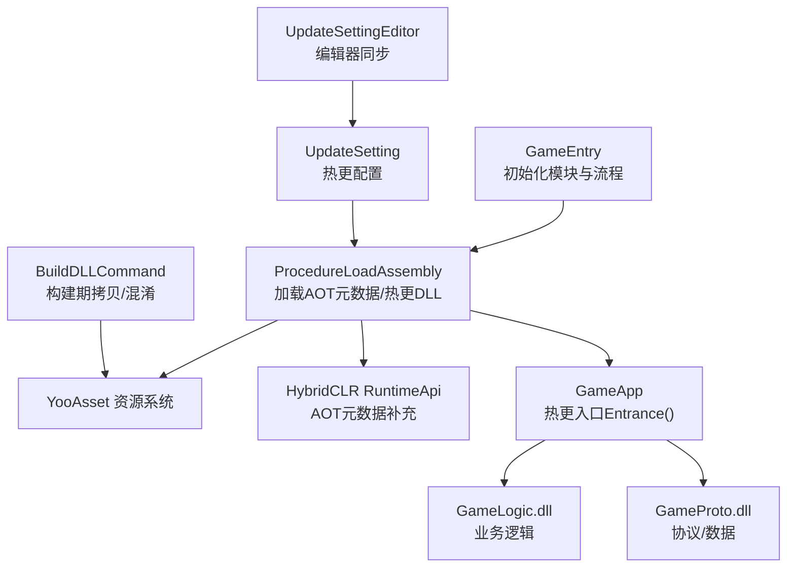
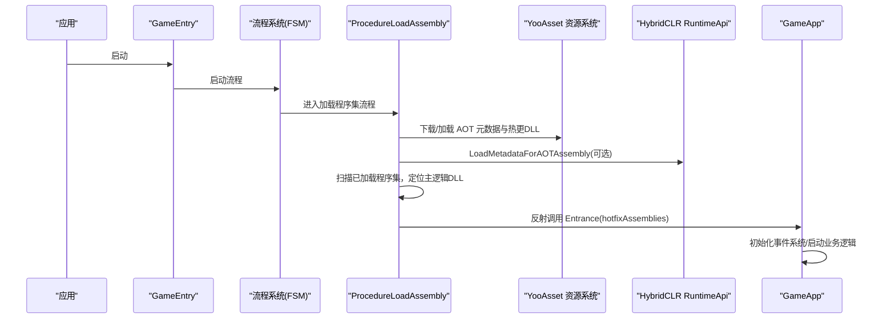
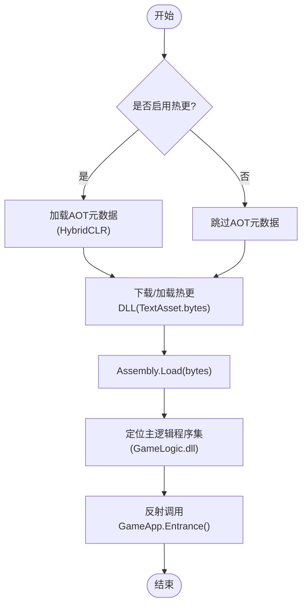
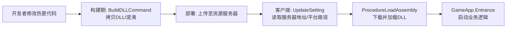
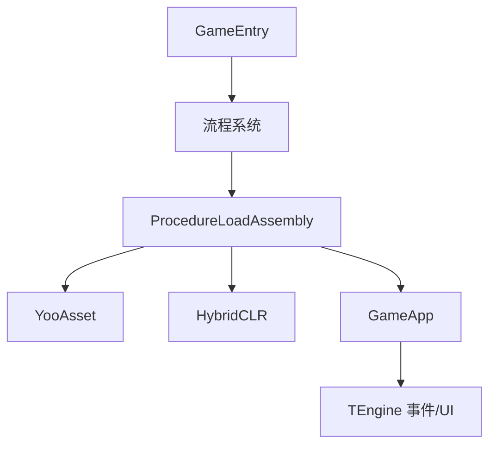

# 程序集管理

<cite>
**本文引用的文件**   
- [GameEntry.cs](file://UnityProject/Assets/GameScripts/GameEntry.cs)
- [ProcedureLoadAssembly.cs](file://UnityProject/Assets/GameScripts/Procedure/ProcedureLoadAssembly.cs)
- [UpdateSetting.cs](file://UnityProject/Assets/TEngine/Runtime/Core/UpdateSetting.cs)
- [UpdateSettingEditor.cs](file://UnityProject/Assets/TEngine/Editor/Utility/UpdateSettingEditor.cs)
- [BuildDLLCommand.cs](file://UnityProject/Assets/TEngine/Editor/HybridCLR/BuildDLLCommand.cs)
- [GameApp.cs](file://UnityProject/Assets/GameScripts/HotFix/GameLogic/GameApp.cs)
- [GameLogic.asmdef](file://UnityProject/Assets/GameScripts/HotFix/GameLogic/GameLogic.asmdef)
- [GameProto.asmdef](file://UnityProject/Assets/GameScripts/HotFix/GameProto/GameProto.asmdef)
</cite>

## 目录
1. [简介](#简介)
2. [项目结构](#项目结构)
3. [核心组件](#核心组件)
4. [架构总览](#架构总览)
5. [详细组件分析](#详细组件分析)
6. [依赖关系分析](#依赖关系分析)
7. [性能与内存考量](#性能与内存考量)
8. [故障排查指南](#故障排查指南)
9. [结论](#结论)
10. [附录：打包、部署与更新流程](#附录打包部署与更新流程)

## 简介
本文件面向“热更新程序集”的管理与使用，覆盖以下主题：
- 程序集的组织结构与命名规范
- 版本管理与依赖关系处理
- 动态加载、卸载与内存管理
- 程序集间通信与接口设计原则
- 热替换机制与兼容性检查
- 自动化打包、部署与更新流程
- 监控、调试与问题诊断方法

本项目基于 Unity + HybridCLR + YooAsset 实现热更新。核心流程由“流程系统（FSM）”驱动，在启动后进入“加载程序集”阶段，从资源系统下载并加载主逻辑与热更程序集，随后通过反射调用热更入口初始化业务逻辑。

## 项目结构
- 运行时入口
  - GameEntry：初始化框架模块并启动流程系统
- 流程系统
  - ProcedureLoadAssembly：负责 AOT 元数据加载、热更程序集下载与加载、主逻辑程序集发现与入口调用
- 配置中心
  - UpdateSetting：集中管理热更开关、程序集清单、AOT 元数据清单、资源服务器地址、平台路径等
- 编辑器工具
  - UpdateSettingEditor：同步 UpdateSetting 到 HybridCLRSettings，便于在编辑器中维护热更程序集列表
  - BuildDLLCommand：构建期复制热更 DLL 到 StreamingAssets，并进行混淆等后处理
- 热更代码组织
  - GameApp：热更域入口，接收已加载的热更程序集列表，启动业务逻辑
  - GameLogic.asmdef / GameProto.asmdef：定义热更程序集及其引用关系

图表来源
- [GameEntry.cs:6-14](file://UnityProject/Assets/GameScripts/GameEntry.cs#L6-L14)
- [ProcedureLoadAssembly.cs:42-150](file://UnityProject/Assets/GameScripts/Procedure/ProcedureLoadAssembly.cs#L42-L150)
- [UpdateSetting.cs:50-90](file://UnityProject/Assets/TEngine/Runtime/Core/UpdateSetting.cs#L50-L90)
- [UpdateSettingEditor.cs:10-70](file://UnityProject/Assets/TEngine/Editor/Utility/UpdateSettingEditor.cs#L10-L70)
- [BuildDLLCommand.cs:107-170](file://UnityProject/Assets/TEngine/Editor/HybridCLR/BuildDLLCommand.cs#L107-L170)
- [GameApp.cs:17-47](file://UnityProject/Assets/GameScripts/HotFix/GameLogic/GameApp.cs#L17-L47)

章节来源
- [GameEntry.cs:6-14](file://UnityProject/Assets/GameScripts/GameEntry.cs#L6-L14)
- [ProcedureLoadAssembly.cs:42-150](file://UnityProject/Assets/GameScripts/Procedure/ProcedureLoadAssembly.cs#L42-L150)
- [UpdateSetting.cs:50-90](file://UnityProject/Assets/TEngine/Runtime/Core/UpdateSetting.cs#L50-L90)
- [UpdateSettingEditor.cs:10-70](file://UnityProject/Assets/TEngine/Editor/Utility/UpdateSettingEditor.cs#L10-L70)
- [BuildDLLCommand.cs:107-170](file://UnityProject/Assets/TEngine/Editor/HybridCLR/BuildDLLCommand.cs#L107-L170)
- [GameApp.cs:17-47](file://UnityProject/Assets/GameScripts/HotFix/GameLogic/GameApp.cs#L17-L47)

## 核心组件
- 流程入口与模块初始化
  - GameEntry：在 Awake 中获取更新驱动、资源模块、调试器、FSM 模块，并启动流程
- 程序集加载流程
  - ProcedureLoadAssembly：负责 AOT 元数据加载、热更程序集下载与加载、主逻辑程序集发现与入口调用
- 热更配置
  - UpdateSetting：集中管理热更开关、热更程序集清单、AOT 元数据清单、主逻辑程序集名、资源路径等
- 编辑器同步
  - UpdateSettingEditor：将 UpdateSetting 中的热更程序集同步到 HybridCLRSettings，保证构建一致性
- 构建期处理
  - BuildDLLCommand：将热更 DLL 复制到 StreamingAssets，执行混淆等后处理
- 热更入口
  - GameApp：热更域入口，接收热更程序集列表，初始化事件系统并启动业务逻辑

章节来源
- [GameEntry.cs:6-14](file://UnityProject/Assets/GameScripts/GameEntry.cs#L6-L14)
- [ProcedureLoadAssembly.cs:42-150](file://UnityProject/Assets/GameScripts/Procedure/ProcedureLoadAssembly.cs#L42-L150)
- [UpdateSetting.cs:50-90](file://UnityProject/Assets/TEngine/Runtime/Core/UpdateSetting.cs#L50-L90)
- [UpdateSettingEditor.cs:10-70](file://UnityProject/Assets/TEngine/Editor/Utility/UpdateSettingEditor.cs#L10-L70)
- [BuildDLLCommand.cs:107-170](file://UnityProject/Assets/TEngine/Editor/HybridCLR/BuildDLLCommand.cs#L107-L170)
- [GameApp.cs:17-47](file://UnityProject/Assets/GameScripts/HotFix/GameLogic/GameApp.cs#L17-L47)

## 架构总览
下图展示从应用启动到热更逻辑执行的完整时序：

图表来源
- [GameEntry.cs:6-14](file://UnityProject/Assets/GameScripts/GameEntry.cs#L6-L14)
- [ProcedureLoadAssembly.cs:42-150](file://UnityProject/Assets/GameScripts/Procedure/ProcedureLoadAssembly.cs#L42-L150)
- [GameApp.cs:17-47](file://UnityProject/Assets/GameScripts/HotFix/GameLogic/GameApp.cs#L17-L47)

## 详细组件分析

### 程序集组织与命名规范
- 热更程序集清单
  - 通过 UpdateSetting.HotUpdateAssemblies 指定需要热更的程序集名称（含 .dll），例如 GameProto.dll、GameLogic.dll
- 主逻辑程序集
  - UpdateSetting.LogicMainDllName 指定主逻辑程序集名称（如 GameLogic.dll），用于在运行期定位并反射调用入口
- 程序集定义文件
  - GameLogic.asmdef、GameProto.asmdef 定义了程序集名称、根命名空间及引用关系，确保编译期依赖正确
- 建议的命名约定
  - 热更程序集以功能域划分，如 GameProto（协议）、GameLogic（业务逻辑）
  - 避免在热更程序集中直接强依赖引擎类型，尽量通过 TEngine 提供的接口进行交互

章节来源
- [UpdateSetting.cs:71-90](file://UnityProject/Assets/TEngine/Runtime/Core/UpdateSetting.cs#L71-L90)
- [GameLogic.asmdef:1-31](file://UnityProject/Assets/GameScripts/HotFix/GameLogic/GameLogic.asmdef#L1-L31)
- [GameProto.asmdef:1-20](file://UnityProject/Assets/GameScripts/HotFix/GameProto/GameProto.asmdef#L1-L20)

### 版本管理与依赖关系
- 版本标识
  - 当前仓库未内置显式版本号字段；建议在 UpdateSetting 扩展 Version 字段或在资源清单中加入版本信息
- 依赖关系
  - 通过 asmdef 的 references 声明依赖 GUID，确保编译期依赖稳定
  - 运行期依赖通过 HotUpdateAssemblies 清单控制加载顺序与完整性校验
- 兼容性检查
  - 运行期通过反射查找主逻辑程序集中的 GameApp.Entrance 方法，若缺失则失败退出，防止不兼容版本运行

章节来源
- [GameLogic.asmdef:1-31](file://UnityProject/Assets/GameScripts/HotFix/GameLogic/GameLogic.asmdef#L1-L31)
- [GameProto.asmdef:1-20](file://UnityProject/Assets/GameScripts/HotFix/GameProto/GameProto.asmdef#L1-L20)
- [ProcedureLoadAssembly.cs:124-150](file://UnityProject/Assets/GameScripts/Procedure/ProcedureLoadAssembly.cs#L124-L150)

### 动态加载、卸载与内存管理
- 动态加载
  - ProcedureLoadAssembly 通过 YooAsset 加载 TextAsset（.bytes），再使用 Assembly.Load 载入程序集
  - 支持两种模式：Addressable 或本地 TextAsset 路径
- AOT 元数据加载
  - 在非编辑器环境下，调用 HybridCLR.RuntimeApi.LoadMetadataForAOTAssembly 为 AOT 程序集补充元数据，使泛型等方法回退解释执行
- 卸载与内存回收
  - 加载完成后立即调用 _resourceModule.UnloadAsset(textAsset) 释放 TextAsset 占用
  - 程序集卸载受限于 CLR 限制，通常不建议频繁卸载；可通过进程重启或隔离域策略规避内存泄漏风险

图表来源
- [ProcedureLoadAssembly.cs:50-150](file://UnityProject/Assets/GameScripts/Procedure/ProcedureLoadAssembly.cs#L50-L150)
- [ProcedureLoadAssembly.cs:220-292](file://UnityProject/Assets/GameScripts/Procedure/ProcedureLoadAssembly.cs#L220-L292)

章节来源
- [ProcedureLoadAssembly.cs:50-150](file://UnityProject/Assets/GameScripts/Procedure/ProcedureLoadAssembly.cs#L50-L150)
- [ProcedureLoadAssembly.cs:220-292](file://UnityProject/Assets/GameScripts/Procedure/ProcedureLoadAssembly.cs#L220-L292)

### 程序集间通信与接口设计原则
- 通信方式
  - 通过 TEngine 的事件系统（GameEventHelper.Init）与 UI 模块（GameModule.UI）进行解耦通信
- 接口设计原则
  - 热更程序集应仅依赖稳定的公共接口（如 TEngine 暴露的 API），避免直接耦合引擎内部类型
  - 通过入口方法（Entrance）注入已加载的热更程序集列表，便于按需反射调用

章节来源
- [GameApp.cs:17-47](file://UnityProject/Assets/GameScripts/HotFix/GameLogic/GameApp.cs#L17-L47)

### 热替换机制与兼容性检查
- 热替换
  - 通过替换资源服务器上的 .bytes 文件实现热更；下次启动时 ProcedureLoadAssembly 会重新加载新的程序集
- 兼容性检查
  - 运行期检查主逻辑程序集是否存在、是否包含 GameApp.Entrance 方法，否则记录致命错误并中止

章节来源
- [ProcedureLoadAssembly.cs:124-150](file://UnityProject/Assets/GameScripts/Procedure/ProcedureLoadAssembly.cs#L124-L150)

### 自动化打包、部署与更新流程
- 构建期
  - BuildDLLCommand 将热更 DLL 复制到 StreamingAssets 目录，并执行混淆等后处理
- 编辑器同步
  - UpdateSettingEditor 将 UpdateSetting 中的热更程序集同步到 HybridCLRSettings，确保构建一致
- 运行期
  - UpdateSetting 提供资源服务器地址与平台路径，ProcedureLoadAssembly 根据配置下载并加载

图表来源
- [BuildDLLCommand.cs:107-170](file://UnityProject/Assets/TEngine/Editor/HybridCLR/BuildDLLCommand.cs#L107-L170)
- [UpdateSetting.cs:97-178](file://UnityProject/Assets/TEngine/Runtime/Core/UpdateSetting.cs#L97-L178)
- [ProcedureLoadAssembly.cs:50-150](file://UnityProject/Assets/GameScripts/Procedure/ProcedureLoadAssembly.cs#L50-L150)
- [GameApp.cs:17-47](file://UnityProject/Assets/GameScripts/HotFix/GameLogic/GameApp.cs#L17-L47)

章节来源
- [BuildDLLCommand.cs:107-170](file://UnityProject/Assets/TEngine/Editor/HybridCLR/BuildDLLCommand.cs#L107-L170)
- [UpdateSettingEditor.cs:10-70](file://UnityProject/Assets/TEngine/Editor/Utility/UpdateSettingEditor.cs#L10-L70)
- [UpdateSetting.cs:97-178](file://UnityProject/Assets/TEngine/Runtime/Core/UpdateSetting.cs#L97-L178)
- [ProcedureLoadAssembly.cs:50-150](file://UnityProject/Assets/GameScripts/Procedure/ProcedureLoadAssembly.cs#L50-L150)
- [GameApp.cs:17-47](file://UnityProject/Assets/GameScripts/HotFix/GameLogic/GameApp.cs#L17-L47)

## 依赖关系分析
- 组件耦合
  - GameEntry 依赖 TEngine 模块系统，启动流程
  - ProcedureLoadAssembly 依赖 YooAsset 与 HybridCLR，负责资源与元数据加载
  - GameApp 依赖 TEngine 的事件系统与 UI 模块
- 外部依赖
  - YooAsset：资源加载与卸载
  - HybridCLR：AOT 元数据补充与解释执行回退
- 潜在循环依赖
  - 热更程序集应避免反向依赖主逻辑程序集的实现细节，仅通过接口与 TEngine 暴露的能力交互

图表来源
- [GameEntry.cs:6-14](file://UnityProject/Assets/GameScripts/GameEntry.cs#L6-L14)
- [ProcedureLoadAssembly.cs:42-150](file://UnityProject/Assets/GameScripts/Procedure/ProcedureLoadAssembly.cs#L42-L150)
- [GameApp.cs:17-47](file://UnityProject/Assets/GameScripts/HotFix/GameLogic/GameApp.cs#L17-L47)

章节来源
- [GameEntry.cs:6-14](file://UnityProject/Assets/GameScripts/GameEntry.cs#L6-L14)
- [ProcedureLoadAssembly.cs:42-150](file://UnityProject/Assets/GameScripts/Procedure/ProcedureLoadAssembly.cs#L42-L150)
- [GameApp.cs:17-47](file://UnityProject/Assets/GameScripts/HotFix/GameLogic/GameApp.cs#L17-L47)

## 性能与内存考量
- 加载性能
  - 并行加载多个热更 DLL，减少首屏等待时间
  - 使用 Addressable 可节省运行时清单内存（UpdateSetting.ReplaceAssetPathWithAddress）
- 内存管理
  - 及时 UnloadAsset 已加载的 TextAsset，避免重复占用
  - 谨慎使用 Reflection，避免频繁 Type/Method 查询造成 GC 压力
- AOT 元数据
  - 仅在必要时加载 AOT 元数据，避免不必要的开销

[本节为通用指导，不直接分析具体文件]

## 故障排查指南
- 常见问题
  - 主逻辑程序集缺失：检查 ENABLE_HYBRIDCLR 宏与 LogicMainDllName 配置
  - 入口方法缺失：确认 GameApp.Entrance 存在且签名匹配
  - AOT 元数据加载失败：检查 AOTMetaAssemblies 清单与对应 .bytes 资源
- 日志定位
  - ProcedureLoadAssembly 输出关键步骤日志（加载成功/失败、AOT 元数据结果）
  - GameApp 输出热更入口启动与释放日志
- 快速恢复
  - 回滚资源服务器上的 .bytes 文件
  - 清理缓存并重启应用

章节来源
- [ProcedureLoadAssembly.cs:124-150](file://UnityProject/Assets/GameScripts/Procedure/ProcedureLoadAssembly.cs#L124-L150)
- [ProcedureLoadAssembly.cs:220-292](file://UnityProject/Assets/GameScripts/Procedure/ProcedureLoadAssembly.cs#L220-L292)
- [GameApp.cs:17-47](file://UnityProject/Assets/GameScripts/HotFix/GameLogic/GameApp.cs#L17-L47)

## 结论
本项目通过流程系统驱动、YooAsset 资源系统与 HybridCLR 元数据能力，实现了稳定可控的热更新程序集加载与管理。配合 UpdateSetting 与编辑器工具，形成从开发、构建到部署的闭环流程。遵循接口化设计与最小依赖原则，可有效降低热更带来的兼容性与稳定性风险。

[本节为总结性内容，不直接分析具体文件]

## 附录：打包、部署与更新流程
- 开发阶段
  - 在 UpdateSetting 中维护 HotUpdateAssemblies 与 AOTMetaAssemblies
  - 通过 UpdateSettingEditor 同步到 HybridCLRSettings
- 构建阶段
  - 使用 BuildDLLCommand 将热更 DLL 复制到 StreamingAssets，并执行混淆
- 部署阶段
  - 将生成的 .bytes 资源上传至资源服务器（UpdateSetting.ResDownLoadPath）
- 运行阶段
  - 客户端按 UpdateSetting 配置下载并加载程序集，反射调用 GameApp.Entrance 启动业务逻辑

章节来源
- [UpdateSettingEditor.cs:10-70](file://UnityProject/Assets/TEngine/Editor/Utility/UpdateSettingEditor.cs#L10-L70)
- [BuildDLLCommand.cs:107-170](file://UnityProject/Assets/TEngine/Editor/HybridCLR/BuildDLLCommand.cs#L107-L170)
- [UpdateSetting.cs:97-178](file://UnityProject/Assets/TEngine/Runtime/Core/UpdateSetting.cs#L97-L178)
- [ProcedureLoadAssembly.cs:50-150](file://UnityProject/Assets/GameScripts/Procedure/ProcedureLoadAssembly.cs#L50-L150)
- [GameApp.cs:17-47](file://UnityProject/Assets/GameScripts/HotFix/GameLogic/GameApp.cs#L17-L47)