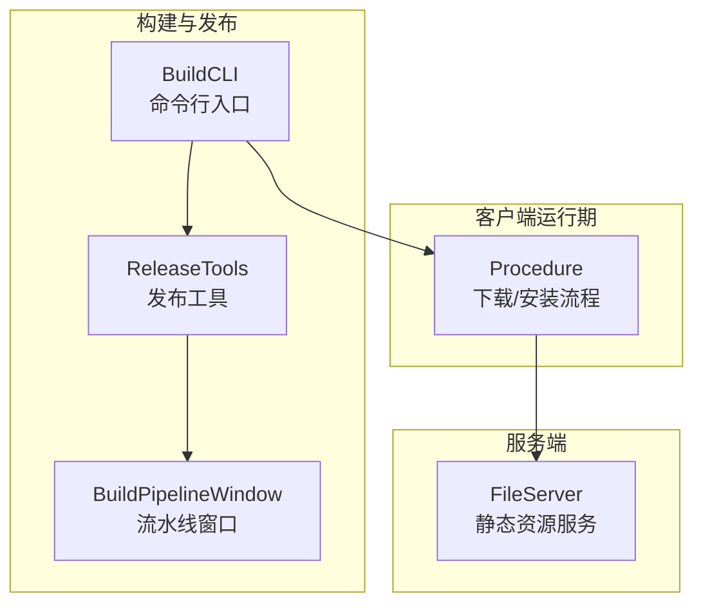
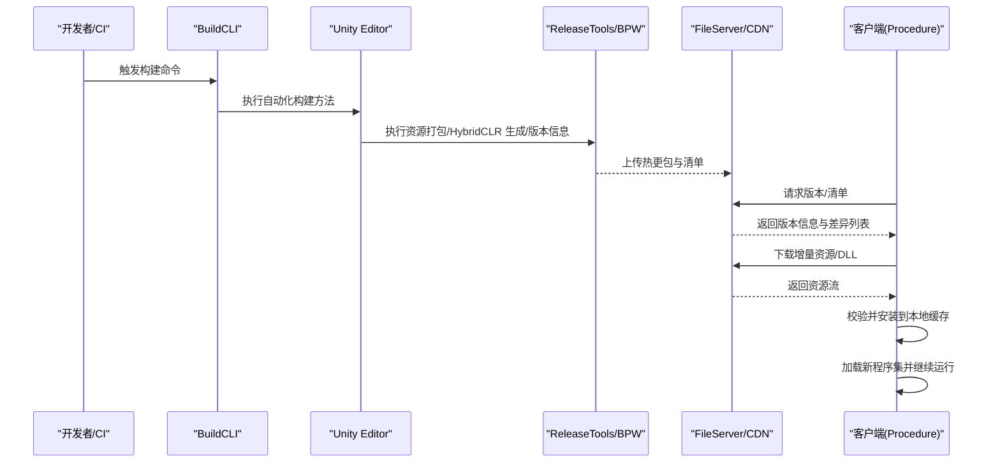
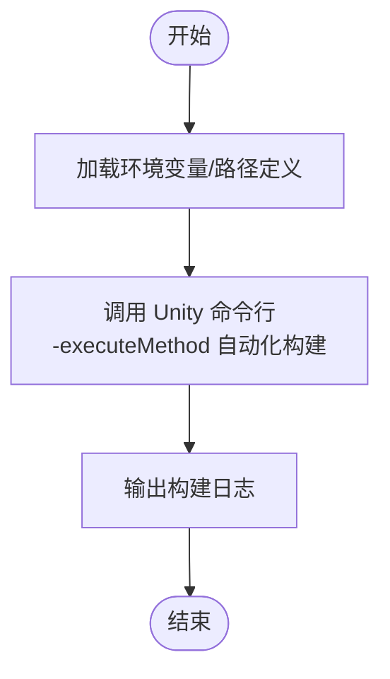
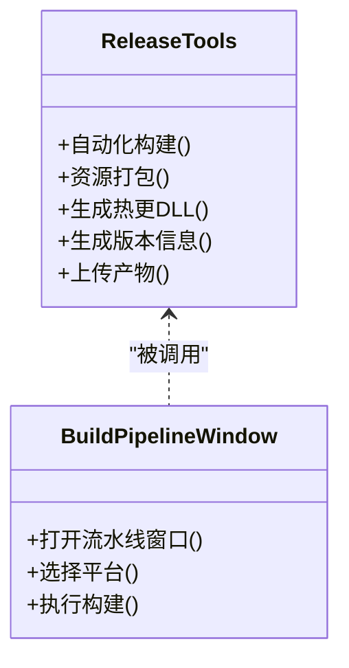
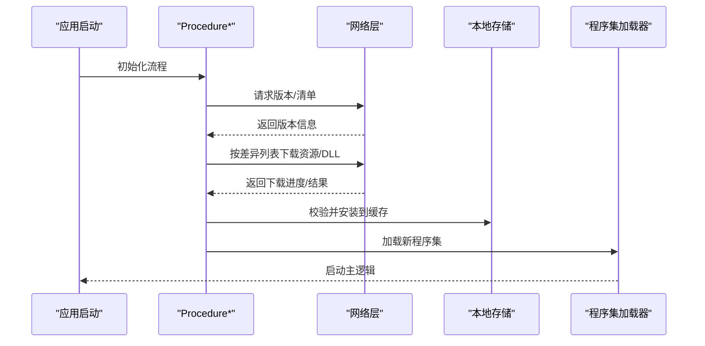
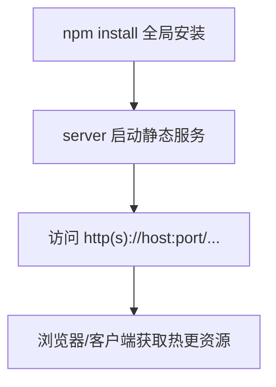
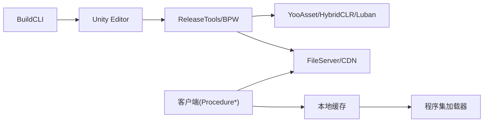

# 部署发布

<cite>
**本文引用的文件**   
- [README.md](file://README.md)
- [build_android.bat](file://BuildCLI/build_android.bat)
- [build_android.sh](file://BuildCLI/build_android.sh)
- [ReleaseTools.cs](file://UnityProject/Assets/TEngine/Editor/ReleaseTools/ReleaseTools.cs)
- [BuildPipelineWindow.cs](file://UnityProject/Assets/TEngine/Editor/ReleaseTools/BuildPipelineWindow.cs)
- [ProcedureDownloadFile.cs](file://UnityProject/Assets/GameScripts/Procedure/ProcedureDownloadFile.cs)
- [ProcedureDownloadOver.cs](file://UnityProject/Assets/GameScripts/Procedure/ProcedureDownloadOver.cs)
- [package.json](file://Tools/FileServer/package.json)
- [README.md](file://Tools/FileServer/README.md)
</cite>

## 目录
1. [简介](#简介)
2. [项目结构](#项目结构)
3. [核心组件](#核心组件)
4. [架构总览](#架构总览)
5. [详细组件分析](#详细组件分析)
6. [依赖分析](#依赖分析)
7. [性能考虑](#性能考虑)
8. [故障排查指南](#故障排查指南)
9. [结论](#结论)
10. [附录](#附录)

## 简介
本文件面向“热更新部署发布”的完整流程，覆盖以下关键主题：
- 热更新包生成：代码编译、资源打包、版本信息生成
- 多平台发布与特殊处理：Android、iOS、WebGL
- 热更新服务器配置与部署：静态文件服务、版本管理、CDN 加速
- 客户端热更新流程：检测、下载、安装
- 自动化脚本与 CI/CD 集成方案
- 监控、统计与回滚工具与方法

本项目基于 Unity + HybridCLR + YooAsset 的热更新体系，提供跨平台（Windows/macOS/Android/iOS/WebGL）的一体化构建与发布能力。

## 项目结构
围绕“部署发布”的关键目录与文件如下：
- BuildCLI：命令行构建入口（Android 示例）
- UnityProject/Assets/TEngine/Editor/ReleaseTools：编辑器侧发布工具与流水线窗口
- UnityProject/Assets/GameScripts/Procedure：启动流程中的下载与安装阶段
- Tools/FileServer：Node.js 静态资源服务器（用于本地或测试环境的热更资源托管）

图表来源
- [build_android.bat:1-9](file://BuildCLI/build_android.bat#L1-L9)
- [build_android.sh:1-19](file://BuildCLI/build_android.sh#L1-L19)
- [ReleaseTools.cs](file://UnityProject/Assets/TEngine/Editor/ReleaseTools/ReleaseTools.cs)
- [BuildPipelineWindow.cs](file://UnityProject/Assets/TEngine/Editor/ReleaseTools/BuildPipelineWindow.cs)
- [ProcedureDownloadFile.cs](file://UnityProject/Assets/GameScripts/Procedure/ProcedureDownloadFile.cs)
- [ProcedureDownloadOver.cs](file://UnityProject/Assets/GameScripts/Procedure/ProcedureDownloadOver.cs)
- [package.json](file://Tools/FileServer/package.json)

章节来源
- [README.md:20-33](file://README.md#L20-L33)
- [README.md:75-81](file://README.md#L75-L81)

## 核心组件
- 构建入口（BuildCLI）
  - Windows 批处理与 macOS/Linux Shell 脚本，调用 Unity 命令行执行自动化构建方法，输出构建日志。
- 发布工具（ReleaseTools / BuildPipelineWindow）
  - 在 Unity Editor 中提供可视化流水线与自动化构建入口，串联 AB 打包、HybridCLR 热更 DLL 生成、版本信息写入等步骤。
- 客户端流程（Procedure*）
  - 负责启动后检查版本、拉取热更清单与增量资源、校验并安装到本地缓存，随后加载新程序集继续游戏。
- 静态资源服务器（FileServer）
  - Node.js 实现的轻量静态文件服务，支持端口、编码、HTTPS、跨域等常用选项，适合本地调试与小型团队内网发布。

章节来源
- [build_android.bat:1-9](file://BuildCLI/build_android.bat#L1-L9)
- [build_android.sh:1-19](file://BuildCLI/build_android.sh#L1-L19)
- [ReleaseTools.cs](file://UnityProject/Assets/TEngine/Editor/ReleaseTools/ReleaseTools.cs)
- [BuildPipelineWindow.cs](file://UnityProject/Assets/TEngine/Editor/ReleaseTools/BuildPipelineWindow.cs)
- [ProcedureDownloadFile.cs](file://UnityProject/Assets/GameScripts/Procedure/ProcedureDownloadFile.cs)
- [ProcedureDownloadOver.cs](file://UnityProject/Assets/GameScripts/Procedure/ProcedureDownloadOver.cs)
- [package.json:1-30](file://Tools/FileServer/package.json#L1-L30)

## 架构总览
下图展示从“构建 → 发布 → 客户端检测/下载/安装 → 运行”的整体链路。

图表来源
- [build_android.bat:1-9](file://BuildCLI/build_android.bat#L1-L9)
- [build_android.sh:1-19](file://BuildCLI/build_android.sh#L1-L19)
- [ReleaseTools.cs](file://UnityProject/Assets/TEngine/Editor/ReleaseTools/ReleaseTools.cs)
- [BuildPipelineWindow.cs](file://UnityProject/Assets/TEngine/Editor/ReleaseTools/BuildPipelineWindow.cs)
- [ProcedureDownloadFile.cs](file://UnityProject/Assets/GameScripts/Procedure/ProcedureDownloadFile.cs)
- [ProcedureDownloadOver.cs](file://UnityProject/Assets/GameScripts/Procedure/ProcedureDownloadOver.cs)
- [package.json:1-30](file://Tools/FileServer/package.json#L1-L30)

## 详细组件分析

### 构建入口（BuildCLI）
- 作用
  - 封装 Unity 命令行参数，统一工作区路径、日志路径，调用 ReleaseTools 提供的自动化构建方法。
- Android 构建
  - Windows 与 Shell 双实现，均通过 -executeMethod 指定自动化入口，便于 CI 集成。
- 扩展点
  - 可复制模板新增 iOS/WebGL 等平台构建脚本，替换目标方法与产物路径。

图表来源
- [build_android.bat:1-9](file://BuildCLI/build_android.bat#L1-L9)
- [build_android.sh:1-19](file://BuildCLI/build_android.sh#L1-L19)

章节来源
- [build_android.bat:1-9](file://BuildCLI/build_android.bat#L1-L9)
- [build_android.sh:1-19](file://BuildCLI/build_android.sh#L1-L19)

### 发布工具（ReleaseTools / BuildPipelineWindow）
- 职责
  - 在 Unity Editor 中提供可视化流水线与一键构建入口；串联 YooAsset 资源打包、HybridCLR 热更 DLL 生成、版本信息生成与上传。
- 典型步骤
  - 清理旧产物 → 生成配置表（如 Luban）→ 构建 AB 包 → 生成热更 DLL → 生成版本清单 → 上传至服务器/CDN。
- 可配置项
  - 目标平台、构建模式（开发/测试/正式）、是否启用压缩、是否开启增量构建、上传目标地址等。

图表来源
- [ReleaseTools.cs](file://UnityProject/Assets/TEngine/Editor/ReleaseTools/ReleaseTools.cs)
- [BuildPipelineWindow.cs](file://UnityProject/Assets/TEngine/Editor/ReleaseTools/BuildPipelineWindow.cs)

章节来源
- [ReleaseTools.cs](file://UnityProject/Assets/TEngine/Editor/ReleaseTools/ReleaseTools.cs)
- [BuildPipelineWindow.cs](file://UnityProject/Assets/TEngine/Editor/ReleaseTools/BuildPipelineWindow.cs)

### 客户端热更新流程（Procedure*）
- 流程要点
  - 启动后先检查远程版本与本地版本差异；
  - 根据差异列表下载增量资源与热更 DLL；
  - 校验完整性后安装到本地缓存；
  - 重新加载程序集并进入主流程。
- 关键节点
  - 创建下载器、下载文件、下载完成回调、清理缓存、加载程序集、启动游戏。

图表来源
- [ProcedureDownloadFile.cs](file://UnityProject/Assets/GameScripts/Procedure/ProcedureDownloadFile.cs)
- [ProcedureDownloadOver.cs](file://UnityProject/Assets/GameScripts/Procedure/ProcedureDownloadOver.cs)

章节来源
- [ProcedureDownloadFile.cs](file://UnityProject/Assets/GameScripts/Procedure/ProcedureDownloadFile.cs)
- [ProcedureDownloadOver.cs](file://UnityProject/Assets/GameScripts/Procedure/ProcedureDownloadOver.cs)

### 静态资源服务器（FileServer）
- 功能
  - 提供静态文件服务，支持端口、字符编码、默认页、跨域、HTTPS 等选项，适合本地调试与小型团队内网发布。
- 使用方式
  - 通过 npm 全局安装后可直接以 server 命令启动；也可通过 package.json 的 bin 字段进行自定义入口。
- 生产建议
  - 生产环境建议使用 Nginx/Caddy/对象存储+CDN，将 FileServer 作为开发/测试用途。

图表来源
- [README.md](file://Tools/FileServer/README.md)
- [package.json:1-30](file://Tools/FileServer/package.json#L1-L30)

章节来源
- [README.md](file://Tools/FileServer/README.md)
- [package.json:1-30](file://Tools/FileServer/package.json#L1-L30)

## 依赖分析
- 构建链
  - BuildCLI → Unity Editor → ReleaseTools/BPW → YooAsset/HybridCLR/Luban（外部工具）
- 运行链
  - 客户端 Procedure* → 网络层 → 静态资源服务器/CDN → 本地缓存 → 程序集加载器
- 耦合关系
  - 构建端与服务端解耦，仅通过“版本清单 + 资源包”契约交互；
  - 客户端对服务器接口（版本/清单/资源）有明确约定，便于替换 CDN 或私有化部署。

图表来源
- [build_android.bat:1-9](file://BuildCLI/build_android.bat#L1-L9)
- [build_android.sh:1-19](file://BuildCLI/build_android.sh#L1-L19)
- [ReleaseTools.cs](file://UnityProject/Assets/TEngine/Editor/ReleaseTools/ReleaseTools.cs)
- [BuildPipelineWindow.cs](file://UnityProject/Assets/TEngine/Editor/ReleaseTools/BuildPipelineWindow.cs)
- [ProcedureDownloadFile.cs](file://UnityProject/Assets/GameScripts/Procedure/ProcedureDownloadFile.cs)
- [ProcedureDownloadOver.cs](file://UnityProject/Assets/GameScripts/Procedure/ProcedureDownloadOver.cs)
- [package.json:1-30](file://Tools/FileServer/package.json#L1-L30)

## 性能考虑
- 构建阶段
  - 增量构建：仅在变更时重建受影响资源与 DLL，缩短构建时间。
  - 并行打包：合理划分 AB 分组，利用多线程提升打包吞吐。
  - 资源压缩：区分纹理/音频/文本的压缩策略，平衡体积与加载速度。
- 传输阶段
  - CDN 加速：热点资源就近分发，降低首包与增量下载延迟。
  - 断点续传与分片下载：提升弱网环境下的稳定性与成功率。
- 运行阶段
  - 预取与预热：在空闲时段预取下一关卡资源，减少卡顿。
  - 内存管理：严格遵循 LRU/ARC 策略，及时释放不再使用的资源。

## 故障排查指南
- 构建失败
  - 检查 Unity 命令行参数与环境变量是否正确；查看构建日志定位错误。
  - 确认 HybridCLR 已正确安装与符号生成；AB 打包是否成功。
- 客户端无法检测到更新
  - 检查服务器可达性与 CORS/HTTPS 配置；确认版本清单路径与格式正确。
- 下载失败或卡住
  - 检查网络代理、防火墙与 CDN 状态；确认分片与断点续传配置。
- 安装后崩溃
  - 校验资源与 DLL 完整性；确认程序集加载顺序与依赖关系。

章节来源
- [build_android.bat:1-9](file://BuildCLI/build_android.bat#L1-L9)
- [build_android.sh:1-19](file://BuildCLI/build_android.sh#L1-L19)
- [ProcedureDownloadFile.cs](file://UnityProject/Assets/GameScripts/Procedure/ProcedureDownloadFile.cs)
- [ProcedureDownloadOver.cs](file://UnityProject/Assets/GameScripts/Procedure/ProcedureDownloadOver.cs)

## 结论
本方案以 Unity 为构建中心，结合 ReleaseTools/BPW 提供可视化的发布流水线，配合 FileServer 或 CDN 完成热更资源的托管与分发。客户端通过标准化的 Procedure 流程完成版本检测、增量下载与安装，最终加载新程序集继续运行。该架构具备良好的可扩展性，可平滑接入 CI/CD、监控统计与回滚机制，满足多平台（Android/iOS/WebGL）的商业化发布需求。

## 附录

### 热更新包生成流程（代码编译、资源打包、版本信息）
- 代码编译
  - 使用 HybridCLR 生成热更 DLL；确保符号与元数据一致。
- 资源打包
  - 使用 YooAsset 构建 AB 包，按平台与场景拆分，生成清单与哈希。
- 版本信息生成
  - 生成版本号、构建时间、平台标识、资源清单与差异对比文件，供客户端校验与增量下载。

章节来源
- [README.md:75-81](file://README.md#L75-L81)
- [ReleaseTools.cs](file://UnityProject/Assets/TEngine/Editor/ReleaseTools/ReleaseTools.cs)
- [BuildPipelineWindow.cs](file://UnityProject/Assets/TEngine/Editor/ReleaseTools/BuildPipelineWindow.cs)

### 多平台发布与特殊处理
- Android
  - 使用 build_android.* 脚本调用 Unity 自动化构建；注意签名、混淆与分包策略。
- iOS
  - 需配置 Xcode 工程、证书与描述文件；关注资源大小与冷启动优化。
- WebGL
  - 注意 WASM 体积限制与浏览器缓存策略；建议开启 Gzip/Brotli 与强缓存。

章节来源
- [build_android.bat:1-9](file://BuildCLI/build_android.bat#L1-L9)
- [build_android.sh:1-19](file://BuildCLI/build_android.sh#L1-L19)
- [README.md:212-219](file://README.md#L212-L219)

### 热更新服务器配置与部署
- 文件服务
  - 使用 FileServer 快速启动静态资源服务；生产环境推荐 Nginx/Caddy/对象存储+CDN。
- 版本管理
  - 维护版本清单与差异文件；支持灰度发布与多版本共存。
- CDN 加速
  - 将热更资源推送到 CDN；配置缓存头与回源策略，保障高可用与低延迟。

章节来源
- [README.md](file://Tools/FileServer/README.md)
- [package.json:1-30](file://Tools/FileServer/package.json#L1-L30)

### 客户端热更新检测、下载、安装
- 检测
  - 启动时请求版本/清单，比较本地与远端差异。
- 下载
  - 按差异列表并发下载资源与 DLL，支持断点续传与重试。
- 安装
  - 校验完整性后写入本地缓存，重载程序集并继续运行。

章节来源
- [ProcedureDownloadFile.cs](file://UnityProject/Assets/GameScripts/Procedure/ProcedureDownloadFile.cs)
- [ProcedureDownloadOver.cs](file://UnityProject/Assets/GameScripts/Procedure/ProcedureDownloadOver.cs)

### 自动化脚本与 CI/CD 集成
- 本地脚本
  - 使用 BuildCLI 脚本一键构建；支持传入语言、工作区等参数。
- CI/CD
  - 在流水线中安装 Unity 与依赖，执行构建脚本，产出热更包与清单，并上传至服务器/CDN。
  - 可加入质量门禁：单元测试、静态扫描、包体大小阈值检查。

章节来源
- [build_android.bat:1-9](file://BuildCLI/build_android.bat#L1-L9)
- [build_android.sh:1-19](file://BuildCLI/build_android.sh#L1-L19)

### 监控、统计与回滚
- 监控
  - 上报下载成功率、耗时、失败原因；监控服务器 QPS 与带宽。
- 统计
  - 统计各版本占比、地区分布、设备型号与系统版本。
- 回滚
  - 保留历史版本清单与资源；客户端支持回退到上一稳定版本。

[本节为通用实践说明，不直接分析具体文件]