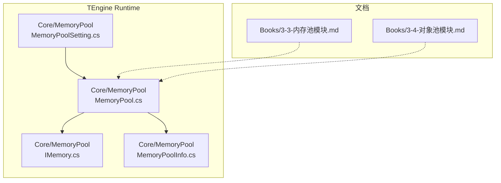
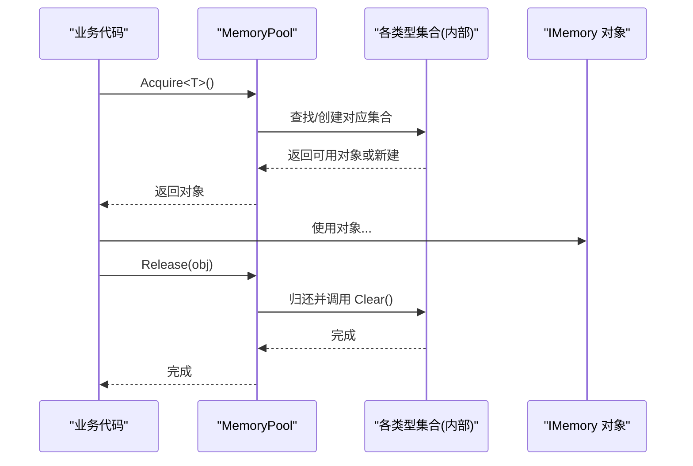
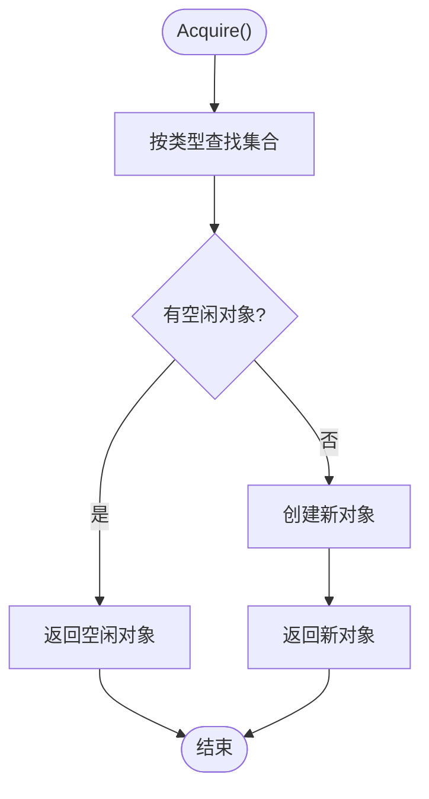
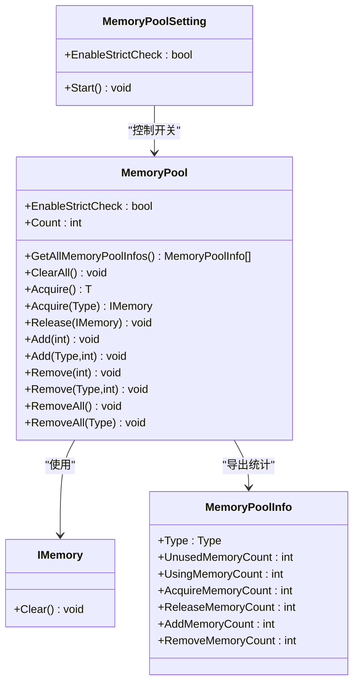

# 内存优化技术

<cite>
**本文引用的文件**
- [MemoryPool.cs](file://UnityProject/Assets/TEngine/Runtime/Core/MemoryPool/MemoryPool.cs)
- [IMemory.cs](file://UnityProject/Assets/TEngine/Runtime/Core/MemoryPool/IMemory.cs)
- [MemoryPoolSetting.cs](file://UnityProject/Assets/TEngine/Runtime/Core/MemoryPool/MemoryPoolSetting.cs)
- [MemoryPoolInfo.cs](file://UnityProject/Assets/TEngine/Runtime/Core/MemoryPool/MemoryPoolInfo.cs)
- [3-3-内存池模块.md](file://Books/3-3-内存池模块.md)
- [3-4-对象池模块.md](file://Books/3-4-对象池模块.md)
</cite>

## 目录
1. [简介](#简介)
2. [项目结构](#项目结构)
3. [核心组件](#核心组件)
4. [架构总览](#架构总览)
5. [详细组件分析](#详细组件分析)
6. [依赖关系分析](#依赖关系分析)
7. [性能与内存优化要点](#性能与内存优化要点)
8. [故障排查指南](#故障排查指南)
9. [结论](#结论)
10. [附录](#附录)

## 简介
本文件面向 TEngine 的内存优化技术，聚焦以下主题：
- 垃圾回收优化、内存碎片预防与内存泄漏防护
- 内存池与对象池的设计原理、池化策略、容量控制与性能监控
- 资源卸载机制、引用计数与弱引用思路（概念性说明）
- 内存分析工具使用（Unity Profiler 集成与自定义监控）
- 常见问题诊断与解决方案，以及多平台优化建议

## 项目结构
TEngine 在 Unity 工程中以 Runtime 模块组织核心能力。与内存优化直接相关的代码位于 Core/MemoryPool 目录，配套文档位于 Books 目录。

图表来源
- [MemoryPool.cs:1-208](file://UnityProject/Assets/TEngine/Runtime/Core/MemoryPool/MemoryPool.cs#L1-L208)
- [IMemory.cs:1-14](file://UnityProject/Assets/TEngine/Runtime/Core/MemoryPool/IMemory.cs#L1-L14)
- [MemoryPoolSetting.cs:1-80](file://UnityProject/Assets/TEngine/Runtime/Core/MemoryPool/MemoryPoolSetting.cs#L1-L80)
- [MemoryPoolInfo.cs:1-119](file://UnityProject/Assets/TEngine/Runtime/Core/MemoryPool/MemoryPoolInfo.cs#L1-L119)
- [3-3-内存池模块.md:1-159](file://Books/3-3-内存池模块.md#L1-L159)
- [3-4-对象池模块.md:1-226](file://Books/3-4-对象池模块.md#L1-L226)

章节来源
- [MemoryPool.cs:1-208](file://UnityProject/Assets/TEngine/Runtime/Core/MemoryPool/MemoryPool.cs#L1-L208)
- [IMemory.cs:1-14](file://UnityProject/Assets/TEngine/Runtime/Core/MemoryPool/IMemory.cs#L1-L14)
- [MemoryPoolSetting.cs:1-80](file://UnityProject/Assets/TEngine/Runtime/Core/MemoryPool/MemoryPoolSetting.cs#L1-L80)
- [MemoryPoolInfo.cs:1-119](file://UnityProject/Assets/TEngine/Runtime/Core/MemoryPool/MemoryPoolInfo.cs#L1-L119)
- [3-3-内存池模块.md:1-159](file://Books/3-3-内存池模块.md#L1-L159)
- [3-4-对象池模块.md:1-226](file://Books/3-4-对象池模块.md#L1-L226)

## 核心组件
- MemoryPool：静态入口，提供按类型管理的内存池获取、释放、预分配、清理与统计信息导出；支持严格检查开关以增强开发期安全性。
- IMemory：内存对象的统一接口，要求实现 Clear() 以便归还池时进行状态重置。
- MemoryPoolSetting：编辑器/运行期可配置的组件，用于启用或禁用严格检查，便于在开发阶段发现误用与泄漏风险。
- MemoryPoolInfo：轻量级结构体，承载每种类型的内存池统计指标（未使用/使用中/获取/归还/增加/移除数量）。

章节来源
- [MemoryPool.cs:1-208](file://UnityProject/Assets/TEngine/Runtime/Core/MemoryPool/MemoryPool.cs#L1-L208)
- [IMemory.cs:1-14](file://UnityProject/Assets/TEngine/Runtime/Core/MemoryPool/IMemory.cs#L1-L14)
- [MemoryPoolSetting.cs:1-80](file://UnityProject/Assets/TEngine/Runtime/Core/MemoryPool/MemoryPoolSetting.cs#L1-L80)
- [MemoryPoolInfo.cs:1-119](file://UnityProject/Assets/TEngine/Runtime/Core/MemoryPool/MemoryPoolInfo.cs#L1-L119)

## 架构总览
下图展示内存池的核心交互：业务代码通过 MemoryPool 获取/释放实现了 IMemory 的对象；MemoryPoolSetting 控制严格检查开关；MemoryPoolInfo 暴露统计信息供监控与分析。

图表来源
- [MemoryPool.cs:66-101](file://UnityProject/Assets/TEngine/Runtime/Core/MemoryPool/MemoryPool.cs#L66-L101)
- [IMemory.cs:6-12](file://UnityProject/Assets/TEngine/Runtime/Core/MemoryPool/IMemory.cs#L6-L12)

## 详细组件分析

### 内存池（MemoryPool）
- 设计要点
  - 按类型维护独立集合，避免跨类型污染，提升复用效率。
  - 提供 Acquire/Release/Add/Remove/RemoveAll/ClearAll 等完整生命周期 API。
  - 支持 EnableStrictCheck 严格检查，校验类型合法性与接口实现，降低误用风险。
  - 提供 GetAllMemoryPoolInfos 导出统计，便于运行时分析与可视化。
- 关键流程
  - Acquire：根据类型定位集合，从空闲列表取对象或按需创建。
  - Release：校验参数与类型，归还对象并触发 Clear() 重置状态。
  - Add/Remove：批量扩容/缩容，配合统计字段观察趋势。
  - ClearAll：销毁所有集合，释放全部对象。
- 复杂度与并发
  - 集合访问采用锁保护，保证多线程安全；频繁加锁可能带来一定开销，建议在热点路径减少跨线程共享。
- 扩展点
  - 可通过统计信息结合外部监控（如 Unity Profiler）绘制曲线，辅助容量调优。

图表来源
- [MemoryPool.cs:66-85](file://UnityProject/Assets/TEngine/Runtime/Core/MemoryPool/MemoryPool.cs#L66-L85)

章节来源
- [MemoryPool.cs:1-208](file://UnityProject/Assets/TEngine/Runtime/Core/MemoryPool/MemoryPool.cs#L1-L208)

### 内存对象接口（IMemory）
- 职责：定义统一的 Clear() 方法，确保对象归还池时可被正确重置，避免状态残留导致二次使用异常。
- 最佳实践：在 Clear() 中清空引用、重置数值、释放子资源句柄等，保证“干净”回池。

章节来源
- [IMemory.cs:1-14](file://UnityProject/Assets/TEngine/Runtime/Core/MemoryPool/IMemory.cs#L1-L14)

### 配置组件（MemoryPoolSetting）
- 作用：在场景中添加该组件，依据枚举策略自动设置 EnableStrictCheck，便于在开发期开启严格检查，发布期关闭以降低开销。
- 行为：Start 时根据配置决定是否启用严格检查，随后销毁自身，不干扰运行时逻辑。

章节来源
- [MemoryPoolSetting.cs:1-80](file://UnityProject/Assets/TEngine/Runtime/Core/MemoryPool/MemoryPoolSetting.cs#L1-L80)

### 统计信息（MemoryPoolInfo）
- 内容：包含类型、未使用/使用中数量、获取/归还/增加/移除次数等指标。
- 用途：结合 UI 或日志输出，观察池的使用趋势，指导容量调整与问题定位。

章节来源
- [MemoryPoolInfo.cs:1-119](file://UnityProject/Assets/TEngine/Runtime/Core/MemoryPool/MemoryPoolInfo.cs#L1-L119)

### 对象池（ObjectPoolModule）
- 角色：管理 GameObject 等 Unity 对象的生命周期，提供单次/多次获取模式，支持容量与过期时间配置。
- 与内存池的关系：对象池更偏重 Unity 对象复用；内存池更偏轻量的托管对象复用。两者互补，共同降低 GC 压力。
- 参考文档：Books/3-4-对象池模块.md 提供了创建、Spawn/Unspawn、Register 等 API 与最佳实践。

章节来源
- [3-4-对象池模块.md:1-226](file://Books/3-4-对象池模块.md#L1-L226)

## 依赖关系分析
- 组件耦合
  - MemoryPool 依赖 IMemory 接口约束对象行为。
  - MemoryPoolSetting 仅影响 MemoryPool 的行为开关，无强耦合。
  - MemoryPoolInfo 为纯数据载体，被 MemoryPool 聚合导出。
- 外部依赖
  - 依赖 Unity 环境（MonoBehaviour、Debug、Application），但核心逻辑保持平台无关。
- 潜在循环依赖
  - 当前结构清晰，未见循环依赖迹象。

图表来源
- [MemoryPool.cs:1-208](file://UnityProject/Assets/TEngine/Runtime/Core/MemoryPool/MemoryPool.cs#L1-L208)
- [IMemory.cs:1-14](file://UnityProject/Assets/TEngine/Runtime/Core/MemoryPool/IMemory.cs#L1-L14)
- [MemoryPoolSetting.cs:1-80](file://UnityProject/Assets/TEngine/Runtime/Core/MemoryPool/MemoryPoolSetting.cs#L1-L80)
- [MemoryPoolInfo.cs:1-119](file://UnityProject/Assets/TEngine/Runtime/Core/MemoryPool/MemoryPoolInfo.cs#L1-L119)

## 性能与内存优化要点
- 垃圾回收优化
  - 高频小对象优先走内存池，减少分配与 GC 频率。
  - 在 Clear() 中及时清空引用，避免长生命周期对象持有短生命周期对象造成 GC 延迟回收。
- 内存碎片预防
  - 合理预估峰值并发数，提前 Add 预热，减少运行期扩容带来的碎片。
  - 对大对象谨慎池化，避免长期占用大块连续内存。
- 内存泄漏防护
  - 启用严格检查（开发期），尽早暴露类型错误与非法操作。
  - 遵循“释放即置空”的规范，避免重复 Release 或释放后继续使用。
- 容量控制与监控
  - 基于 MemoryPoolInfo 的 Using/Acquire/Release 趋势，动态调整初始容量与上限。
  - 将统计接入 Unity Profiler 或自研面板，形成持续观测闭环。
- 资源卸载与生命周期
  - 对象池负责 Unity 对象（GameObject/UI）的显式生命周期管理；内存池负责托管对象的状态重置。
  - 场景切换或模块卸载时，调用 RemoveAll/ClearAll 释放资源，防止残留引用。
- 引用计数与弱引用（概念）
  - 若需跨模块共享且避免强引用导致的泄漏，可在上层引入弱引用包装或事件解绑机制，确保对象可被 GC。
  - 对于需要“存在即有效”的缓存，可采用带失效时间的弱引用表，定期清理。

[本节为通用指导，不直接分析具体文件]

## 故障排查指南
- 常见症状
  - 帧率抖动：GC 频繁触发，通常由临时对象分配过多引起。
  - 内存持续增长：对象未释放或释放后仍被持有，导致无法回收。
  - 崩溃或异常：Release 后继续访问对象，或重复 Release 同一对象。
- 排查步骤
  - 开启严格检查：在场景添加 MemoryPoolSetting，选择开发期启用，观察控制台警告。
  - 采集统计：调用 GetAllMemoryPoolInfos，对比 Acquire/Release 差值与 Using 数量，定位异常增长的类型。
  - 复现最小用例：隔离问题类型，确认 Clear() 是否正确清理所有引用。
  - 结合 Unity Profiler：查看 GC.Alloc 与 Object Allocation 曲线，关联问题时间段与对象类型。
- 修复建议
  - 修正 Clear() 遗漏的引用清理。
  - 避免在异步回调中持有已释放对象，必要时使用弱引用或事件解绑。
  - 对热点路径减少装箱/拆箱与临时数组分配，改用池化数据结构。

章节来源
- [3-3-内存池模块.md:92-150](file://Books/3-3-内存池模块.md#L92-L150)
- [MemoryPoolSetting.cs:31-79](file://UnityProject/Assets/TEngine/Runtime/Core/MemoryPool/MemoryPoolSetting.cs#L31-L79)
- [MemoryPool.cs:164-185](file://UnityProject/Assets/TEngine/Runtime/Core/MemoryPool/MemoryPool.cs#L164-L185)

## 结论
TEngine 的内存池与对象池协同工作，前者专注托管对象的快速复用与状态重置，后者专注 Unity 对象的生命周期管理。通过严格检查、统计监控与合理的池化策略，可有效降低 GC 压力、减少内存碎片并规避内存泄漏。结合 Unity Profiler 与自定义监控面板，可构建完整的内存优化闭环，并在不同平台上持续调优。

[本节为总结性内容，不直接分析具体文件]

## 附录
- 使用建议速查
  - 小对象高频分配：优先使用内存池（IMemory + MemoryPool）。
  - GameObject/UI 复用：使用对象池（ObjectPoolModule）。
  - 开发期开启严格检查，发布期关闭。
  - 每次 Release 后立即置空引用，禁止二次访问。
  - 定期导出 MemoryPoolInfo，纳入性能回归检测。

[本节为补充说明，不直接分析具体文件]