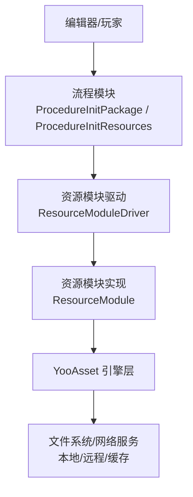
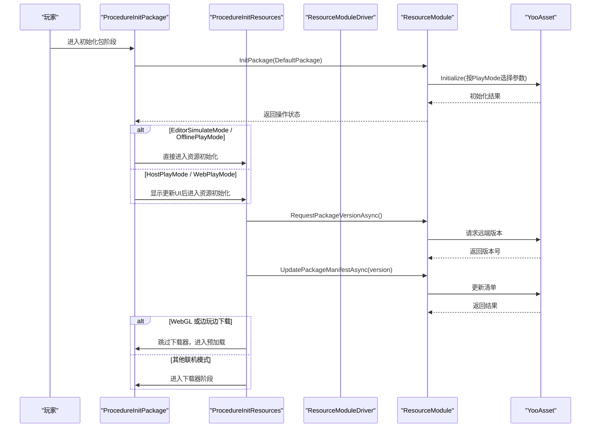
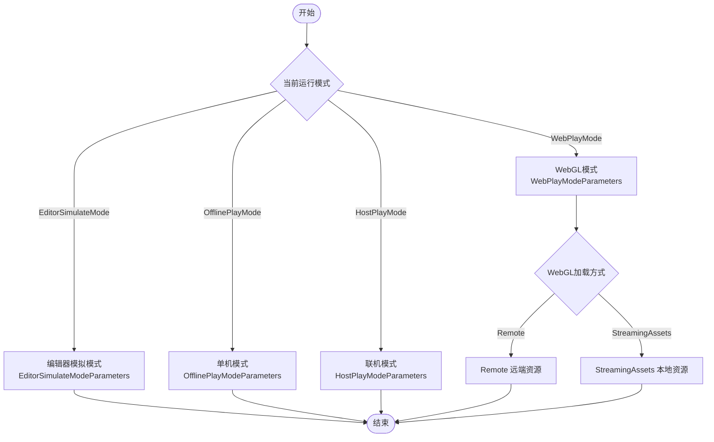
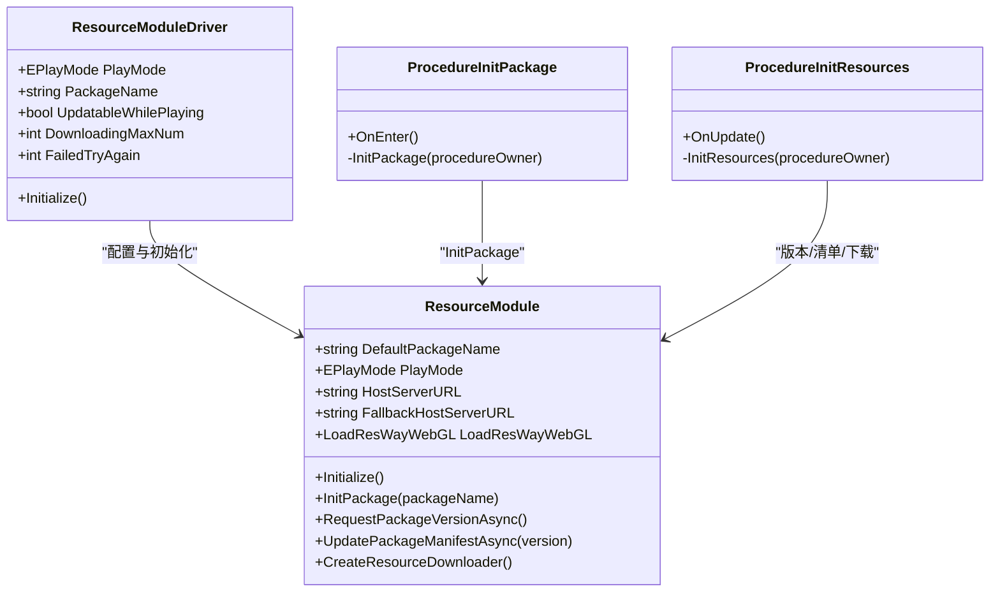

# 多平台适配

<cite>
**本文引用的文件**   
- [README.md](file://README.md)
- [3-1-资源模块.md](file://Books/3-1-资源模块.md)
- [ResourceModuleDriver.cs](file://UnityProject/Assets/TEngine/Runtime/Module/ResourceModule/ResourceModuleDriver.cs)
- [ResourceModule.cs](file://UnityProject/Assets/TEngine/Runtime/Module/ResourceModule/ResourceModule.cs)
- [ProcedureInitPackage.cs](file://UnityProject/Assets/GameScripts/Procedure/ProcedureInitPackage.cs)
- [ProcedureInitResources.cs](file://UnityProject/Assets/GameScripts/Procedure/ProcedureInitResources.cs)
</cite>

## 目录
1. [简介](#简介)
2. [项目结构](#项目结构)
3. [核心组件](#核心组件)
4. [架构总览](#架构总览)
5. [详细组件分析](#详细组件分析)
6. [依赖关系分析](#依赖关系分析)
7. [性能与优化](#性能与优化)
8. [故障排查指南](#故障排查指南)
9. [结论](#结论)
10. [附录](#附录)

## 简介
本文件聚焦 TEngine 的多平台适配方案，围绕运行模式（EditorSimulateMode、OfflinePlayMode、HostPlayMode、WebGL/WebPlayMode）展开，说明各平台（Windows、Android、iOS、WebGL、微信小游戏）的资源加载差异与适配策略，并给出 YooAsset 的平台特定配置、打包策略与跨平台最佳实践。内容基于仓库内资源模块文档与运行时实现进行梳理，帮助开发者在不同平台上稳定构建与发布。

## 项目结构
TEngine 将资源管理封装在 ResourceModule 中，并通过流程模块驱动启动与更新逻辑；YooAsset 作为底层资源系统被统一抽象。关键路径：
- 资源模块文档：Books/3-1-资源模块.md
- 运行时驱动：UnityProject/Assets/TEngine/Runtime/Module/ResourceModule/ResourceModuleDriver.cs
- 资源模块实现：UnityProject/Assets/TEngine/Runtime/Module/ResourceModule/ResourceModule.cs
- 启动流程：UnityProject/Assets/GameScripts/Procedure/ProcedureInitPackage.cs、ProcedureInitResources.cs

图表来源
- [ResourceModuleDriver.cs:236-270](file://UnityProject/Assets/TEngine/Runtime/Module/ResourceModule/ResourceModuleDriver.cs#L236-L270)
- [ResourceModule.cs:119-260](file://UnityProject/Assets/TEngine/Runtime/Module/ResourceModule/ResourceModule.cs#L119-L260)
- [ProcedureInitPackage.cs:31-69](file://UnityProject/Assets/GameScripts/Procedure/ProcedureInitPackage.cs#L31-L69)
- [ProcedureInitResources.cs:37-66](file://UnityProject/Assets/GameScripts/Procedure/ProcedureInitResources.cs#L37-L66)

章节来源
- [README.md:130-138](file://README.md#L130-L138)
- [3-1-资源模块.md:31-61](file://Books/3-1-资源模块.md#L31-L61)

## 核心组件
- ResourceModuleDriver：场景中的资源组件，负责读取配置、设置运行模式、远端地址、WebGL 加载方式等，并调用 ResourceModule.Initialize()。
- ResourceModule：对 YooAsset 的封装，提供 InitPackage、版本查询、清单更新、下载器创建、资源卸载等能力；根据 PlayMode 选择不同初始化参数。
- 流程模块：ProcedureInitPackage 负责 Package 初始化与模式分流；ProcedureInitResources 负责清单获取、在线更新判断与预加载分流。

章节来源
- [ResourceModuleDriver.cs:14-105](file://UnityProject/Assets/TEngine/Runtime/Module/ResourceModule/ResourceModuleDriver.cs#L14-L105)
- [ResourceModule.cs:14-93](file://UnityProject/Assets/TEngine/Runtime/Module/ResourceModule/ResourceModule.cs#L14-L93)
- [ProcedureInitPackage.cs:12-69](file://UnityProject/Assets/GameScripts/Procedure/ProcedureInitPackage.cs#L12-L69)
- [ProcedureInitResources.cs:10-66](file://UnityProject/Assets/GameScripts/Procedure/ProcedureInitResources.cs#L10-L66)

## 架构总览
下图展示从启动到资源初始化的完整时序，以及不同运行模式的分支处理。

图表来源
- [ProcedureInitPackage.cs:31-69](file://UnityProject/Assets/GameScripts/Procedure/ProcedureInitPackage.cs#L31-L69)
- [ProcedureInitResources.cs:37-66](file://UnityProject/Assets/GameScripts/Procedure/ProcedureInitResources.cs#L37-L66)
- [ResourceModule.cs:140-260](file://UnityProject/Assets/TEngine/Runtime/Module/ResourceModule/ResourceModule.cs#L140-L260)

## 详细组件分析

### 运行模式与平台适配
- EditorSimulateMode（编辑器模拟模式）
  - 适用：编辑器内快速验证，不依赖打包产物。
  - 行为：使用 EditorSimulateModeParameters 初始化，直接访问编辑器下的模拟文件系统。
  - 注意：打包后不会走该模式。
- OfflinePlayMode（单机模式）
  - 适用：从 StreamingAssets 内置资源加载，无需网络。
  - 行为：使用 OfflinePlayModeParameters，BuildinFileSystem 指向内置 AB。
  - 前置：需提前构建 AssetBundle 并复制到 StreamingAssets。
- HostPlayMode（联机模式）
  - 适用：支持热更新，先拉取清单与增量资源。
  - 行为：使用 HostPlayModeParameters，结合 Buildin + Cache FileSystem，通过 RemoteServices 访问远端。
- WebPlayMode（WebGL 模式）
  - 适用：网页游戏与微信小游戏。
  - 行为：使用 WebPlayModeParameters，支持两种加载方式：
    - Remote：访问远程资源（默认）。
    - StreamingAssets：跳过远程下载，直接访问 StreamingAssets。
  - 微信小游戏：自动适配其文件系统与缓存路径。

图表来源
- [ResourceModule.cs:173-233](file://UnityProject/Assets/TEngine/Runtime/Module/ResourceModule/ResourceModule.cs#L173-L233)
- [3-1-资源模块.md:31-61](file://Books/3-1-资源模块.md#L31-L61)

章节来源
- [3-1-资源模块.md:31-61](file://Books/3-1-资源模块.md#L31-L61)
- [ResourceModule.cs:173-233](file://UnityProject/Assets/TEngine/Runtime/Module/ResourceModule/ResourceModule.cs#L173-L233)

### 平台差异与适配要点
- Windows/macOS（Standalone）
  - 常用模式：OfflinePlayMode 或 HostPlayMode。
  - 建议：开发期用 HostPlayMode 联调热更；发布期可用 OfflinePlayMode 减少首包体积。
- Android/iOS
  - 常用模式：HostPlayMode（推荐），配合 CDN 分发 AB 与清单。
  - 建议：开启 UpdatableWhilePlaying 以“边玩边下”提升体验；合理设置 DownloadingMaxNum 与 FailedTryAgain。
- WebGL
  - 常用模式：WebPlayMode。
  - 加载方式：
    - Remote：生产环境首选，支持热更新与CDN缓存。
    - StreamingAssets：开发调试快速验证，避免网络问题。
  - 微信小游戏：自动适配 WeChatWASM 的文件系统与缓存路径。
- 微信小游戏
  - 特殊点：文件系统与沙盒路径由 WeChatWASM 提供；资源缓存路径位于 USER_DATA_PATH 下的 __GAME_FILE_CACHE。
  - 建议：确保远端服务器支持小程序环境，必要时调整子目录路径。

章节来源
- [3-1-资源模块.md:45-61](file://Books/3-1-资源模块.md#L45-L61)
- [ResourceModule.cs:217-233](file://UnityProject/Assets/TEngine/Runtime/Module/ResourceModule/ResourceModule.cs#L217-L233)

### YooAsset 平台特定配置与打包策略
- 配置入口
  - ResourceModuleDriver：设置 HostServerURL、FallbackHostServerURL、LoadResWayWebGL、DownloadingMaxNum、FailedTryAgain、UpdatableWhilePlaying 等。
  - TEngineSetting（文档层面）：提供 HostServerURL、FallbackHostServerURL、LoadResWayWebGL 的配置界面。
- 打包策略
  - 编辑器模式：使用 EditorSimulateMode 快速验证，无需真实 AB。
  - 单机模式：构建 AB 并复制到 StreamingAssets，确保离线可运行。
  - 联机模式：AB 与清单部署至远端，客户端按需下载增量。
  - WebGL：优先 Remote 方式，便于 CDN 与热更新；开发期可用 StreamingAssets 加速调试。
- 微信小游戏
  - 使用 WechatFileSystemCreater 提供的参数，指定缓存根目录为 USER_DATA_PATH/__GAME_FILE_CACHE。

章节来源
- [ResourceModuleDriver.cs:253-270](file://UnityProject/Assets/TEngine/Runtime/Module/ResourceModule/ResourceModuleDriver.cs#L253-L270)
- [3-1-资源模块.md:77-94](file://Books/3-1-资源模块.md#L77-L94)
- [ResourceModule.cs:217-233](file://UnityProject/Assets/TEngine/Runtime/Module/ResourceModule/ResourceModule.cs#L217-L233)

### 跨平台开发最佳实践
- 路径与文件系统
  - 统一使用 Addressable 定位地址，避免平台相关路径拼接。
  - WebGL 与微信小游戏优先使用框架提供的文件系统参数，不要硬编码路径。
- 网络请求
  - 使用 HostServerURL/FallbackHostServerURL 双地址容灾；合理设置超时与重试次数。
  - 在弱网环境下启用 UpdatableWhilePlaying，降低首屏等待。
- 资源组织
  - 按功能域划分资源包（如 UI、Battle、Audio），减少首次加载体积。
  - 图集与纹理压缩按平台质量档位配置，平衡清晰度与内存占用。
- 生命周期与释放
  - 优先使用 LoadGameObject/LoadGameObjectAsync，让框架自动绑定 AssetsReference。
  - 定期触发 UnloadUnusedAssets，或在低内存回调中强制回收。

章节来源
- [3-1-资源模块.md:581-637](file://Books/3-1-资源模块.md#L581-L637)
- [ResourceModuleDriver.cs:289-320](file://UnityProject/Assets/TEngine/Runtime/Module/ResourceModule/ResourceModuleDriver.cs#L289-L320)

### 常见问题与解决方案
- 单机模式 HTTP 404
  - 现象：未构建 AB 或未复制到 StreamingAssets。
  - 解决：先构建 AB 并复制到 StreamingAssets，再运行 OfflinePlayMode。
- 联机模式清单/版本失败
  - 现象：RequestPackageVersionAsync 或 UpdatePackageManifestAsync 失败。
  - 解决：检查 HostServerURL/FallbackHostServerURL 可达性；确认远端清单与版本文件存在且路径正确。
- WebGL 资源无法加载
  - 现象：Remote 模式下跨域或路径错误。
  - 解决：开发期切换 LoadResWayWebGL 为 StreamingAssets 验证；生产环境确保 CDN 配置与 CORS 正确。
- 微信小游戏缓存异常
  - 现象：资源写入失败或找不到缓存。
  - 解决：确认 WeChatWASM 路径与权限；必要时清理沙盒缓存后重试。

章节来源
- [ProcedureInitPackage.cs:102-110](file://UnityProject/Assets/GameScripts/Procedure/ProcedureInitPackage.cs#L102-L110)
- [ProcedureInitResources.cs:112-134](file://UnityProject/Assets/GameScripts/Procedure/ProcedureInitResources.cs#L112-L134)
- [3-1-资源模块.md:88-94](file://Books/3-1-资源模块.md#L88-L94)

## 依赖关系分析
- ResourceModuleDriver 依赖 Settings.UpdateSetting 获取远端地址与 WebGL 加载方式。
- ResourceModule 依赖 YooAsset 的 Provider 与 FileSystem 参数，根据 PlayMode 选择不同初始化路径。
- 流程模块依赖 ResourceModule 的版本与清单接口，决定是否需要进入下载器或预加载阶段。

图表来源
- [ResourceModuleDriver.cs:14-105](file://UnityProject/Assets/TEngine/Runtime/Module/ResourceModule/ResourceModuleDriver.cs#L14-L105)
- [ResourceModule.cs:14-93](file://UnityProject/Assets/TEngine/Runtime/Module/ResourceModule/ResourceModule.cs#L14-L93)
- [ProcedureInitPackage.cs:12-69](file://UnityProject/Assets/GameScripts/Procedure/ProcedureInitPackage.cs#L12-L69)
- [ProcedureInitResources.cs:10-66](file://UnityProject/Assets/GameScripts/Procedure/ProcedureInitResources.cs#L10-L66)

章节来源
- [ResourceModuleDriver.cs:236-270](file://UnityProject/Assets/TEngine/Runtime/Module/ResourceModule/ResourceModuleDriver.cs#L236-L270)
- [ResourceModule.cs:119-260](file://UnityProject/Assets/TEngine/Runtime/Module/ResourceModule/ResourceModule.cs#L119-L260)
- [ProcedureInitPackage.cs:31-69](file://UnityProject/Assets/GameScripts/Procedure/ProcedureInitPackage.cs#L31-L69)
- [ProcedureInitResources.cs:37-66](file://UnityProject/Assets/GameScripts/Procedure/ProcedureInitResources.cs#L37-L66)

## 性能与优化
- 异步与时间切片
  - 通过 Milliseconds 控制每帧最大耗时，避免卡顿。
- 下载并发与重试
  - DownloadingMaxNum 控制并发数，FailedTryAgain 控制重试次数，兼顾吞吐与稳定性。
- 资源对象池与缓存
  - AssetCapacity、AssetExpireTime、AssetAutoReleaseInterval 控制对象池容量与过期策略。
- 自动释放
  - UseSystemUnloadUnusedAssets 与 min/max 间隔控制系统级资源释放频率。
- WebGL 优化
  - 生产环境使用 Remote 模式，利用 CDN 与浏览器缓存；开发期使用 StreamingAssets 减少网络开销。
- 微信小游戏
  - 合理使用沙盒缓存路径，避免频繁 IO；必要时主动清理无用缓存。

章节来源
- [ResourceModuleDriver.cs:112-142](file://UnityProject/Assets/TEngine/Runtime/Module/ResourceModule/ResourceModuleDriver.cs#L112-L142)
- [ResourceModuleDriver.cs:186-232](file://UnityProject/Assets/TEngine/Runtime/Module/ResourceModule/ResourceModuleDriver.cs#L186-L232)
- [ResourceModuleDriver.cs:289-320](file://UnityProject/Assets/TEngine/Runtime/Module/ResourceModule/ResourceModuleDriver.cs#L289-L320)
- [ResourceModule.cs:429-447](file://UnityProject/Assets/TEngine/Runtime/Module/ResourceModule/ResourceModule.cs#L429-L447)

## 故障排查指南
- 资源初始化失败
  - 检查 InitPackage 返回值与错误信息；若提示 PackageManifest 缺失，确认 StreamingAssets/package/DefaultPackage/PackageManifest_DefaultPackage.version 是否存在。
- 联机模式网络错误
  - 校验 HostServerURL/FallbackHostServerURL 可达性；必要时切换到备用服务器。
- WebGL 资源加载异常
  - 切换 LoadResWayWebGL 为 StreamingAssets 验证本地资源；确认远端 CORS 与路径。
- 微信小游戏缓存问题
  - 清理沙盒缓存后重试；确认 WeChatWASM 路径与权限。

章节来源
- [ProcedureInitPackage.cs:102-110](file://UnityProject/Assets/GameScripts/Procedure/ProcedureInitPackage.cs#L102-L110)
- [ProcedureInitResources.cs:112-134](file://UnityProject/Assets/GameScripts/Procedure/ProcedureInitResources.cs#L112-L134)
- [3-1-资源模块.md:88-94](file://Books/3-1-资源模块.md#L88-L94)

## 结论
TEngine 通过 ResourceModule 对 YooAsset 的统一抽象，提供了覆盖编辑器、单机、联机与 WebGL/微信小游戏的完整多平台适配方案。开发者只需在 ResourceModuleDriver 与 TEngineSetting 中配置运行模式与远端地址，即可在不同平台上获得一致的资源加载体验。结合流程模块的启动与更新逻辑，可实现稳定的热更新与“边玩边下”体验。建议在项目中遵循本文的最佳实践，合理规划资源包与网络策略，以获得更好的性能与可维护性。

## 附录
- 资源模块 API 参考与示例见 Books/3-1-资源模块.md。
- 快速开始与全平台支持见 README.md。