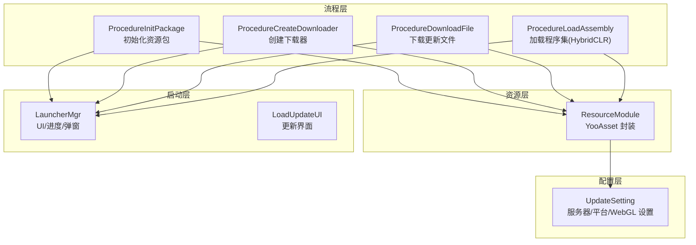
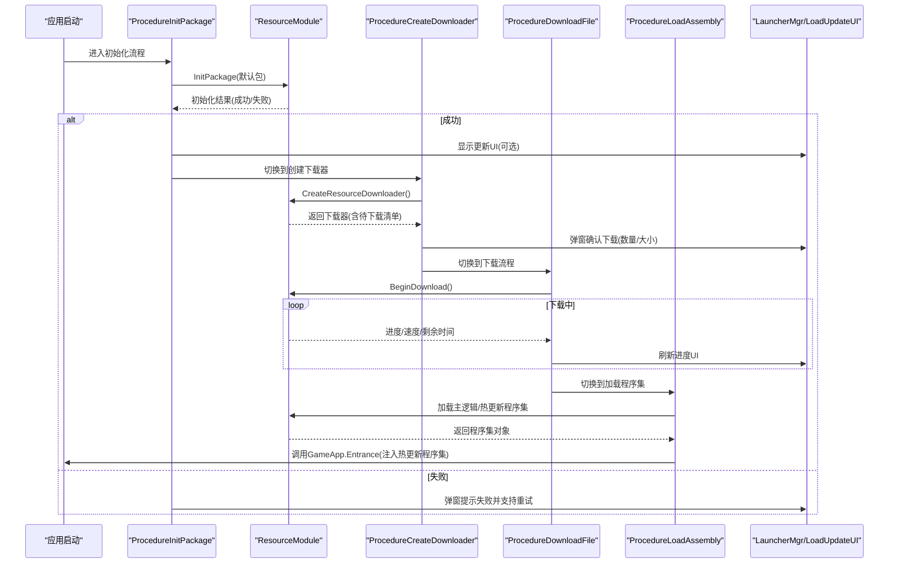
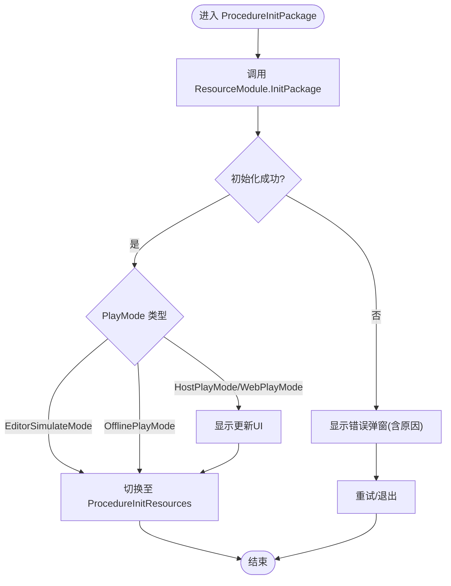
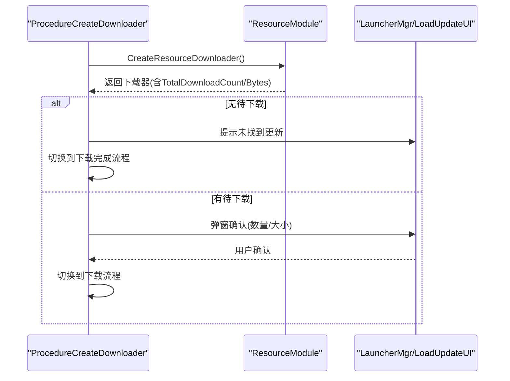
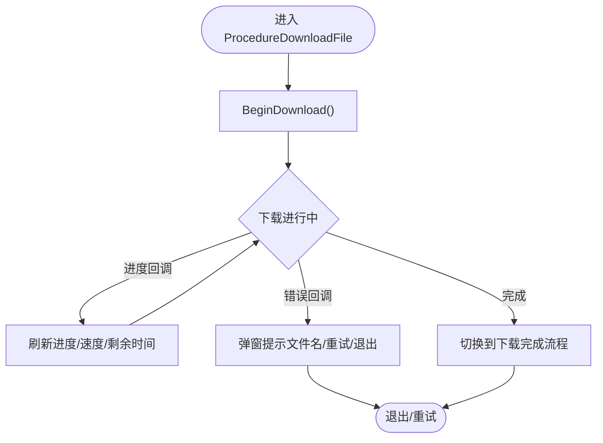
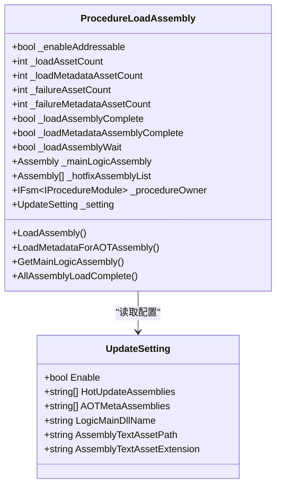
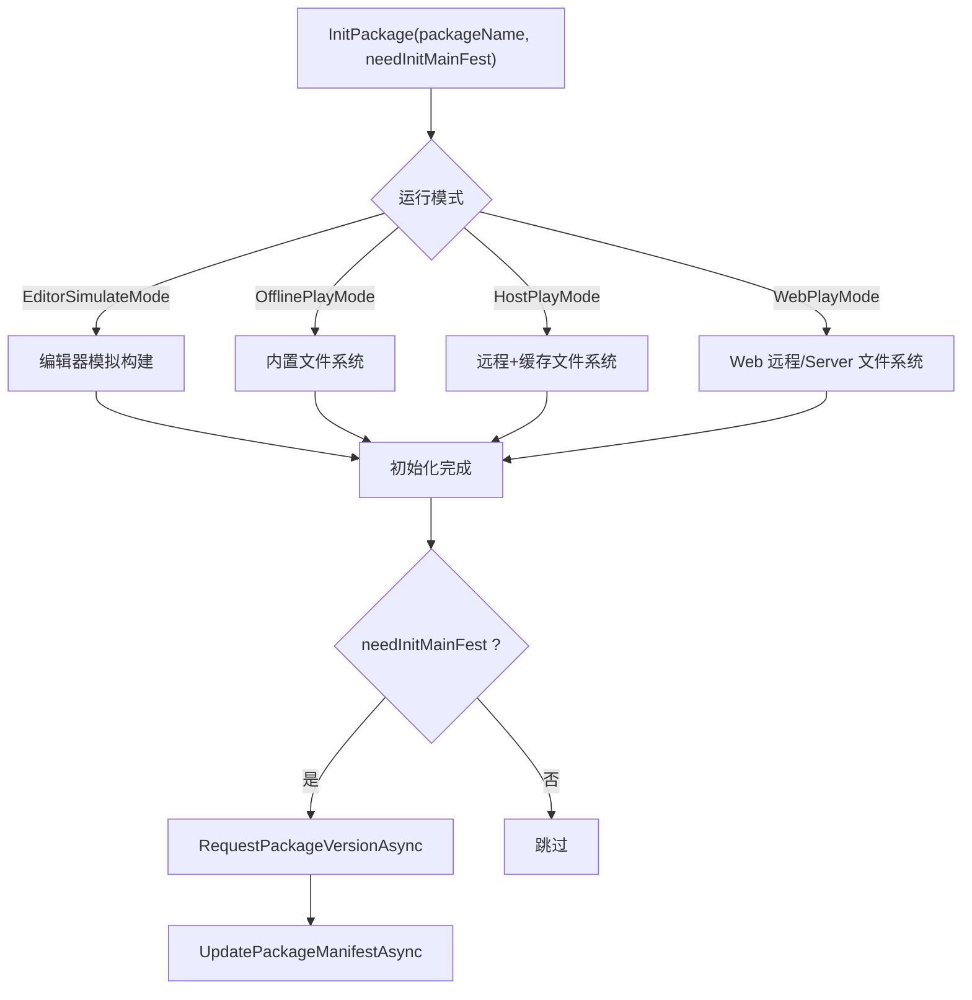
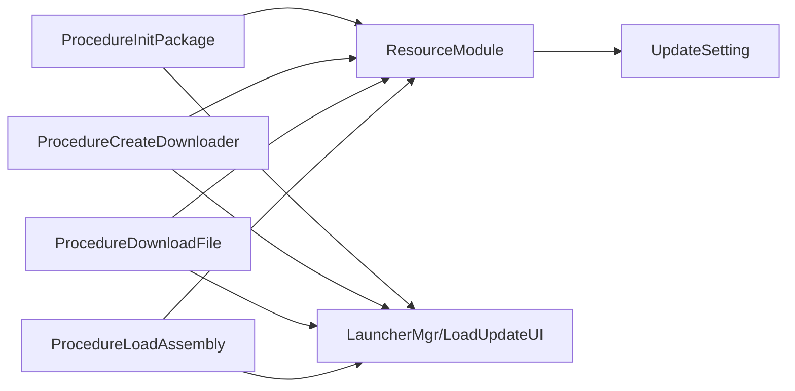

# 热更新资源处理

<cite>
**本文引用的文件**   
- [ProcedureInitPackage.cs](file://UnityProject/Assets/GameScripts/Procedure/ProcedureInitPackage.cs)
- [ProcedureCreateDownloader.cs](file://UnityProject/Assets/GameScripts/Procedure/ProcedureCreateDownloader.cs)
- [ProcedureDownloadFile.cs](file://UnityProject/Assets/GameScripts/Procedure/ProcedureDownloadFile.cs)
- [ProcedureLoadAssembly.cs](file://UnityProject/Assets/GameScripts/Procedure/ProcedureLoadAssembly.cs)
- [ResourceModule.cs](file://UnityProject/Assets/TEngine/Runtime/Module/ResourceModule/ResourceModule.cs)
- [UpdateSetting.cs](file://UnityProject/Assets/TEngine/Runtime/Core/UpdateSetting.cs)
- [LauncherMgr.cs](file://UnityProject/Assets/Launcher/Scripts/LauncherMgr.cs)
- [LoadUpdateUI.cs](file://UnityProject/Assets/Launcher/Scripts/LoadUpdateUI.cs)
</cite>

## 目录
1. [简介](#简介)
2. [项目结构](#项目结构)
3. [核心组件](#核心组件)
4. [架构总览](#架构总览)
5. [详细组件分析](#详细组件分析)
6. [依赖关系分析](#依赖关系分析)
7. [性能与容量规划](#性能与容量规划)
8. [故障排查指南](#故障排查指南)
9. [结论](#结论)
10. [附录](#附录)

## 简介
本文件系统性阐述基于 HybridCLR 的热更新资源处理方案，覆盖增量更新、版本管理与回滚策略；详述资源包的下载、校验与安装流程；说明冷/热混合部署、资源分片与按需加载；给出状态监控、错误处理与用户提示的实现方法；并补充安全考虑（签名验证、完整性检查与防篡改机制）的落地建议。

## 项目结构
本项目在 Unity 工程中以“流程（Procedure）+ 资源模块（ResourceModule）”为核心组织热更新逻辑：
- 流程层：负责启动、初始化包、创建下载器、下载文件、加载程序集等阶段控制。
- 资源层：封装 YooAsset 的资源包初始化、清单版本请求与更新、下载器创建、缓存清理等能力。
- 配置层：通过 UpdateSetting 提供平台路径、服务器地址、WebGL 加载方式、是否启用热更等配置。
- 启动层：Launcher 提供 UI 展示与进度刷新，配合流程进行用户交互。

图表来源
- [ProcedureInitPackage.cs:15-119](file://UnityProject/Assets/GameScripts/Procedure/ProcedureInitPackage.cs#L15-L119)
- [ProcedureCreateDownloader.cs:14-75](file://UnityProject/Assets/GameScripts/Procedure/ProcedureCreateDownloader.cs#L14-L75)
- [ProcedureDownloadFile.cs:12-103](file://UnityProject/Assets/GameScripts/Procedure/ProcedureDownloadFile.cs#L12-L103)
- [ProcedureLoadAssembly.cs:19-293](file://UnityProject/Assets/GameScripts/Procedure/ProcedureLoadAssembly.cs#L19-L293)
- [ResourceModule.cs:119-366](file://UnityProject/Assets/TEngine/Runtime/Module/ResourceModule/ResourceModule.cs#L119-L366)
- [UpdateSetting.cs:50-219](file://UnityProject/Assets/TEngine/Runtime/Core/UpdateSetting.cs#L50-L219)
- [LauncherMgr.cs:11-...](file://UnityProject/Assets/Launcher/Scripts/LauncherMgr.cs#L11-L...)
- [LoadUpdateUI.cs:9-...](file://UnityProject/Assets/Launcher/Scripts/LoadUpdateUI.cs#L9-L...)

章节来源
- [ProcedureInitPackage.cs:15-119](file://UnityProject/Assets/GameScripts/Procedure/ProcedureInitPackage.cs#L15-L119)
- [ProcedureCreateDownloader.cs:14-75](file://UnityProject/Assets/GameScripts/Procedure/ProcedureCreateDownloader.cs#L14-L75)
- [ProcedureDownloadFile.cs:12-103](file://UnityProject/Assets/GameScripts/Procedure/ProcedureDownloadFile.cs#L12-L103)
- [ProcedureLoadAssembly.cs:19-293](file://UnityProject/Assets/GameScripts/Procedure/ProcedureLoadAssembly.cs#L19-L293)
- [ResourceModule.cs:119-366](file://UnityProject/Assets/TEngine/Runtime/Module/ResourceModule/ResourceModule.cs#L119-L366)
- [UpdateSetting.cs:50-219](file://UnityProject/Assets/TEngine/Runtime/Core/UpdateSetting.cs#L50-L219)

## 核心组件
- 流程类
  - ProcedureInitPackage：初始化资源包，根据运行模式分支到编辑器/离线/可更新模式，失败时弹窗重试。
  - ProcedureCreateDownloader：创建下载器，统计待下载数量与大小，弹出确认对话框后进入下载流程。
  - ProcedureDownloadFile：开始下载，注册回调，计算速度/剩余时间，刷新进度 UI。
  - ProcedureLoadAssembly：加载主逻辑与热更新程序集，结合 HybridCLR 为 AOT 程序集补充元数据，最终调用 GameApp.Entrance。
- 资源模块 ResourceModule：封装 YooAsset 的包初始化、版本请求/更新、下载器创建、缓存清理、资源查询/加载等。
- 配置 UpdateSetting：提供服务器地址、备用地址、平台名称、WebGL 加载方式、是否启用热更、程序集列表等。
- 启动层 LauncherMgr/LoadUpdateUI：统一显示更新 UI、进度条、消息框与重试入口。

章节来源
- [ProcedureInitPackage.cs:15-119](file://UnityProject/Assets/GameScripts/Procedure/ProcedureInitPackage.cs#L15-L119)
- [ProcedureCreateDownloader.cs:14-75](file://UnityProject/Assets/GameScripts/Procedure/ProcedureCreateDownloader.cs#L14-L75)
- [ProcedureDownloadFile.cs:12-103](file://UnityProject/Assets/GameScripts/Procedure/ProcedureDownloadFile.cs#L12-L103)
- [ProcedureLoadAssembly.cs:19-293](file://UnityProject/Assets/GameScripts/Procedure/ProcedureLoadAssembly.cs#L19-L293)
- [ResourceModule.cs:119-366](file://UnityProject/Assets/TEngine/Runtime/Module/ResourceModule/ResourceModule.cs#L119-L366)
- [UpdateSetting.cs:50-219](file://UnityProject/Assets/TEngine/Runtime/Core/UpdateSetting.cs#L50-L219)
- [LauncherMgr.cs:11-...](file://UnityProject/Assets/Launcher/Scripts/LauncherMgr.cs#L11-L...)
- [LoadUpdateUI.cs:9-...](file://UnityProject/Assets/Launcher/Scripts/LoadUpdateUI.cs#L9-L...)

## 架构总览
下图展示了从启动到进入游戏的主控流程，以及各组件之间的协作关系。

图表来源
- [ProcedureInitPackage.cs:21-119](file://UnityProject/Assets/GameScripts/Procedure/ProcedureInitPackage.cs#L21-L119)
- [ProcedureCreateDownloader.cs:30-75](file://UnityProject/Assets/GameScripts/Procedure/ProcedureCreateDownloader.cs#L30-L75)
- [ProcedureDownloadFile.cs:38-103](file://UnityProject/Assets/GameScripts/Procedure/ProcedureDownloadFile.cs#L38-L103)
- [ProcedureLoadAssembly.cs:42-150](file://UnityProject/Assets/GameScripts/Procedure/ProcedureLoadAssembly.cs#L42-L150)
- [ResourceModule.cs:140-366](file://UnityProject/Assets/TEngine/Runtime/Module/ResourceModule/ResourceModule.cs#L140-L366)
- [LauncherMgr.cs:11-...](file://UnityProject/Assets/Launcher/Scripts/LauncherMgr.cs#L11-L...)
- [LoadUpdateUI.cs:9-...](file://UnityProject/Assets/Launcher/Scripts/LoadUpdateUI.cs#L9-L...)

## 详细组件分析

### 资源包初始化与模式分支（ProcedureInitPackage）
- 功能要点
  - 异步初始化默认资源包，成功后根据 PlayMode 分支：编辑器模拟、离线、主机/网页可更新模式。
  - 可更新模式下打开更新 UI，随后进入后续流程。
  - 初始化失败时弹窗提示原因并提供重试或退出。
- 关键实现点
  - 使用 _resourceModule.InitPackage 完成包初始化。
  - 对特定错误（如 PackageManifest 缺失）做友好提示。
  - 通过 LauncherMgr.ShowUI/ShowMessageBox 与 Retry 实现用户交互与重试。

图表来源
- [ProcedureInitPackage.cs:21-119](file://UnityProject/Assets/GameScripts/Procedure/ProcedureInitPackage.cs#L21-L119)
- [ResourceModule.cs:140-260](file://UnityProject/Assets/TEngine/Runtime/Module/ResourceModule/ResourceModule.cs#L140-L260)

章节来源
- [ProcedureInitPackage.cs:21-119](file://UnityProject/Assets/GameScripts/Procedure/ProcedureInitPackage.cs#L21-L119)
- [ResourceModule.cs:140-260](file://UnityProject/Assets/TEngine/Runtime/Module/ResourceModule/ResourceModule.cs#L140-L260)

### 下载器创建与确认（ProcedureCreateDownloader）
- 功能要点
  - 延迟半秒后创建下载器，获取待下载文件数与总大小。
  - 若无待下载文件直接跳过；否则弹窗确认，确认后进入下载流程。
- 关键实现点
  - 使用 _resourceModule.CreateResourceDownloader 获取下载器。
  - 通过 LauncherMgr.ShowMessageBox 提示总量与大小，用户确认后切换状态。

图表来源
- [ProcedureCreateDownloader.cs:30-75](file://UnityProject/Assets/GameScripts/Procedure/ProcedureCreateDownloader.cs#L30-L75)
- [ResourceModule.cs:346-366](file://UnityProject/Assets/TEngine/Runtime/Module/ResourceModule/ResourceModule.cs#L346-L366)

章节来源
- [ProcedureCreateDownloader.cs:30-75](file://UnityProject/Assets/GameScripts/Procedure/ProcedureCreateDownloader.cs#L30-L75)
- [ResourceModule.cs:346-366](file://UnityProject/Assets/TEngine/Runtime/Module/ResourceModule/ResourceModule.cs#L346-L366)

### 下载过程与进度反馈（ProcedureDownloadFile）
- 功能要点
  - 开始下载，注册错误与进度回调。
  - 计算当前速度与剩余时间，刷新 UI 进度与文案。
  - 下载失败时弹窗提示文件名，支持重试或退出。
- 关键实现点
  - downloader.BeginDownload() 与 await downloader 等待完成。
  - OnDownloadErrorCallback/OnDownloadProgressCallback 分别处理异常与进度。
  - 使用 Utility.File.GetLengthString 格式化速率。

图表来源
- [ProcedureDownloadFile.cs:38-103](file://UnityProject/Assets/GameScripts/Procedure/ProcedureDownloadFile.cs#L38-L103)

章节来源
- [ProcedureDownloadFile.cs:38-103](file://UnityProject/Assets/GameScripts/Procedure/ProcedureDownloadFile.cs#L38-L103)

### 程序集加载与 HybridCLR 集成（ProcedureLoadAssembly）
- 功能要点
  - 根据 UpdateSetting.Enable 与 PlayMode 决定是否加载热更新程序集。
  - 若启用，则按配置列表加载主逻辑与热更新程序集，并通过 Assembly.Load(bytes) 载入。
  - 为 AOT 程序集加载元数据（HybridCLR），使泛型/AOT 函数在解释模式下执行。
  - 完成后查找 GameApp.Entrance 并传入热更新程序集列表，启动游戏逻辑。
- 关键实现点
  - LoadMetadataForAOTAssembly 调用 HybridCLR.RuntimeApi.LoadMetadataForAOTAssembly。
  - GetMainLogicAssembly 扫描已加载程序集，匹配 LogicMainDllName 与 HotUpdateAssemblies。
  - AllAssemblyLoadComplete 反射调用入口方法。

图表来源
- [ProcedureLoadAssembly.cs:19-293](file://UnityProject/Assets/GameScripts/Procedure/ProcedureLoadAssembly.cs#L19-L293)
- [UpdateSetting.cs:50-219](file://UnityProject/Assets/TEngine/Runtime/Core/UpdateSetting.cs#L50-L219)

章节来源
- [ProcedureLoadAssembly.cs:42-150](file://UnityProject/Assets/GameScripts/Procedure/ProcedureLoadAssembly.cs#L42-L150)
- [ProcedureLoadAssembly.cs:181-293](file://UnityProject/Assets/GameScripts/Procedure/ProcedureLoadAssembly.cs#L181-L293)
- [UpdateSetting.cs:50-219](file://UnityProject/Assets/TEngine/Runtime/Core/UpdateSetting.cs#L50-L219)

### 资源模块能力（ResourceModule）
- 包初始化：支持 EditorSimulateMode、OfflinePlayMode、HostPlayMode、WebPlayMode 多种模式，自动选择文件系统与远程服务。
- 版本管理：RequestPackageVersionAsync 与 UpdatePackageManifestAsync 用于拉取远端清单并更新本地清单。
- 下载器：CreateResourceDownloader 创建下载器，支持并发与重试次数配置。
- 资源查询/加载：HasAsset、GetAssetInfo、LoadAsset 等接口，内部维护资源池与引用计数。
- 缓存清理：ClearCacheFilesAsync/ClearAllBundleFiles 支持清理未使用的 Bundle 文件或全部文件。

图表来源
- [ResourceModule.cs:140-260](file://UnityProject/Assets/TEngine/Runtime/Module/ResourceModule/ResourceModule.cs#L140-L260)

章节来源
- [ResourceModule.cs:140-260](file://UnityProject/Assets/TEngine/Runtime/Module/ResourceModule/ResourceModule.cs#L140-L260)
- [ResourceModule.cs:346-366](file://UnityProject/Assets/TEngine/Runtime/Module/ResourceModule/ResourceModule.cs#L346-L366)
- [ResourceModule.cs:458-602](file://UnityProject/Assets/TEngine/Runtime/Module/ResourceModule/ResourceModule.cs#L458-L602)

## 依赖关系分析
- 流程层依赖资源模块进行包初始化、清单更新与下载器创建。
- 流程层依赖启动层进行 UI 展示与用户交互。
- 配置层 UpdateSetting 被流程层与资源模块共同消费，决定服务器地址、平台路径、WebGL 行为与热更开关。
- HybridCLR 仅在启用热更且非编辑器模拟模式下参与程序集加载与元数据补充。

图表来源
- [ProcedureInitPackage.cs:21-119](file://UnityProject/Assets/GameScripts/Procedure/ProcedureInitPackage.cs#L21-L119)
- [ProcedureCreateDownloader.cs:30-75](file://UnityProject/Assets/GameScripts/Procedure/ProcedureCreateDownloader.cs#L30-L75)
- [ProcedureDownloadFile.cs:38-103](file://UnityProject/Assets/GameScripts/Procedure/ProcedureDownloadFile.cs#L38-L103)
- [ProcedureLoadAssembly.cs:42-150](file://UnityProject/Assets/GameScripts/Procedure/ProcedureLoadAssembly.cs#L42-L150)
- [ResourceModule.cs:140-366](file://UnityProject/Assets/TEngine/Runtime/Module/ResourceModule/ResourceModule.cs#L140-L366)
- [UpdateSetting.cs:50-219](file://UnityProject/Assets/TEngine/Runtime/Core/UpdateSetting.cs#L50-L219)

章节来源
- [ProcedureInitPackage.cs:21-119](file://UnityProject/Assets/GameScripts/Procedure/ProcedureInitPackage.cs#L21-L119)
- [ProcedureCreateDownloader.cs:30-75](file://UnityProject/Assets/GameScripts/Procedure/ProcedureCreateDownloader.cs#L30-L75)
- [ProcedureDownloadFile.cs:38-103](file://UnityProject/Assets/GameScripts/Procedure/ProcedureDownloadFile.cs#L38-L103)
- [ProcedureLoadAssembly.cs:42-150](file://UnityProject/Assets/GameScripts/Procedure/ProcedureLoadAssembly.cs#L42-L150)
- [ResourceModule.cs:140-366](file://UnityProject/Assets/TEngine/Runtime/Module/ResourceModule/ResourceModule.cs#L140-L366)
- [UpdateSetting.cs:50-219](file://UnityProject/Assets/TEngine/Runtime/Core/UpdateSetting.cs#L50-L219)

## 性能与容量规划
- 下载并发与重试
  - 通过 ResourceModule.DownloadingMaxNum 与 FailedTryAgain 控制并发与重试次数，避免网络拥塞与频繁失败。
- 内存与资源回收
  - 使用资源池与引用计数，支持 UnloadUnusedAssets/ForceUnloadAllAssets；低内存事件触发强制卸载。
- WebGL 特殊处理
  - WebGL 下可选择 Remote 或 StreamingAssets 两种加载方式，减少首包体积与提升首开体验。
- 清单与版本
  - 按需请求远端清单并更新本地清单，避免不必要的下载；合理划分资源包，降低单次更新量。

[本节为通用指导，不直接分析具体文件]

## 故障排查指南
- 资源初始化失败
  - 现象：初始化失败弹窗，提示 PackageManifest 缺失或 HTTP 404。
  - 排查：检查 StreamingAssets/package/DefaultPackage/PackageManifest_DefaultPackage.version 是否存在；核对服务器地址与平台路径。
  - 参考：[ProcedureInitPackage.cs:102-109](file://UnityProject/Assets/GameScripts/Procedure/ProcedureInitPackage.cs#L102-L109)
- 下载失败
  - 现象：下载过程中报错，弹窗提示失败文件名。
  - 排查：检查网络连通性、CDN 可用性；查看下载器并发与重试参数；必要时重新创建下载器。
  - 参考：[ProcedureDownloadFile.cs:66-70](file://UnityProject/Assets/GameScripts/Procedure/ProcedureDownloadFile.cs#L66-L70)
- 程序集加载失败
  - 现象：无法找到主逻辑程序集或入口方法，日志输出致命错误。
  - 排查：确认 ENABLE_HYBRIDCLR 宏定义；检查 LogicMainDllName 与 HotUpdateAssemblies 配置；确保 .bytes 资源存在。
  - 参考：[ProcedureLoadAssembly.cs:130-149](file://UnityProject/Assets/GameScripts/Procedure/ProcedureLoadAssembly.cs#L130-L149)

章节来源
- [ProcedureInitPackage.cs:102-109](file://UnityProject/Assets/GameScripts/Procedure/ProcedureInitPackage.cs#L102-L109)
- [ProcedureDownloadFile.cs:66-70](file://UnityProject/Assets/GameScripts/Procedure/ProcedureDownloadFile.cs#L66-L70)
- [ProcedureLoadAssembly.cs:130-149](file://UnityProject/Assets/GameScripts/Procedure/ProcedureLoadAssembly.cs#L130-L149)

## 结论
本方案以流程驱动与资源模块解耦的方式，实现了基于 HybridCLR 的热更新与冷更新的混合部署。通过 YooAsset 的包与清单机制，完成增量更新与版本管理；借助 Launcher 层提供一致的用户体验；同时预留了安全扩展点（签名、完整性校验）。建议在发布前完善服务端签名与校验链路，并在客户端增加校验失败的回滚与降级策略，以提升整体稳定性与安全性。

[本节为总结性内容，不直接分析具体文件]

## 附录

### 增量更新、版本管理与回滚策略
- 增量更新
  - 通过 RequestPackageVersionAsync 与 UpdatePackageManifestAsync 拉取远端清单差异，仅下载变更文件。
  - 使用 CreateResourceDownloader 批量下载，结合并发与重试提高成功率。
- 版本管理
  - 资源包版本由远端清单决定，客户端通过 GetPackageVersion 获取当前包版本。
  - UpdateSetting 提供平台化路径，保证多端隔离与独立版本。
- 回滚策略
  - 建议在客户端保留上一稳定版本的清单与资源快照；当新版本校验失败或运行时异常达到阈值时，自动回滚至上一版本并提示用户。
  - 可在 Launcher 层增加“回滚并重启”入口，便于用户主动恢复。

[本节为概念性说明，不直接分析具体文件]

### 资源包下载、验证与安装流程
- 下载
  - 创建下载器，统计待下载文件与大小，弹窗确认后开始下载。
  - 下载过程中实时反馈进度、速度与剩余时间。
- 验证
  - 建议在下载完成后对每个文件进行哈希校验（如 SHA-256），并与清单中的校验值比对。
  - 校验失败的文件应标记并重试，超过阈值则中断并提示用户。
- 安装
  - 校验通过后，将文件写入缓存目录，并更新本地清单索引。
  - 若安装失败，清理未完成安装的文件，保持系统一致性。

[本节为概念性说明，不直接分析具体文件]

### 热更新与冷更新的混合部署、资源分片与按需加载
- 混合部署
  - 冷更新：核心引擎与基础资源随安装包发布（OfflinePlayMode）。
  - 热更新：业务逻辑与可变资源通过 HotUpdateAssemblies 与资源包下发（HostPlayMode/WebPlayMode）。
- 资源分片
  - 按场景/模块拆分资源包，减少首次加载体积；利用 IsNeedDownloadFromRemote 判断是否需要远程下载。
- 按需加载
  - 使用 LoadAsset/LoadAssetAsync 按需加载资源，结合资源池与引用计数控制内存占用。

[本节为概念性说明，不直接分析具体文件]

### 热更新状态监控、错误处理与用户提示
- 状态监控
  - 在下载流程中持续上报进度、速度、剩余时间与累计下载量。
  - 在程序集加载阶段记录加载数量、失败数量与元数据加载状态。
- 错误处理
  - 下载错误：弹窗提示文件名，支持重试或退出。
  - 初始化错误：提示具体原因（如清单缺失），支持重试。
  - 程序集错误：记录致命错误并终止流程，提示用户检查配置与资源。
- 用户提示
  - 统一通过 LauncherMgr.ShowUI/ShowMessageBox 展示信息，保持 UI 风格一致。

章节来源
- [ProcedureDownloadFile.cs:72-90](file://UnityProject/Assets/GameScripts/Procedure/ProcedureDownloadFile.cs#L72-L90)
- [ProcedureInitPackage.cs:71-109](file://UnityProject/Assets/GameScripts/Procedure/ProcedureInitPackage.cs#L71-L109)
- [ProcedureLoadAssembly.cs:181-218](file://UnityProject/Assets/GameScripts/Procedure/ProcedureLoadAssembly.cs#L181-L218)

### 安全考虑：签名验证、完整性检查与防篡改
- 签名验证
  - 服务端对清单与资源文件进行数字签名；客户端在拉取清单与下载完成后验证签名，拒绝非法资源。
- 完整性检查
  - 对每个资源文件计算哈希并与清单中的哈希值比对；不一致则判定为损坏或被篡改。
- 防篡改机制
  - 客户端侧对关键清单与校验表进行加密存储，防止本地篡改。
  - 在网络层启用 HTTPS 与证书固定，防止中间人攻击。
- 回滚与降级
  - 当校验失败或多次异常时，自动回滚到上一稳定版本，并引导用户修复网络或重新下载。

[本节为概念性说明，不直接分析具体文件]