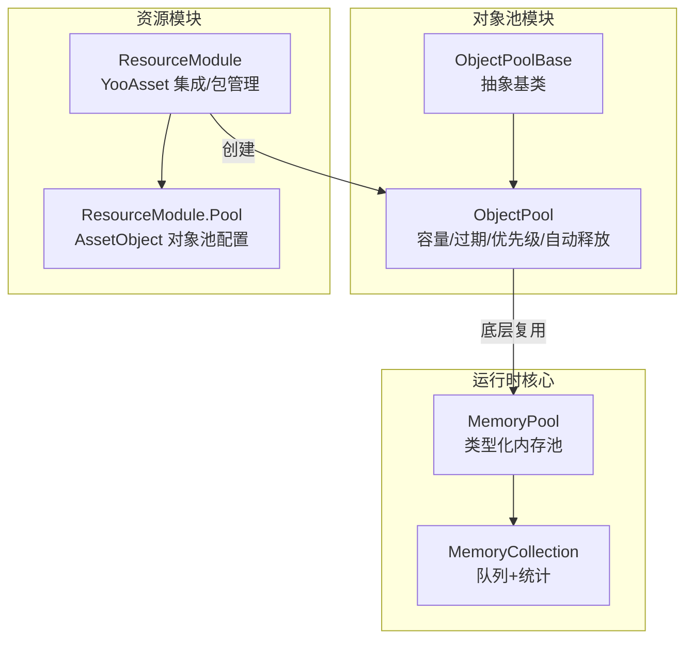
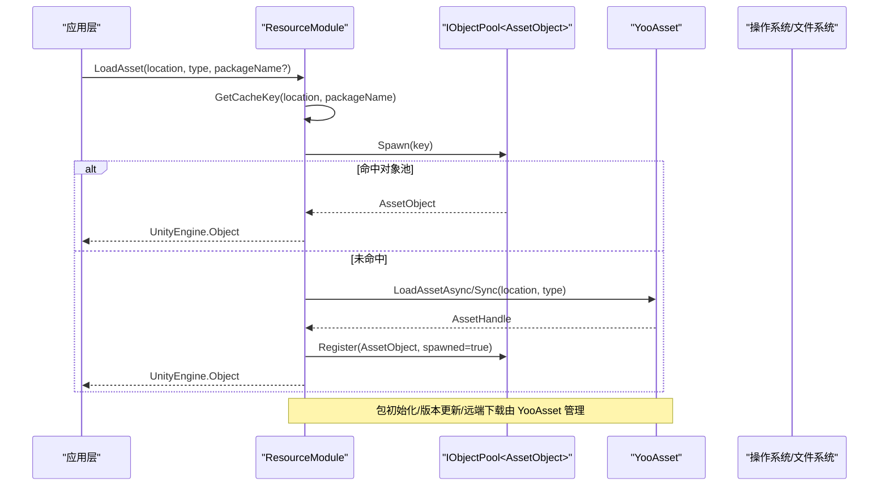
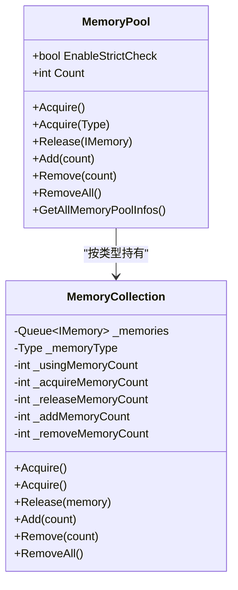
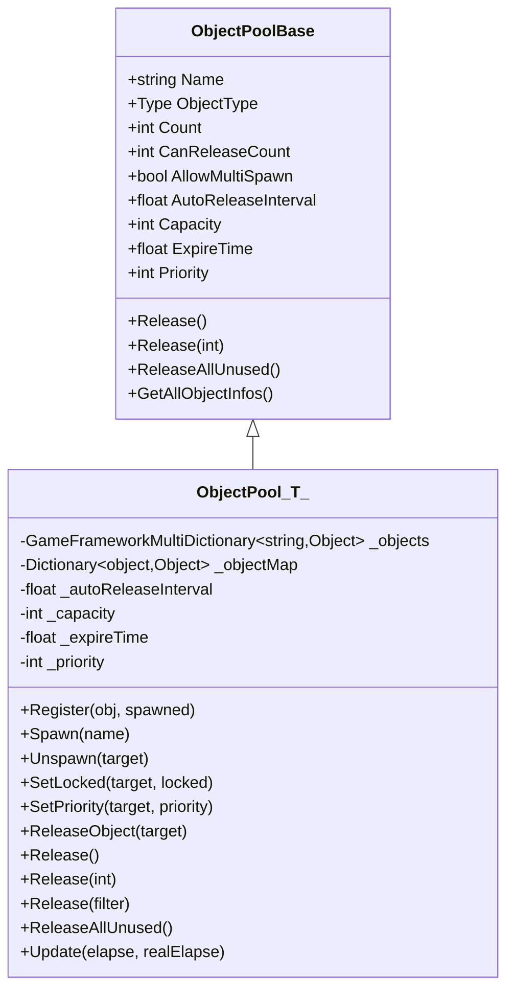
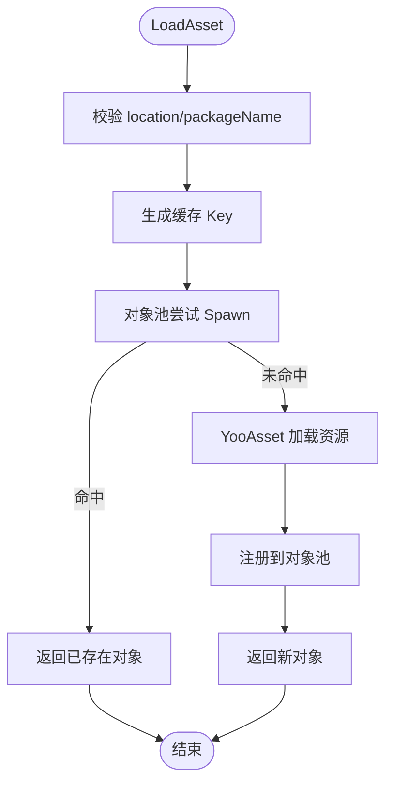
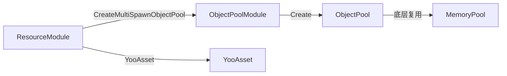

# 缓存管理策略

<cite>
**本文引用的文件**   
- [MemoryPool.cs](file://UnityProject/Assets/TEngine/Runtime/Core/MemoryPool/MemoryPool.cs)
- [MemoryPool.MemoryCollection.cs](file://UnityProject/Assets/TEngine/Runtime/Core/MemoryPool/MemoryPool.MemoryCollection.cs)
- [MemoryPoolSetting.cs](file://UnityProject/Assets/TEngine/Runtime/Core/MemoryPool/MemoryPoolSetting.cs)
- [ResourceModule.cs](file://UnityProject/Assets/TEngine/Runtime/Module/ResourceModule/ResourceModule.cs)
- [ResourceModule.Pool.cs](file://UnityProject/Assets/TEngine/Runtime/Module/ResourceModule/ResourceModule.Pool.cs)
- [ObjectPoolBase.cs](file://UnityProject/Assets/TEngine/Runtime/Module/ObjectPoolModule/ObjectPoolBase.cs)
- [ObjectPoolModule.ObjectPool.cs](file://UnityProject/Assets/TEngine/Runtime/Module/ObjectPoolModule/ObjectPoolModule.ObjectPool.cs)
</cite>

## 目录
1. [引言](#引言)
2. [项目结构](#项目结构)
3. [核心组件](#核心组件)
4. [架构总览](#架构总览)
5. [详细组件分析](#详细组件分析)
6. [依赖关系分析](#依赖关系分析)
7. [性能与内存优化](#性能与内存优化)
8. [故障排查指南](#故障排查指南)
9. [结论](#结论)

## 引言
本文件围绕 TEngine 的缓存与对象复用机制，系统性梳理以下主题：
- LRU（最近最少使用）与 ARC（自适应替换缓存）在资源管理中的实现思路与应用场景
- 资源缓存的生命周期、内存限制与自动清理机制
- 对象池在资源管理中的应用：对象复用、预分配与回收策略
- 缓存命中率优化、内存占用监控与性能调优方法
- 不同平台下的缓存行为差异与适配方案

说明：仓库中未直接提供 LRU/ARC 算法的具体源码实现。LRU/ARC 在本项目中以“对象池 + 优先级 + 最后使用时间”的组合方式体现为可配置的淘汰策略；真正的包级缓存与磁盘缓存由 YooAsset 负责。下文将结合代码给出落地实践与扩展建议。

## 项目结构
与缓存和对象复用相关的核心代码位于以下路径：
- 运行时核心内存池：Runtime/Core/MemoryPool
- 资源模块：Runtime/Module/ResourceModule
- 对象池模块：Runtime/Module/ObjectPoolModule

图示来源
- [MemoryPool.cs:1-208](file://UnityProject/Assets/TEngine/Runtime/Core/MemoryPool/MemoryPool.cs#L1-L208)
- [MemoryPool.MemoryCollection.cs:1-157](file://UnityProject/Assets/TEngine/Runtime/Core/MemoryPool/MemoryPool.MemoryCollection.cs#L1-L157)
- [ObjectPoolBase.cs:1-134](file://UnityProject/Assets/TEngine/Runtime/Module/ObjectPoolModule/ObjectPoolBase.cs#L1-L134)
- [ObjectPoolModule.ObjectPool.cs:1-602](file://UnityProject/Assets/TEngine/Runtime/Module/ObjectPoolModule/ObjectPoolModule.ObjectPool.cs#L1-L602)
- [ResourceModule.cs:1-800](file://UnityProject/Assets/TEngine/Runtime/Module/ResourceModule/ResourceModule.cs#L1-L800)
- [ResourceModule.Pool.cs:1-68](file://UnityProject/Assets/TEngine/Runtime/Module/ResourceModule/ResourceModule.Pool.cs#L1-L68)

章节来源
- [MemoryPool.cs:1-208](file://UnityProject/Assets/TEngine/Runtime/Core/MemoryPool/MemoryPool.cs#L1-L208)
- [MemoryPool.MemoryCollection.cs:1-157](file://UnityProject/Assets/TEngine/Runtime/Core/MemoryPool/MemoryPool.MemoryCollection.cs#L1-L157)
- [ObjectPoolBase.cs:1-134](file://UnityProject/Assets/TEngine/Runtime/Module/ObjectPoolModule/ObjectPoolBase.cs#L1-L134)
- [ObjectPoolModule.ObjectPool.cs:1-602](file://UnityProject/Assets/TEngine/Runtime/Module/ObjectPoolModule/ObjectPoolModule.ObjectPool.cs#L1-L602)
- [ResourceModule.cs:1-800](file://UnityProject/Assets/TEngine/Runtime/Module/ResourceModule/ResourceModule.cs#L1-L800)
- [ResourceModule.Pool.cs:1-68](file://UnityProject/Assets/TEngine/Runtime/Module/ResourceModule/ResourceModule.Pool.cs#L1-L68)

## 核心组件
- MemoryPool：按类型维护 IMemory 对象的无锁/轻量锁队列，支持获取、归还、批量增删与统计信息导出，并提供严格检查开关。
- MemoryCollection：具体类型的池内部实现，包含空闲队列、使用计数、获取/归还/新增/移除计数等指标。
- ObjectPoolBase/ObjectPool<T>：通用对象池抽象与实现，支持容量上限、过期时间、优先级、是否允许多次 Spawn、自动释放间隔与筛选回调。
- ResourceModule：基于 YooAsset 的资源加载与包管理，封装了 AssetObject 的对象池、资源卸载、低内存响应、WebGL 等平台差异处理。
- ResourceModule.Pool：对外暴露 AssetObject 对象池的关键参数（容量、过期、自动释放间隔、优先级）。

章节来源
- [MemoryPool.cs:1-208](file://UnityProject/Assets/TEngine/Runtime/Core/MemoryPool/MemoryPool.cs#L1-L208)
- [MemoryPool.MemoryCollection.cs:1-157](file://UnityProject/Assets/TEngine/Runtime/Core/MemoryPool/MemoryPool.MemoryCollection.cs#L1-L157)
- [ObjectPoolBase.cs:1-134](file://UnityProject/Assets/TEngine/Runtime/Module/ObjectPoolModule/ObjectPoolBase.cs#L1-L134)
- [ObjectPoolModule.ObjectPool.cs:1-602](file://UnityProject/Assets/TEngine/Runtime/Module/ObjectPoolModule/ObjectPoolModule.ObjectPool.cs#L1-L602)
- [ResourceModule.cs:1-800](file://UnityProject/Assets/TEngine/Runtime/Module/ResourceModule/ResourceModule.cs#L1-L800)
- [ResourceModule.Pool.cs:1-68](file://UnityProject/Assets/TEngine/Runtime/Module/ResourceModule/ResourceModule.Pool.cs#L1-L68)

## 架构总览
资源加载与对象复用的整体流程如下：

图示来源
- [ResourceModule.cs:692-725](file://UnityProject/Assets/TEngine/Runtime/Module/ResourceModule/ResourceModule.cs#L692-L725)
- [ResourceModule.cs:769-800](file://UnityProject/Assets/TEngine/Runtime/Module/ResourceModule/ResourceModule.cs#L769-L800)
- [ResourceModule.Pool.cs:47-66](file://UnityProject/Assets/TEngine/Runtime/Module/ResourceModule/ResourceModule.Pool.cs#L47-L66)

## 详细组件分析

### 内存池（MemoryPool / MemoryCollection）
- 设计要点
  - 按类型维护独立集合，避免跨类型污染。
  - 通过队列实现 FIFO 复用，配合 Clear() 保证对象状态重置。
  - 提供严格检查模式，防止重复释放或非法类型。
  - 暴露统计信息用于监控与诊断。
- 复杂度
  - Acquire/Release 均摊 O(1)，批量 Add/Remove 为 O(n)。
- 适用场景
  - 高频短生命周期对象（如临时数据结构、日志缓冲、帧间中间结果）。

图示来源
- [MemoryPool.cs:1-208](file://UnityProject/Assets/TEngine/Runtime/Core/MemoryPool/MemoryPool.cs#L1-L208)
- [MemoryPool.MemoryCollection.cs:1-157](file://UnityProject/Assets/TEngine/Runtime/Core/MemoryPool/MemoryPool.MemoryCollection.cs#L1-L157)

章节来源
- [MemoryPool.cs:1-208](file://UnityProject/Assets/TEngine/Runtime/Core/MemoryPool/MemoryPool.cs#L1-L208)
- [MemoryPool.MemoryCollection.cs:1-157](file://UnityProject/Assets/TEngine/Runtime/Core/MemoryPool/MemoryPool.MemoryCollection.cs#L1-L157)

### 对象池（ObjectPoolBase / ObjectPool<T>）
- 设计要点
  - 统一抽象 ObjectPoolBase，定义名称、容量、过期、优先级、自动释放间隔等能力。
  - ObjectPool<T> 实现多键索引（名称）、对象映射、可释放候选收集、默认筛选器（过期优先 + 优先级/LRU 排序）。
  - 支持 SetLocked/SetPriority 控制对象保留与淘汰顺序。
  - Update 周期触发自动释放，Release 支持自定义筛选回调。
- 淘汰策略（近似 LRU）
  - 默认筛选器会先剔除超过 ExpireTime 的对象，再按 Priority 升序、LastUseTime 降序选择待释放对象，体现“低优先级且较久未用”优先淘汰。
- 复杂度
  - Spawn/Unspawn 平均 O(1)，Release 默认 O(k log k)（k 为候选数量），可通过自定义筛选回调优化。

图示来源
- [ObjectPoolBase.cs:1-134](file://UnityProject/Assets/TEngine/Runtime/Module/ObjectPoolModule/ObjectPoolBase.cs#L1-L134)
- [ObjectPoolModule.ObjectPool.cs:1-602](file://UnityProject/Assets/TEngine/Runtime/Module/ObjectPoolModule/ObjectPoolModule.ObjectPool.cs#L1-L602)

章节来源
- [ObjectPoolBase.cs:1-134](file://UnityProject/Assets/TEngine/Runtime/Module/ObjectPoolModule/ObjectPoolBase.cs#L1-L134)
- [ObjectPoolModule.ObjectPool.cs:1-602](file://UnityProject/Assets/TEngine/Runtime/Module/ObjectPoolModule/ObjectPoolModule.ObjectPool.cs#L1-L602)

### 资源模块（ResourceModule）
- 职责
  - 初始化 YooAsset，创建并管理多个 ResourcePackage。
  - 提供同步/异步资源加载接口，内部通过 AssetObject 对象池进行复用。
  - 提供资源卸载、强制卸载、低内存回调、缓存文件清理等能力。
  - 针对 WebGL 等平台做差异化处理。
- 关键流程
  - 加载时先尝试从对象池 Spawn，命中则直接返回；否则调用 YooAsset 加载并注册到对象池。
  - 低内存事件触发后，调用外部注册的回调执行强制卸载。
  - 支持按包名区分缓存 Key，避免跨包冲突。

图示来源
- [ResourceModule.cs:692-725](file://UnityProject/Assets/TEngine/Runtime/Module/ResourceModule/ResourceModule.cs#L692-L725)
- [ResourceModule.cs:769-800](file://UnityProject/Assets/TEngine/Runtime/Module/ResourceModule/ResourceModule.cs#L769-L800)

章节来源
- [ResourceModule.cs:1-800](file://UnityProject/Assets/TEngine/Runtime/Module/ResourceModule/ResourceModule.cs#L1-L800)
- [ResourceModule.Pool.cs:1-68](file://UnityProject/Assets/TEngine/Runtime/Module/ResourceModule/ResourceModule.Pool.cs#L1-L68)

### LRU 与 ARC 的实现与应用
- LRU（最近最少使用）
  - 在对象池中通过 LastUseTime 与 Priority 组合实现近似 LRU：默认筛选器对候选对象按优先级升序、最后使用时间降序排序，从而优先淘汰“低优先级且较久未用”的对象。
  - 适用场景：UI 元素、频繁创建销毁的临时 GameObject 包装体等。
- ARC（自适应替换缓存）
  - 仓库未提供 ARC 的直接实现。可在对象池层面扩展：引入访问频率权重与年龄衰减因子，动态调整候选对象的淘汰优先级，从而实现更贴近 ARC 的行为。
  - 适用场景：热点数据波动大、访问模式随时间变化的资源（如关卡资源、活动资源）。

注意：上述 LRU/ARC 属于策略层面的解释与建议，并非仓库现有源码的直接实现。

[本节不直接分析具体文件]

### 资源缓存生命周期与自动清理
- 生命周期
  - 首次加载：YooAsset 加载资源，包装为 AssetObject 并注册到对象池。
  - 后续访问：优先从对象池 Spawn，减少 GC 与 IO。
  - 释放：调用 UnloadAsset 或对象池自动释放，最终回收到 MemoryPool。
- 自动清理
  - 对象池自动释放：根据 AutoReleaseInterval 周期性触发 Release，依据 ExpireTime、Priority、LastUseTime 淘汰。
  - 资源卸载：UnloadUnusedAssets 遍历所有包卸载引用计数为零的资源；ForceUnloadAllAssets 强制卸载全部资源（WebGL 不支持）。
  - 低内存响应：OnLowMemory 触发外部注册的强制卸载动作。
  - 缓存文件清理：ClearCacheFilesAsync 清理远端下载的缓存文件。

章节来源
- [ResourceModule.cs:390-447](file://UnityProject/Assets/TEngine/Runtime/Module/ResourceModule/ResourceModule.cs#L390-L447)
- [ResourceModule.cs:373-388](file://UnityProject/Assets/TEngine/Runtime/Module/ResourceModule/ResourceModule.cs#L373-L388)
- [ObjectPoolModule.ObjectPool.cs:408-479](file://UnityProject/Assets/TEngine/Runtime/Module/ObjectPoolModule/ObjectPoolModule.ObjectPool.cs#L408-L479)

### 内存限制配置与对象池参数
- 对象池容量与过期
  - AssetCapacity：对象池最大容量，超出时触发 Release。
  - AssetExpireTime：对象最后使用时间超过该阈值将被优先淘汰。
  - AssetAutoReleaseInterval：自动释放周期。
  - AssetPriority：对象池级别优先级，影响整体释放顺序。
- 内存池严格检查
  - MemoryPoolSetting 提供开发/编辑器环境下的严格检查开关，防止重复释放与非法类型。

章节来源
- [ResourceModule.Pool.cs:10-41](file://UnityProject/Assets/TEngine/Runtime/Module/ResourceModule/ResourceModule.Pool.cs#L10-L41)
- [MemoryPoolSetting.cs:1-80](file://UnityProject/Assets/TEngine/Runtime/Core/MemoryPool/MemoryPoolSetting.cs#L1-L80)

### 平台差异与适配
- WebGL
  - ForceUnloadAllAssets 不支持，需避免调用。
  - 资源加载方式可选择 Remote/WebServer，并在微信小游戏环境下使用特定文件系统参数。
- 离线/主机/编辑器模拟模式
  - 通过 PlayMode 切换不同的初始化参数与文件系统后端。
- 包自动卸载
  - AutoUnloadBundleWhenUnused 控制包级资源在引用计数归零后的自动卸载行为。

章节来源
- [ResourceModule.cs:209-233](file://UnityProject/Assets/TEngine/Runtime/Module/ResourceModule/ResourceModule.cs#L209-L233)
- [ResourceModule.cs:429-442](file://UnityProject/Assets/TEngine/Runtime/Module/ResourceModule/ResourceModule.cs#L429-L442)
- [ResourceModule.cs:173-207](file://UnityProject/Assets/TEngine/Runtime/Module/ResourceModule/ResourceModule.cs#L173-L207)

## 依赖关系分析
- ResourceModule 依赖 IObjectPoolModule 创建 AssetObject 对象池，并通过 YooAsset 完成实际的资源加载与包管理。
- ObjectPool<T> 依赖 MemoryPool 进行底层对象复用（Object<T> 实例）。
- MemoryPool 通过 Dictionary<Type, MemoryCollection> 维护各类型池，线程安全通过 lock 保护。

图示来源
- [ResourceModule.cs:136-138](file://UnityProject/Assets/TEngine/Runtime/Module/ResourceModule/ResourceModule.cs#L136-L138)
- [ResourceModule.Pool.cs:59-66](file://UnityProject/Assets/TEngine/Runtime/Module/ResourceModule/ResourceModule.Pool.cs#L59-L66)
- [ObjectPoolModule.ObjectPool.cs:400-402](file://UnityProject/Assets/TEngine/Runtime/Module/ObjectPoolModule/ObjectPoolModule.ObjectPool.cs#L400-L402)
- [MemoryPool.cs:187-205](file://UnityProject/Assets/TEngine/Runtime/Core/MemoryPool/MemoryPool.cs#L187-L205)

章节来源
- [ResourceModule.cs:119-138](file://UnityProject/Assets/TEngine/Runtime/Module/ResourceModule/ResourceModule.cs#L119-L138)
- [ResourceModule.Pool.cs:59-66](file://UnityProject/Assets/TEngine/Runtime/Module/ResourceModule/ResourceModule.Pool.cs#L59-L66)
- [ObjectPoolModule.ObjectPool.cs:400-402](file://UnityProject/Assets/TEngine/Runtime/Module/ObjectPoolModule/ObjectPoolModule.ObjectPool.cs#L400-L402)
- [MemoryPool.cs:187-205](file://UnityProject/Assets/TEngine/Runtime/Core/MemoryPool/MemoryPool.cs#L187-L205)

## 性能与内存优化
- 提升缓存命中率
  - 合理设置 AssetCapacity 与 AssetExpireTime，使热点资源常驻对象池。
  - 使用 GetCacheKey 的 packageName 前缀隔离不同包的资源，避免误命中。
  - 对频繁使用的 UI 或特效对象启用对象池复用，减少 Instantiate 与 GC。
- 降低内存峰值
  - 开启 AutoUnloadBundleWhenUnused，让不再使用的包及时释放。
  - 在低内存事件中调用 SetForceUnloadUnusedAssetsAction 触发强制卸载。
  - 定期调用 ClearCacheFilesAsync 清理远端缓存文件。
- 监控与诊断
  - 使用 MemoryPool.GetAllMemoryPoolInfos 获取各类型池的使用/归还/新增/移除计数。
  - 使用 ObjectPool<T>.GetAllObjectInfos 查看对象池内对象的状态与使用次数。
  - 开启 MemoryPoolSetting 的严格检查（开发/编辑器环境），尽早发现重复释放与非法类型问题。
- 算法与策略调优
  - 自定义 Release 筛选回调，实现更接近 ARC 的动态淘汰策略（例如引入访问频率、热度衰减）。
  - 调整 AssetPriority 与对象级 Priority，引导释放顺序。

章节来源
- [MemoryPool.cs:33-48](file://UnityProject/Assets/TEngine/Runtime/Core/MemoryPool/MemoryPool.cs#L33-L48)
- [ObjectPoolModule.ObjectPool.cs:485-498](file://UnityProject/Assets/TEngine/Runtime/Module/ObjectPoolModule/ObjectPoolModule.ObjectPool.cs#L485-L498)
- [ResourceModule.cs:390-447](file://UnityProject/Assets/TEngine/Runtime/Module/ResourceModule/ResourceModule.cs#L390-L447)
- [ResourceModule.cs:373-388](file://UnityProject/Assets/TEngine/Runtime/Module/ResourceModule/ResourceModule.cs#L373-L388)
- [MemoryPoolSetting.cs:35-79](file://UnityProject/Assets/TEngine/Runtime/Core/MemoryPool/MemoryPoolSetting.cs#L35-L79)

## 故障排查指南
- 常见问题
  - 重复释放：开启严格检查后，若再次 Release 已归还对象会抛出异常。
  - 非法类型：传入非 IMemory 或抽象类型会抛出异常。
  - 找不到目标对象：Unspawn 传入不在池中的 target 会抛出异常。
- 定位步骤
  - 检查 MemoryPool.EnableStrictCheck 是否开启。
  - 核对对象池容量与过期时间是否过小导致过早释放。
  - 确认资源加载路径与包名是否正确，避免跨包误命中。
  - 在 WebGL 平台避免调用 ForceUnloadAllAssets。
- 恢复措施
  - 调整对象池参数（容量、过期、自动释放间隔）。
  - 在低内存事件中主动触发卸载，释放无用资源。
  - 清理远端缓存文件，避免磁盘占用过高。

章节来源
- [MemoryPool.cs:164-185](file://UnityProject/Assets/TEngine/Runtime/Core/MemoryPool/MemoryPool.cs#L164-L185)
- [MemoryPool.MemoryCollection.cs:83-98](file://UnityProject/Assets/TEngine/Runtime/Core/MemoryPool/MemoryPool.MemoryCollection.cs#L83-L98)
- [ObjectPoolModule.ObjectPool.cs:241-277](file://UnityProject/Assets/TEngine/Runtime/Module/ObjectPoolModule/ObjectPoolModule.ObjectPool.cs#L241-L277)
- [ResourceModule.cs:429-442](file://UnityProject/Assets/TEngine/Runtime/Module/ResourceModule/ResourceModule.cs#L429-L442)

## 结论
- TEngine 通过 MemoryPool 与 ObjectPool<T> 构建了高效的对象复用体系，并结合 ResourceModule 与 YooAsset 实现了资源加载、包管理与缓存清理。
- LRU 行为通过对象池的优先级与最后使用时间近似实现；ARC 可作为扩展策略在筛选回调中实现。
- 针对不同平台（尤其是 WebGL）提供了差异化处理与限制。
- 通过合理的对象池参数配置、自动释放策略与低内存响应机制，可有效提升缓存命中率、降低内存峰值并改善整体性能。