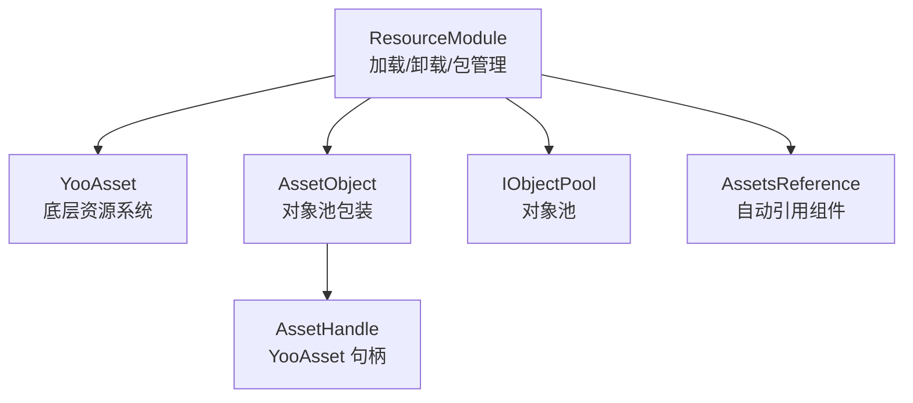
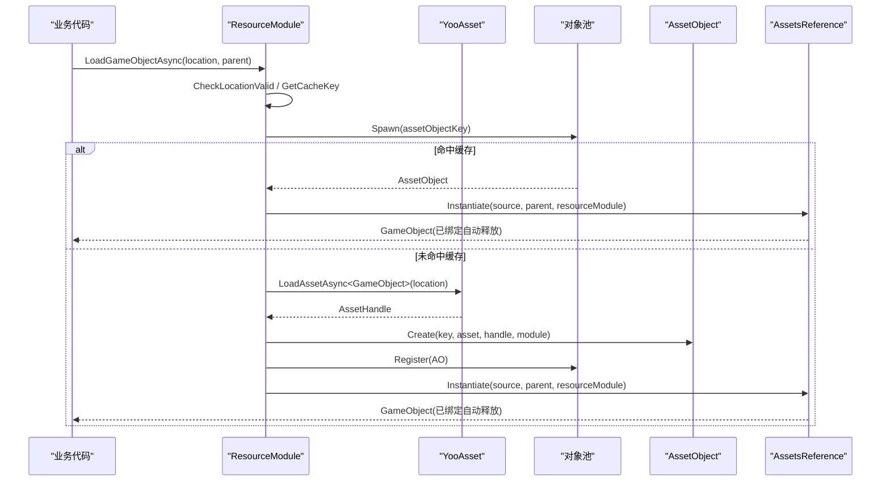
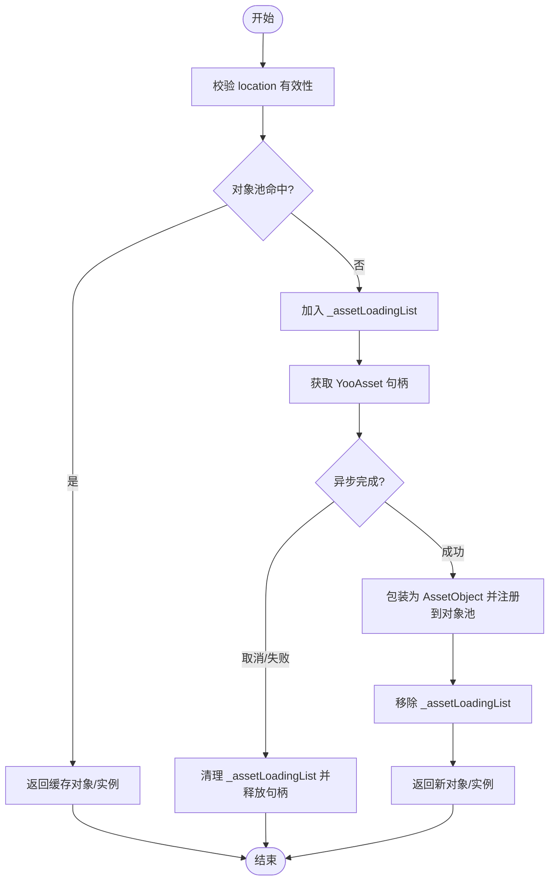
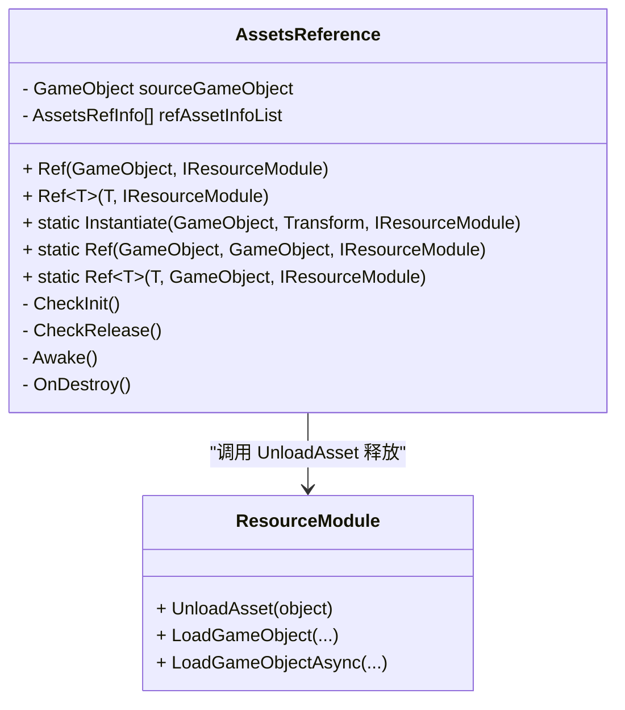
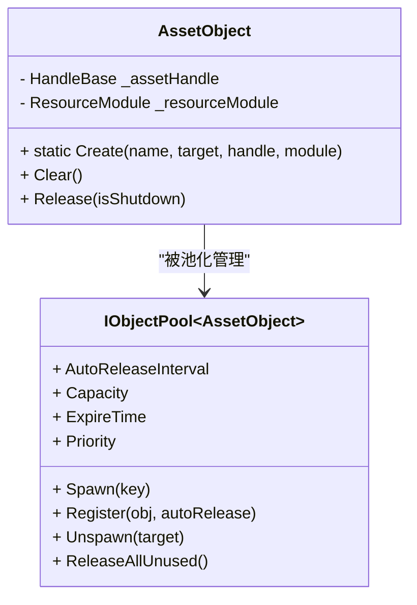
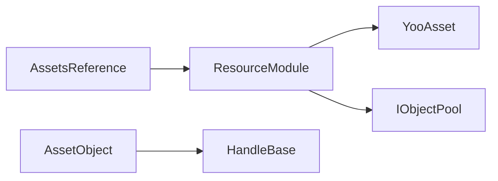

# 资源加载机制

<cite>
**本文引用的文件**   
- [ResourceModule.cs](file://UnityProject/Assets/TEngine/Runtime/Module/ResourceModule/ResourceModule.cs)
- [AssetsReference.cs](file://UnityProject/Assets/TEngine/Runtime/Module/ResourceModule/Reference/AssetsReference.cs)
- [ResourceModule.AssetObject.cs](file://UnityProject/Assets/TEngine/Runtime/Module/ResourceModule/ResourceModule.AssetObject.cs)
- [ResourceModule.Pool.cs](file://UnityProject/Assets/TEngine/Runtime/Module/ResourceModule/ResourceModule.Pool.cs)
- [3-1-资源模块.md](file://Books/3-1-资源模块.md)
</cite>

## 目录
1. [简介](#简介)
2. [项目结构](#项目结构)
3. [核心组件](#核心组件)
4. [架构总览](#架构总览)
5. [详细组件分析](#详细组件分析)
6. [依赖关系分析](#依赖关系分析)
7. [性能与优化建议](#性能与优化建议)
8. [故障排查指南](#故障排查指南)
9. [结论](#结论)
10. [附录：常用 API 速查](#附录常用-api-速查)

## 简介
本文件系统性梳理 TEngine 资源模块的资源加载机制，重点解释 ResourceModule 的同步与异步加载流程、AssetReference 的自动引用与释放、资源分组（包）管理、依赖与优先级、回调与进度监控，并给出 Prefab、Texture、AudioClip 等资源的加载示例路径与最佳实践。

## 项目结构
资源模块位于 Runtime/Module/ResourceModule 下，核心由以下文件组成：
- ResourceModule.cs：对外暴露的加载、卸载、包管理与远端服务配置入口
- Reference/AssetsReference.cs：挂载在实例上的自动引用追踪组件
- ResourceModule.AssetObject.cs：对象池中的资源包装体，持有 YooAsset 句柄
- ResourceModule.Pool.cs：对象池配置与 UnloadAsset 接口封装

图表来源
- [ResourceModule.cs:119-138](file://UnityProject/Assets/TEngine/Runtime/Module/ResourceModule/ResourceModule.cs#L119-L138)
- [ResourceModule.AssetObject.cs:16-36](file://UnityProject/Assets/TEngine/Runtime/Module/ResourceModule/ResourceModule.AssetObject.cs#L16-L36)
- [ResourceModule.Pool.cs:59-66](file://UnityProject/Assets/TEngine/Runtime/Module/ResourceModule/ResourceModule.Pool.cs#L59-L66)
- [AssetsReference.cs:160-174](file://UnityProject/Assets/TEngine/Runtime/Module/ResourceModule/Reference/AssetsReference.cs#L160-L174)

章节来源
- [ResourceModule.cs:119-138](file://UnityProject/Assets/TEngine/Runtime/Module/ResourceModule/ResourceModule.cs#L119-L138)
- [ResourceModule.Pool.cs:5-66](file://UnityProject/Assets/TEngine/Runtime/Module/ResourceModule/ResourceModule.Pool.cs#L5-L66)
- [AssetsReference.cs:31-203](file://UnityProject/Assets/TEngine/Runtime/Module/ResourceModule/Reference/AssetsReference.cs#L31-L203)

## 核心组件
- ResourceModule：统一资源加载入口，封装 YooAsset，提供同步/异步/回调三种加载方式，支持多资源包、远程更新、缓存与回收。
- AssetsReference：附加到 GameObject 或绑定任意 UnityEngine.Object 的轻量组件，负责在销毁时调用 ResourceModule.UnloadAsset 进行自动释放。
- AssetObject：对象池中的资源包装，持有目标对象与 YooAsset 句柄，在对象被回收时释放句柄。
- IObjectPool<AssetObject>：对象池抽象，用于复用 AssetObject 并控制自动释放间隔、容量、过期时间等。

章节来源
- [ResourceModule.cs:17-117](file://UnityProject/Assets/TEngine/Runtime/Module/ResourceModule/ResourceModule.cs#L17-L117)
- [AssetsReference.cs:31-203](file://UnityProject/Assets/TEngine/Runtime/Module/ResourceModule/Reference/AssetsReference.cs#L31-L203)
- [ResourceModule.AssetObject.cs:11-62](file://UnityProject/Assets/TEngine/Runtime/Module/ResourceModule/ResourceModule.AssetObject.cs#L11-L62)
- [ResourceModule.Pool.cs:5-66](file://UnityProject/Assets/TEngine/Runtime/Module/ResourceModule/ResourceModule.Pool.cs#L5-L66)

## 架构总览
ResourceModule 基于 YooAsset 构建，向上暴露统一的加载 API；向下通过 AssetHandle 与 YooAsset 交互，并通过对象池复用 AssetObject，实现“资源对象级”的引用计数与自动释放。AssetsReference 作为生命周期钩子，确保实例销毁时触发资源释放。

图表来源
- [ResourceModule.cs:872-922](file://UnityProject/Assets/TEngine/Runtime/Module/ResourceModule/ResourceModule.cs#L872-L922)
- [AssetsReference.cs:160-174](file://UnityProject/Assets/TEngine/Runtime/Module/ResourceModule/Reference/AssetsReference.cs#L160-L174)
- [ResourceModule.AssetObject.cs:16-36](file://UnityProject/Assets/TEngine/Runtime/Module/ResourceModule/ResourceModule.AssetObject.cs#L16-L36)

## 详细组件分析

### ResourceModule 加载流程
- 初始化
  - Initialize：初始化 YooAssets、设置每帧最大时间切片、创建默认资源包并设为默认包，注入对象池模块。
  - InitPackage：根据运行模式（EditorSimulateMode/OfflinePlayMode/HostPlayMode/WebPlayMode）创建对应参数并初始化包；可选请求远端版本并更新清单。
- 同步加载
  - LoadAsset<T>/LoadAsset：校验 location，检查有效性，尝试从对象池获取 AssetObject；未命中则通过 YooAssets.LoadAssetSync 获取句柄，包装为 AssetObject 并注册到对象池。
  - LoadGameObject：同逻辑，但会实例化 GameObject 并通过 AssetsReference.Instantiate 绑定自动释放。
- 异步加载（UniTask）
  - LoadAssetAsync<T>：校验 location，等待并发同 key 的加载完成（避免重复加载），优先从对象池返回；否则发起 YooAssets.LoadAssetAsync，完成后包装并注册到对象池。
  - LoadGameObjectAsync：同上，最终通过 AssetsReference.Instantiate 返回带自动释放能力的 GameObject。
- 回调式异步加载
  - LoadAsset(location, callback)：校验 location，若命中缓存直接回调；否则发起异步加载，成功后包装并回调。
  - LoadAsset(location, priority, callbacks, userData)：更完整的回调接口，包含成功、失败、进度回调，内部使用 InvokeProgress 轮询进度。
- 进度监控
  - InvokeProgress：在 handle 未完成时循环 Yield 并回调进度。
- 资源回收
  - UnloadUnusedAssets：释放对象池中未使用的资源，并遍历所有已初始化包执行 UnloadUnusedAssetsAsync。
  - ForceUnloadAllAssets/ForceUnloadUnusedAssets：强制卸载全部或未使用资源。
  - OnLowMemory：低内存回调，触发强制回收策略。

图表来源
- [ResourceModule.cs:692-725](file://UnityProject/Assets/TEngine/Runtime/Module/ResourceModule/ResourceModule.cs#L692-L725)
- [ResourceModule.cs:823-870](file://UnityProject/Assets/TEngine/Runtime/Module/ResourceModule/ResourceModule.cs#L823-L870)
- [ResourceModule.cs:1199-1221](file://UnityProject/Assets/TEngine/Runtime/Module/ResourceModule/ResourceModule.cs#L1199-L1221)

章节来源
- [ResourceModule.cs:119-138](file://UnityProject/Assets/TEngine/Runtime/Module/ResourceModule/ResourceModule.cs#L119-L138)
- [ResourceModule.cs:140-261](file://UnityProject/Assets/TEngine/Runtime/Module/ResourceModule/ResourceModule.cs#L140-L261)
- [ResourceModule.cs:692-725](file://UnityProject/Assets/TEngine/Runtime/Module/ResourceModule/ResourceModule.cs#L692-L725)
- [ResourceModule.cs:727-760](file://UnityProject/Assets/TEngine/Runtime/Module/ResourceModule/ResourceModule.cs#L727-L760)
- [ResourceModule.cs:769-821](file://UnityProject/Assets/TEngine/Runtime/Module/ResourceModule/ResourceModule.cs#L769-L821)
- [ResourceModule.cs:823-922](file://UnityProject/Assets/TEngine/Runtime/Module/ResourceModule/ResourceModule.cs#L823-L922)
- [ResourceModule.cs:935-1027](file://UnityProject/Assets/TEngine/Runtime/Module/ResourceModule/ResourceModule.cs#L935-L1027)
- [ResourceModule.cs:1037-1129](file://UnityProject/Assets/TEngine/Runtime/Module/ResourceModule/ResourceModule.cs#L1037-L1129)
- [ResourceModule.cs:1131-1147](file://UnityProject/Assets/TEngine/Runtime/Module/ResourceModule/ResourceModule.cs#L1131-L1147)
- [ResourceModule.cs:1156-1193](file://UnityProject/Assets/TEngine/Runtime/Module/ResourceModule/ResourceModule.cs#L1156-L1193)
- [ResourceModule.cs:1199-1221](file://UnityProject/Assets/TEngine/Runtime/Module/ResourceModule/ResourceModule.cs#L1199-L1221)
- [ResourceModule.cs:392-447](file://UnityProject/Assets/TEngine/Runtime/Module/ResourceModule/ResourceModule.cs#L392-L447)

### AssetReference 自动引用与释放
- 作用
  - 当通过 ResourceModule.LoadGameObject* 加载预制体时，框架会为实例添加 AssetsReference 组件，并将源预制体与当前实例关联。
  - 当实例 Destroy 时，组件会调用 ResourceModule.UnloadAsset 释放对应的资源对象。
- 关键方法
  - Ref(GameObject source, ...)：将 source 与当前实例绑定，记录原始实例映射，防止克隆后重复释放。
  - Ref<T>(T source, ...)：绑定任意 UnityEngine.Object 类型资源。
  - Instantiate(source, parent, resourceModule)：实例化 source 并自动添加 AssetsReference 组件，完成绑定。
- 生命周期
  - Awake：若是克隆实例，清空引用记录，避免误释放。
  - OnDestroy：释放 sourceGameObject 与 refAssetInfoList 中所有资源。

图表来源
- [AssetsReference.cs:31-203](file://UnityProject/Assets/TEngine/Runtime/Module/ResourceModule/Reference/AssetsReference.cs#L31-L203)
- [ResourceModule.cs:727-760](file://UnityProject/Assets/TEngine/Runtime/Module/ResourceModule/ResourceModule.cs#L727-L760)
- [ResourceModule.cs:872-922](file://UnityProject/Assets/TEngine/Runtime/Module/ResourceModule/ResourceModule.cs#L872-L922)

章节来源
- [AssetsReference.cs:31-203](file://UnityProject/Assets/TEngine/Runtime/Module/ResourceModule/Reference/AssetsReference.cs#L31-L203)

### AssetObject 与对象池
- AssetObject
  - 包装目标对象与 YooAsset 句柄，在 Release 时释放句柄，避免内存泄漏。
  - 通过 MemoryPool.Acquire 复用，减少 GC 压力。
- 对象池
  - 通过 IObjectPoolModule.CreateMultiSpawnObjectPool 创建，支持容量、过期时间、自动释放间隔等配置。
  - UnloadAsset 调用对象的 Unspawn，触发引用计数下降与可能的释放。

图表来源
- [ResourceModule.AssetObject.cs:11-62](file://UnityProject/Assets/TEngine/Runtime/Module/ResourceModule/ResourceModule.AssetObject.cs#L11-L62)
- [ResourceModule.Pool.cs:5-66](file://UnityProject/Assets/TEngine/Runtime/Module/ResourceModule/ResourceModule.Pool.cs#L5-L66)

章节来源
- [ResourceModule.AssetObject.cs:11-62](file://UnityProject/Assets/TEngine/Runtime/Module/ResourceModule/ResourceModule.AssetObject.cs#L11-L62)
- [ResourceModule.Pool.cs:5-66](file://UnityProject/Assets/TEngine/Runtime/Module/ResourceModule/ResourceModule.Pool.cs#L5-L66)

### 资源分组（包）管理
- 默认包：Initialize 时创建 DefaultPackage 并设为默认包。
- 自定义包：InitPackage(packageName) 可创建并初始化多个包，支持 EditorSimulateMode/OfflinePlayMode/HostPlayMode/WebPlayMode 多种运行模式。
- 包信息：GetPackageVersion、RequestPackageVersionAsync、UpdatePackageManifestAsync、CreateResourceDownloader、ClearCacheFilesAsync 等接口均支持指定 packageName。
- 资源定位：GetAssetInfo/HasAsset/CheckLocationValid 等方法支持按包查询，缓存 _assetInfoMap 提升性能。

章节来源
- [ResourceModule.cs:119-138](file://UnityProject/Assets/TEngine/Runtime/Module/ResourceModule/ResourceModule.cs#L119-L138)
- [ResourceModule.cs:140-261](file://UnityProject/Assets/TEngine/Runtime/Module/ResourceModule/ResourceModule.cs#L140-L261)
- [ResourceModule.cs:294-388](file://UnityProject/Assets/TEngine/Runtime/Module/ResourceModule/ResourceModule.cs#L294-L388)
- [ResourceModule.cs:533-620](file://UnityProject/Assets/TEngine/Runtime/Module/ResourceModule/ResourceModule.cs#L533-L620)

### 依赖处理与加载优先级
- 依赖处理
  - 通过 YooAsset 的 AssetHandle 与 AssetInfo 管理依赖，ResourceModule 不显式维护依赖图，而是交由底层处理。
  - TryWaitingLoading 保证同一 location 的并发加载只进行一次，其他请求等待完成，避免重复下载与重复实例化。
- 加载优先级
  - LoadAssetAsync(location, assetType, priority, callbacks, userData) 支持传入 priority，但当前实现中未对 priority 做队列调度，仅透传至回调体系。
  - 可通过外部调度器（如任务队列）结合 priority 控制实际加载顺序。

章节来源
- [ResourceModule.cs:1199-1221](file://UnityProject/Assets/TEngine/Runtime/Module/ResourceModule/ResourceModule.cs#L1199-L1221)
- [ResourceModule.cs:935-1027](file://UnityProject/Assets/TEngine/Runtime/Module/ResourceModule/ResourceModule.cs#L935-L1027)

### 加载回调机制与错误处理
- 回调接口
  - LoadAsset(location, callback)：简单回调，成功返回资源，失败返回 null。
  - LoadAsset(location, priority, callbacks, userData)：完整回调集，包含成功、失败、进度回调。
- 进度监控
  - InvokeProgress：在 handle 未完成时循环 Yield 并回调进度，供 UI 显示加载百分比。
- 错误处理
  - 位置无效：CheckLocationValid 失败时记录日志并返回空或触发失败回调。
  - 资源不存在：GetAssetInfo.Error 非空时抛出异常或触发失败回调。
  - 异步失败：handle.Status == Failed 时触发失败回调或抛出异常。
  - 超时保护：TryWaitingLoading 在编辑器模式下提供超时保护，避免无限等待。

章节来源
- [ResourceModule.cs:769-821](file://UnityProject/Assets/TEngine/Runtime/Module/ResourceModule/ResourceModule.cs#L769-L821)
- [ResourceModule.cs:935-1027](file://UnityProject/Assets/TEngine/Runtime/Module/ResourceModule/ResourceModule.cs#L935-L1027)
- [ResourceModule.cs:1037-1129](file://UnityProject/Assets/TEngine/Runtime/Module/ResourceModule/ResourceModule.cs#L1037-L1129)
- [ResourceModule.cs:1131-1147](file://UnityProject/Assets/TEngine/Runtime/Module/ResourceModule/ResourceModule.cs#L1131-L1147)
- [ResourceModule.cs:1199-1221](file://UnityProject/Assets/TEngine/Runtime/Module/ResourceModule/ResourceModule.cs#L1199-L1221)

### 不同类型资源的加载示例（路径指引）
以下为常见资源类型的加载示例路径，请根据实际资源地址替换 location：
- Prefab（GameObject）
  - 同步：[ResourceModule.cs:727-760](file://UnityProject/Assets/TEngine/Runtime/Module/ResourceModule/ResourceModule.cs#L727-L760)
  - 异步：[ResourceModule.cs:872-922](file://UnityProject/Assets/TEngine/Runtime/Module/ResourceModule/ResourceModule.cs#L872-L922)
- Texture
  - 同步：[ResourceModule.cs:692-725](file://UnityProject/Assets/TEngine/Runtime/Module/ResourceModule/ResourceModule.cs#L692-L725)
  - 异步：[ResourceModule.cs:823-870](file://UnityProject/Assets/TEngine/Runtime/Module/ResourceModule/ResourceModule.cs#L823-L870)
- AudioClip
  - 同步：[ResourceModule.cs:692-725](file://UnityProject/Assets/TEngine/Runtime/Module/ResourceModule/ResourceModule.cs#L692-L725)
  - 异步：[ResourceModule.cs:823-870](file://UnityProject/Assets/TEngine/Runtime/Module/ResourceModule/ResourceModule.cs#L823-L870)

说明
- 以上方法均会自动将资源包装为 AssetObject 并注册到对象池，便于后续自动释放。
- 对于 GameObject，会通过 AssetsReference.Instantiate 自动绑定自动释放能力。

章节来源
- [ResourceModule.cs:692-725](file://UnityProject/Assets/TEngine/Runtime/Module/ResourceModule/ResourceModule.cs#L692-L725)
- [ResourceModule.cs:727-760](file://UnityProject/Assets/TEngine/Runtime/Module/ResourceModule/ResourceModule.cs#L727-L760)
- [ResourceModule.cs:823-870](file://UnityProject/Assets/TEngine/Runtime/Module/ResourceModule/ResourceModule.cs#L823-L870)
- [ResourceModule.cs:872-922](file://UnityProject/Assets/TEngine/Runtime/Module/ResourceModule/ResourceModule.cs#L872-L922)

## 依赖关系分析
- ResourceModule 依赖 YooAsset 进行资源加载与包管理。
- ResourceModule 依赖 IObjectPoolModule 提供的对象池能力，用于复用 AssetObject。
- AssetsReference 依赖 ResourceModule 以在销毁时触发资源释放。
- AssetObject 依赖 YooAsset.HandleBase 以在释放时正确释放句柄。

图表来源
- [ResourceModule.cs:119-138](file://UnityProject/Assets/TEngine/Runtime/Module/ResourceModule/ResourceModule.cs#L119-L138)
- [ResourceModule.Pool.cs:59-66](file://UnityProject/Assets/TEngine/Runtime/Module/ResourceModule/ResourceModule.Pool.cs#L59-L66)
- [AssetsReference.cs:160-174](file://UnityProject/Assets/TEngine/Runtime/Module/ResourceModule/Reference/AssetsReference.cs#L160-L174)
- [ResourceModule.AssetObject.cs:16-36](file://UnityProject/Assets/TEngine/Runtime/Module/ResourceModule/ResourceModule.AssetObject.cs#L16-L36)

章节来源
- [ResourceModule.cs:119-138](file://UnityProject/Assets/TEngine/Runtime/Module/ResourceModule/ResourceModule.cs#L119-L138)
- [ResourceModule.Pool.cs:59-66](file://UnityProject/Assets/TEngine/Runtime/Module/ResourceModule/ResourceModule.Pool.cs#L59-L66)
- [AssetsReference.cs:160-174](file://UnityProject/Assets/TEngine/Runtime/Module/ResourceModule/Reference/AssetsReference.cs#L160-L174)
- [ResourceModule.AssetObject.cs:16-36](file://UnityProject/Assets/TEngine/Runtime/Module/ResourceModule/ResourceModule.AssetObject.cs#L16-L36)

## 性能与优化建议
- 优先使用 LoadGameObject/LoadGameObjectAsync：自动添加 AssetsReference，避免手动释放导致的泄漏。
- 合理使用对象池参数：调整 AssetCapacity、AssetExpireTime、AssetAutoReleaseInterval 平衡内存与性能。
- 批量预加载：在场景切换前预加载高频资源，降低卡顿。
- 分包管理：将不同模块资源放入不同包，按需加载与卸载，减少内存峰值。
- 进度反馈：使用回调接口的进度回调更新 UI，提升用户体验。
- WebGL 平台：根据 LoadResWayWebGL 选择 Remote 或 StreamingAssets，开发阶段可用 StreamingAssets 快速验证。

章节来源
- [3-1-资源模块.md:31-94](file://Books/3-1-资源模块.md#L31-L94)
- [ResourceModule.Pool.cs:10-41](file://UnityProject/Assets/TEngine/Runtime/Module/ResourceModule/ResourceModule.Pool.cs#L10-L41)
- [ResourceModule.cs:935-1027](file://UnityProject/Assets/TEngine/Runtime/Module/ResourceModule/ResourceModule.cs#L935-L1027)

## 故障排查指南
- 资源地址无效
  - 现象：CheckLocationValid 失败，返回空或触发失败回调。
  - 排查：确认 location 是否拼写正确、是否属于指定包。
- 资源不存在
  - 现象：GetAssetInfo.Error 非空，抛出异常或触发失败回调。
  - 排查：确认资源是否打包、名称是否唯一。
- 异步加载超时（编辑器模式）
  - 现象：TryWaitingLoading 超时日志。
  - 排查：检查网络或资源服务器配置，确认包初始化是否成功。
- 内存不足
  - 现象：OnLowMemory 触发强制回收。
  - 排查：调整对象池参数，减少常驻资源，及时卸载不再使用的资源。

章节来源
- [ResourceModule.cs:692-725](file://UnityProject/Assets/TEngine/Runtime/Module/ResourceModule/ResourceModule.cs#L692-L725)
- [ResourceModule.cs:935-1027](file://UnityProject/Assets/TEngine/Runtime/Module/ResourceModule/ResourceModule.cs#L935-L1027)
- [ResourceModule.cs:1199-1221](file://UnityProject/Assets/TEngine/Runtime/Module/ResourceModule/ResourceModule.cs#L1199-L1221)
- [ResourceModule.cs:392-447](file://UnityProject/Assets/TEngine/Runtime/Module/ResourceModule/ResourceModule.cs#L392-L447)

## 结论
ResourceModule 提供了统一、安全、高性能的资源加载与管理能力：
- 同步/异步/回调三种加载方式覆盖不同场景。
- AssetReference 实现完全自动化的资源引用与释放，降低内存泄漏风险。
- 多包管理与远端更新支持热更新与多平台部署。
- 对象池与 LRU 策略提升资源复用率与内存利用率。
- 完善的错误处理与进度监控保障用户体验与稳定性。

## 附录：常用 API 速查
- 同步加载
  - LoadAsset<T>(location, packageName)
  - LoadGameObject(location, parent, packageName)
- 异步加载（UniTask）
  - LoadAssetAsync<T>(location, cancellationToken, packageName)
  - LoadGameObjectAsync(location, parent, cancellationToken, packageName)
- 回调式异步加载
  - LoadAsset(location, callback, packageName)
  - LoadAsset(location, priority, callbacks, userData, packageName)
- 资源管理
  - UnloadAsset(asset)
  - UnloadUnusedAssets()
  - ForceUnloadAllAssets()
  - ForceUnloadUnusedAssets(performGCCollect)
- 包管理
  - GetPackageVersion(customPackageName)
  - RequestPackageVersionAsync(appendTimeTicks, timeout, customPackageName)
  - UpdatePackageManifestAsync(packageVersion, timeout, customPackageName)
  - CreateResourceDownloader(customPackageName)
  - ClearCacheFilesAsync(clearMode, customPackageName)
  - ClearAllBundleFiles(customPackageName)
- 资源信息
  - GetAssetInfo(location, packageName)
  - GetAssetInfos(tag, packageName)
  - GetAssetInfos(tags[], packageName)
- 远端服务
  - SetRemoteServicesUrl(defaultHostServer, fallbackHostServer)

章节来源
- [3-1-资源模块.md:346-577](file://Books/3-1-资源模块.md#L346-L577)
- [ResourceModule.cs:692-725](file://UnityProject/Assets/TEngine/Runtime/Module/ResourceModule/ResourceModule.cs#L692-L725)
- [ResourceModule.cs:727-760](file://UnityProject/Assets/TEngine/Runtime/Module/ResourceModule/ResourceModule.cs#L727-L760)
- [ResourceModule.cs:769-821](file://UnityProject/Assets/TEngine/Runtime/Module/ResourceModule/ResourceModule.cs#L769-L821)
- [ResourceModule.cs:823-922](file://UnityProject/Assets/TEngine/Runtime/Module/ResourceModule/ResourceModule.cs#L823-L922)
- [ResourceModule.cs:935-1129](file://UnityProject/Assets/TEngine/Runtime/Module/ResourceModule/ResourceModule.cs#L935-L1129)
- [ResourceModule.cs:294-388](file://UnityProject/Assets/TEngine/Runtime/Module/ResourceModule/ResourceModule.cs#L294-L388)
- [ResourceModule.cs:533-620](file://UnityProject/Assets/TEngine/Runtime/Module/ResourceModule/ResourceModule.cs#L533-L620)
- [ResourceModule.cs:1227-1249](file://UnityProject/Assets/TEngine/Runtime/Module/ResourceModule/ResourceModule.cs#L1227-L1249)