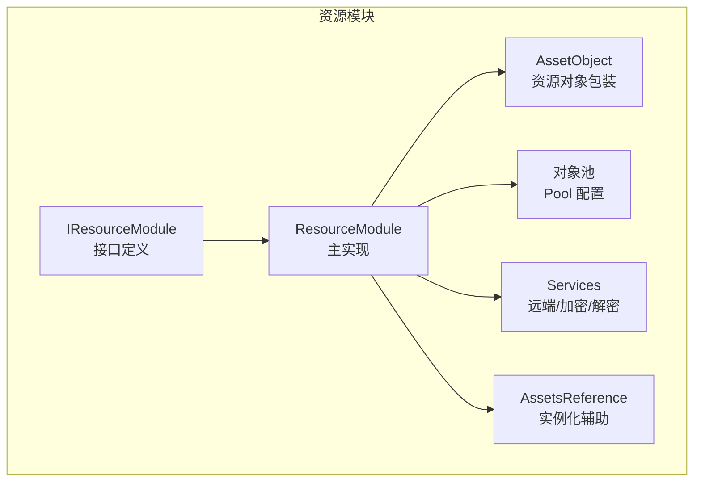
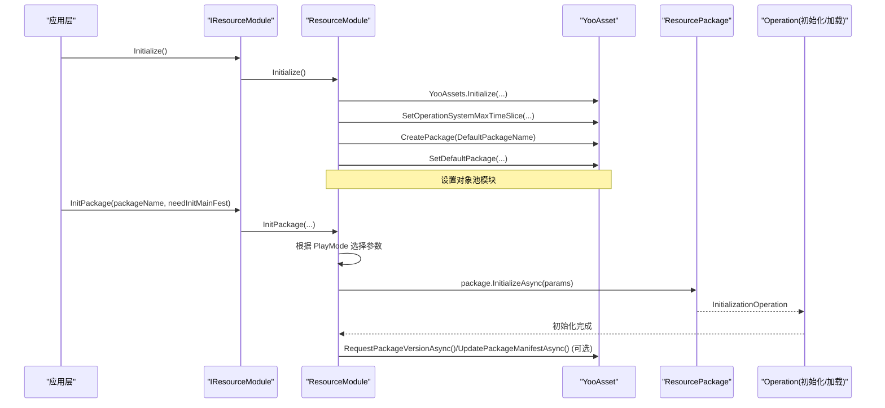
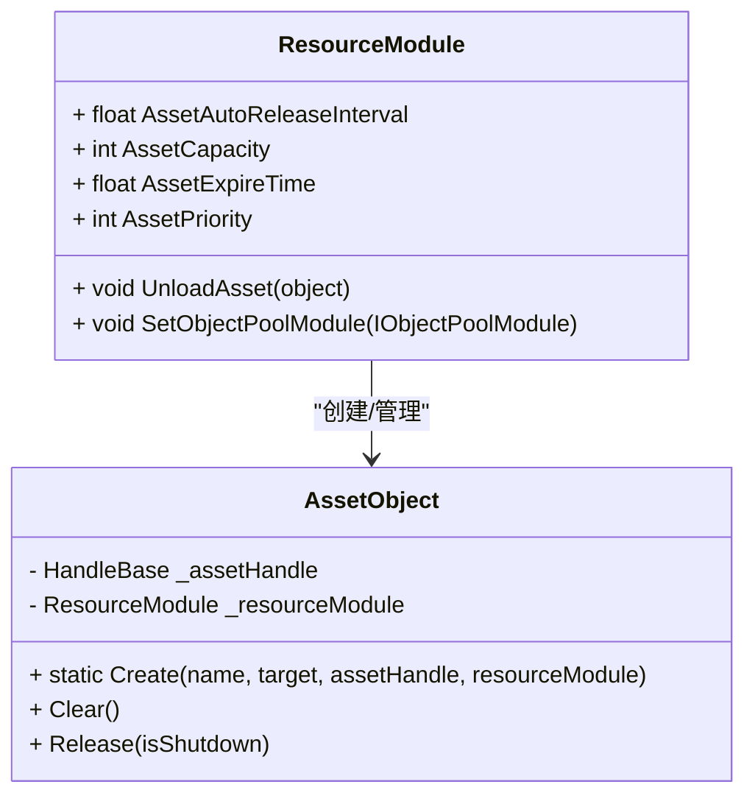
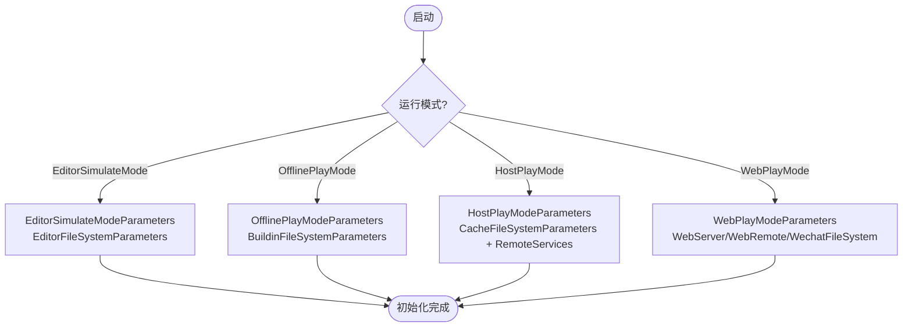
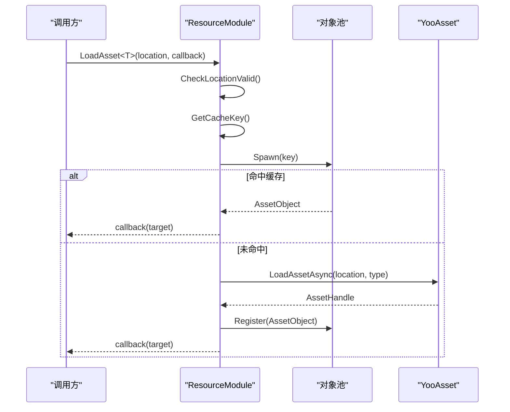
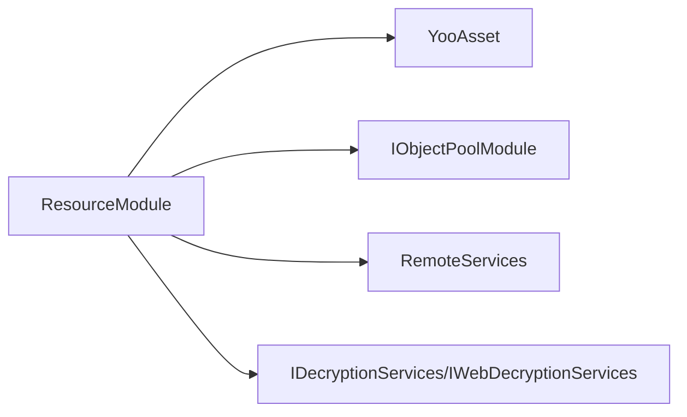

# 资源管理系统

<cite>
**本文引用的文件**   
- [IResourceModule.cs](file://UnityProject/Assets/TEngine/Runtime/Module/ResourceModule/IResourceModule.cs)
- [ResourceModule.cs](file://UnityProject/Assets/TEngine/Runtime/Module/ResourceModule/ResourceModule.cs)
- [ResourceModule.AssetObject.cs](file://UnityProject/Assets/TEngine/Runtime/Module/ResourceModule/ResourceModule.AssetObject.cs)
- [ResourceModule.Pool.cs](file://UnityProject/Assets/TEngine/Runtime/Module/ResourceModule/ResourceModule.Pool.cs)
- [ResourceModule.Services.cs](file://UnityProject/Assets/TEngine/Runtime/Module/ResourceModule/ResourceModule.Services.cs)
- [Books/3-1-资源模块.md](file://Books/3-1-资源模块.md)
</cite>

## 目录
1. [简介](#简介)
2. [项目结构](#项目结构)
3. [核心组件](#核心组件)
4. [架构总览](#架构总览)
5. [详细组件分析](#详细组件分析)
6. [依赖关系分析](#依赖关系分析)
7. [性能与内存优化](#性能与内存优化)
8. [故障排查指南](#故障排查指南)
9. [结论](#结论)
10. [附录](#附录)

## 简介
本文件系统性梳理 TEngine 基于 YooAsset 的资源管理子系统，围绕 IResourceModule 接口与 ResourceModule 实现展开，覆盖资源加载生命周期、缓存策略（LRU/ARC）、对象池与引用计数、自动释放机制、资源分组与多包管理、异步/同步加载流程、低内存处理、以及不同运行模式（EditorSimulateMode、OfflinePlayMode、HostPlayMode）的配置与使用场景。同时给出监控与性能优化建议，帮助开发者在复杂项目中稳定高效地管理资源。

## 项目结构
资源模块位于 UnityProject/Assets/TEngine/Runtime/Module/ResourceModule 下，核心文件包括：
- IResourceModule.cs：对外暴露的资源管理接口
- ResourceModule.cs：资源管理器主实现，封装初始化、包管理、加载卸载、版本与清单更新等
- ResourceModule.AssetObject.cs：资源对象包装，持有 AssetHandle 并负责释放
- ResourceModule.Pool.cs：对象池配置与 UnloadAsset 入口
- ResourceModule.Services.cs：远端服务、加密/解密服务、WebGL 解密适配
- Reference/AssetsReference.cs：用于实例化 GameObject 的辅助类（与 LoadGameObject 配合）

图表来源
- [IResourceModule.cs:12-354](file://UnityProject/Assets/TEngine/Runtime/Module/ResourceModule/IResourceModule.cs#L12-L354)
- [ResourceModule.cs:17-138](file://UnityProject/Assets/TEngine/Runtime/Module/ResourceModule/ResourceModule.cs#L17-L138)
- [ResourceModule.AssetObject.cs:11-62](file://UnityProject/Assets/TEngine/Runtime/Module/ResourceModule/ResourceModule.AssetObject.cs#L11-L62)
- [ResourceModule.Pool.cs:5-66](file://UnityProject/Assets/TEngine/Runtime/Module/ResourceModule/ResourceModule.Pool.cs#L5-L66)
- [ResourceModule.Services.cs:12-32](file://UnityProject/Assets/TEngine/Runtime/Module/ResourceModule/ResourceModule.Services.cs#L12-L32)

章节来源
- [IResourceModule.cs:12-354](file://UnityProject/Assets/TEngine/Runtime/Module/ResourceModule/IResourceModule.cs#L12-L354)
- [ResourceModule.cs:17-138](file://UnityProject/Assets/TEngine/Runtime/Module/ResourceModule/ResourceModule.cs#L17-L138)

## 核心组件
- IResourceModule：统一资源访问接口，包含初始化、包管理、资源查询/加载/卸载、下载器、版本与清单更新、低内存回调等能力。
- ResourceModule：具体实现，封装 YooAsset 初始化、多包管理、资源句柄获取、对象池集成、自动释放、运行模式选择、远程服务与解密服务等。
- AssetObject：对 Unity Object 的轻量包装，持有 AssetHandle，并在释放时调用 Dispose，避免资源泄漏。
- Pool：通过 IObjectPoolModule 创建多生成对象池，提供容量、过期时间、优先级、自动释放间隔等参数，并提供 UnloadAsset 入口。
- Services：提供 RemoteServices（默认/备用远端 URL）、多种加密/解密方案（FileStream/FileOffset/Web 适配），支持 WebGL 平台差异。

章节来源
- [IResourceModule.cs:12-354](file://UnityProject/Assets/TEngine/Runtime/Module/ResourceModule/IResourceModule.cs#L12-L354)
- [ResourceModule.cs:17-138](file://UnityProject/Assets/TEngine/Runtime/Module/ResourceModule/ResourceModule.cs#L17-L138)
- [ResourceModule.AssetObject.cs:11-62](file://UnityProject/Assets/TEngine/Runtime/Module/ResourceModule/ResourceModule.AssetObject.cs#L11-L62)
- [ResourceModule.Pool.cs:5-66](file://UnityProject/Assets/TEngine/Runtime/Module/ResourceModule/ResourceModule.Pool.cs#L5-L66)
- [ResourceModule.Services.cs:12-32](file://UnityProject/Assets/TEngine/Runtime/Module/ResourceModule/ResourceModule.Services.cs#L12-L32)

## 架构总览
资源系统以 IResourceModule 为门面，内部由 ResourceModule 协调 YooAsset、对象池、远端服务与解密服务，完成资源的初始化、加载、缓存、释放与回收。

图表来源
- [ResourceModule.cs:119-138](file://UnityProject/Assets/TEngine/Runtime/Module/ResourceModule/ResourceModule.cs#L119-L138)
- [ResourceModule.cs:140-261](file://UnityProject/Assets/TEngine/Runtime/Module/ResourceModule/ResourceModule.cs#L140-L261)

## 详细组件分析

### IResourceModule 接口设计
- 运行与配置
  - PlayMode：EditorSimulateMode / OfflinePlayMode / HostPlayMode / WebPlayMode
  - EncryptionType：None / FileOffSet / FileStream
  - UpdatableWhilePlaying、DownloadingMaxNum、FailedTryAgain：热更与并发控制
  - Milliseconds：异步系统每帧最大时间切片
  - AutoUnloadBundleWhenUnused：是否自动卸载未使用的 Bundle
  - HostServerURL / FallbackHostServerURL：远端地址
  - LoadResWayWebGL：WebGL 加载方式
  - AssetAutoReleaseInterval / AssetCapacity / AssetExpireTime / AssetPriority：对象池参数
- 生命周期
  - Initialize()
  - InitPackage(customPackageName, needInitMainFest)
  - OnLowMemory()
  - SetForceUnloadUnusedAssetsAction(action)
- 资源操作
  - HasAsset / CheckLocationValid / GetAssetInfos / GetAssetInfo
  - LoadAssetAsync / LoadAsset / LoadGameObject / LoadAssetAsync<T>/LoadAssetAsync(Type)
  - LoadAssetSyncHandle / LoadAssetAsyncHandle
  - UnloadAsset / UnloadUnusedAssets / ForceUnloadAllAssets / ForceUnloadUnusedAssets
- 包与清单
  - PackageVersion / GetPackageVersion / RequestPackageVersionAsync / UpdatePackageManifestAsync
  - Downloader / CreateResourceDownloader
  - ClearCacheFilesAsync / ClearAllBundleFiles
  - SetRemoteServicesUrl

章节来源
- [IResourceModule.cs:12-354](file://UnityProject/Assets/TEngine/Runtime/Module/ResourceModule/IResourceModule.cs#L12-L354)

### ResourceModule 主实现
- 初始化与包管理
  - 初始化 YooAsset 与时间切片
  - 创建并设置默认包 DefaultPackage
  - 注入对象池模块
- 运行模式初始化
  - EditorSimulateMode：编辑器模拟构建，使用 EditorFileSystemParameters
  - OfflinePlayMode：离线模式，使用 BuildinFileSystemParameters
  - HostPlayMode：联机模式，使用 CacheFileSystemParameters + RemoteServices
  - WebPlayMode：WebGL 模式，区分 Remote/Server 与微信小游戏路径
- 资源定位与缓存
  - GetCacheKey(location, packageName)：按包名拼接 Key
  - 同步/异步句柄获取：GetHandleSync/GetHandleAsync
  - 同步加载：LoadAsset/LoadGameObject，命中对象池则直接返回
  - 异步加载：LoadAsset<T>(location, callback)，先等待同 key 正在加载的任务，再尝试从对象池或加载
- 资源回收与低内存
  - UnloadUnusedAssets：释放对象池中未使用项，并遍历已初始化包执行 UnloadUnusedAssetsAsync
  - ForceUnloadAllAssets：强制卸载所有资源（WebGL 不支持）
  - OnLowMemory：触发强制释放逻辑
  - SetForceUnloadUnusedAssetsAction：注册低内存行为回调
- 资源信息/存在性检查
  - GetAssetInfo：带本地缓存 _assetInfoMap
  - HasAsset：结合 IsNeedDownloadFromRemote 判断在线/磁盘状态
  - CheckLocationValid：校验定位地址有效性
- 版本与清单
  - GetPackageVersion / RequestPackageVersionAsync / UpdatePackageManifestAsync
  - SetRemoteServicesUrl：设置默认与备用远端地址
- 下载与清理
  - CreateResourceDownloader：创建下载器，支持并发数与重试次数
  - ClearCacheFilesAsync / ClearAllBundleFiles：清理缓存/沙盒

章节来源
- [ResourceModule.cs:17-138](file://UnityProject/Assets/TEngine/Runtime/Module/ResourceModule/ResourceModule.cs#L17-L138)
- [ResourceModule.cs:140-261](file://UnityProject/Assets/TEngine/Runtime/Module/ResourceModule/ResourceModule.cs#L140-L261)
- [ResourceModule.cs:390-447](file://UnityProject/Assets/TEngine/Runtime/Module/ResourceModule/ResourceModule.cs#L390-L447)
- [ResourceModule.cs:451-620](file://UnityProject/Assets/TEngine/Runtime/Module/ResourceModule/ResourceModule.cs#L451-L620)
- [ResourceModule.cs:624-725](file://UnityProject/Assets/TEngine/Runtime/Module/ResourceModule/ResourceModule.cs#L624-L725)
- [ResourceModule.cs:727-760](file://UnityProject/Assets/TEngine/Runtime/Module/ResourceModule/ResourceModule.cs#L727-L760)
- [ResourceModule.cs:769-800](file://UnityProject/Assets/TEngine/Runtime/Module/ResourceModule/ResourceModule.cs#L769-L800)

### AssetObject 与对象池
- AssetObject
  - 包装目标对象与 AssetHandle，确保 Release 时正确 Dispose
  - 继承自 ObjectBase，参与对象池生命周期
- 对象池
  - 通过 IObjectPoolModule.CreateMultiSpawnObjectPool 创建
  - 暴露容量、过期时间、优先级、自动释放间隔等参数
  - UnloadAsset 通过 Unspawn 将对象归还池

图表来源
- [ResourceModule.AssetObject.cs:11-62](file://UnityProject/Assets/TEngine/Runtime/Module/ResourceModule/ResourceModule.AssetObject.cs#L11-L62)
- [ResourceModule.Pool.cs:5-66](file://UnityProject/Assets/TEngine/Runtime/Module/ResourceModule/ResourceModule.Pool.cs#L5-L66)

章节来源
- [ResourceModule.AssetObject.cs:11-62](file://UnityProject/Assets/TEngine/Runtime/Module/ResourceModule/ResourceModule.AssetObject.cs#L11-L62)
- [ResourceModule.Pool.cs:5-66](file://UnityProject/Assets/TEngine/Runtime/Module/ResourceModule/ResourceModule.Pool.cs#L5-L66)

### 远端服务与加密/解密
- RemoteServices：提供默认与备用远端 URL 拼接
- 加密/解密
  - FileStreamEncryption / FileStreamDecryption：流式异或加密/解密
  - FileOffsetEncryption / FileOffsetDecryption：偏移读取/写入
  - Web 平台：FileOffsetWebDecryption / FileStreamWebDecryption
- BundleStream：自定义 FileStream，读取时进行异或解密

图表来源
- [ResourceModule.cs:173-233](file://UnityProject/Assets/TEngine/Runtime/Module/ResourceModule/ResourceModule.cs#L173-L233)
- [ResourceModule.Services.cs:12-32](file://UnityProject/Assets/TEngine/Runtime/Module/ResourceModule/ResourceModule.Services.cs#L12-L32)
- [ResourceModule.Services.cs:37-117](file://UnityProject/Assets/TEngine/Runtime/Module/ResourceModule/ResourceModule.Services.cs#L37-L117)
- [ResourceModule.Services.cs:122-197](file://UnityProject/Assets/TEngine/Runtime/Module/ResourceModule/ResourceModule.Services.cs#L122-L197)
- [ResourceModule.Services.cs:204-239](file://UnityProject/Assets/TEngine/Runtime/Module/ResourceModule/ResourceModule.Services.cs#L204-L239)
- [ResourceModule.Services.cs:247-269](file://UnityProject/Assets/TEngine/Runtime/Module/ResourceModule/ResourceModule.Services.cs#L247-L269)

章节来源
- [ResourceModule.Services.cs:12-32](file://UnityProject/Assets/TEngine/Runtime/Module/ResourceModule/ResourceModule.Services.cs#L12-L32)
- [ResourceModule.Services.cs:37-117](file://UnityProject/Assets/TEngine/Runtime/Module/ResourceModule/ResourceModule.Services.cs#L37-L117)
- [ResourceModule.Services.cs:122-197](file://UnityProject/Assets/TEngine/Runtime/Module/ResourceModule/ResourceModule.Services.cs#L122-L197)
- [ResourceModule.Services.cs:204-239](file://UnityProject/Assets/TEngine/Runtime/Module/ResourceModule/ResourceModule.Services.cs#L204-L239)
- [ResourceModule.Services.cs:247-269](file://UnityProject/Assets/TEngine/Runtime/Module/ResourceModule/ResourceModule.Services.cs#L247-L269)

### 资源加载生命周期与自动释放
- 同步加载
  - 校验 location 有效性
  - 计算缓存 Key，尝试从对象池 Spawn
  - 若未命中，调用 YooAsset 同步加载获取 AssetHandle
  - 包装为 AssetObject 并注册到对象池
- 异步加载
  - 校验 location 有效性
  - 等待同 Key 的加载任务（避免重复加载）
  - 尝试从对象池 Spawn，命中则直接回调
  - 否则异步加载，完成后包装并注册
- 自动释放
  - 对象池定期释放可释放对象（基于 AutoReleaseInterval）
  - UnloadUnusedAssets 主动触发包级与对象池级回收
  - 低内存回调触发强制释放

图表来源
- [ResourceModule.cs:692-725](file://UnityProject/Assets/TEngine/Runtime/Module/ResourceModule/ResourceModule.cs#L692-L725)
- [ResourceModule.cs:769-800](file://UnityProject/Assets/TEngine/Runtime/Module/ResourceModule/ResourceModule.cs#L769-L800)

章节来源
- [ResourceModule.cs:692-725](file://UnityProject/Assets/TEngine/Runtime/Module/ResourceModule/ResourceModule.cs#L692-L725)
- [ResourceModule.cs:769-800](file://UnityProject/Assets/TEngine/Runtime/Module/ResourceModule/ResourceModule.cs#L769-L800)

### 资源分组管理与多包
- 默认包：DefaultPackageName 对应默认资源包
- 自定义包：InitPackage 支持传入 customPackageName，内部维护 PackageMap
- 资源信息查询：GetAssetInfos/GetAssetInfo 支持指定 packageName，未传则走默认包
- 缓存 Key：当 packageName 非默认时，Key 拼接为 "packageName/location"，保证跨包隔离

章节来源
- [ResourceModule.cs:100-117](file://UnityProject/Assets/TEngine/Runtime/Module/ResourceModule/ResourceModule.cs#L100-L117)
- [ResourceModule.cs:140-172](file://UnityProject/Assets/TEngine/Runtime/Module/ResourceModule/ResourceModule.cs#L140-L172)
- [ResourceModule.cs:495-569](file://UnityProject/Assets/TEngine/Runtime/Module/ResourceModule/ResourceModule.cs#L495-L569)
- [ResourceModule.cs:682-690](file://UnityProject/Assets/TEngine/Runtime/Module/ResourceModule/ResourceModule.cs#L682-L690)

### 异步/同步加载 API 对比
- 同步
  - LoadAsset<T>(location, packageName)
  - LoadAsset(location, Type, packageName)
  - LoadGameObject(location, parent, packageName)
  - LoadAssetSyncHandle<T>(location, packageName)
- 异步
  - LoadAssetAsync(location, priority, callbacks, userData, packageName)
  - LoadAssetAsync(location, assetType, priority, callbacks, userData, packageName)
  - LoadAsset<T>(location, callback, packageName)
  - LoadAssetAsync<T>(location, cancellationToken, packageName)
  - LoadAssetAsync(location, assetType, cancellationToken, packageName)
  - LoadGameObjectAsync(location, parent, cancellationToken, packageName)
  - LoadAssetAsyncHandle<T>(location, packageName)

章节来源
- [IResourceModule.cs:172-281](file://UnityProject/Assets/TEngine/Runtime/Module/ResourceModule/IResourceModule.cs#L172-L281)

### 资源监控与性能优化
- 监控
  - 日志：YooAssets.Initialize(new ResourceLogger())
  - 版本与清单：RequestPackageVersionAsync / UpdatePackageManifestAsync
  - 下载器：CreateResourceDownloader 支持并发与重试
- 性能
  - 时间切片：SetOperationSystemMaxTimeSlice(Milliseconds)
  - 对象池：容量、过期时间、优先级、自动释放间隔
  - 自动卸载：AutoUnloadBundleWhenUnused
  - 低内存：OnLowMemory 触发强制释放

章节来源
- [ResourceModule.cs:119-138](file://UnityProject/Assets/TEngine/Runtime/Module/ResourceModule/ResourceModule.cs#L119-L138)
- [ResourceModule.cs:314-341](file://UnityProject/Assets/TEngine/Runtime/Module/ResourceModule/ResourceModule.cs#L314-L341)
- [ResourceModule.cs:343-366](file://UnityProject/Assets/TEngine/Runtime/Module/ResourceModule/ResourceModule.cs#L343-L366)
- [ResourceModule.Pool.cs:10-41](file://UnityProject/Assets/TEngine/Runtime/Module/ResourceModule/ResourceModule.Pool.cs#L10-L41)

## 依赖关系分析
- ResourceModule 依赖 YooAsset 提供的包与操作句柄
- 通过 IObjectPoolModule 接入对象池，统一管理资源对象生命周期
- 通过 RemoteServices 对接远端资源服务器
- 通过 IDecryptionServices/IWebDecryptionServices 适配不同加密方案与平台

图表来源
- [ResourceModule.cs:119-138](file://UnityProject/Assets/TEngine/Runtime/Module/ResourceModule/ResourceModule.cs#L119-L138)
- [ResourceModule.Services.cs:12-32](file://UnityProject/Assets/TEngine/Runtime/Module/ResourceModule/ResourceModule.Services.cs#L12-L32)

章节来源
- [ResourceModule.cs:119-138](file://UnityProject/Assets/TEngine/Runtime/Module/ResourceModule/ResourceModule.cs#L119-L138)
- [ResourceModule.Services.cs:12-32](file://UnityProject/Assets/TEngine/Runtime/Module/ResourceModule/ResourceModule.Services.cs#L12-L32)

## 性能与内存优化
- 对象池调优
  - 合理设置 AssetCapacity、AssetExpireTime、AssetAutoReleaseInterval、AssetPriority
  - 避免频繁创建销毁大型资源，优先复用
- 加载策略
  - 优先使用异步加载，避免阻塞主线程
  - 利用 LoadAssetAsyncHandle 获取句柄，便于精细控制生命周期
- 缓存与复用
  - 使用 GetAssetInfo 的本地缓存减少重复查询
  - 合理使用 packageName 隔离资源，避免跨包冲突
- 自动卸载
  - 开启 AutoUnloadBundleWhenUnused，降低常驻内存
  - 定期调用 UnloadUnusedAssets 或在场景切换时触发
- 低内存保护
  - 注册 SetForceUnloadUnusedAssetsAction，在 OnLowMemory 中触发强释放
  - 在 WebGL 平台注意 ForceUnloadAllAssets 的限制

章节来源
- [ResourceModule.Pool.cs:10-41](file://UnityProject/Assets/TEngine/Runtime/Module/ResourceModule/ResourceModule.Pool.cs#L10-L41)
- [ResourceModule.cs:390-447](file://UnityProject/Assets/TEngine/Runtime/Module/ResourceModule/ResourceModule.cs#L390-L447)
- [ResourceModule.cs:533-569](file://UnityProject/Assets/TEngine/Runtime/Module/ResourceModule/ResourceModule.cs#L533-L569)

## 故障排查指南
- 资源不存在或定位无效
  - 检查 CheckLocationValid 返回值
  - 确认 location 与 packageName 匹配
- 资源在线但无法加载
  - 使用 IsNeedDownloadFromRemote 判断是否需要下载
  - 检查 HostServerURL/FallbackHostServerURL 配置
- 内存增长异常
  - 检查对象池参数与 AutoUnloadBundleWhenUnused
  - 调用 UnloadUnusedAssets 或启用低内存回调
- WebGL 平台限制
  - ForceUnloadAllAssets 不支持，需改用其他回收策略
  - WebGL 解密与文件系统参数需正确配置

章节来源
- [ResourceModule.cs:577-620](file://UnityProject/Assets/TEngine/Runtime/Module/ResourceModule/ResourceModule.cs#L577-L620)
- [ResourceModule.cs:429-441](file://UnityProject/Assets/TEngine/Runtime/Module/ResourceModule/ResourceModule.cs#L429-L441)
- [ResourceModule.cs:390-407](file://UnityProject/Assets/TEngine/Runtime/Module/ResourceModule/ResourceModule.cs#L390-L407)

## 结论
TEngine 资源管理系统以 IResourceModule 为统一入口，依托 YooAsset 提供强大的包管理与加载能力，并通过对象池、自动释放、低内存回调与多运行模式适配，形成完整的资源生命周期管理体系。开发者应合理利用异步加载、对象池与自动卸载机制，结合监控与调试手段，确保在不同平台与模式下稳定高效地运行。

## 附录
- 运行模式说明
  - EditorSimulateMode：编辑器内模拟构建，适合开发期快速迭代
  - OfflinePlayMode：离线模式，资源内置于包中，无需网络
  - HostPlayMode：联机模式，支持缓存与远端更新，适合线上环境
  - WebPlayMode：WebGL 模式，支持远程/服务器/微信小游戏文件系统
- 参考文档
  - [Books/3-1-资源模块.md](file://Books/3-1-资源模块.md)

章节来源
- [ResourceModule.cs:173-233](file://UnityProject/Assets/TEngine/Runtime/Module/ResourceModule/ResourceModule.cs#L173-L233)
- [Books/3-1-资源模块.md](file://Books/3-1-资源模块.md)