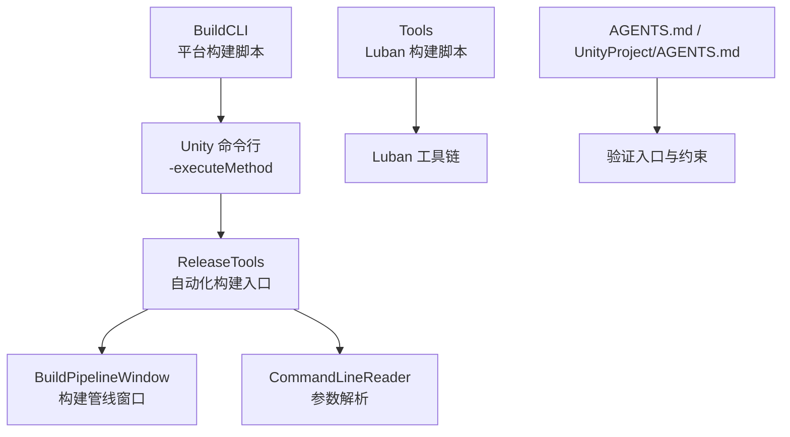
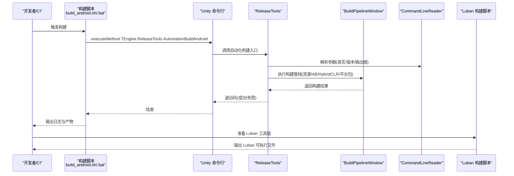
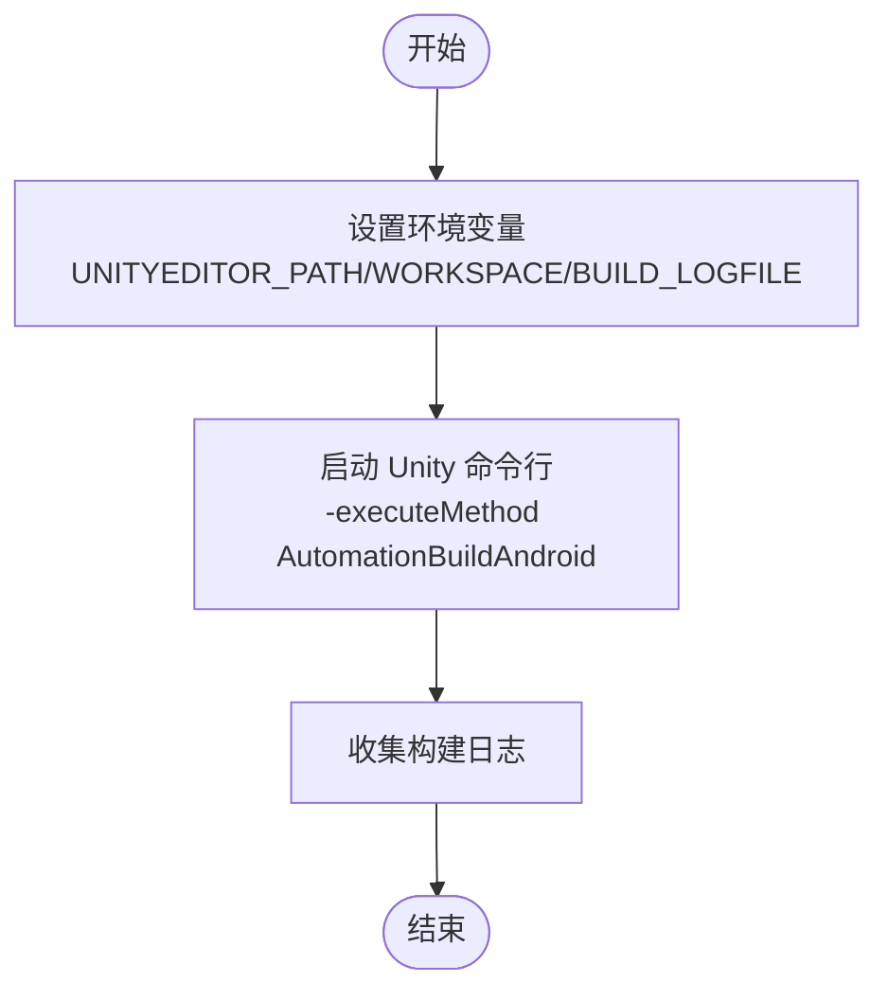
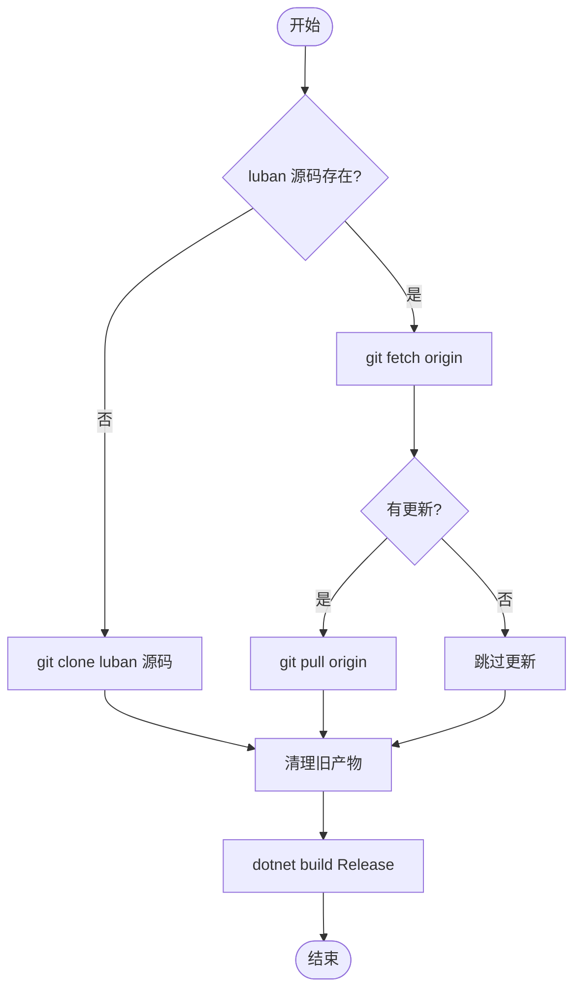
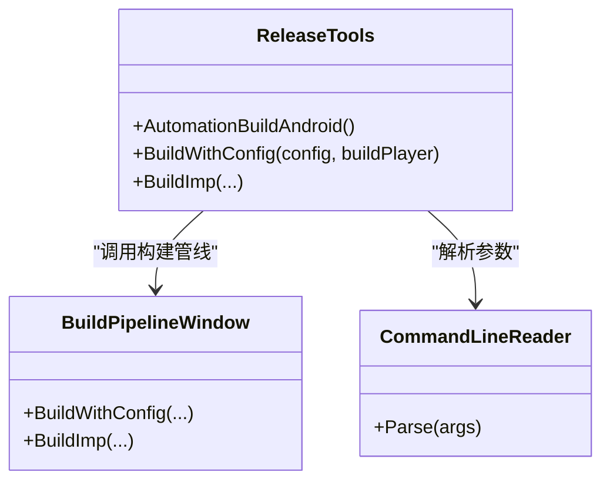
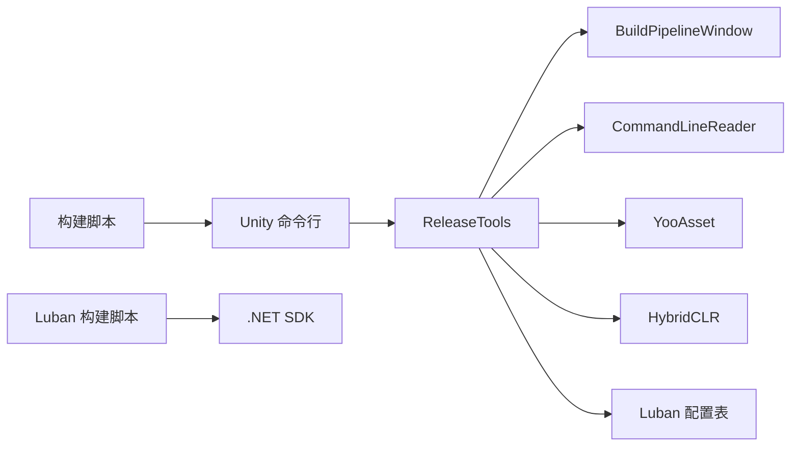
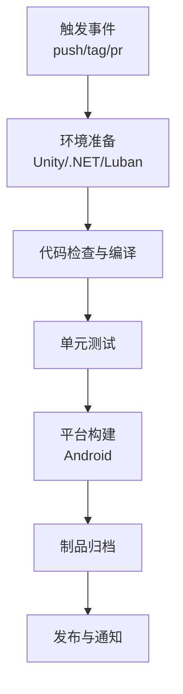

# 发布自动化与 CI/CD

<cite>
**本文引用的文件**   
- [README.md](file://README.md)
- [AGENTS.md](file://AGENTS.md)
- [UnityProject/AGENTS.md](file://UnityProject/AGENTS.md)
- [BuildCLI/build_android.sh](file://BuildCLI/build_android.sh)
- [BuildCLI/build_android.bat](file://BuildCLI/build_android.bat)
- [Tools/build-luban.sh](file://Tools/build-luban.sh)
- [Tools/build-luban.bat](file://Tools/build-luban.bat)
- [UnityProject/Assets/TEngine/Editor/ReleaseTools/ReleaseTools.cs](file://UnityProject/Assets/TEngine/Editor/ReleaseTools/ReleaseTools.cs)
- [UnityProject/Assets/TEngine/Editor/ReleaseTools/BuildPipelineWindow.cs](file://UnityProject/Assets/TEngine/Editor/ReleaseTools/BuildPipelineWindow.cs)
- [UnityProject/Assets/TEngine/Editor/Utility/CommandLineReader.cs](file://UnityProject/Assets/TEngine/Editor/Utility/CommandLineReader.cs)
</cite>

## 目录
1. [简介](#简介)
2. [项目结构](#项目结构)
3. [核心组件](#核心组件)
4. [架构总览](#架构总览)
5. [详细组件分析](#详细组件分析)
6. [依赖关系分析](#依赖关系分析)
7. [性能与稳定性考量](#性能与稳定性考量)
8. [故障排查指南](#故障排查指南)
9. [结论](#结论)
10. [附录：CI/CD 集成建议](#附录cicd-集成建议)

## 简介
本文件面向 TEngine 的发布自动化与持续集成，目标是提供一套可落地的流水线设计：从代码检查、编译、测试、打包到发布的完整流程；同时给出 Git 分支与版本管理策略、主流 CI 工具（Jenkins、GitHub Actions、GitLab CI）的集成要点、发布通知与回滚方案，以及团队协作最佳实践与常见陷阱。

TEngine 本身是 Unity 框架解决方案，具备 HybridCLR 热更新、YooAsset 资源管理、Luban 配置表生成等能力，因此发布流水线需要覆盖：
- .NET/C# 构建与验证
- Unity Editor 命令与批处理构建
- Luban 配置表生成与校验
- Android 等平台打包产物归档
- 可选的 GitHub/GitLab 标签与制品发布

## 项目结构
仓库中与发布自动化直接相关的目录与脚本如下：
- BuildCLI：平台构建入口脚本（Android），通过 Unity 命令行调用编辑器方法执行自动化构建
- Tools：Luban 构建脚本，负责拉取/更新并编译 Luban 工具链
- UnityProject/Assets/TEngine/Editor/ReleaseTools：编辑器侧统一发布工具，包含自动化构建入口、构建管线窗口与配置读取
- UnityProject/Assets/TEngine/Editor/Utility/CommandLineReader：命令行参数解析，供外部脚本驱动构建
- AGENTS.md 与 UnityProject/AGENTS.md：仓库级与 Unity 项目级工作流约束，定义本地与 CI 共用验证入口与边界

图示来源
- [BuildCLI/build_android.sh:1-19](file://BuildCLI/build_android.sh#L1-L19)
- [BuildCLI/build_android.bat:1-9](file://BuildCLI/build_android.bat#L1-L9)
- [UnityProject/Assets/TEngine/Editor/ReleaseTools/ReleaseTools.cs:18-120](file://UnityProject/Assets/TEngine/Editor/ReleaseTools/ReleaseTools.cs#L18-L120)
- [UnityProject/Assets/TEngine/Editor/ReleaseTools/BuildPipelineWindow.cs:480-530](file://UnityProject/Assets/TEngine/Editor/ReleaseTools/BuildPipelineWindow.cs#L480-L530)
- [UnityProject/Assets/TEngine/Editor/Utility/CommandLineReader.cs:1-40](file://UnityProject/Assets/TEngine/Editor/Utility/CommandLineReader.cs#L1-L40)
- [Tools/build-luban.sh:1-36](file://Tools/build-luban.sh#L1-L36)
- [Tools/build-luban.bat:1-49](file://Tools/build-luban.bat#L1-L49)
- [AGENTS.md:1-38](file://AGENTS.md#L1-L38)
- [UnityProject/AGENTS.md:1-43](file://UnityProject/AGENTS.md#L1-L43)

章节来源
- [README.md:20-34](file://README.md#L20-L34)
- [AGENTS.md:1-38](file://AGENTS.md#L1-L38)
- [UnityProject/AGENTS.md:1-43](file://UnityProject/AGENTS.md#L1-L43)

## 核心组件
- 平台构建脚本（Android）
  - 作用：在 CI 或本地批量模式下启动 Unity，调用 ReleaseTools 的自动化构建方法，输出构建日志
  - 关键点：路径定义、Unity 命令行参数、日志收集
- Luban 构建脚本
  - 作用：拉取/更新 Luban 源码，清理旧产物，编译 Release 版工具链
  - 关键点：增量更新、错误降级、dotnet 构建
- 编辑器发布工具
  - ReleaseTools：统一的发布入口，支持自动化构建、版本号生成、资源复制等
  - BuildPipelineWindow：编辑器内构建管线窗口，封装多阶段构建逻辑
  - CommandLineReader：解析外部传入的参数（如语言、版本、输出根目录等）

章节来源
- [BuildCLI/build_android.sh:1-19](file://BuildCLI/build_android.sh#L1-L19)
- [BuildCLI/build_android.bat:1-9](file://BuildCLI/build_android.bat#L1-L9)
- [Tools/build-luban.sh:1-36](file://Tools/build-luban.sh#L1-L36)
- [Tools/build-luban.bat:1-49](file://Tools/build-luban.bat#L1-L49)
- [UnityProject/Assets/TEngine/Editor/ReleaseTools/ReleaseTools.cs:18-120](file://UnityProject/Assets/TEngine/Editor/ReleaseTools/ReleaseTools.cs#L18-L120)
- [UnityProject/Assets/TEngine/Editor/ReleaseTools/BuildPipelineWindow.cs:480-530](file://UnityProject/Assets/TEngine/Editor/ReleaseTools/BuildPipelineWindow.cs#L480-L530)
- [UnityProject/Assets/TEngine/Editor/Utility/CommandLineReader.cs:1-40](file://UnityProject/Assets/TEngine/Editor/Utility/CommandLineReader.cs#L1-L40)

## 架构总览
下图展示“外部脚本 → Unity 命令行 → 编辑器工具 → 构建产物”的主链路，以及 Luban 工具链的并行准备过程。

图示来源
- [BuildCLI/build_android.sh:1-19](file://BuildCLI/build_android.sh#L1-L19)
- [BuildCLI/build_android.bat:1-9](file://BuildCLI/build_android.bat#L1-L9)
- [UnityProject/Assets/TEngine/Editor/ReleaseTools/ReleaseTools.cs:18-120](file://UnityProject/Assets/TEngine/Editor/ReleaseTools/ReleaseTools.cs#L18-L120)
- [UnityProject/Assets/TEngine/Editor/ReleaseTools/BuildPipelineWindow.cs:480-530](file://UnityProject/Assets/TEngine/Editor/ReleaseTools/BuildPipelineWindow.cs#L480-L530)
- [UnityProject/Assets/TEngine/Editor/Utility/CommandLineReader.cs:1-40](file://UnityProject/Assets/TEngine/Editor/Utility/CommandLineReader.cs#L1-L40)
- [Tools/build-luban.sh:1-36](file://Tools/build-luban.sh#L1-L36)
- [Tools/build-luban.bat:1-49](file://Tools/build-luban.bat#L1-L49)

## 详细组件分析

### 组件一：平台构建脚本（Android）
- 功能
  - 设置工作区路径与 Unity 编辑器路径
  - 以批处理模式启动 Unity，调用 ReleaseTools 的自动化构建方法
  - 收集并打印构建日志
- 关键参数
  - -logFile：构建日志输出
  - -executeMethod：指定静态方法入口
  - -quit -batchmode：无头运行
  - -CustomArgs：向编辑器传递自定义参数（如语言）
- 适用场景
  - 本地快速验证 Android 构建
  - CI 中作为平台构建步骤

图示来源
- [BuildCLI/build_android.sh:1-19](file://BuildCLI/build_android.sh#L1-L19)
- [BuildCLI/build_android.bat:1-9](file://BuildCLI/build_android.bat#L1-L9)

章节来源
- [BuildCLI/build_android.sh:1-19](file://BuildCLI/build_android.sh#L1-L19)
- [BuildCLI/build_android.bat:1-9](file://BuildCLI/build_android.bat#L1-L9)

### 组件二：Luban 构建脚本
- 功能
  - 检测 luban 源码目录是否存在，不存在则克隆
  - 若存在，尝试 fetch/pull 远程更新
  - 清理旧产物，使用 dotnet 构建 Release 版本
- 容错
  - fetch/pull 失败时继续本地构建，保证流水线不中断
- 适用场景
  - 首次构建或 CI 环境初始化
  - 确保 Luban 工具链与配置源一致

图示来源
- [Tools/build-luban.sh:1-36](file://Tools/build-luban.sh#L1-L36)
- [Tools/build-luban.bat:1-49](file://Tools/build-luban.bat#L1-L49)

章节来源
- [Tools/build-luban.sh:1-36](file://Tools/build-luban.sh#L1-L36)
- [Tools/build-luban.bat:1-49](file://Tools/build-luban.bat#L1-L49)

### 组件三：编辑器发布工具（ReleaseTools / BuildPipelineWindow / CommandLineReader）
- ReleaseTools
  - 提供自动化构建入口（例如 Android）
  - 统一管理版本号、资源复制、HybridCLR 与 YooAsset 相关步骤
- BuildPipelineWindow
  - 编辑器内可视化构建管线，封装多阶段构建逻辑
  - 对外暴露构建方法供自动化调用
- CommandLineReader
  - 解析外部传入参数（语言、版本、输出根等）
  - 为自动化构建提供稳定参数契约

图示来源
- [UnityProject/Assets/TEngine/Editor/ReleaseTools/ReleaseTools.cs:18-120](file://UnityProject/Assets/TEngine/Editor/ReleaseTools/ReleaseTools.cs#L18-L120)
- [UnityProject/Assets/TEngine/Editor/ReleaseTools/BuildPipelineWindow.cs:480-530](file://UnityProject/Assets/TEngine/Editor/ReleaseTools/BuildPipelineWindow.cs#L480-L530)
- [UnityProject/Assets/TEngine/Editor/Utility/CommandLineReader.cs:1-40](file://UnityProject/Assets/TEngine/Editor/Utility/CommandLineReader.cs#L1-L40)

章节来源
- [UnityProject/Assets/TEngine/Editor/ReleaseTools/ReleaseTools.cs:18-120](file://UnityProject/Assets/TEngine/Editor/ReleaseTools/ReleaseTools.cs#L18-L120)
- [UnityProject/Assets/TEngine/Editor/ReleaseTools/BuildPipelineWindow.cs:480-530](file://UnityProject/Assets/TEngine/Editor/ReleaseTools/BuildPipelineWindow.cs#L480-L530)
- [UnityProject/Assets/TEngine/Editor/Utility/CommandLineReader.cs:1-40](file://UnityProject/Assets/TEngine/Editor/Utility/CommandLineReader.cs#L1-L40)

## 依赖关系分析
- 外部依赖
  - Unity 编辑器（命令行）
  - .NET SDK（用于 Luban 构建）
  - Git（用于拉取/更新 Luban 源码）
- 内部依赖
  - BuildCLI 脚本依赖 ReleaseTools 提供的自动化方法
  - ReleaseTools 依赖 BuildPipelineWindow 与 CommandLineReader
  - 构建产物依赖 YooAsset（AB）、HybridCLR（热更 DLL）、Luban（配置表）

图示来源
- [BuildCLI/build_android.sh:1-19](file://BuildCLI/build_android.sh#L1-L19)
- [BuildCLI/build_android.bat:1-9](file://BuildCLI/build_android.bat#L1-L9)
- [Tools/build-luban.sh:1-36](file://Tools/build-luban.sh#L1-L36)
- [Tools/build-luban.bat:1-49](file://Tools/build-luban.bat#L1-L49)
- [UnityProject/Assets/TEngine/Editor/ReleaseTools/ReleaseTools.cs:18-120](file://UnityProject/Assets/TEngine/Editor/ReleaseTools/ReleaseTools.cs#L18-L120)
- [UnityProject/Assets/TEngine/Editor/ReleaseTools/BuildPipelineWindow.cs:480-530](file://UnityProject/Assets/TEngine/Editor/ReleaseTools/BuildPipelineWindow.cs#L480-L530)
- [UnityProject/Assets/TEngine/Editor/Utility/CommandLineReader.cs:1-40](file://UnityProject/Assets/TEngine/Editor/Utility/CommandLineReader.cs#L1-L40)

章节来源
- [README.md:20-34](file://README.md#L20-L34)
- [AGENTS.md:1-38](file://AGENTS.md#L1-L38)
- [UnityProject/AGENTS.md:1-43](file://UnityProject/AGENTS.md#L1-L43)

## 性能与稳定性考量
- 构建缓存
  - 复用 Unity Library 与 Package Cache，减少重复下载与编译时间
  - 对 Luban 源码进行增量更新，避免每次全量克隆
- 并行化
  - 将 Luban 构建与 Unity 构建解耦，先准备工具链再进入 Unity 构建
  - 多平台构建按平台并行执行（注意资源锁与磁盘 IO）
- 幂等性
  - 构建前清理旧产物，确保输出稳定
  - 版本号由流水线注入，避免手工输入不一致
- 可观测性
  - 统一日志输出到固定路径，便于 CI 聚合与回溯
  - 关键步骤增加状态标记（开始/完成/失败）

[本节为通用指导，不涉及具体文件]

## 故障排查指南
- Unity 命令行无法启动
  - 检查 UNITYEDITOR_PATH 是否正确指向 Unity 可执行文件
  - 确认 batchmode 与 quit 参数组合是否生效
- 自动化构建方法未找到
  - 确认 -executeMethod 名称与 ReleaseTools 中的静态方法一致
- Luban 构建失败
  - 检查 dotnet 版本与目标框架
  - 网络问题导致 git fetch/pull 失败时，脚本会降级使用本地源码
- 构建日志缺失
  - 检查 -logFile 路径权限与磁盘空间
  - 确认构建脚本末尾已输出日志内容

章节来源
- [BuildCLI/build_android.sh:1-19](file://BuildCLI/build_android.sh#L1-L19)
- [BuildCLI/build_android.bat:1-9](file://BuildCLI/build_android.bat#L1-L9)
- [Tools/build-luban.sh:1-36](file://Tools/build-luban.sh#L1-L36)
- [Tools/build-luban.bat:1-49](file://Tools/build-luban.bat#L1-L49)

## 结论
TEngine 的发布自动化以“外部脚本 + Unity 命令行 + 编辑器工具”为核心，结合 Luban 工具链准备，形成可复用的构建流水线。通过明确的参数契约与日志规范，可在 Jenkins、GitHub Actions、GitLab CI 等环境中稳定运行。配合合理的 Git 分支与版本管理策略，可实现从开发到发布的闭环。

[本节为总结性内容，不涉及具体文件]

## 附录：CI/CD 集成建议

### Git 工作流与分支管理
- 推荐分支模型
  - main：受保护的生产分支，仅允许合并经过验证的变更
  - develop：日常开发集成分支
  - feature/*：功能分支，完成后合并至 develop
  - release/*：预发布分支，用于冻结与回归测试
  - hotfix/*：紧急修复分支，直接从 main 切出，修复后合并回 main 与 develop
- 版本标签
  - 使用语义化版本（vX.Y.Z），在 release 分支打 tag 后触发正式构建与发布
- 热更新分支
  - 热更新内容通常随业务分支迭代，建议在 release 分支上统一生成热更包，并通过独立渠道分发

[本节为通用指导，不涉及具体文件]

### 持续集成流水线（示例）
- 公共阶段
  - 检出代码、安装依赖（Unity、.NET SDK）
  - 构建 Luban 工具链
  - 代码检查（C# 编译、Lint）
  - 单元测试（如有）
- 平台构建阶段
  - 调用 BuildCLI 脚本执行 Android 构建
  - 产出 APK/AAB 与构建日志
- 发布阶段
  - 根据 tag 创建制品（APK/AAB、AB 包、热更 DLL、配置表）
  - 推送制品到对象存储或应用商店
  - 发送通知（邮件/IM/Slack/钉钉）

[本节为概念性流程图，不映射具体文件]

### Jenkins 集成要点
- 使用 Pipeline 脚本定义阶段
- 节点选择带 Unity 环境的 Agent
- 缓存 Unity Library 与 Package Cache
- 使用 Credentials 管理密钥与签名文件

### GitHub Actions 集成要点
- 使用 actions/checkout 获取代码
- 使用 unity-actions 或自定义脚本启动 Unity 命令行
- 使用 artifacts 上传构建产物
- 使用 tags 触发 release 流程

### GitLab CI 集成要点
- 在 .gitlab-ci.yml 中定义 stages
- 使用 Docker 镜像包含 Unity 与 .NET
- 使用 artifacts 保存日志与产物
- 使用 rules 控制触发条件

[本节为通用指导，不涉及具体文件]

### 发布通知与部署脚本
- 通知
  - 构建成功后发送消息（包含版本号、构建人、产物链接）
  - 失败时立即告警，附带日志摘要
- 部署
  - 将 AB 包与热更 DLL 上传至 CDN
  - 更新版本清单与下载地址
  - 服务端校验客户端版本并引导更新

[本节为通用指导，不涉及具体文件]

### 回滚机制
- 制品保留策略
  - 保留最近 N 个版本的制品，支持快速回滚
- 版本清单
  - 维护版本清单文件，记录各版本资源地址与校验信息
- 灰度发布
  - 小流量灰度，观察指标后再全量发布
- 一键回滚
  - 通过切换版本清单或 CDN 路由实现秒级回滚

[本节为通用指导，不涉及具体文件]

### 团队协作最佳实践
- 明确职责
  - 开发者负责功能与单测，CI 负责质量门禁，运维负责发布与监控
- 代码审查
  - 所有变更需经过 PR/MR 审查，关键变更需多人审批
- 文档同步
  - 变更影响面较大时，同步更新文档与操作手册
- 安全合规
  - 密钥与证书不上库，使用 CI 凭据管理
  - 制品签名与校验，防止篡改

[本节为通用指导，不涉及具体文件]

### 常见陷阱与规避
- 手工修改生成代码
  - 应修改模板或上游生成器，避免被覆盖
- 忽略构建日志
  - 必须采集并归档日志，便于定位问题
- 版本号不一致
  - 版本号应由流水线注入，禁止手工输入
- 资源路径硬编码
  - 使用配置表或配置文件管理资源路径
- 多实例冲突
  - CI 中确保 Unity 实例隔离，避免资源锁冲突

[本节为通用指导，不涉及具体文件]