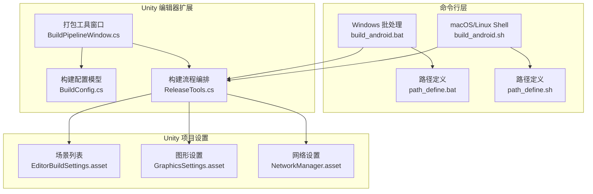
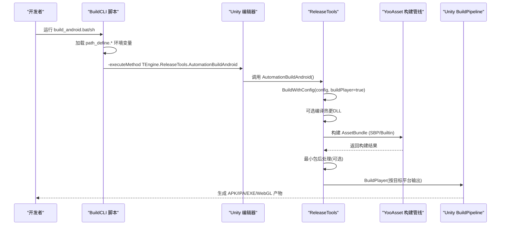
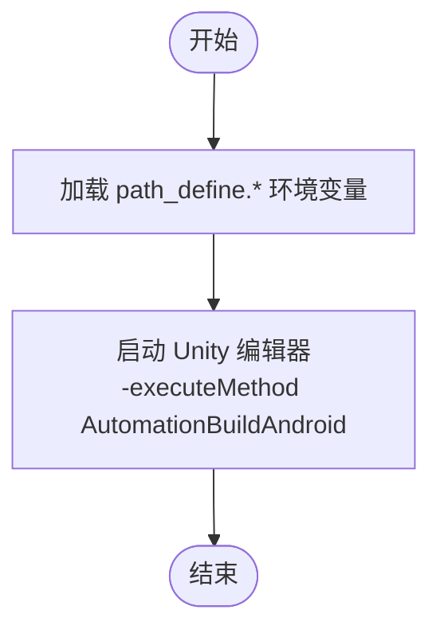
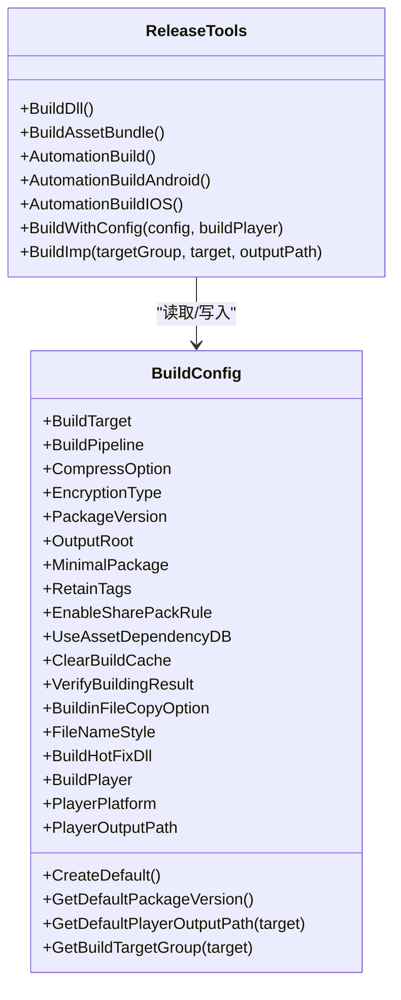
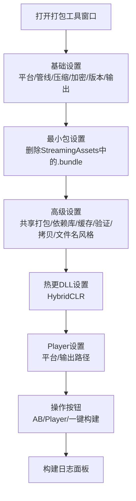
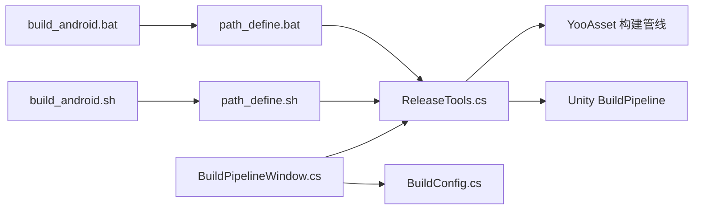

# 多平台构建配置

<cite>
**本文引用的文件**   
- [README.md](file://README.md)
- [build_android.bat](file://BuildCLI/build_android.bat)
- [build_android.sh](file://BuildCLI/build_android.sh)
- [path_define.bat](file://BuildCLI/path_define.bat)
- [path_define.sh](file://BuildCLI/path_define.sh)
- [EditorBuildSettings.asset](file://UnityProject/ProjectSettings/EditorBuildSettings.asset)
- [GraphicsSettings.asset](file://UnityProject/ProjectSettings/GraphicsSettings.asset)
- [NetworkManager.asset](file://UnityProject/ProjectSettings/NetworkManager.asset)
- [BuildConfig.cs](file://UnityProject/Assets/TEngine/Editor/ReleaseTools/BuildConfig.cs)
- [BuildPipelineWindow.cs](file://UnityProject/Assets/TEngine/Editor/ReleaseTools/BuildPipelineWindow.cs)
- [ReleaseTools.cs](file://UnityProject/Assets/TEngine/Editor/ReleaseTools/ReleaseTools.cs)
</cite>

## 目录
1. [简介](#简介)
2. [项目结构](#项目结构)
3. [核心组件](#核心组件)
4. [架构总览](#架构总览)
5. [详细组件分析](#详细组件分析)
6. [依赖关系分析](#依赖关系分析)
7. [性能与优化](#性能与优化)
8. [故障排查指南](#故障排查指南)
9. [结论](#结论)
10. [附录](#附录)

## 简介
本文件聚焦 TEngine 的多平台构建配置，覆盖 Windows、Android、iOS、WebGL、微信小游戏等平台的特殊设置与要求；详解 BuildCLI 工具（批处理与 Shell 脚本）的使用方法；说明 Unity 项目设置中针对各平台的 Player Settings、Graphics Settings、Network Settings 等关键项；并提供签名、证书管理、打包参数建议以及常见问题与性能优化策略。

## 项目结构
TEngine 的构建相关代码主要分布在以下位置：
- BuildCLI：跨平台命令行入口，负责调用 Unity 编辑器执行自动化构建
- UnityProject/Assets/TEngine/Editor/ReleaseTools：打包工具集（窗口、配置、流水线）
- UnityProject/ProjectSettings：Unity 项目级构建与渲染、网络等全局设置

**图表来源**
- [build_android.bat:1-9](file://BuildCLI/build_android.bat#L1-L9)
- [build_android.sh:1-19](file://BuildCLI/build_android.sh#L1-L19)
- [path_define.bat:1-7](file://BuildCLI/path_define.bat#L1-L7)
- [path_define.sh:1-15](file://BuildCLI/path_define.sh#L1-L15)
- [BuildPipelineWindow.cs:86-115](file://UnityProject/Assets/TEngine/Editor/ReleaseTools/BuildPipelineWindow.cs#L86-L115)
- [BuildConfig.cs:8-89](file://UnityProject/Assets/TEngine/Editor/ReleaseTools/BuildConfig.cs#L8-L89)
- [ReleaseTools.cs:119-159](file://UnityProject/Assets/TEngine/Editor/ReleaseTools/ReleaseTools.cs#L119-L159)
- [EditorBuildSettings.asset:1-12](file://UnityProject/ProjectSettings/EditorBuildSettings.asset#L1-L12)
- [GraphicsSettings.asset:1-65](file://UnityProject/ProjectSettings/GraphicsSettings.asset#L1-L65)
- [NetworkManager.asset:1-9](file://UnityProject/ProjectSettings/NetworkManager.asset#L1-L9)

**章节来源**
- [README.md:205-224](file://README.md#L205-L224)

## 核心组件
- BuildCLI 命令行入口
  - Windows 批处理：调用 path_define.bat 设置工作区与 Unity 路径，再启动 Unity 并执行 TEngine.ReleaseTools.AutomationBuildAndroid
  - macOS/Linux Shell：source path_define.sh 后以相同方式调用 Unity 执行 Android 自动化构建
- ReleaseTools 构建编排
  - BuildWithConfig：统一入口，支持先编译热更 DLL、构建 AB、最小包后处理、可选构建 Player
  - BuildImp：封装 Unity BuildPipeline.BuildPlayer，完成可执行程序或安装包生成
  - AutomationBuild*：提供一键菜单入口（Windows/Android/iOS）
- BuildPipelineWindow 可视化打包界面
  - 提供目标平台、构建管线、压缩/加密、AB 输出目录、最小包模式、文件名风格、是否构建 Player 等选项
  - 持久化配置到 EditorPrefs，便于重复使用
- BuildConfig 配置模型
  - 集中管理构建目标、管线、压缩、加密、版本号、输出根、最小包、共享打包、依赖数据库、清理缓存、验证结果、内置文件拷贝、文件名风格、热更 DLL、Player 平台与输出路径等
- Unity 项目设置
  - EditorBuildSettings：定义参与构建的场景列表
  - GraphicsSettings：默认渲染路径、移动端渲染路径、着色器包含等
  - NetworkManager：网络调试级别、发送频率等

**章节来源**
- [build_android.bat:1-9](file://BuildCLI/build_android.bat#L1-L9)
- [build_android.sh:1-19](file://BuildCLI/build_android.sh#L1-L19)
- [path_define.bat:1-7](file://BuildCLI/path_define.bat#L1-L7)
- [path_define.sh:1-15](file://BuildCLI/path_define.sh#L1-L15)
- [BuildPipelineWindow.cs:161-379](file://UnityProject/Assets/TEngine/Editor/ReleaseTools/BuildPipelineWindow.cs#L161-L379)
- [BuildConfig.cs:8-89](file://UnityProject/Assets/TEngine/Editor/ReleaseTools/BuildConfig.cs#L8-L89)
- [ReleaseTools.cs:119-159](file://UnityProject/Assets/TEngine/Editor/ReleaseTools/ReleaseTools.cs#L119-L159)
- [EditorBuildSettings.asset:1-12](file://UnityProject/ProjectSettings/EditorBuildSettings.asset#L1-L12)
- [GraphicsSettings.asset:1-65](file://UnityProject/ProjectSettings/GraphicsSettings.asset#L1-L65)
- [NetworkManager.asset:1-9](file://UnityProject/ProjectSettings/NetworkManager.asset#L1-L9)

## 架构总览
下图展示从命令行到 Unity 编辑器再到资源与 Player 构建的整体流程。

**图表来源**
- [build_android.bat:1-9](file://BuildCLI/build_android.bat#L1-L9)
- [build_android.sh:1-19](file://BuildCLI/build_android.sh#L1-L19)
- [ReleaseTools.cs:88-110](file://UnityProject/Assets/TEngine/Editor/ReleaseTools/ReleaseTools.cs#L88-L110)
- [ReleaseTools.cs:119-159](file://UnityProject/Assets/TEngine/Editor/ReleaseTools/ReleaseTools.cs#L119-L159)
- [ReleaseTools.cs:408-431](file://UnityProject/Assets/TEngine/Editor/ReleaseTools/ReleaseTools.cs#L408-L431)

## 详细组件分析

### BuildCLI 命令行工具
- Windows 批处理
  - 切换至脚本所在目录
  - 调用 path_define.bat 设置 WORKSPACE、UNITYEDITOR_PATH、日志路径
  - 通过 Unity.exe 以 -executeMethod 方式调用 TEngine.ReleaseTools.AutomationBuildAndroid
- macOS/Linux Shell
  - source path_define.sh 设置环境变量
  - 同样以 Unity 命令行方式执行 Android 自动化构建
- 路径定义
  - path_define.bat/sh 分别定义 Windows 与 macOS 的工作空间与 Unity 安装路径，需根据实际环境修改

**图表来源**
- [build_android.bat:1-9](file://BuildCLI/build_android.bat#L1-L9)
- [build_android.sh:1-19](file://BuildCLI/build_android.sh#L1-L19)
- [path_define.bat:1-7](file://BuildCLI/path_define.bat#L1-L7)
- [path_define.sh:1-15](file://BuildCLI/path_define.sh#L1-L15)

**章节来源**
- [build_android.bat:1-9](file://BuildCLI/build_android.bat#L1-L9)
- [build_android.sh:1-19](file://BuildCLI/build_android.sh#L1-L19)
- [path_define.bat:1-7](file://BuildCLI/path_define.bat#L1-L7)
- [path_define.sh:1-15](file://BuildCLI/path_define.sh#L1-L15)

### ReleaseTools 构建编排
- BuildWithConfig
  - 可选编译热更 DLL
  - 刷新资源
  - 调用内部构建逻辑生成 AB
  - 若启用最小包模式，删除 StreamingAssets 中非保留 tag 的 .bundle
  - 可选构建 Player
- BuildInternalWithConfig
  - 根据配置选择 SBP 或 Builtin 管线
  - 设置输出根、内置文件根、包名/版本、压缩、加密、共享打包、文件名风格、依赖数据库、清理缓存、验证结果等
- BuildImp
  - 切换 Active Build Target
  - 使用 Unity BuildPipeline.BuildPlayer 生成最终产物
- AutomationBuild*
  - 为 Windows/Android/iOS 提供一键菜单入口，预设输出路径与平台

**图表来源**
- [ReleaseTools.cs:119-159](file://UnityProject/Assets/TEngine/Editor/ReleaseTools/ReleaseTools.cs#L119-L159)
- [ReleaseTools.cs:165-214](file://UnityProject/Assets/TEngine/Editor/ReleaseTools/ReleaseTools.cs#L165-L214)
- [ReleaseTools.cs:408-431](file://UnityProject/Assets/TEngine/Editor/ReleaseTools/ReleaseTools.cs#L408-L431)
- [BuildConfig.cs:8-89](file://UnityProject/Assets/TEngine/Editor/ReleaseTools/BuildConfig.cs#L8-L89)

**章节来源**
- [ReleaseTools.cs:119-159](file://UnityProject/Assets/TEngine/Editor/ReleaseTools/ReleaseTools.cs#L119-L159)
- [ReleaseTools.cs:165-214](file://UnityProject/Assets/TEngine/Editor/ReleaseTools/ReleaseTools.cs#L165-L214)
- [ReleaseTools.cs:408-431](file://UnityProject/Assets/TEngine/Editor/ReleaseTools/ReleaseTools.cs#L408-L431)
- [BuildConfig.cs:8-89](file://UnityProject/Assets/TEngine/Editor/ReleaseTools/BuildConfig.cs#L8-L89)

### BuildPipelineWindow 可视化打包界面
- 基础设置
  - 目标平台、构建管线（SBP/Builtin）、压缩方式（Uncompressed/LZMA/LZ4）、加密方式（无/文件偏移/文件流）
  - 资源版本号（支持自动生成）、AB 输出目录（支持相对路径）
- 最小包设置
  - 启用最小包模式后，删除 StreamingAssets 中的 .bundle，仅保留清单；可按 Tag 保留指定 bundle
- 高级设置
  - 共享资源打包、依赖数据库、清理构建缓存、验证构建结果
  - 内置文件拷贝策略、文件名风格（HashName/BundleName/BundleName_HashName）
- 热更 DLL 设置
  - 构建前编译热更 DLL（HybridCLR）
- Player 设置
  - 可选择构建 Player，指定平台与输出路径
- 操作按钮
  - 构建 AssetBundle / 构建 Player / 一键构建（AB+Player）
- 日志面板
  - 实时显示构建日志，支持清空与滚动查看

**图表来源**
- [BuildPipelineWindow.cs:161-379](file://UnityProject/Assets/TEngine/Editor/ReleaseTools/BuildPipelineWindow.cs#L161-L379)
- [BuildPipelineWindow.cs:385-462](file://UnityProject/Assets/TEngine/Editor/ReleaseTools/BuildPipelineWindow.cs#L385-L462)

**章节来源**
- [BuildPipelineWindow.cs:161-379](file://UnityProject/Assets/TEngine/Editor/ReleaseTools/BuildPipelineWindow.cs#L161-L379)
- [BuildPipelineWindow.cs:385-462](file://UnityProject/Assets/TEngine/Editor/ReleaseTools/BuildPipelineWindow.cs#L385-L462)

### Unity 项目设置（跨平台通用）
- EditorBuildSettings
  - 定义参与构建的场景列表，当前包含 main.unity
- GraphicsSettings
  - 默认渲染路径与移动端渲染路径
  - 预置着色器包含、雾效/光晕/反射等开关
- NetworkManager
  - 网络调试级别、发送频率等

**章节来源**
- [EditorBuildSettings.asset:1-12](file://UnityProject/ProjectSettings/EditorBuildSettings.asset#L1-L12)
- [GraphicsSettings.asset:1-65](file://UnityProject/ProjectSettings/GraphicsSettings.asset#L1-L65)
- [NetworkManager.asset:1-9](file://UnityProject/ProjectSettings/NetworkManager.asset#L1-L9)

## 依赖关系分析
- BuildCLI 脚本依赖 path_define.* 的环境变量，进而驱动 Unity 执行 ReleaseTools 的自动化方法
- ReleaseTools 依赖 BuildConfig 提供的配置项，控制 YooAsset 构建管线与 Unity BuildPipeline
- BuildPipelineWindow 将用户交互映射到 BuildConfig，并通过 ReleaseTools 执行构建

**图表来源**
- [build_android.bat:1-9](file://BuildCLI/build_android.bat#L1-L9)
- [build_android.sh:1-19](file://BuildCLI/build_android.sh#L1-L19)
- [path_define.bat:1-7](file://BuildCLI/path_define.bat#L1-L7)
- [path_define.sh:1-15](file://BuildCLI/path_define.sh#L1-L15)
- [BuildPipelineWindow.cs:86-115](file://UnityProject/Assets/TEngine/Editor/ReleaseTools/BuildPipelineWindow.cs#L86-L115)
- [BuildConfig.cs:8-89](file://UnityProject/Assets/TEngine/Editor/ReleaseTools/BuildConfig.cs#L8-L89)
- [ReleaseTools.cs:119-159](file://UnityProject/Assets/TEngine/Editor/ReleaseTools/ReleaseTools.cs#L119-L159)

**章节来源**
- [ReleaseTools.cs:119-159](file://UnityProject/Assets/TEngine/Editor/ReleaseTools/ReleaseTools.cs#L119-L159)
- [BuildPipelineWindow.cs:86-115](file://UnityProject/Assets/TEngine/Editor/ReleaseTools/BuildPipelineWindow.cs#L86-L115)

## 性能与优化
- 构建管线选择
  - ScriptableBuildPipeline（SBP）通常具备更好的并行性与增量构建能力；Builtin 管线兼容性更好但速度较慢
- 压缩与加密
  - LZ4 适合快速构建与运行时解压；LZMA 体积更小但构建与解压开销更大
  - 文件偏移/文件流加密会增加构建与运行时的额外开销，按需开启
- 共享打包与依赖数据库
  - 启用共享资源打包可减少冗余；依赖数据库提升打包速度
- 最小包模式
  - 删除 StreamingAssets 中的 .bundle，显著减小首包体积；配合 HostPlayMode 在线下载资源
- 文件名风格
  - BundleName_HashName 兼顾可读性与唯一性，便于定位问题
- Player 构建
  - 合理设置 Player 输出路径与平台，避免不必要的重编译

[本节为通用指导，不直接分析具体文件]

## 故障排查指南
- 命令行无法找到 Unity 或工作区路径错误
  - 检查 path_define.bat/sh 中的 UNITYEDITOR_PATH 与 WORKSPACE 是否正确
- 构建失败且日志为空
  - 在 Shell 脚本中已打印日志内容；Windows 批处理可查看 build.log
- 最小包模式下资源缺失
  - 确认 RetainTags 配置正确，确保需要内嵌的 bundle 被保留
- Player 构建失败
  - 检查目标平台 SDK/工具链是否安装完整；确认 EditorBuildSettings 中场景有效
- 网络相关问题
  - 调整 NetworkManager 的调试级别与发送频率，观察日志定位问题

**章节来源**
- [build_android.sh:13-15](file://BuildCLI/build_android.sh#L13-L15)
- [ReleaseTools.cs:290-365](file://UnityProject/Assets/TEngine/Editor/ReleaseTools/ReleaseTools.cs#L290-L365)
- [NetworkManager.asset:1-9](file://UnityProject/ProjectSettings/NetworkManager.asset#L1-L9)

## 结论
TEngine 提供了从命令行到可视化界面的完整多平台构建体系。通过 BuildCLI 与 ReleaseTools 的组合，开发者可以稳定地构建 AB 与 Player；借助 BuildPipelineWindow 可灵活调整构建参数；结合 Unity 项目设置与 YooAsset/HybridCLR，实现高性能、可热更新的全平台解决方案。

[本节为总结性内容，不直接分析具体文件]

## 附录

### 各平台特殊构建设置与要求
- Windows
  - 使用 StandaloneWindows64 目标；注意 .NET 版本与 Visual Studio 工具链
  - 输出路径示例：Build/Windows/Release_Windows.exe
- Android
  - 使用 Android 目标；确保 JDK/SDK/NDK 配置正确
  - 输出路径示例：Build/Android/<日期-分钟>Android.apk
- iOS
  - 使用 iOS 目标；需 Xcode 与 Apple 开发者证书
  - 输出路径示例：Build/IOS/XCode_Project
- WebGL
  - 使用 WebGL 目标；注意浏览器兼容性与内存限制
  - 输出路径示例：Build/WebGL
- 微信小游戏
  - 使用 WebGL 目标进行适配；遵循微信小游戏平台限制（如 API 与资源大小）

**章节来源**
- [BuildConfig.cs:56-69](file://UnityProject/Assets/TEngine/Editor/ReleaseTools/BuildConfig.cs#L56-L69)
- [README.md:205-224](file://README.md#L205-L224)

### BuildCLI 使用方法
- Windows
  - 编辑 path_define.bat 设置 Unity 与工作区路径
  - 运行 build_android.bat 执行 Android 自动化构建
- macOS/Linux
  - 编辑 path_define.sh 设置 Unity 与工作区路径
  - 运行 build_android.sh 执行 Android 自动化构建

**章节来源**
- [build_android.bat:1-9](file://BuildCLI/build_android.bat#L1-L9)
- [build_android.sh:1-19](file://BuildCLI/build_android.sh#L1-L19)
- [path_define.bat:1-7](file://BuildCLI/path_define.bat#L1-L7)
- [path_define.sh:1-15](file://BuildCLI/path_define.sh#L1-L15)

### Unity 项目设置要点
- Player Settings
  - 根据目标平台设置图标、分辨率、全屏模式、脚本后端等
- Graphics Settings
  - 默认渲染路径与移动端渲染路径；按需开启/关闭特效
- Network Settings
  - 调试级别与发送频率；根据平台特性调整

**章节来源**
- [GraphicsSettings.asset:1-65](file://UnityProject/ProjectSettings/GraphicsSettings.asset#L1-L65)
- [NetworkManager.asset:1-9](file://UnityProject/ProjectSettings/NetworkManager.asset#L1-L9)

### 签名与证书管理
- Android
  - 在 Unity Player Settings 中配置 Keystore、Alias、密码；或使用命令行参数传入
- iOS
  - 在 Xcode 中配置 Code Signing 与 Provisioning Profile；确保 Team 与 Bundle ID 正确
- Windows
  - 可使用 Authenticode 对 EXE 进行签名（可选）

[本节为通用指导，不直接分析具体文件]

### 打包参数速查
- 目标平台：StandaloneWindows64 / Android / iOS / WebGL
- 构建管线：ScriptableBuildPipeline / BuiltinBuildPipeline
- 压缩：Uncompressed / LZMA / LZ4
- 加密：无 / 文件偏移 / 文件流
- 文件名风格：HashName / BundleName / BundleName_HashName
- 最小包：删除 StreamingAssets 中的 .bundle（可保留指定 Tag）

**章节来源**
- [BuildPipelineWindow.cs:32-66](file://UnityProject/Assets/TEngine/Editor/ReleaseTools/BuildPipelineWindow.cs#L32-L66)
- [BuildConfig.cs:8-89](file://UnityProject/Assets/TEngine/Editor/ReleaseTools/BuildConfig.cs#L8-L89)