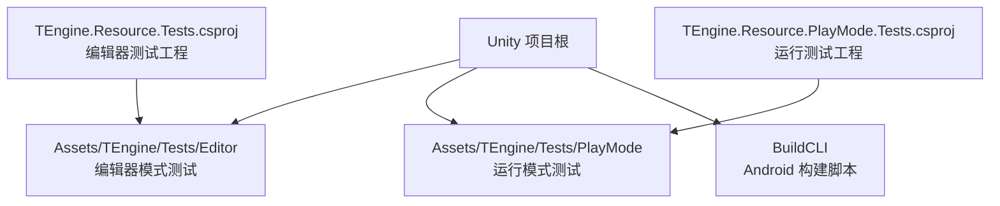
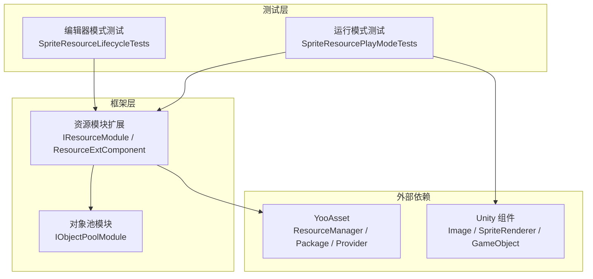
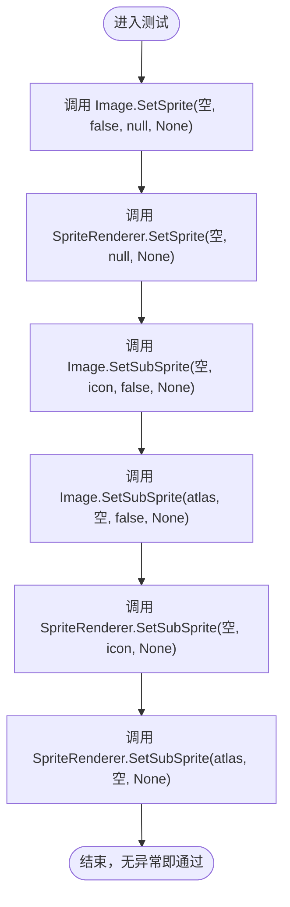
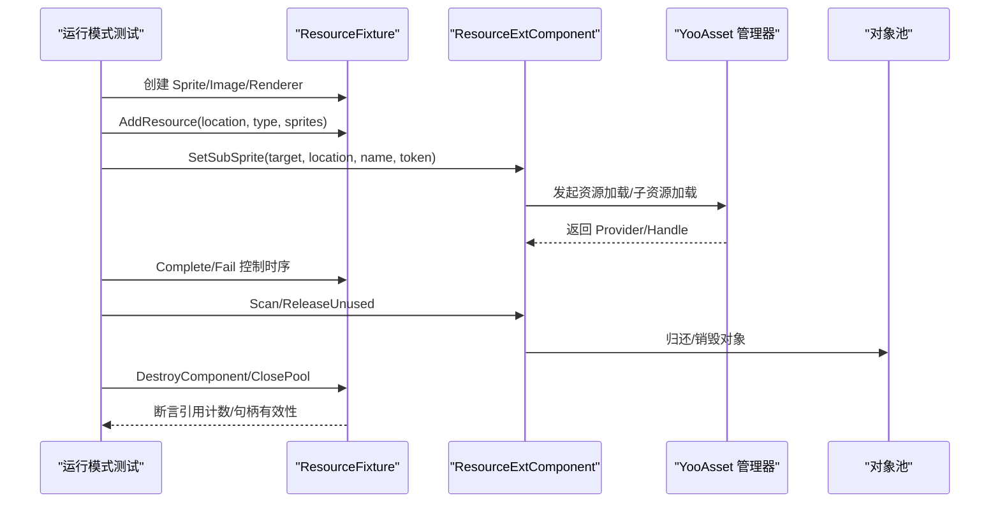
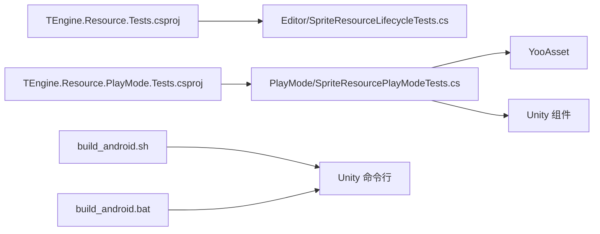

# 测试验证流程

<cite>
**本文引用的文件**   
- [README.md](file://README.md)
- [SpriteResourceLifecycleTests.cs（编辑器模式）](file://UnityProject/Assets/TEngine/Tests/Editor/SpriteResourceLifecycleTests.cs)
- [SpriteResourcePlayModeTests.cs（运行模式）](file://UnityProject/Assets/TEngine/Tests/PlayMode/SpriteResourcePlayModeTests.cs)
- [TEngine.Resource.Tests.csproj](file://UnityProject/TEngine.Resource.Tests.csproj)
- [TEngine.Resource.PlayMode.Tests.csproj](file://UnityProject/TEngine.Resource.PlayMode.Tests.csproj)
- [build_android.sh](file://BuildCLI/build_android.sh)
- [build_android.bat](file://BuildCLI/build_android.bat)
</cite>

## 目录
1. [简介](#简介)
2. [项目结构](#项目结构)
3. [核心组件](#核心组件)
4. [架构总览](#架构总览)
5. [详细组件分析](#详细组件分析)
6. [依赖关系分析](#依赖关系分析)
7. [性能考虑](#性能考虑)
8. [故障排查指南](#故障排查指南)
9. [结论](#结论)
10. [附录](#附录)

## 简介
本文件面向 TEngine 发布前的测试与验证，覆盖单元测试、集成测试、UI 自动化测试的实施方法；性能测试方案（帧率、内存、CPU）；兼容性测试策略（设备、操作系统、浏览器版本）；测试环境搭建（测试数据、模拟服务器、日志收集与分析）；以及自动化脚本使用与持续集成配置建议。文档基于仓库现有测试代码与构建脚本进行说明，确保可落地执行。

## 项目结构
TEngine 的测试相关资产集中在 Unity 项目的 Assets/TEngine/Tests 目录下，包含编辑器模式与运行模式两类测试用例；同时提供 Android 平台批量构建脚本，便于在 CI 中驱动 Unity 完成打包与日志输出。

图示来源
- [SpriteResourceLifecycleTests.cs（编辑器模式）:1-23](file://UnityProject/Assets/TEngine/Tests/Editor/SpriteResourceLifecycleTests.cs#L1-L23)
- [SpriteResourcePlayModeTests.cs（运行模式）:1-403](file://UnityProject/Assets/TEngine/Tests/PlayMode/SpriteResourcePlayModeTests.cs#L1-L403)
- [TEngine.Resource.Tests.csproj:54-57](file://UnityProject/TEngine.Resource.Tests.csproj#L54-L57)
- [TEngine.Resource.PlayMode.Tests.csproj:54-57](file://UnityProject/TEngine.Resource.PlayMode.Tests.csproj#L54-L57)
- [build_android.sh:7-11](file://BuildCLI/build_android.sh#L7-L11)
- [build_android.bat:5-5](file://BuildCLI/build_android.bat#L5-L5)

章节来源
- [README.md:52-85](file://README.md#L52-L85)
- [README.md:173-201](file://README.md#L173-L201)

## 核心组件
- 编辑器模式测试：验证 Sprite 资源扩展 API 的空值与取消令牌守卫逻辑，确保空输入与 CancellationToken.None 不会引发异常。
- 运行模式测试：围绕 YooAsset 的资源加载生命周期，覆盖共享资源引用计数、取消令牌、失败回退、请求替换、图集克隆销毁等关键路径。
- 测试工程定义：通过 csproj 明确编译源文件与 NUnit 依赖，支持在 Unity 编辑器或 CLI 下执行。
- 构建脚本：以 Unity 命令行驱动 Android 打包，并输出日志到指定文件，便于 CI 采集。

章节来源
- [SpriteResourceLifecycleTests.cs（编辑器模式）:10-21](file://UnityProject/Assets/TEngine/Tests/Editor/SpriteResourceLifecycleTests.cs#L10-L21)
- [SpriteResourcePlayModeTests.cs（运行模式）:18-209](file://UnityProject/Assets/TEngine/Tests/PlayMode/SpriteResourcePlayModeTests.cs#L18-L209)
- [TEngine.Resource.Tests.csproj:54-57](file://UnityProject/TEngine.Resource.Tests.csproj#L54-L57)
- [TEngine.Resource.PlayMode.Tests.csproj:54-57](file://UnityProject/TEngine.Resource.PlayMode.Tests.csproj#L54-L57)
- [build_android.sh:7-11](file://BuildCLI/build_android.sh#L7-L11)
- [build_android.bat:5-5](file://BuildCLI/build_android.bat#L5-L5)

## 架构总览
下图展示从测试用例到框架模块与外部依赖的调用关系，包括 Unity 组件、YooAsset、对象池与资源模块扩展点。

图示来源
- [SpriteResourcePlayModeTests.cs（运行模式）:212-401](file://UnityProject/Assets/TEngine/Tests/PlayMode/SpriteResourcePlayModeTests.cs#L212-L401)
- [SpriteResourceLifecycleTests.cs（编辑器模式）:10-21](file://UnityProject/Assets/TEngine/Tests/Editor/SpriteResourceLifecycleTests.cs#L10-L21)

## 详细组件分析

### 编辑器模式测试：Sprite 资源扩展 API 守卫
- 目标：验证 Image.SetSprite/SetSubSprite 与 SpriteRenderer.SetSprite/SetSubSprite 对空字符串与 CancellationToken.None 的安全处理。
- 关键点：
  - 空字符串作为 location/name 不应抛异常。
  - 取消令牌为 None 时行为一致。
- 断言方式：无显式 Assert，依赖不抛出异常即通过。

图示来源
- [SpriteResourceLifecycleTests.cs（编辑器模式）:10-21](file://UnityProject/Assets/TEngine/Tests/Editor/SpriteResourceLifecycleTests.cs#L10-L21)

章节来源
- [SpriteResourceLifecycleTests.cs（编辑器模式）:10-21](file://UnityProject/Assets/TEngine/Tests/Editor/SpriteResourceLifecycleTests.cs#L10-L21)

### 运行模式测试：Sprite 资源生命周期与引用管理
- 场景一：共享资源引用计数与释放
  - 多个目标共享同一资源句柄，引用计数应正确累加与减少。
  - 隐藏/禁用不影响已持有引用；销毁后应释放句柄。
- 场景二：并发加载、取消令牌与失败回退
  - 取消其中一个等待者不应影响其他等待者的句柄有效性。
  - 失败时应保留原图片，且旧图集句柄归还。
  - 切换为普通图片后也应归还旧图集。
- 场景三：请求替换与图集克隆销毁
  - 新请求应替换旧请求的结果。
  - 组件销毁后，缓存的图集克隆需被销毁，避免泄漏。

图示来源
- [SpriteResourcePlayModeTests.cs（运行模式）:18-209](file://UnityProject/Assets/TEngine/Tests/PlayMode/SpriteResourcePlayModeTests.cs#L18-L209)
- [SpriteResourcePlayModeTests.cs（运行模式）:212-401](file://UnityProject/Assets/TEngine/Tests/PlayMode/SpriteResourcePlayModeTests.cs#L212-L401)

章节来源
- [SpriteResourcePlayModeTests.cs（运行模式）:18-209](file://UnityProject/Assets/TEngine/Tests/PlayMode/SpriteResourcePlayModeTests.cs#L18-L209)
- [SpriteResourcePlayModeTests.cs（运行模式）:212-401](file://UnityProject/Assets/TEngine/Tests/PlayMode/SpriteResourcePlayModeTests.cs#L212-L401)

### UI 自动化测试实施建议
- 目标：在真实 Unity 场景中驱动 UI 交互，验证窗口打开、关闭、事件响应与资源加载。
- 建议方案：
  - 使用 Unity Test Runner 的 Play Mode 测试，结合 UIAutomation 模块。
  - 通过自定义 Fixture 封装 UI 操作序列，断言界面状态与资源引用。
  - 将 UI 自动化用例与资源生命周期测试合并，确保 UI 与底层资源一致性。

[本节为概念性指导，不直接分析具体文件]

### 性能测试方案
- 帧率监控：
  - 在运行模式下开启 Unity Profiler，记录 FPS 曲线，关注资源加载与 UI 刷新峰值。
  - 建议在关键场景（如多 Sprite 切换、图集克隆）前后对比帧率。
- 内存使用分析：
  - 使用 Unity Memory Profiler 或 YooAsset 统计，观察 AssetItemObject 引用数与 SpriteAtlas 克隆数量。
  - 重点检查组件销毁后是否释放缓存的图集克隆与资源句柄。
- CPU 占用检测：
  - 关注 ReleaseUnused/Scan 周期内的 GC 与 CPU 尖刺，避免频繁分配。
  - 在并发加载与取消令牌场景下，评估线程调度与回调开销。

[本节为通用性能建议，不直接分析具体文件]

### 兼容性测试策略
- 设备与系统：
  - 覆盖 Windows、macOS、Android、iOS、WebGL 等平台，参考 README 的平台支持列表。
  - 针对移动端关注低端机型与不同 GPU 驱动的渲染差异。
- 浏览器版本（WebGL）：
  - 覆盖主流浏览器最新版本及 LTS 版本，验证 WebGL 后端兼容性与资源加载稳定性。
- 资源与图集：
  - 校验 SpriteAtlas 在不同平台的压缩格式与采样设置。
  - 验证懒加载、异步加载与同步加载在不同平台的一致性。

章节来源
- [README.md:205-219](file://README.md#L205-L219)

## 依赖关系分析
- 测试工程与源文件：
  - 编辑器测试工程包含 Editor 目录下的测试类。
  - 运行测试工程包含 PlayMode 目录下的测试类。
- 外部依赖：
  - NUnit 用于断言与测试编排。
  - YooAsset 提供资源包、管理器与 Provider 机制。
  - Unity 组件（Image、SpriteRenderer、GameObject）作为被测载体。
- 构建脚本：
  - 通过 Unity 命令行执行 TEngine.ReleaseTools.AutomationBuildAndroid，输出日志至 BUILD_LOGFILE。

图示来源
- [TEngine.Resource.Tests.csproj:54-57](file://UnityProject/TEngine.Resource.Tests.csproj#L54-L57)
- [TEngine.Resource.PlayMode.Tests.csproj:54-57](file://UnityProject/TEngine.Resource.PlayMode.Tests.csproj#L54-L57)
- [SpriteResourcePlayModeTests.cs（运行模式）:212-401](file://UnityProject/Assets/TEngine/Tests/PlayMode/SpriteResourcePlayModeTests.cs#L212-L401)
- [build_android.sh:7-11](file://BuildCLI/build_android.sh#L7-L11)
- [build_android.bat:5-5](file://BuildCLI/build_android.bat#L5-L5)

章节来源
- [TEngine.Resource.Tests.csproj:54-57](file://UnityProject/TEngine.Resource.Tests.csproj#L54-L57)
- [TEngine.Resource.PlayMode.Tests.csproj:54-57](file://UnityProject/TEngine.Resource.PlayMode.Tests.csproj#L54-L57)
- [build_android.sh:7-11](file://BuildCLI/build_android.sh#L7-L11)
- [build_android.bat:5-5](file://BuildCLI/build_android.bat#L5-L5)

## 性能考虑
- 资源加载优化：
  - 复用共享资源句柄，避免重复加载。
  - 合理使用懒加载与异步加载，降低主线程压力。
- 内存管理：
  - 及时归还不再使用的资源句柄。
  - 组件销毁时清理缓存的图集克隆与对象池资源。
- 扫描与释放：
  - 合理设置 ReleaseUnused 触发频率，避免频繁 GC。
  - 在 UI 切换与场景切换时主动触发扫描，确保资源释放。

[本节为通用性能建议，不直接分析具体文件]

## 故障排查指南
- 常见问题定位：
  - 资源未释放：检查组件销毁与对象池销毁是否成对调用。
  - 句柄无效：确认 CancelToken 的使用与并发请求替换逻辑。
  - 失败回退：断言原图片未被替换，旧图集句柄已归还。
- 日志与调试：
  - 使用 Unity 控制台与 Profiler 查看异常堆栈与资源引用变化。
  - 在 CI 中解析构建日志，定位打包阶段错误。

章节来源
- [SpriteResourcePlayModeTests.cs（运行模式）:75-140](file://UnityProject/Assets/TEngine/Tests/PlayMode/SpriteResourcePlayModeTests.cs#L75-L140)
- [SpriteResourcePlayModeTests.cs（运行模式）:141-209](file://UnityProject/Assets/TEngine/Tests/PlayMode/SpriteResourcePlayModeTests.cs#L141-L209)

## 结论
TEngine 的测试体系以编辑器模式与运行模式双轨并行，覆盖资源扩展 API 的安全性与 YooAsset 资源生命周期的关键路径。配合 Unity 命令行构建脚本，可在 CI 中实现自动化打包与日志采集。建议在发布前完善 UI 自动化测试与性能基线，建立跨平台兼容性矩阵，确保质量与稳定性。

[本节为总结性内容，不直接分析具体文件]

## 附录

### 测试环境搭建指南
- 环境要求：
  - Unity 推荐版本见 README。
  - 安装 YooAsset 与 HybridCLR（如需热更新）。
- 测试数据准备：
  - 准备 Sprite 与 SpriteAtlas 资源，放置于 AssetRaw 或对应资源组。
  - 使用 Luban 生成配置表（可选），用于业务数据驱动测试。
- 模拟服务器配置：
  - 使用 Tools/FileServer 启动本地静态资源服务，供客户端加载 AB 与配置文件。
- 日志收集与分析：
  - 使用 build_android.sh/.bat 输出构建日志至 BUILD_LOGFILE。
  - 在 CI 中解析日志关键字，标记失败与警告。

章节来源
- [README.md:52-85](file://README.md#L52-L85)
- [build_android.sh:7-11](file://BuildCLI/build_android.sh#L7-L11)
- [build_android.bat:5-5](file://BuildCLI/build_android.bat#L5-L5)

### 自动化测试脚本使用方法
- 编辑器模式测试：
  - 在 Unity 编辑器中打开 Test Runner，运行 Editor Tests。
- 运行模式测试：
  - 在 Unity 编辑器中打开 Test Runner，运行 Play Mode Tests。
- 批量构建：
  - 执行 build_android.sh 或 build_android.bat，传入工作区路径与语言参数。
  - 查看 BUILD_LOGFILE 获取构建结果与错误信息。

章节来源
- [SpriteResourceLifecycleTests.cs（编辑器模式）:10-21](file://UnityProject/Assets/TEngine/Tests/Editor/SpriteResourceLifecycleTests.cs#L10-L21)
- [SpriteResourcePlayModeTests.cs（运行模式）:18-209](file://UnityProject/Assets/TEngine/Tests/PlayMode/SpriteResourcePlayModeTests.cs#L18-L209)
- [build_android.sh:7-11](file://BuildCLI/build_android.sh#L7-L11)
- [build_android.bat:5-5](file://BuildCLI/build_android.bat#L5-L5)

### 持续集成配置建议
- 触发条件：
  - Push/Pull Request 触发完整门禁。
  - 每日定时任务执行全量回归。
- 步骤建议：
  - 安装 Unity 与依赖包。
  - 运行编辑器模式与运行模式测试。
  - 执行 Android 构建脚本，输出日志。
  - 解析测试结果与构建日志，生成报告。
- 产物归档：
  - 归档 APK/IPA/WebGL 包体。
  - 归档测试报告与性能指标。

[本节为通用 CI 建议，不直接分析具体文件]