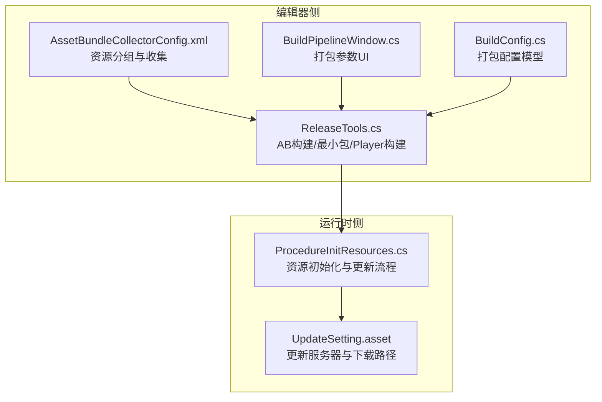
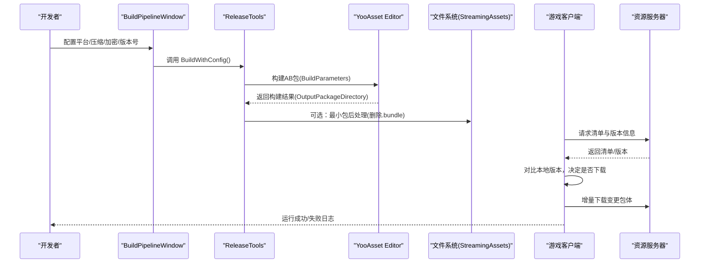
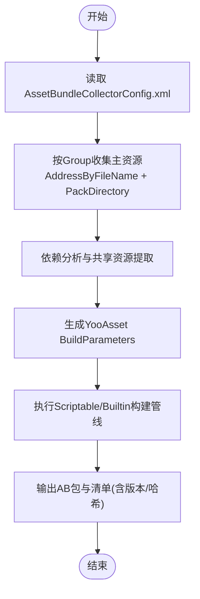
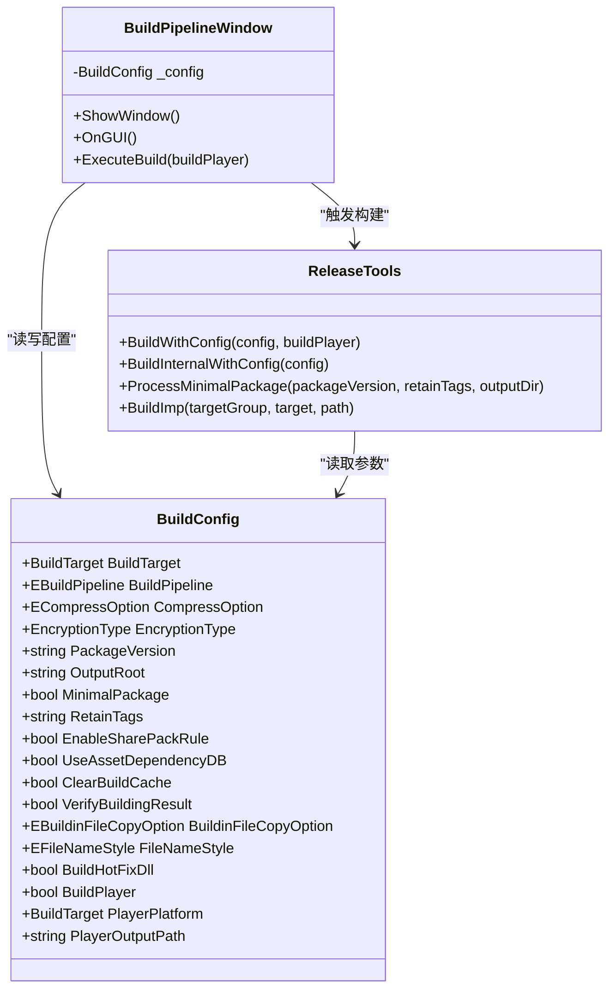
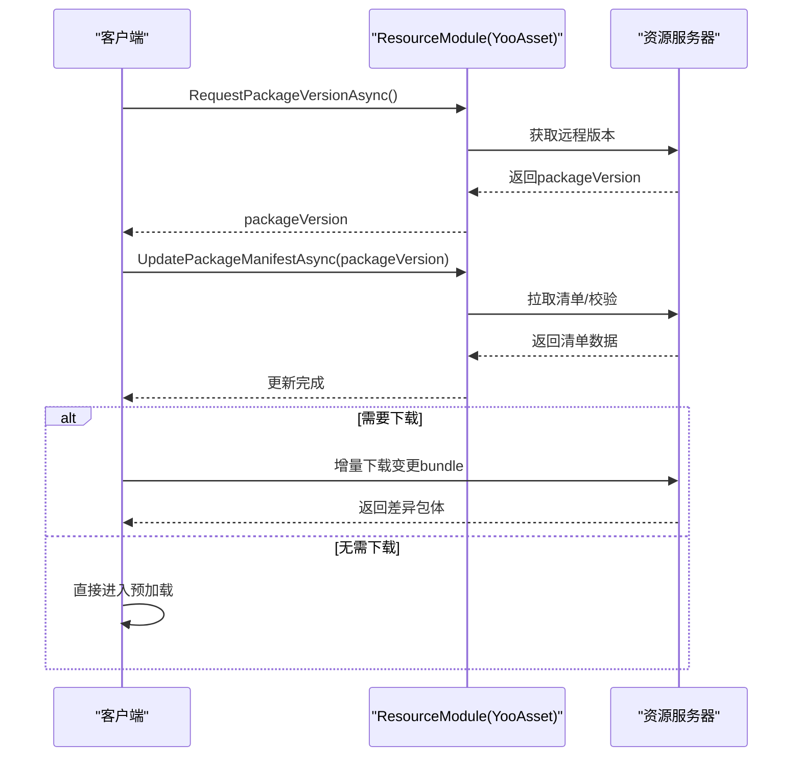
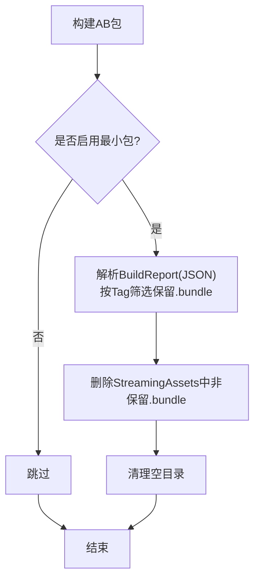
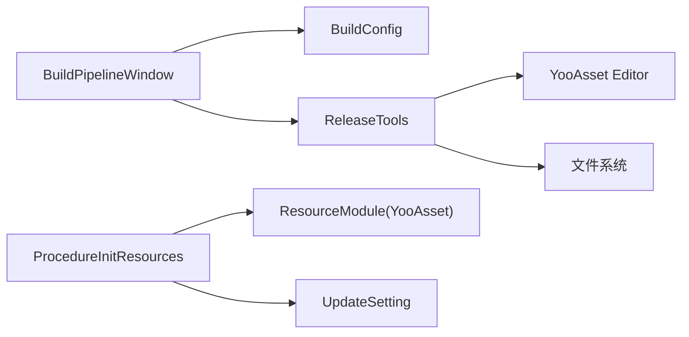

# 资源打包与版本管理

<cite>
**本文引用的文件**   
- [AssetBundleCollectorConfig.xml](file://UnityProject/Assets/Editor/AssetBundleCollector/AssetBundleCollectorConfig.xml)
- [BuildConfig.cs](file://UnityProject/Assets/TEngine/Editor/ReleaseTools/BuildConfig.cs)
- [BuildPipelineWindow.cs](file://UnityProject/Assets/TEngine/Editor/ReleaseTools/BuildPipelineWindow.cs)
- [ReleaseTools.cs](file://UnityProject/Assets/TEngine/Editor/ReleaseTools/ReleaseTools.cs)
- [ProcedureInitResources.cs](file://UnityProject/Assets/GameScripts/Procedure/ProcedureInitResources.cs)
- [UpdateSetting.asset](file://UnityProject/Assets/TEngine/Settings/UpdateSetting.asset)
</cite>

## 目录
1. [简介](#简介)
2. [项目结构](#项目结构)
3. [核心组件](#核心组件)
4. [架构总览](#架构总览)
5. [详细组件分析](#详细组件分析)
6. [依赖关系分析](#依赖关系分析)
7. [性能考虑](#性能考虑)
8. [故障排查指南](#故障排查指南)
9. [结论](#结论)
10. [附录](#附录)

## 简介
本文面向 TEngine 项目的资源打包与版本管理，系统性说明 AB 包构建流程、YooAsset 打包配置、版本号与补丁机制、以及发布前验证与常见问题排查。文档同时给出可视化架构图与流程图，帮助读者快速理解从“资源收集”到“客户端加载更新”的完整链路。

## 项目结构
本项目在 Unity 工程内通过编辑器工具完成资源打包与 Player 构建，运行时通过 YooAsset 进行资源加载与更新。关键路径如下：
- 资源分组与收集：Editor/AssetBundleCollector/AssetBundleCollectorConfig.xml
- 打包配置与窗口：TEngine/Editor/ReleaseTools/BuildConfig.cs、BuildPipelineWindow.cs
- 打包执行与后处理：TEngine/Editor/ReleaseTools/ReleaseTools.cs
- 运行时资源初始化与更新：GameScripts/Procedure/ProcedureInitResources.cs
- 更新服务器地址等设置：TEngine/Settings/UpdateSetting.asset

**图示来源**
- [AssetBundleCollectorConfig.xml:1-48](file://UnityProject/Assets/Editor/AssetBundleCollector/AssetBundleCollectorConfig.xml#L1-L48)
- [BuildPipelineWindow.cs:10-116](file://UnityProject/Assets/TEngine/Editor/ReleaseTools/BuildPipelineWindow.cs#L10-L116)
- [BuildConfig.cs:8-89](file://UnityProject/Assets/TEngine/Editor/ReleaseTools/BuildConfig.cs#L8-L89)
- [ReleaseTools.cs:114-214](file://UnityProject/Assets/TEngine/Editor/ReleaseTools/ReleaseTools.cs#L114-L214)
- [ProcedureInitResources.cs:71-105](file://UnityProject/Assets/GameScripts/Procedure/ProcedureInitResources.cs#L71-L105)
- [UpdateSetting.asset:1-37](file://UnityProject/Assets/TEngine/Settings/UpdateSetting.asset#L1-L37)

**章节来源**
- [AssetBundleCollectorConfig.xml:1-48](file://UnityProject/Assets/Editor/AssetBundleCollector/AssetBundleCollectorConfig.xml#L1-L48)
- [BuildPipelineWindow.cs:10-116](file://UnityProject/Assets/TEngine/Editor/ReleaseTools/BuildPipelineWindow.cs#L10-L116)
- [BuildConfig.cs:8-89](file://UnityProject/Assets/TEngine/Editor/ReleaseTools/BuildConfig.cs#L8-L89)
- [ReleaseTools.cs:114-214](file://UnityProject/Assets/TEngine/Editor/ReleaseTools/ReleaseTools.cs#L114-L214)
- [ProcedureInitResources.cs:71-105](file://UnityProject/Assets/GameScripts/Procedure/ProcedureInitResources.cs#L71-L105)
- [UpdateSetting.asset:1-37](file://UnityProject/Assets/TEngine/Settings/UpdateSetting.asset#L1-L37)

## 核心组件
- AssetBundleCollector 配置：定义 Package 与 Group，按目录或标签收集主资源，并指定打包规则（如按目录打包）。
- BuildConfig：集中存储打包目标平台、压缩算法、加密方式、版本号、输出目录、共享打包、依赖数据库、文件名风格等。
- BuildPipelineWindow：提供可视化 UI，用于选择平台、管线、压缩、加密、最小包模式、是否构建 Player 等，并持久化设置。
- ReleaseTools：实现 AB 构建、最小包后处理（删除 StreamingAssets 中的 .bundle）、Player 构建、加密服务映射等。
- ProcedureInitResources：运行时初始化资源模块，拉取远程清单、比较版本、进入下载或预加载阶段。
- UpdateSetting.asset：配置热更程序集、更新策略、下载地址、Fallback 地址、WebGL 加载方式、本地构建地址等。

**章节来源**
- [AssetBundleCollectorConfig.xml:1-48](file://UnityProject/Assets/Editor/AssetBundleCollector/AssetBundleCollectorConfig.xml#L1-L48)
- [BuildConfig.cs:8-89](file://UnityProject/Assets/TEngine/Editor/ReleaseTools/BuildConfig.cs#L8-L89)
- [BuildPipelineWindow.cs:10-116](file://UnityProject/Assets/TEngine/Editor/ReleaseTools/BuildPipelineWindow.cs#L10-L116)
- [ReleaseTools.cs:114-214](file://UnityProject/Assets/TEngine/Editor/ReleaseTools/ReleaseTools.cs#L114-L214)
- [ProcedureInitResources.cs:71-105](file://UnityProject/Assets/GameScripts/Procedure/ProcedureInitResources.cs#L71-L105)
- [UpdateSetting.asset:1-37](file://UnityProject/Assets/TEngine/Settings/UpdateSetting.asset#L1-L37)

## 架构总览
下图展示从编辑器打包到运行时更新的端到端流程。

**图示来源**
- [BuildPipelineWindow.cs:383-426](file://UnityProject/Assets/TEngine/Editor/ReleaseTools/BuildPipelineWindow.cs#L383-L426)
- [ReleaseTools.cs:114-214](file://UnityProject/Assets/TEngine/Editor/ReleaseTools/ReleaseTools.cs#L114-L214)
- [ProcedureInitResources.cs:71-105](file://UnityProject/Assets/GameScripts/Procedure/ProcedureInitResources.cs#L71-L105)

## 详细组件分析

### AB 包构建流程与分组策略
- 资源分组与收集
  - 使用 AssetBundleCollectorConfig.xml 定义多个 Package（如 DefaultPackage、OtherPackage、Dlc1Package、Dlc2Package），每个 Package 下包含若干 Group。
  - Group 支持按目录收集（CollectPath）和按标签过滤（AssetTags），打包规则为 PackDirectory，地址规则为 AddressByFileName。
  - 该配置驱动 YooAsset 的资源收集与依赖分析，形成稳定的 AB 包划分。

- 打包参数与策略
  - BuildConfig 提供压缩算法（默认 LZ4）、加密类型（无/文件偏移/文件流）、文件名风格（HashName/BundleName/BundleName_HashName）、共享打包规则、依赖数据库开关、清理缓存等。
  - BuildPipelineWindow 将这些参数暴露给使用者，并持久化至 EditorPrefs。
  - ReleaseTools 将配置转换为 YooAsset 的 BuildParameters，调用 ScriptableBuildPipeline 或 BuiltinBuildPipeline 执行构建。

- 增量更新机制
  - 通过 EnableSharePackRule 与 UseAssetDependencyDB 提升构建效率，减少重复打包。
  - 文件名风格采用 BundleName_HashName，便于识别变更；结合 YooAsset 的版本与清单系统，客户端可仅下载差异包体。

**图示来源**
- [AssetBundleCollectorConfig.xml:1-48](file://UnityProject/Assets/Editor/AssetBundleCollector/AssetBundleCollectorConfig.xml#L1-L48)
- [BuildConfig.cs:8-89](file://UnityProject/Assets/TEngine/Editor/ReleaseTools/BuildConfig.cs#L8-L89)
- [ReleaseTools.cs:165-214](file://UnityProject/Assets/TEngine/Editor/ReleaseTools/ReleaseTools.cs#L165-L214)

**章节来源**
- [AssetBundleCollectorConfig.xml:1-48](file://UnityProject/Assets/Editor/AssetBundleCollector/AssetBundleCollectorConfig.xml#L1-L48)
- [BuildConfig.cs:8-89](file://UnityProject/Assets/TEngine/Editor/ReleaseTools/BuildConfig.cs#L8-L89)
- [ReleaseTools.cs:165-214](file://UnityProject/Assets/TEngine/Editor/ReleaseTools/ReleaseTools.cs#L165-L214)

### YooAsset 资源打包配置
- 包体划分
  - DefaultPackage 下按目录划分 Actor、Audios、Configs、DLL、Effects、Fonts、Materials、Scenes、UI、UIRaw 等组，便于按业务域分包。
  - OtherPackage、Dlc1Package、Dlc2Package 通过标签（models/scenes）划分扩展内容，适合 DLC 或额外内容包。

- 压缩算法选择
  - 支持 Uncompressed/LZMA/LZ4。推荐生产环境使用 LZ4 以平衡体积与解压速度。

- 加密设置
  - 支持 None/FileOffSet/FileStream。ReleaseTools 根据枚举映射到对应 IEncryptionServices。

- 文件名风格
  - HashName/BundleName/BundleName_HashName。推荐使用 BundleName_HashName 以便追踪变更。

- 内置文件拷贝
  - ClearAndCopyAll/ClearAndCopyByTags/OnlyCopyAll/OnlyCopyByTags/None，控制将哪些 bundle 复制到 StreamingAssets。

**图示来源**
- [BuildConfig.cs:8-89](file://UnityProject/Assets/TEngine/Editor/ReleaseTools/BuildConfig.cs#L8-L89)
- [BuildPipelineWindow.cs:10-116](file://UnityProject/Assets/TEngine/Editor/ReleaseTools/BuildPipelineWindow.cs#L10-L116)
- [ReleaseTools.cs:114-214](file://UnityProject/Assets/TEngine/Editor/ReleaseTools/ReleaseTools.cs#L114-L214)

**章节来源**
- [AssetBundleCollectorConfig.xml:1-48](file://UnityProject/Assets/Editor/AssetBundleCollector/AssetBundleCollectorConfig.xml#L1-L48)
- [BuildConfig.cs:8-89](file://UnityProject/Assets/TEngine/Editor/ReleaseTools/BuildConfig.cs#L8-L89)
- [BuildPipelineWindow.cs:10-116](file://UnityProject/Assets/TEngine/Editor/ReleaseTools/BuildPipelineWindow.cs#L10-L116)
- [ReleaseTools.cs:114-214](file://UnityProject/Assets/TEngine/Editor/ReleaseTools/ReleaseTools.cs#L114-L214)

### 版本管理系统工作原理
- 版本号规则
  - 默认版本号格式为“日期-分钟数”，可通过 BuildConfig.GetDefaultPackageVersion() 自动生成，也可手动输入。
  - 版本号作为 PackageVersion 写入 YooAsset 清单，用于客户端比对与回滚。

- 补丁生成
  - 通过文件名风格（BundleName_HashName）与依赖数据库，YooAsset 能识别变更资源，生成增量补丁。
  - 客户端通过 RequestPackageVersionAsync 与 UpdatePackageManifestAsync 获取远程清单并切换至最新版本。

- 回滚机制
  - 若网络不可达且本地存在上次成功记录（GAME_VERSION），可回退到本地已缓存版本继续运行。
  - 可选更新模式下，可提示用户进行可选更新或跳过。

**图示来源**
- [ProcedureInitResources.cs:71-105](file://UnityProject/Assets/GameScripts/Procedure/ProcedureInitResources.cs#L71-L105)
- [ProcedureInitResources.cs:136-170](file://UnityProject/Assets/GameScripts/Procedure/ProcedureInitResources.cs#L136-L170)
- [UpdateSetting.asset:1-37](file://UnityProject/Assets/TEngine/Settings/UpdateSetting.asset#L1-L37)

**章节来源**
- [BuildConfig.cs:50-54](file://UnityProject/Assets/TEngine/Editor/ReleaseTools/BuildConfig.cs#L50-L54)
- [ProcedureInitResources.cs:71-105](file://UnityProject/Assets/GameScripts/Procedure/ProcedureInitResources.cs#L71-L105)
- [ProcedureInitResources.cs:136-170](file://UnityProject/Assets/GameScripts/Procedure/ProcedureInitResources.cs#L136-L170)
- [UpdateSetting.asset:1-37](file://UnityProject/Assets/TEngine/Settings/UpdateSetting.asset#L1-L37)

### 资源优化策略
- 纹理压缩
  - 建议在导入设置中针对平台选择合适的纹理压缩格式（如 ASTC/PVRTC/ETC2/BCn），以减少内存占用与带宽消耗。
- 图集合并
  - 使用 SpriteAtlas 或自定义图集工具合并小图，减少 DrawCall 与加载开销。
- 资源分包最佳实践
  - 按业务域（Actor/UI/Audios/Scenes/DLL）分包，避免大单体包。
  - 对频繁变更的内容（如 UI、音效）独立分包，提高增量更新命中率。
  - 共享资源（材质、字体、公共贴图）启用共享打包规则，减少冗余。

[本节为通用指导，不直接分析具体文件]

### 发布前的资源验证流程
- 构建后验证
  - ReleaseTools 支持 VerifyBuildingResult，构建完成后自动校验资源完整性。
- 最小包模式
  - 构建后将 StreamingAssets 中的 .bundle 按需删除，仅保留清单与必要文件，减小首包体积。
- 清单与版本一致性
  - 确保客户端 UpdateSetting 中的 ResDownLoadPath/FallbackResDownLoadPath 指向正确的资源服务器。
  - 确认 BuildinFileCopyOption 与 FileNameStyle 与客户端加载逻辑一致。

**图示来源**
- [ReleaseTools.cs:286-365](file://UnityProject/Assets/TEngine/Editor/ReleaseTools/ReleaseTools.cs#L286-L365)

**章节来源**
- [ReleaseTools.cs:286-365](file://UnityProject/Assets/TEngine/Editor/ReleaseTools/ReleaseTools.cs#L286-L365)

## 依赖关系分析
- 编辑器侧
  - BuildPipelineWindow 依赖 BuildConfig 提供参数，调用 ReleaseTools 执行构建。
  - ReleaseTools 依赖 YooAsset Editor API 执行 AB 构建，并依赖文件系统操作进行最小包后处理。
- 运行时侧
  - ProcedureInitResources 依赖 ResourceModule（YooAsset）进行版本与清单更新，依赖 UpdateSetting 提供的服务器地址。

**图示来源**
- [BuildPipelineWindow.cs:10-116](file://UnityProject/Assets/TEngine/Editor/ReleaseTools/BuildPipelineWindow.cs#L10-L116)
- [BuildConfig.cs:8-89](file://UnityProject/Assets/TEngine/Editor/ReleaseTools/BuildConfig.cs#L8-L89)
- [ReleaseTools.cs:114-214](file://UnityProject/Assets/TEngine/Editor/ReleaseTools/ReleaseTools.cs#L114-L214)
- [ProcedureInitResources.cs:71-105](file://UnityProject/Assets/GameScripts/Procedure/ProcedureInitResources.cs#L71-L105)
- [UpdateSetting.asset:1-37](file://UnityProject/Assets/TEngine/Settings/UpdateSetting.asset#L1-L37)

**章节来源**
- [BuildPipelineWindow.cs:10-116](file://UnityProject/Assets/TEngine/Editor/ReleaseTools/BuildPipelineWindow.cs#L10-L116)
- [BuildConfig.cs:8-89](file://UnityProject/Assets/TEngine/Editor/ReleaseTools/BuildConfig.cs#L8-L89)
- [ReleaseTools.cs:114-214](file://UnityProject/Assets/TEngine/Editor/ReleaseTools/ReleaseTools.cs#L114-L214)
- [ProcedureInitResources.cs:71-105](file://UnityProject/Assets/GameScripts/Procedure/ProcedureInitResources.cs#L71-L105)
- [UpdateSetting.asset:1-37](file://UnityProject/Assets/TEngine/Settings/UpdateSetting.asset#L1-L37)

## 性能考虑
- 构建性能
  - 启用 UseAssetDependencyDB 与 EnableSharePackRule 可显著缩短构建时间。
  - 合理分包减少单包体积，降低打包与解压压力。
- 运行时性能
  - 使用 LZ4 压缩平衡解压速度与体积。
  - 图集合并减少渲染批次，提升帧率。
  - 按需加载与异步加载避免卡顿。

[本节为通用指导，不直接分析具体文件]

## 故障排查指南
- 构建失败
  - 检查 BuildPipelineWindow 中平台、管线、压缩、加密配置是否正确。
  - 查看 ReleaseTools 的构建日志，定位 YooAsset 构建错误。
- 最小包模式异常
  - 确认 BuildReport JSON 是否存在且可读。
  - 检查 RetainTags 是否与打包时设置的 Tag 一致。
- 资源加载失败
  - 确认 UpdateSetting 中的 ResDownLoadPath/FallbackResDownLoadPath 可达。
  - 核对客户端版本号与服务器清单版本是否匹配。
- 网络问题
  - ProcedureInitResources 在网络不可达时会尝试回退到本地缓存版本（若存在 GAME_VERSION）。

**章节来源**
- [BuildPipelineWindow.cs:466-512](file://UnityProject/Assets/TEngine/Editor/ReleaseTools/BuildPipelineWindow.cs#L466-L512)
- [ReleaseTools.cs:286-365](file://UnityProject/Assets/TEngine/Editor/ReleaseTools/ReleaseTools.cs#L286-L365)
- [ProcedureInitResources.cs:136-170](file://UnityProject/Assets/GameScripts/Procedure/ProcedureInitResources.cs#L136-L170)
- [UpdateSetting.asset:1-37](file://UnityProject/Assets/TEngine/Settings/UpdateSetting.asset#L1-L37)

## 结论
TEngine 通过 AssetBundleCollector 与 YooAsset 的组合，提供了稳定高效的 AB 包构建与版本管理机制。配合 BuildPipelineWindow 与 ReleaseTools，开发者可在编辑器中便捷地配置与执行打包任务；运行时通过 ProcedureInitResources 实现平滑的版本更新与回滚。遵循本文的分包与优化建议，可显著提升构建效率与运行体验。

[本节为总结性内容，不直接分析具体文件]

## 附录
- 常用命令与入口
  - 一键打包 AB：菜单项“TEngine/Build/一键打包AssetBundle”
  - 自动化打包 Windows/Android/iOS：对应菜单项
  - CLI 入口：BuildDll/BuildAssetBundle（需传入 platform/outputRoot/packageVersion）

**章节来源**
- [ReleaseTools.cs:20-63](file://UnityProject/Assets/TEngine/Editor/ReleaseTools/ReleaseTools.cs#L20-L63)
- [ReleaseTools.cs:66-112](file://UnityProject/Assets/TEngine/Editor/ReleaseTools/ReleaseTools.cs#L66-L112)