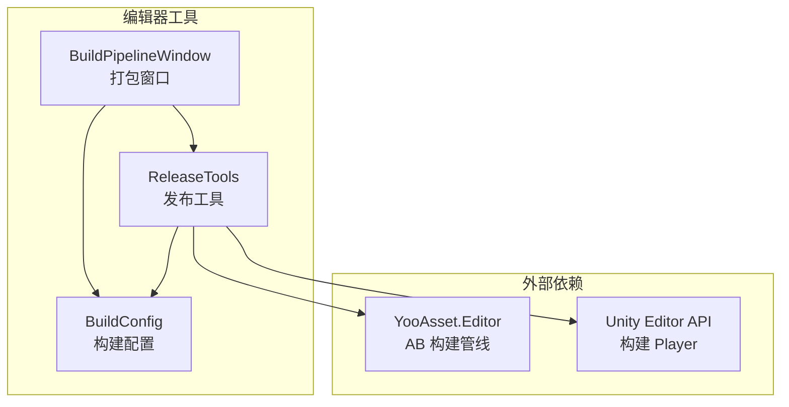
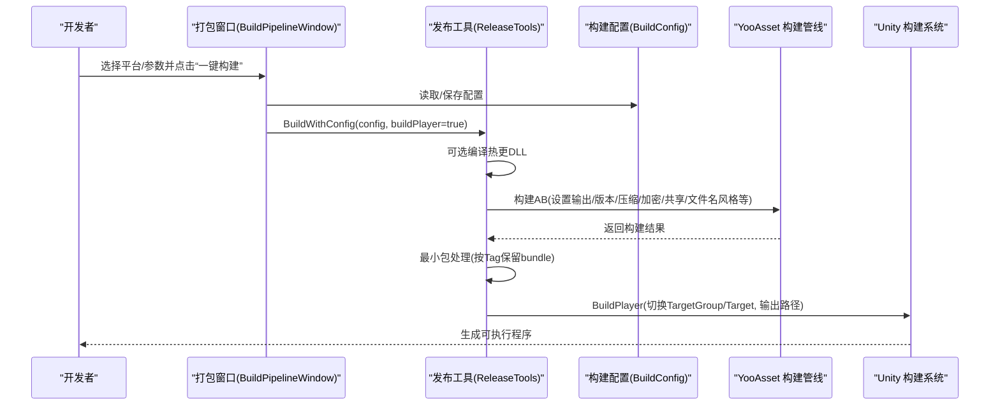
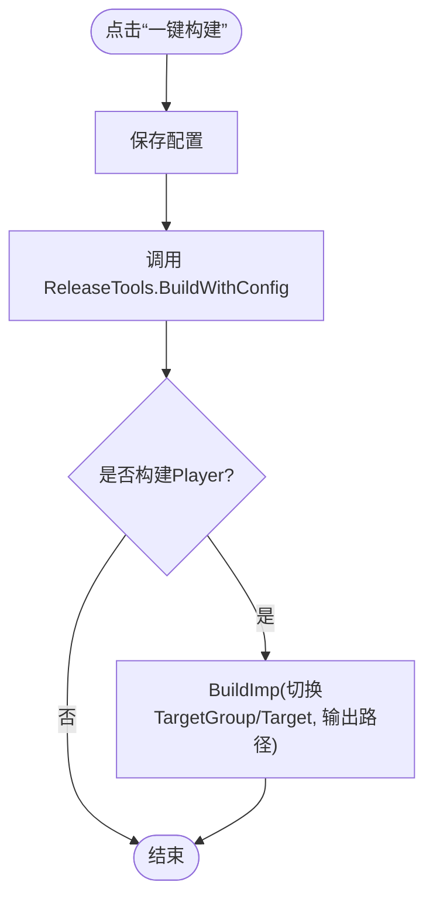
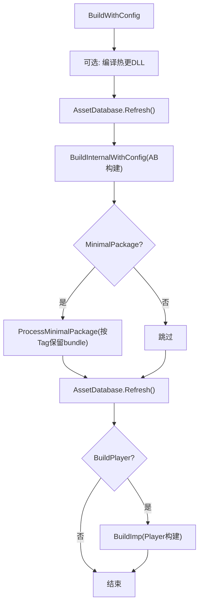
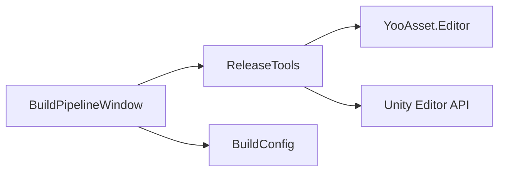

# 部署发布

<cite>
**本文引用的文件**   
- [README.md](file://README.md)
- [BuildPipelineWindow.cs](file://UnityProject/Assets/TEngine/Editor/ReleaseTools/BuildPipelineWindow.cs)
- [ReleaseTools.cs](file://UnityProject/Assets/TEngine/Editor/ReleaseTools/ReleaseTools.cs)
- [BuildConfig.cs](file://UnityProject/Assets/TEngine/Editor/ReleaseTools/BuildConfig.cs)
- [build_android.bat](file://BuildCLI/build_android.bat)
- [3-1-资源模块.md](file://Books/3-1-资源模块.md)
</cite>

## 目录
1. [简介](#简介)
2. [项目结构](#项目结构)
3. [核心组件](#核心组件)
4. [架构总览](#架构总览)
5. [详细组件分析](#详细组件分析)
6. [依赖关系分析](#依赖关系分析)
7. [性能与优化](#性能与优化)
8. [测试与验证流程](#测试与验证流程)
9. [自动化与CI/CD集成](#自动化与cicd集成)
10. [平台特殊要求与注意事项](#平台特殊要求与注意事项)
11. [故障排查](#故障排查)
12. [结论](#结论)

## 简介
本章节面向 TEngine 的部署与发布，覆盖多平台构建配置、热更新资源打包与发布（AB 包、版本管理、增量更新）、资源优化策略（图集压缩、纹理压缩、资源分包）、发布前测试验证、以及自动化与 CI/CD 最佳实践。文档同时给出不同平台的特殊要求和注意事项，帮助团队快速建立稳定、可重复的发布流水线。

## 项目结构
TEngine 的发布能力主要由 Unity 编辑器工具与脚本驱动：
- 编辑器打包窗口：提供可视化配置与一键构建入口
- 发布工具类：封装 AB 构建、最小包处理、Player 构建等核心流程
- 构建配置对象：集中管理平台、管线、压缩、加密、输出路径等参数
- 命令行脚本：在 CI 或本地批处理中调用 Unity 执行静默构建

图表来源
- [BuildPipelineWindow.cs:10-116](file://UnityProject/Assets/TEngine/Editor/ReleaseTools/BuildPipelineWindow.cs#L10-L116)
- [ReleaseTools.cs:119-159](file://UnityProject/Assets/TEngine/Editor/ReleaseTools/ReleaseTools.cs#L119-L159)
- [BuildConfig.cs:8-36](file://UnityProject/Assets/TEngine/Editor/ReleaseTools/BuildConfig.cs#L8-L36)

章节来源
- [README.md:20-33](file://README.md#L20-L33)

## 核心组件
- 打包窗口 BuildPipelineWindow
  - 提供目标平台、构建管线、压缩方式、加密方式、资源版本号、输出目录、最小包模式、共享打包、依赖数据库、清理缓存、结果校验、内置文件拷贝、文件名风格、热更 DLL 编译、Player 构建等选项
  - 支持“构建 AssetBundle”、“构建 Player”、“一键构建 (AB + Player)”三种操作
- 发布工具 ReleaseTools
  - 统一入口 BuildWithConfig：可选编译热更 DLL → 刷新资源 → 构建 AB → 最小包后处理 → 刷新资源 → 构建 Player
  - 内部实现 BuildInternalWithConfig：根据配置选择 SBP 或 Builtin 管线，设置输出根、StreamingAssets 根、包名/版本、压缩、加密、共享打包、文件名风格、依赖数据库等
  - 最小包处理 ProcessMinimalPackage：解析构建报告 JSON，按 Tag 保留 bundle，删除其余 .bundle，并清理空目录
  - Player 构建 BuildImp：切换目标平台组与目标，调用 Unity BuildPipeline.BuildPlayer
- 构建配置 BuildConfig
  - 集中定义平台、管线、压缩、加密、版本号、输出路径、最小包开关与保留 Tag、高级选项、热更 DLL 开关、Player 平台与输出路径
  - 提供默认值生成与平台到 TargetGroup 的映射

章节来源
- [BuildPipelineWindow.cs:10-116](file://UnityProject/Assets/TEngine/Editor/ReleaseTools/BuildPipelineWindow.cs#L10-L116)
- [ReleaseTools.cs:119-159](file://UnityProject/Assets/TEngine/Editor/ReleaseTools/ReleaseTools.cs#L119-L159)
- [BuildConfig.cs:8-36](file://UnityProject/Assets/TEngine/Editor/ReleaseTools/BuildConfig.cs#L8-L36)

## 架构总览
下图展示从编辑器窗口到 AB 构建与 Player 构建的整体流程，以及与 YooAsset 和 Unity 构建系统的交互关系。

图表来源
- [BuildPipelineWindow.cs:385-426](file://UnityProject/Assets/TEngine/Editor/ReleaseTools/BuildPipelineWindow.cs#L385-L426)
- [ReleaseTools.cs:119-159](file://UnityProject/Assets/TEngine/Editor/ReleaseTools/ReleaseTools.cs#L119-L159)
- [ReleaseTools.cs:165-214](file://UnityProject/Assets/TEngine/Editor/ReleaseTools/ReleaseTools.cs#L165-L214)
- [ReleaseTools.cs:408-431](file://UnityProject/Assets/TEngine/Editor/ReleaseTools/ReleaseTools.cs#L408-L431)

## 详细组件分析

### 打包窗口 BuildPipelineWindow
- 功能要点
  - 基础设置：目标平台、构建管线（SBP/Builtin）、压缩方式（Uncompressed/LZMA/LZ4）、加密方式（无/文件偏移/文件流）、资源版本号、AB 输出目录
  - 最小包设置：启用最小包模式，支持按 Tag 保留 bundle
  - 高级设置：共享打包、使用依赖数据库、清理构建缓存、验证构建结果、内置文件拷贝策略、文件名风格
  - 热更 DLL 设置：构建前编译 HybridCLR 热更程序集
  - Player 设置：是否构建 Player、Player 平台、输出路径
  - 操作按钮：构建 AB / 构建 Player / 一键构建
  - 日志面板：实时显示构建日志
- 关键行为
  - ExecuteBuild：根据是否构建 Player 调用 ReleaseTools.BuildWithConfig
  - ExecuteBuildPlayerOnly：仅构建 Player，通过 ReleaseTools.BuildImp 完成
  - 持久化：将配置写入 EditorPrefs，下次打开自动恢复

图表来源
- [BuildPipelineWindow.cs:385-426](file://UnityProject/Assets/TEngine/Editor/ReleaseTools/BuildPipelineWindow.cs#L385-L426)
- [BuildPipelineWindow.cs:514-542](file://UnityProject/Assets/TEngine/Editor/ReleaseTools/BuildPipelineWindow.cs#L514-L542)

章节来源
- [BuildPipelineWindow.cs:10-116](file://UnityProject/Assets/TEngine/Editor/ReleaseTools/BuildPipelineWindow.cs#L10-L116)
- [BuildPipelineWindow.cs:161-380](file://UnityProject/Assets/TEngine/Editor/ReleaseTools/BuildPipelineWindow.cs#L161-L380)
- [BuildPipelineWindow.cs:385-542](file://UnityProject/Assets/TEngine/Editor/ReleaseTools/BuildPipelineWindow.cs#L385-L542)

### 发布工具 ReleaseTools
- 统一构建入口 BuildWithConfig
  - 步骤：可选编译热更 DLL → 刷新资源 → 构建 AB → 最小包处理 → 刷新资源 → 构建 Player
- AB 构建 BuildInternalWithConfig
  - 根据 BuildPipeline 选择 ScriptableBuildPipeline 或 BuiltinBuildPipeline
  - 设置输出根、StreamingAssets 根、包名/版本、压缩、加密、共享打包、文件名风格、依赖数据库、缓存清理、结果校验
- 最小包处理 ProcessMinimalPackage
  - 读取构建报告 JSON，解析 BundleInfos 的 Tags
  - 根据 RetainTags 匹配保留 bundle，删除其余 .bundle
  - 清理空目录
- Player 构建 BuildImp
  - 切换 BuildTargetGroup/BuildTarget，调用 Unity BuildPipeline.BuildPlayer

图表来源
- [ReleaseTools.cs:119-159](file://UnityProject/Assets/TEngine/Editor/ReleaseTools/ReleaseTools.cs#L119-L159)
- [ReleaseTools.cs:165-214](file://UnityProject/Assets/TEngine/Editor/ReleaseTools/ReleaseTools.cs#L165-L214)
- [ReleaseTools.cs:290-402](file://UnityProject/Assets/TEngine/Editor/ReleaseTools/ReleaseTools.cs#L290-L402)
- [ReleaseTools.cs:408-431](file://UnityProject/Assets/TEngine/Editor/ReleaseTools/ReleaseTools.cs#L408-L431)

章节来源
- [ReleaseTools.cs:119-159](file://UnityProject/Assets/TEngine/Editor/ReleaseTools/ReleaseTools.cs#L119-L159)
- [ReleaseTools.cs:165-214](file://UnityProject/Assets/TEngine/Editor/ReleaseTools/ReleaseTools.cs#L165-L214)
- [ReleaseTools.cs:290-402](file://UnityProject/Assets/TEngine/Editor/ReleaseTools/ReleaseTools.cs#L290-L402)
- [ReleaseTools.cs:408-431](file://UnityProject/Assets/TEngine/Editor/ReleaseTools/ReleaseTools.cs#L408-L431)

### 构建配置 BuildConfig
- 字段说明
  - 基础：BuildTarget、BuildPipeline、CompressOption、EncryptionType、PackageVersion、OutputRoot
  - 最小包：MinimalPackage、RetainTags
  - 高级：EnableSharePackRule、UseAssetDependencyDB、ClearBuildCache、VerifyBuildingResult、BuildinFileCopyOption、FileNameStyle
  - 热更 DLL：BuildHotFixDll
  - Player：BuildPlayer、PlayerPlatform、PlayerOutputPath
- 工厂方法
  - CreateDefault：基于当前活动平台生成默认配置
  - GetDefaultPackageVersion：生成日期+分钟的资源版本号
  - GetDefaultPlayerOutputPath：按平台生成默认 Player 输出路径
  - GetBuildTargetGroup：BuildTarget 到 BuildTargetGroup 的映射

章节来源
- [BuildConfig.cs:8-36](file://UnityProject/Assets/TEngine/Editor/ReleaseTools/BuildConfig.cs#L8-L36)
- [BuildConfig.cs:38-86](file://UnityProject/Assets/TEngine/Editor/ReleaseTools/BuildConfig.cs#L38-L86)

## 依赖关系分析
- 组件耦合
  - BuildPipelineWindow 依赖 ReleaseTools 与 BuildConfig
  - ReleaseTools 依赖 YooAsset.Editor 管线与 Unity Editor API
  - BuildConfig 为纯数据载体，被窗口与工具共同消费
- 外部依赖
  - YooAsset：AB 构建、构建报告、压缩/加密服务
  - Unity Editor：构建 Player、平台切换、资源刷新
- 潜在循环依赖
  - 当前结构为单向依赖（窗口→工具→外部），未见循环引用

图表来源
- [BuildPipelineWindow.cs:10-116](file://UnityProject/Assets/TEngine/Editor/ReleaseTools/BuildPipelineWindow.cs#L10-L116)
- [ReleaseTools.cs:119-159](file://UnityProject/Assets/TEngine/Editor/ReleaseTools/ReleaseTools.cs#L119-L159)
- [BuildConfig.cs:8-36](file://UnityProject/Assets/TEngine/Editor/ReleaseTools/BuildConfig.cs#L8-L36)

章节来源
- [BuildPipelineWindow.cs:10-116](file://UnityProject/Assets/TEngine/Editor/ReleaseTools/BuildPipelineWindow.cs#L10-L116)
- [ReleaseTools.cs:119-159](file://UnityProject/Assets/TEngine/Editor/ReleaseTools/ReleaseTools.cs#L119-L159)
- [BuildConfig.cs:8-36](file://UnityProject/Assets/TEngine/Editor/ReleaseTools/BuildConfig.cs#L8-L36)

## 性能与优化
- 构建管线选择
  - ScriptableBuildPipeline（SBP）：适合大规模工程，配合依赖数据库提升构建速度
  - BuiltinBuildPipeline：兼容性好，适合小规模或调试场景
- 压缩与加密
  - 压缩：Uncompressed/LZMA/LZ4，按需权衡体积与构建速度
  - 加密：无/文件偏移/文件流，生产环境建议开启以增强资源安全
- 共享打包与依赖数据库
  - EnableSharePackRule：提取共享资源到独立 bundle，减少重复
  - UseAssetDependencyDB：加速增量构建
- 文件名风格
  - HashName/BundleName/BundleName_HashName，便于缓存与增量更新
- 最小包模式
  - 删除 StreamingAssets 中的 .bundle，仅保留清单，显著减小首包体积
  - 通过 RetainTags 精确控制需要保留的 bundle
- 资源加载与内存
  - 资源模块基于 YooAsset，支持 LRU/ARC 缓存策略与自动释放
  - WebGL 支持 Remote/StreamingAssets 两种资源加载方式

章节来源
- [BuildPipelineWindow.cs:161-380](file://UnityProject/Assets/TEngine/Editor/ReleaseTools/BuildPipelineWindow.cs#L161-L380)
- [ReleaseTools.cs:165-214](file://UnityProject/Assets/TEngine/Editor/ReleaseTools/ReleaseTools.cs#L165-L214)
- [3-1-资源模块.md:31-93](file://Books/3-1-资源模块.md#L31-L93)

## 测试与验证流程
- 功能测试
  - 启动流程：ProcedureLaunch → ProcedureSplash → ProcedureInitPackage → ... → ProcedureStartGame
  - 资源加载：确认 HotUpdate 资源能正确下载与加载
- 性能测试
  - 构建时间：对比 SBP/Builtin 与依赖数据库开关对构建时长的影响
  - 运行时内存：观察 LRU/ARC 策略下的内存峰值与回收效果
- 兼容性测试
  - 多平台：Windows、Android、iOS、WebGL、微信小游戏
  - 资源加载方式：WebGL 下 Remote/StreamingAssets 的差异
- 构建结果校验
  - VerifyBuildingResult：构建完成后校验资源完整性
  - 最小包模式：确认 StreamingAssets 中仅保留预期 bundle

章节来源
- [README.md:161-169](file://README.md#L161-L169)
- [BuildPipelineWindow.cs:272-311](file://UnityProject/Assets/TEngine/Editor/ReleaseTools/BuildPipelineWindow.cs#L272-L311)
- [3-1-资源模块.md:31-93](file://Books/3-1-资源模块.md#L31-L93)

## 自动化与CI/CD集成
- 编辑器菜单一键构建
  - “一键打包AssetBundle”、“一键打包Window/Android/iOS”等菜单项可直接触发 ReleaseTools.BuildWithConfig
- 命令行静默构建
  - 通过 CommandLineReader 获取 platform/outputRoot/packageVersion 等参数，调用 ReleaseTools.BuildAssetBundle
  - 示例：build_android.bat 调用 Unity.exe 并传入 -executeMethod TEngine.ReleaseTools.AutomationBuildAndroid
- CI/CD 建议
  - 固定 Unity 版本与平台 SDK
  - 预安装 HybridCLR 与 YooAsset 依赖
  - 使用环境变量注入版本号与输出路径
  - 构建产物归档（AB 包、Player 安装包、构建报告）
  - 失败重试与日志采集

章节来源
- [ReleaseTools.cs:20-62](file://UnityProject/Assets/TEngine/Editor/ReleaseTools/ReleaseTools.cs#L20-L62)
- [ReleaseTools.cs:68-110](file://UnityProject/Assets/TEngine/Editor/ReleaseTools/ReleaseTools.cs#L68-L110)
- [build_android.bat:1-9](file://BuildCLI/build_android.bat#L1-L9)

## 平台特殊要求与注意事项
- Windows/macOS/Linux
  - 建议使用 SBP 与依赖数据库以提升构建效率
  - 生产环境建议开启加密与校验
- Android
  - 注意签名与 keystore 配置
  - 最小包模式可显著降低首包体积
- iOS
  - Xcode 工程生成路径需正确配置
  - 注意证书与描述文件
- WebGL
  - 资源加载方式：Remote（推荐）或 StreamingAssets（开发阶段）
  - 服务器跨域与缓存策略需提前规划
- 微信小游戏
  - 文件系统与资源访问限制较多，需适配小游戏平台
  - 资源分包与增量更新需遵循平台规范

章节来源
- [3-1-资源模块.md:41-56](file://Books/3-1-资源模块.md#L41-L56)
- [BuildConfig.cs:56-69](file://UnityProject/Assets/TEngine/Editor/ReleaseTools/BuildConfig.cs#L56-L69)

## 故障排查
- AB 构建失败
  - 检查 OutputRoot 是否为相对路径且存在
  - 确认 PackageVersion 非空
  - 查看构建日志中的错误信息
- 最小包模式异常
  - 确认构建报告 JSON 是否存在并可反序列化
  - 检查 RetainTags 是否正确匹配 bundle 的 Tags
- Player 构建失败
  - 确认 BuildTargetGroup/BuildTarget 切换成功
  - 检查输出路径权限与磁盘空间
- 资源加载问题
  - 确认 HostServerURL/FallbackHostServerURL 配置正确
  - WebGL 下确认 LoadResWayWebGL 设置符合预期

章节来源
- [ReleaseTools.cs:165-214](file://UnityProject/Assets/TEngine/Editor/ReleaseTools/ReleaseTools.cs#L165-L214)
- [ReleaseTools.cs:290-402](file://UnityProject/Assets/TEngine/Editor/ReleaseTools/ReleaseTools.cs#L290-L402)
- [3-1-资源模块.md:77-93](file://Books/3-1-资源模块.md#L77-L93)

## 结论
TEngine 提供了完善的编辑器打包窗口与发布工具链，覆盖多平台构建、AB 包构建与最小包处理、Player 构建与自动化入口。结合 YooAsset 与 HybridCLR，可实现高效、安全的资源管理与热更新流程。建议在 CI/CD 中固化构建参数与产物归档，并在不同平台上进行充分的功能、性能与兼容性测试，确保发布质量与稳定性。