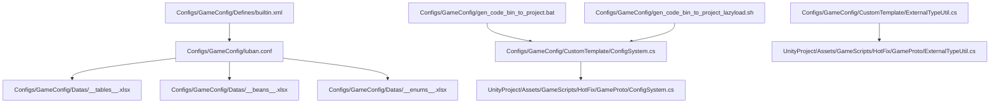
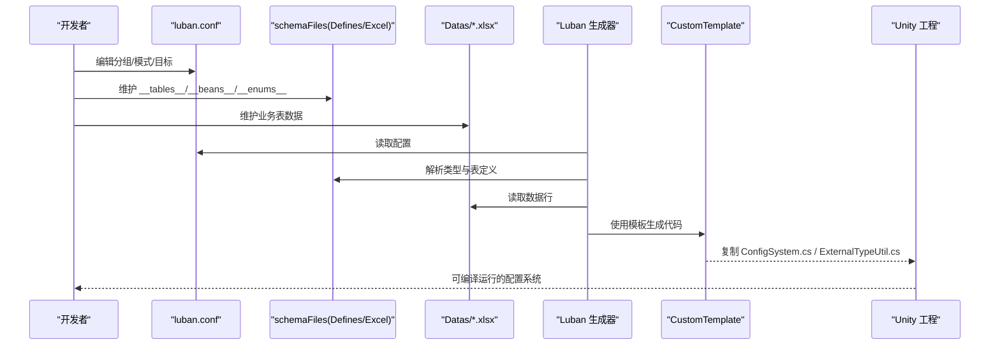
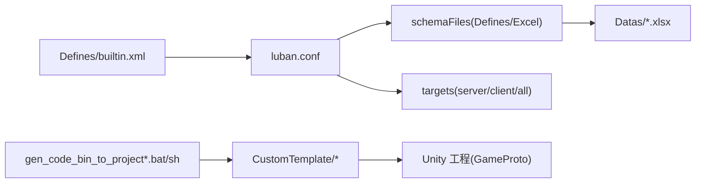

# Luban 集成配置

<cite>
**本文引用的文件**   
- [luban.conf](file://Configs/GameConfig/luban.conf)
- [excel-format.md](file://UnityProject/.codex/skills/luban-dev/references/excel-format.md)
- [schema.md](file://UnityProject/.codex/skills/luban-dev/references/schema.md)
- [regression luban.conf](file://UnityProject/.codex/skills/luban-dev/examples/regression/luban.conf)
- [builtin.xml](file://Configs/GameConfig/Defines/builtin.xml)
- [ExternalTypeUtil.cs](file://Configs/GameConfig/CustomTemplate/ExternalTypeUtil.cs)
- [ConfigSystem.cs](file://Configs/GameConfig/CustomTemplate/ConfigSystem.cs)
- [gen_code_bin_to_project.bat](file://Configs/GameConfig/gen_code_bin_to_project.bat)
- [gen_code_bin_to_project_lazyload.sh](file://Configs/GameConfig/gen_code_bin_to_project_lazyload.sh)
</cite>

## 目录
1. [简介](#简介)
2. [项目结构](#项目结构)
3. [核心组件](#核心组件)
4. [架构总览](#架构总览)
5. [详细组件分析](#详细组件分析)
6. [依赖关系分析](#依赖关系分析)
7. [性能考虑](#性能考虑)
8. [故障排查指南](#故障排查指南)
9. [结论](#结论)
10. [附录](#附录)

## 简介
本文面向 TEngine 项目中 Luban 配置集成的完整说明，重点解释配置文件 luban.conf 的结构与选项，包括 groups、schemaFiles、targets 等；详细说明 schemaFiles 中 __tables__.xlsx、__beans__.xlsx、__enums__.xlsx 的格式规范与编写规则；对比 server、client、all 三种 target 的差异与适用场景；提供完整的配置示例与最佳实践，涵盖自定义类型定义、数据验证规则配置，并给出扩展 Luban 配置能力（自定义生成器与输出格式）的方法。

## 项目结构
本项目在 Configs/GameConfig 下维护 Luban 的配置与模板：
- 配置文件：Configs/GameConfig/luban.conf
- 数据源目录：Configs/GameConfig/Datas（包含 __tables__.xlsx、__beans__.xlsx、__enums__.xlsx 以及业务表如 item.xlsx）
- 类型定义：Configs/GameConfig/Defines/builtin.xml（内置外部类型构造器映射）
- 自定义模板：Configs/GameConfig/CustomTemplate（含 ConfigSystem.cs、ExternalTypeUtil.cs 等）
- 构建脚本：Configs/GameConfig/gen_code_bin_to_project*.bat/sh（复制模板到 Unity 工程并触发代码生成）

图表来源
- [luban.conf:1-22](file://Configs/GameConfig/luban.conf#L1-L22)
- [gen_code_bin_to_project.bat:10-11](file://Configs/GameConfig/gen_code_bin_to_project.bat#L10-L11)
- [gen_code_bin_to_project_lazyload.sh:12-15](file://Configs/GameConfig/gen_code_bin_to_project_lazyload.sh#L12-L15)

章节来源
- [luban.conf:1-22](file://Configs/GameConfig/luban.conf#L1-L22)

## 核心组件
- 分组 groups：用于对表进行逻辑分组，便于在不同目标（server/client/all）中选择性导出。
- 模式文件 schemaFiles：声明类型与表的来源，支持 Defines XML 与 Excel 定义表（__tables__/__beans__/__enums__）。
- 数据目录 dataDir：Excel 数据源根目录。
- 目标 targets：定义不同运行端（server/client/all）的生成策略，包括管理器类名、分组选择、顶层模块名等。

章节来源
- [luban.conf:1-22](file://Configs/GameConfig/luban.conf#L1-L22)

## 架构总览
Luban 读取 luban.conf，解析 groups 与 schemaFiles，定位 Datas 下的 Excel 定义与数据表，再根据 targets 为不同端生成对应的代码与运行时加载器。自定义类型通过 builtin.xml 注入外部构造器，模板中的 ConfigSystem.cs 与 ExternalTypeUtil.cs 会被复制到 Unity 工程中参与编译。

图表来源
- [luban.conf:1-22](file://Configs/GameConfig/luban.conf#L1-L22)
- [gen_code_bin_to_project.bat:10-11](file://Configs/GameConfig/gen_code_bin_to_project.bat#L10-L11)
- [gen_code_bin_to_project_lazyload.sh:12-15](file://Configs/GameConfig/gen_code_bin_to_project_lazyload.sh#L12-L15)

## 详细组件分析

### 配置文件结构与选项
- groups
  - names：分组名称数组，例如 c、s、e。
  - default：是否默认启用该分组。
- schemaFiles
  - fileName：文件或目录路径，如 Defines、Datas/__tables__.xlsx。
  - type：来源类型，空字符串表示 Defines XML，table/bean/enum 分别对应 Excel 定义表。
- dataDir
  - Excel 数据根目录，通常为 Datas。
- targets
  - name：目标名，如 server、client、all。
  - manager：生成的管理器类名，如 Tables。
  - groups：该目标导出的分组集合。
  - topModule：顶层模块命名空间或类名前缀，如 GameConfig。

章节来源
- [luban.conf:1-22](file://Configs/GameConfig/luban.conf#L1-L22)

### schemaFiles 与 Excel 定义表规范
- __tables__.xlsx
  - 用途：注册业务表，指定 value/input/mode/index 等列以描述表结构。
  - 注意：作为“定义表”，不按普通业务表的列格式处理；需遵循最小示例与现有注册表约定。
- __beans__.xlsx
  - 用途：定义 Bean 类型及其字段 var 声明，供表与其他 Bean 引用。
- __enums__.xlsx
  - 用途：定义枚举类型，也可存放常量别名。
- 通用规则
  - 不假设固定前四行，按实际 Sheet 与标记行（如 ##var、##type、##、##group）解析。
  - 保留 Sheet 名、表头、批注、公式与非目标单元格，避免重建为纯值表。
  - 明确主键、可空、空字符串、0、false 的区别；长 ID 需注意数字精度问题。
  - 容器与 Bean 的分隔符由类型/schema 决定，不能简单替换中文逗号。
  - group 是业务选择，不根据字段名推断。
  - 纵表、多行列表、变体需针对工具支持情况测试后再批量改写。
  - 修改后应重新读取记录、检查引用、validate 并执行真实导出。

章节来源
- [excel-format.md:1-15](file://UnityProject/.codex/skills/luban-dev/references/excel-format.md#L1-L15)
- [schema.md:1-15](file://UnityProject/.codex/skills/luban-dev/references/schema.md#L1-L15)

### 目标 targets 差异与适用场景
- server
  - 通常仅导出服务端需要的分组（如 s），减少客户端冗余数据。
- client
  - 通常仅导出客户端需要的分组（如 c），优化包体与加载时间。
- all
  - 同时导出多个分组（如 c,s,e），适合本地调试或全量打包。

建议：
- 将跨端共享的类型放入 bean/enum，并在 client/server 两端都引入。
- 将平台相关的数据拆分到不同分组，避免不必要的传输与解析开销。

章节来源
- [luban.conf:16-21](file://Configs/GameConfig/luban.conf#L16-L21)

### 自定义类型定义与外部构造器
- 通过 Defines/builtin.xml 将外部类型与静态构造方法绑定，例如 Vector2/Vector3/Vector4 等。
- ExternalTypeUtil.cs 提供 NewXxx 静态方法，供生成代码调用以创建对象。
- 模板 ConfigSystem.cs 负责运行时加载与访问接口暴露。

章节来源
- [builtin.xml:7-43](file://Configs/GameConfig/Defines/builtin.xml#L7-L43)
- [ExternalTypeUtil.cs](file://Configs/GameConfig/CustomTemplate/ExternalTypeUtil.cs)
- [ConfigSystem.cs](file://Configs/GameConfig/CustomTemplate/ConfigSystem.cs)

### 数据验证规则配置
- 在 __tables__.xlsx 中通过 input/mode/index 等列表达输入校验、索引与唯一性等约束。
- 结合 Excel 定义列与实际位置从现有注册表读取，避免沿用旧文档的 read_mode/cfg.* 表头。
- 对于 map 类型，确保主键唯一；list 复合索引以生成 API 为准，不要把嵌套 Bean 内字段直接当顶层索引。
- 非 Excel 多记录输入需表达多记录选择，例如 JSON 示例中使用 @rows.json（@ 前为选择器）。

章节来源
- [schema.md:6-10](file://UnityProject/.codex/skills/luban-dev/references/schema.md#L6-L10)

### 扩展 Luban 配置能力（自定义生成器与输出格式）
- 自定义模板
  - 在 CustomTemplate 目录下新增模板文件，并通过构建脚本传入 --customTemplateDir 参数覆盖默认模板。
  - 参考 lazyload 脚本中对 CustomTemplate_Client_LazyLoad 的使用方式。
- 自定义类型
  - 在 builtin.xml 中添加新的 option 条目，指向 ExternalTypeUtil.NewXxx 构造方法。
- 自定义目标
  - 在 targets 中新增目标项，指定 manager、groups、topModule 等，以生成不同端的代码或数据格式。
- 自动化流程
  - 在 gen_code_bin_to_project*.bat/sh 中复制模板到 Unity 工程，并触发 Luban 生成。

章节来源
- [gen_code_bin_to_project_lazyload.sh:18-22](file://Configs/GameConfig/gen_code_bin_to_project_lazyload.sh#L18-L22)
- [gen_code_bin_to_project.bat:10-11](file://Configs/GameConfig/gen_code_bin_to_project.bat#L10-L11)
- [builtin.xml:7-43](file://Configs/GameConfig/Defines/builtin.xml#L7-L43)

## 依赖关系分析
- 配置层：luban.conf 驱动 schemaFiles 与 targets。
- 类型层：Defines/builtin.xml 注入外部类型构造器，Excel 定义表提供类型与表结构。
- 数据层：Datas/*.xlsx 提供业务数据。
- 模板层：CustomTemplate 提供运行时加载器与辅助工具。
- 工程层：gen_code_bin_to_project*.bat/sh 将模板复制到 Unity 工程，完成最终集成。

图表来源
- [luban.conf:1-22](file://Configs/GameConfig/luban.conf#L1-L22)
- [gen_code_bin_to_project.bat:10-11](file://Configs/GameConfig/gen_code_bin_to_project.bat#L10-L11)
- [gen_code_bin_to_project_lazyload.sh:12-15](file://Configs/GameConfig/gen_code_bin_to_project_lazyload.sh#L12-L15)

章节来源
- [luban.conf:1-22](file://Configs/GameConfig/luban.conf#L1-L22)

## 性能考虑
- 合理划分 groups，仅在 client 端导出必要数据，减少网络与内存占用。
- 使用懒加载模板（如 CustomTemplate_Client_LazyLoad）按需加载配置，降低启动时延。
- 避免在 Excel 中使用复杂公式与大量批注，提升解析与生成效率。
- 控制 map/list 的规模与复合索引复杂度，避免生成过大的访问 API。

[本节为通用指导，无需具体文件来源]

## 故障排查指南
- 缺少 __tables__.xlsx 注册表
  - 现象：工作流或脚本报错提示缺失表注册。
  - 解决：在 Datas 下添加 __tables__.xlsx 并按规范注册业务表。
- 重复定义或命名空间漂移
  - 现象：生成错误或类型冲突。
  - 解决：确认类型已在另一来源（Defines XML 或 Excel 定义表）定义，避免重复定义。
- 列名与位置不一致
  - 现象：解析异常或生成结果不符合预期。
  - 解决：以现有注册表为准，不要沿用旧文档的 read_mode/cfg.* 表头。
- 模板未同步到 Unity 工程
  - 现象：运行时报找不到 ConfigSystem.cs 或 ExternalTypeUtil.cs。
  - 解决：执行 gen_code_bin_to_project*.bat/sh 将模板复制到 Unity 工程相应目录。

章节来源
- [domains.py:27-28](file://UnityProject/.codex/scripts/workflow_lib/domains.py#L27-L28)
- [schema.md:12-14](file://UnityProject/.codex/skills/luban-dev/references/schema.md#L12-L14)
- [gen_code_bin_to_project.bat:10-11](file://Configs/GameConfig/gen_code_bin_to_project.bat#L10-L11)
- [gen_code_bin_to_project_lazyload.sh:12-15](file://Configs/GameConfig/gen_code_bin_to_project_lazyload.sh#L12-L15)

## 结论
通过合理的 groups 划分、规范的 schemaFiles 定义与清晰的 targets 配置，TEngine 项目能够稳定地用 Luban 生成多端配置代码与数据。配合自定义类型与模板扩展，可以灵活适配不同的运行环境与性能需求。建议在团队内统一 Excel 定义规范与验证流程，确保数据契约一致性与生成质量。

[本节为总结性内容，无需具体文件来源]

## 附录

### 完整配置示例与最佳实践
- 最小示例
  - 参考 regression 示例中的 luban.conf，仅包含 client 目标与 Defines 源。
- 推荐实践
  - 将共享类型放在 bean/enum，业务表按功能域拆分至不同分组。
  - 在 __tables__.xlsx 中显式声明主键与索引，避免隐式行为。
  - 使用 lazyload 模板优化客户端加载性能。
  - 在 CI 中执行 validate 与真实导出，确保数据与生成产物一致性。

章节来源
- [regression luban.conf:1-7](file://UnityProject/.codex/skills/luban-dev/examples/regression/luban.conf#L1-L7)
- [excel-format.md:1-15](file://UnityProject/.codex/skills/luban-dev/references/excel-format.md#L1-L15)
- [schema.md:1-15](file://UnityProject/.codex/skills/luban-dev/references/schema.md#L1-L15)