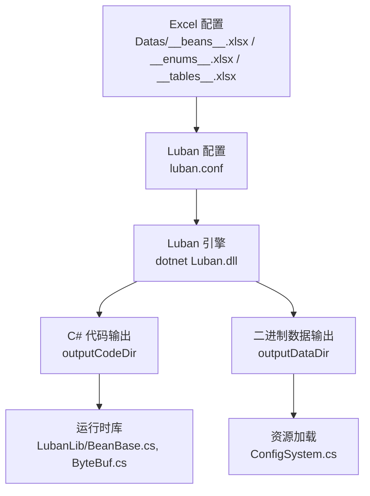
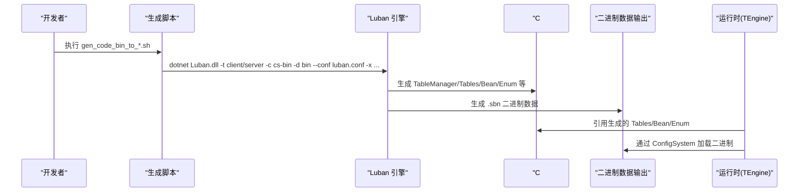
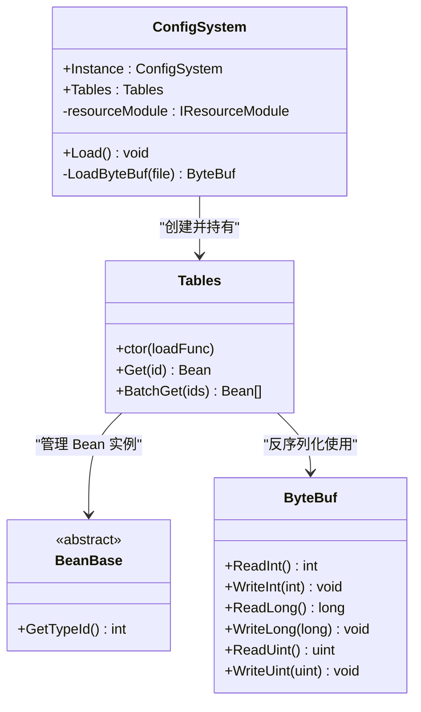
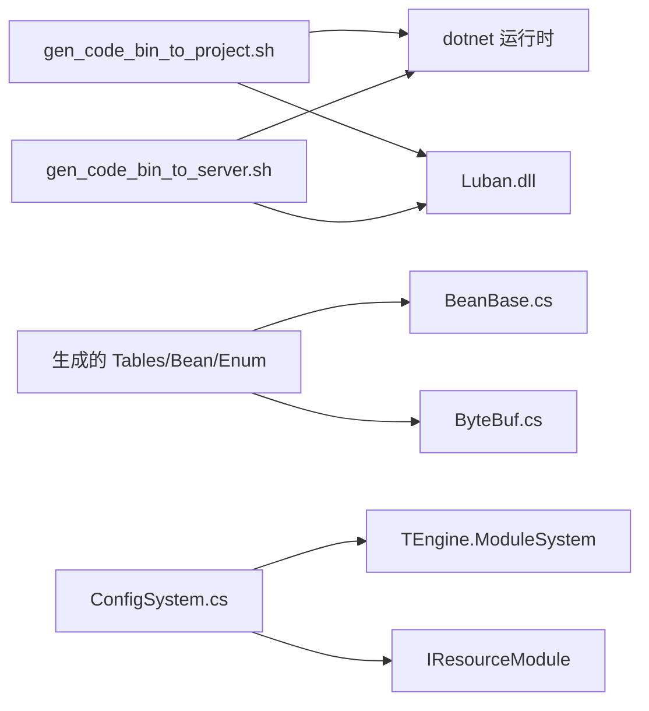

# 代码生成流程

<cite>
**本文引用的文件**   
- [gen_code_bin_to_project.sh](file://Configs/GameConfig/gen_code_bin_to_project.sh)
- [gen_code_bin_to_server.sh](file://Configs/GameConfig/gen_code_bin_to_server.sh)
- [luban.conf](file://Configs/GameConfig/luban.conf)
- [tables.sbn](file://Configs/GameConfig/CustomTemplate/CustomTemplate_Client_LazyLoad/cs-bin/tables.sbn)
- [ConfigSystem.cs](file://Configs/GameConfig/CustomTemplate/ConfigSystem.cs)
- [BeanBase.cs](file://UnityProject/Assets/GameScripts/HotFix/GameProto/LubanLib/BeanBase.cs)
- [ByteBuf.cs](file://UnityProject/Assets/GameScripts/HotFix/GameProto/LubanLib/ByteBuf.cs)
</cite>

## 目录
1. [简介](#简介)
2. [项目结构](#项目结构)
3. [核心组件](#核心组件)
4. [架构总览](#架构总览)
5. [详细组件分析](#详细组件分析)
6. [依赖关系分析](#依赖关系分析)
7. [性能优化建议](#性能优化建议)
8. [故障排查指南](#故障排查指南)
9. [结论](#结论)

## 简介
本文面向 TEngine 项目中基于 Luban 的配置表代码生成流程，系统说明从 Excel 配置到 C# 代码与二进制数据的完整转换过程。重点包括：
- 两个关键脚本 gen_code_bin_to_project.sh 与 gen_code_bin_to_server.sh 的作用、参数与执行路径
- 生成的代码组织方式（TableManager、Bean 类、枚举类型）
- 自定义扩展点（模板、后处理器、验证器）的使用思路
- 性能优化技巧（增量生成、缓存、并行）
- 常见问题与调试方法

## 项目结构
本项目将配置定义与生成工具集中在 Configs/GameConfig 下，并通过脚本调用 Luban 引擎生成客户端与服务端所需的 C# 代码与二进制数据。

图表来源
- [luban.conf:1-22](file://Configs/GameConfig/luban.conf#L1-L22)
- [gen_code_bin_to_project.sh:1-25](file://Configs/GameConfig/gen_code_bin_to_project.sh#L1-L25)
- [gen_code_bin_to_server.sh:1-20](file://Configs/GameConfig/gen_code_bin_to_server.sh#L1-L20)

章节来源
- [luban.conf:1-22](file://Configs/GameConfig/luban.conf#L1-L22)
- [gen_code_bin_to_project.sh:1-25](file://Configs/GameConfig/gen_code_bin_to_project.sh#L1-L25)
- [gen_code_bin_to_server.sh:1-20](file://Configs/GameConfig/gen_code_bin_to_server.sh#L1-L20)

## 核心组件
- 配置定义与分组
  - schemaFiles 定义了 Bean、Enum、Table 三类源文件位置与类型
  - groups 定义 c/s/e 三组，分别对应客户端、服务端、枚举等
  - targets 定义 server/client/all 三种目标，指定 manager、groups、topModule
- 生成脚本
  - gen_code_bin_to_project.sh：为 Unity 客户端生成代码与二进制数据
  - gen_code_bin_to_server.sh：为服务端生成代码与二进制数据
- 运行时库
  - BeanBase.cs：所有 Bean 的抽象基类，要求实现 GetTypeId()
  - ByteBuf.cs：高性能序列化/反序列化缓冲区，供生成的 Bean 使用
- 配置加载器
  - ConfigSystem.cs：单例加载 Tables，通过 IResourceModule 读取二进制并构造 Tables

章节来源
- [luban.conf:1-22](file://Configs/GameConfig/luban.conf#L1-L22)
- [BeanBase.cs:1-8](file://UnityProject/Assets/GameScripts/HotFix/GameProto/LubanLib/BeanBase.cs#L1-L8)
- [ByteBuf.cs:1-800](file://UnityProject/Assets/GameScripts/HotFix/GameProto/LubanLib/ByteBuf.cs#L1-L800)
- [ConfigSystem.cs:1-58](file://Configs/GameConfig/CustomTemplate/ConfigSystem.cs#L1-L58)

## 架构总览
下图展示从 Excel 到最终运行时的端到端流程，以及客户端与服务端的差异。

图表来源
- [gen_code_bin_to_project.sh:17-24](file://Configs/GameConfig/gen_code_bin_to_project.sh#L17-L24)
- [gen_code_bin_to_server.sh:12-19](file://Configs/GameConfig/gen_code_bin_to_server.sh#L12-L19)
- [luban.conf:16-21](file://Configs/GameConfig/luban.conf#L16-L21)

## 详细组件分析

### 生成脚本与参数
- gen_code_bin_to_project.sh
  - 作用：为 Unity 客户端生成代码与二进制数据
  - 关键环境变量
    - WORKSPACE：工作区根目录
    - LUBAN_DLL：Luban.dll 路径
    - CONF_ROOT：配置文件根目录
    - DATA_OUTPATH：二进制输出目录（Unity 资源路径）
    - CODE_OUTPATH：C# 代码输出目录（HotFix 工程）
  - 前置步骤：复制 CustomTemplate 中的 ConfigSystem.cs 与 ExternalTypeUtil.cs 到 HotFix 工程
  - 调用参数
    - -t client：目标平台为客户端
    - -c cs-bin：使用 cs-bin 模板
    - -d bin：数据目录
    - --conf luban.conf：配置文件
    - -x code.lineEnding=crlf：Windows 换行符
    - -x outputCodeDir=outputCodeDir
    - -x outputDataDir=outputDataDir
- gen_code_bin_to_server.sh
  - 作用：为服务端生成代码与二进制数据
  - 关键环境变量
    - DATA_OUTPATH：Server/GameConfig
    - CODE_OUTPATH：Server/Hotfix/Config/GameConfig
  - 调用参数
    - -t server：目标平台为服务端
    - 其他参数与客户端脚本一致

章节来源
- [gen_code_bin_to_project.sh:1-25](file://Configs/GameConfig/gen_code_bin_to_project.sh#L1-L25)
- [gen_code_bin_to_server.sh:1-20](file://Configs/GameConfig/gen_code_bin_to_server.sh#L1-L20)

### 配置定义与分组
- groups
  - c：客户端相关表
  - s：服务端相关表
  - e：枚举相关表
- schemaFiles
  - Defines：内置类型定义
  - Datas/__tables__.xlsx：表定义
  - Datas/__beans__.xlsx：Bean 定义
  - Datas/__enums__.xlsx：枚举定义
- targets
  - server：manager=Tables，groups=[s]，topModule=GameConfig
  - client：manager=Tables，groups=[c]，topModule=GameConfig
  - all：manager=Tables，groups=[c,s,e]，topModule=GameConfig

章节来源
- [luban.conf:1-22](file://Configs/GameConfig/luban.conf#L1-L22)

### 生成的代码结构
- TableManager/Tables
  - 由 target 的 manager 字段决定，当前统一为 Tables
  - Tables 负责按 ID 或键查找 Bean，并提供批量访问接口
- Bean 类
  - 继承自 BeanBase，必须实现 GetTypeId()
  - 每个 Bean 包含与 Excel 列对应的属性，并提供序列化/反序列化逻辑（由模板生成）
- 枚举类型
  - 由 enum 类型定义生成，供 Bean 与 Tables 使用
- 顶层命名空间
  - topModule=GameConfig，所有生成代码位于 GameConfig 命名空间下

章节来源
- [luban.conf:16-21](file://Configs/GameConfig/luban.conf#L16-L21)
- [BeanBase.cs:1-8](file://UnityProject/Assets/GameScripts/HotFix/GameProto/LubanLib/BeanBase.cs#L1-L8)

### 二进制数据与运行时加载
- 二进制数据
  - 由 Luban 根据 schema 生成 .sbn 文件（例如 tables.sbn）
  - 客户端与服务端各自拥有独立的二进制输出目录
- 运行时加载
  - ConfigSystem 提供单例访问 Tables
  - Load() 通过 IResourceModule 加载 TextAsset 字节流，封装为 ByteBuf
  - Tables 构造函数接收一个委托用于按需加载二进制数据

图表来源
- [ConfigSystem.cs:1-58](file://Configs/GameConfig/CustomTemplate/ConfigSystem.cs#L1-L58)
- [BeanBase.cs:1-8](file://UnityProject/Assets/GameScripts/HotFix/GameProto/LubanLib/BeanBase.cs#L1-L8)
- [ByteBuf.cs:1-800](file://UnityProject/Assets/GameScripts/HotFix/GameProto/LubanLib/ByteBuf.cs#L1-L800)

章节来源
- [ConfigSystem.cs:1-58](file://Configs/GameConfig/CustomTemplate/ConfigSystem.cs#L1-L58)
- [ByteBuf.cs:1-800](file://UnityProject/Assets/GameScripts/HotFix/GameProto/LubanLib/ByteBuf.cs#L1-L800)

### 自定义扩展点
- 自定义模板
  - 通过 -c cs-bin 选择模板；可在 CustomTemplate 目录下扩展模板以改变生成代码风格或结构
  - 示例模板产物：cs-bin/tables.sbn
- 后处理器
  - 可通过 Luban 的后处理机制对生成的代码或数据进行二次加工（如格式化、合并、校验）
- 验证器
  - 在 schema 层添加校验规则，确保 Excel 数据符合业务约束（唯一性、范围、引用完整性等）

章节来源
- [tables.sbn:1-1](file://Configs/GameConfig/CustomTemplate/CustomTemplate_Client_LazyLoad/cs-bin/tables.sbn#L1-L1)

## 依赖关系分析
- 脚本依赖
  - 两个脚本均依赖 dotnet 运行时与 Luban.dll
  - 客户端脚本额外复制 CustomTemplate 中的运行时辅助文件
- 运行时依赖
  - 生成的 Tables/Bean/Enum 依赖 LubunLib 中的 BeanBase 与 ByteBuf
  - ConfigSystem 依赖 TEngine 的 ModuleSystem 与 IResourceModule

图表来源
- [gen_code_bin_to_project.sh:1-25](file://Configs/GameConfig/gen_code_bin_to_project.sh#L1-L25)
- [gen_code_bin_to_server.sh:1-20](file://Configs/GameConfig/gen_code_bin_to_server.sh#L1-L20)
- [BeanBase.cs:1-8](file://UnityProject/Assets/GameScripts/HotFix/GameProto/LubanLib/BeanBase.cs#L1-L8)
- [ByteBuf.cs:1-800](file://UnityProject/Assets/GameScripts/HotFix/GameProto/LubanLib/ByteBuf.cs#L1-L800)
- [ConfigSystem.cs:1-58](file://Configs/GameConfig/CustomTemplate/ConfigSystem.cs#L1-L58)

章节来源
- [gen_code_bin_to_project.sh:1-25](file://Configs/GameConfig/gen_code_bin_to_project.sh#L1-L25)
- [gen_code_bin_to_server.sh:1-20](file://Configs/GameConfig/gen_code_bin_to_server.sh#L1-L20)
- [BeanBase.cs:1-8](file://UnityProject/Assets/GameScripts/HotFix/GameProto/LubanLib/BeanBase.cs#L1-L8)
- [ByteBuf.cs:1-800](file://UnityProject/Assets/GameScripts/HotFix/GameProto/LubanLib/ByteBuf.cs#L1-L800)
- [ConfigSystem.cs:1-58](file://Configs/GameConfig/CustomTemplate/ConfigSystem.cs#L1-L58)

## 性能优化建议
- 增量生成
  - 仅当 Excel 或 luban.conf 变更时触发生成，避免全量重建
  - 可结合文件时间戳或哈希比较判断是否需要重新生成
- 缓存机制
  - 缓存已解析的 schema 与模板编译结果，减少重复开销
  - 对大型表的数据进行分块缓存，按需加载
- 并行处理
  - 多表并行序列化/反序列化，利用多核提升吞吐
  - 对独立 Bean 的序列化任务进行并发调度
- 内存优化
  - 使用对象池复用 ByteBuf 实例，减少 GC 压力
  - 合理设置初始容量与扩容策略，避免频繁扩容

[本节为通用指导，不直接分析具体文件]

## 故障排查指南
- 脚本执行失败
  - 检查 dotnet 环境是否可用，Luban.dll 路径是否正确
  - 确认输出目录权限与路径存在
- 生成代码缺失或命名空间错误
  - 核对 luban.conf 中 targets 的 topModule 与 group 配置
  - 确认 schemaFiles 指向正确的 Excel 文件
- 运行时加载失败
  - 检查 ConfigSystem.LoadByteBuf 是否能正确加载 TextAsset
  - 确认二进制文件路径与资源模块配置一致
- 序列化异常
  - 检查 ByteBuf 读写边界与数据类型匹配
  - 查看 SerializationException 抛出位置，定位数据不一致问题

章节来源
- [gen_code_bin_to_project.sh:1-25](file://Configs/GameConfig/gen_code_bin_to_project.sh#L1-L25)
- [gen_code_bin_to_server.sh:1-20](file://Configs/GameConfig/gen_code_bin_to_server.sh#L1-L20)
- [luban.conf:1-22](file://Configs/GameConfig/luban.conf#L1-L22)
- [ConfigSystem.cs:1-58](file://Configs/GameConfig/CustomTemplate/ConfigSystem.cs#L1-L58)
- [ByteBuf.cs:1-800](file://UnityProject/Assets/GameScripts/HotFix/GameProto/LubanLib/ByteBuf.cs#L1-L800)

## 结论
通过 Luban 的代码生成体系，TEngine 实现了从 Excel 配置到 C# 代码与二进制数据的高效转换。脚本化构建确保了客户端与服务端的一致性，运行时库提供了稳定高效的序列化能力。借助自定义模板、后处理器与验证器，团队可以在保证规范的同时灵活扩展生成逻辑。配合增量生成、缓存与并行优化，可在大规模配置场景下保持良好性能与开发体验。