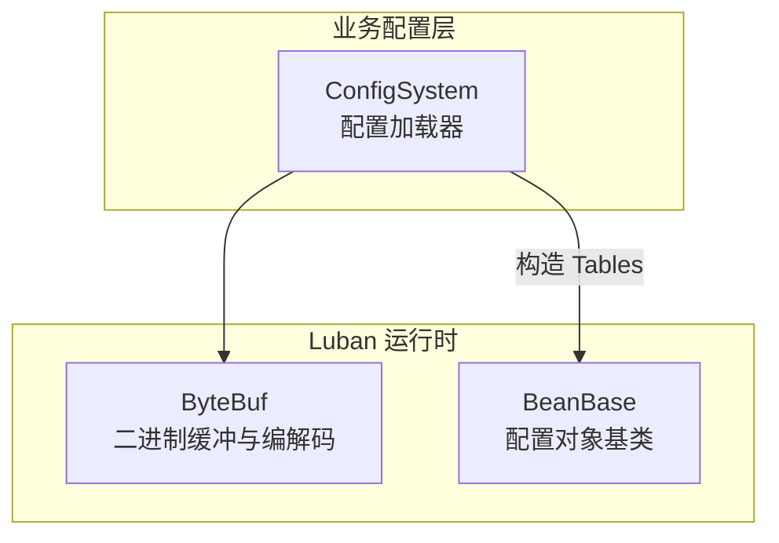
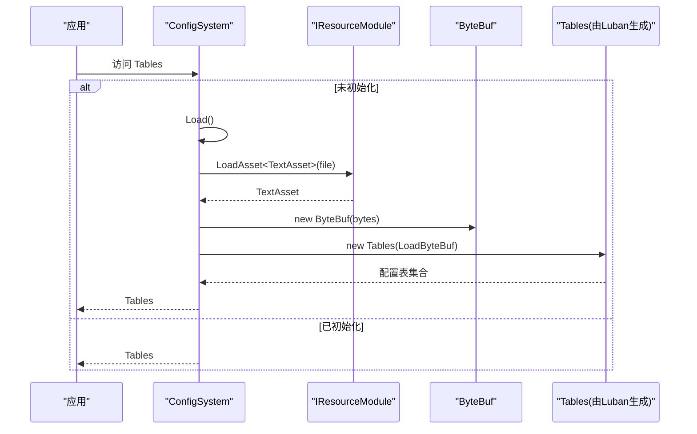
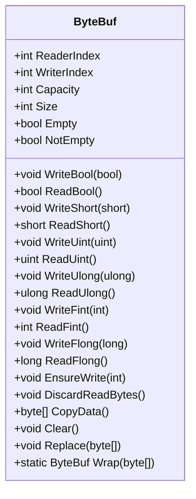
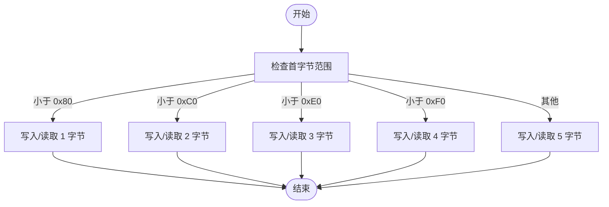
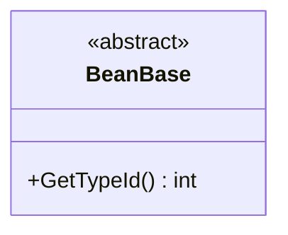
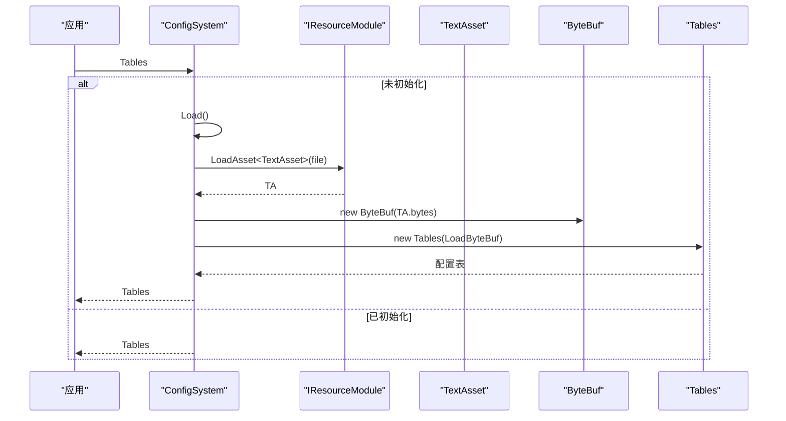
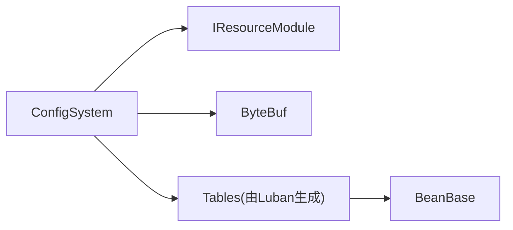

# 数据加载机制

<cite>
**本文引用的文件**   
- [ByteBuf.cs](file://UnityProject/Assets/GameScripts/HotFix/GameProto/LubanLib/ByteBuf.cs)
- [BeanBase.cs](file://UnityProject/Assets/GameScripts/HotFix/GameProto/LubanLib/BeanBase.cs)
- [ConfigSystem.cs](file://Configs/GameConfig/CustomTemplate/ConfigSystem.cs)
</cite>

## 目录
1. [简介](#简介)
2. [项目结构](#项目结构)
3. [核心组件](#核心组件)
4. [架构总览](#架构总览)
5. [详细组件分析](#详细组件分析)
6. [依赖关系分析](#依赖关系分析)
7. [性能考虑](#性能考虑)
8. [故障排查指南](#故障排查指南)
9. [结论](#结论)
10. [附录](#附录)

## 简介
本文件系统性阐述 TEngine 中配置数据的加载机制，重点覆盖：
- 二进制序列化格式与反序列化流程（基于 Luban）
- ByteBuf 的字节流读写、类型转换与内存管理实现原理
- BeanBase 基类在数据绑定中的作用
- 同步、异步、懒加载三种加载策略的实现方式与适用场景
- 预加载、缓存、内存池等性能优化技巧
- 错误处理与异常恢复方案

## 项目结构
围绕配置加载的关键代码位于以下位置：
- Luban 运行时库：ByteBuf、BeanBase
- 自定义配置系统：ConfigSystem（负责资源获取与表实例化）

图表来源
- [ByteBuf.cs:41-106](file://UnityProject/Assets/GameScripts/HotFix/GameProto/LubanLib/ByteBuf.cs#L41-L106)
- [BeanBase.cs:3-6](file://UnityProject/Assets/GameScripts/HotFix/GameProto/LubanLib/BeanBase.cs#L3-L6)
- [ConfigSystem.cs:9-57](file://Configs/GameConfig/CustomTemplate/ConfigSystem.cs#L9-L57)

章节来源
- [ByteBuf.cs:1-106](file://UnityProject/Assets/GameScripts/HotFix/GameProto/LubanLib/ByteBuf.cs#L1-L106)
- [BeanBase.cs:1-8](file://UnityProject/Assets/GameScripts/HotFix/GameProto/LubanLib/BeanBase.cs#L1-L8)
- [ConfigSystem.cs:1-58](file://Configs/GameConfig/CustomTemplate/ConfigSystem.cs#L1-L58)

## 核心组件
- ByteBuf：提供紧凑的二进制缓冲、变长整数编码、基础类型读写、内存扩容与复用能力。
- BeanBase：所有生成配置对象的抽象基类，要求子类声明自身类型 ID，便于按类型分发解析。
- ConfigSystem：对外暴露配置访问入口，封装资源模块调用，按需懒加载并返回已解析的配置表集合。

章节来源
- [ByteBuf.cs:10-26](file://UnityProject/Assets/GameScripts/HotFix/GameProto/LubanLib/ByteBuf.cs#L10-L26)
- [ByteBuf.cs:41-106](file://UnityProject/Assets/GameScripts/HotFix/GameProto/LubanLib/ByteBuf.cs#L41-L106)
- [BeanBase.cs:3-6](file://UnityProject/Assets/GameScripts/HotFix/GameProto/LubanLib/BeanBase.cs#L3-L6)
- [ConfigSystem.cs:9-57](file://Configs/GameConfig/CustomTemplate/ConfigSystem.cs#L9-L57)

## 架构总览
配置加载的整体流程如下：
- 业务侧通过 ConfigSystem.Tables 访问配置；首次访问触发懒加载。
- ConfigSystem 从资源模块加载二进制配置为 TextAsset，再包装为 ByteBuf。
- 使用 ByteBuf 对二进制数据进行高效反序列化，填充由 Luban 生成的配置对象（继承自 BeanBase）。
- 配置对象被缓存于 Tables 中供后续快速访问。

图表来源
- [ConfigSystem.cs:19-57](file://Configs/GameConfig/CustomTemplate/ConfigSystem.cs#L19-L57)
- [ByteBuf.cs:41-106](file://UnityProject/Assets/GameScripts/HotFix/GameProto/LubanLib/ByteBuf.cs#L41-L106)

## 详细组件分析

### ByteBuf：二进制缓冲与编解码
- 设计要点
  - 双指针模型：ReaderIndex/WriterIndex 控制读/写区间，支持零拷贝切片与复用。
  - 自动扩容：写入不足时按 2 倍增长策略扩容，必要时进行 compact 以回收前部空间。
  - 变长整数编码：uint/ulong 采用高位标记位的多段编码，小值更短，提升常见小整数的存储效率。
  - 安全校验：读取越界抛出 SerializationException，保证反序列化健壮性。
  - 平台优化：在允许非对齐访问的平台使用 unsafe 直接内存读写以提升性能。

- 关键能力
  - 基础类型读写：bool、byte、short、int、long、float/double 等。
  - 变长编码：WriteUint/ReadUint、WriteUlong/ReadUlong 及其 unsafe 版本。
  - 固定长度编码：WriteFint/ReadFint、WriteFlong/ReadFlong 等。
  - 缓冲区操作：CopyData、DiscardReadBytes、Clear、Replace、Wrap 等。
  - 容量管理：EnsureWrite/EnsureRead、PropSize、NotCompactWritable 等。

图表来源
- [ByteBuf.cs:41-106](file://UnityProject/Assets/GameScripts/HotFix/GameProto/LubanLib/ByteBuf.cs#L41-L106)
- [ByteBuf.cs:229-307](file://UnityProject/Assets/GameScripts/HotFix/GameProto/LubanLib/ByteBuf.cs#L229-L307)
- [ByteBuf.cs:347-445](file://UnityProject/Assets/GameScripts/HotFix/GameProto/LubanLib/ByteBuf.cs#L347-L445)
- [ByteBuf.cs:608-792](file://UnityProject/Assets/GameScripts/HotFix/GameProto/LubanLib/ByteBuf.cs#L608-L792)
- [ByteBuf.cs:545-584](file://UnityProject/Assets/GameScripts/HotFix/GameProto/LubanLib/ByteBuf.cs#L545-L584)

#### 变长整数编码流程图（uint）

图表来源
- [ByteBuf.cs:360-445](file://UnityProject/Assets/GameScripts/HotFix/GameProto/LubanLib/ByteBuf.cs#L360-L445)

章节来源
- [ByteBuf.cs:10-26](file://UnityProject/Assets/GameScripts/HotFix/GameProto/LubanLib/ByteBuf.cs#L10-L26)
- [ByteBuf.cs:41-106](file://UnityProject/Assets/GameScripts/HotFix/GameProto/LubanLib/ByteBuf.cs#L41-L106)
- [ByteBuf.cs:166-215](file://UnityProject/Assets/GameScripts/HotFix/GameProto/LubanLib/ByteBuf.cs#L166-L215)
- [ByteBuf.cs:229-307](file://UnityProject/Assets/GameScripts/HotFix/GameProto/LubanLib/ByteBuf.cs#L229-L307)
- [ByteBuf.cs:347-445](file://UnityProject/Assets/GameScripts/HotFix/GameProto/LubanLib/ByteBuf.cs#L347-L445)
- [ByteBuf.cs:608-792](file://UnityProject/Assets/GameScripts/HotFix/GameProto/LubanLib/ByteBuf.cs#L608-L792)
- [ByteBuf.cs:545-584](file://UnityProject/Assets/GameScripts/HotFix/GameProto/LubanLib/ByteBuf.cs#L545-L584)

### BeanBase：配置对象基类
- 作用
  - 统一所有生成配置对象的类型标识接口 GetTypeId，便于按类型分发解析与注册。
  - 作为所有配置实体的抽象基类，确保序列化框架能识别并正确构造对象。

图表来源
- [BeanBase.cs:3-6](file://UnityProject/Assets/GameScripts/HotFix/GameProto/LubanLib/BeanBase.cs#L3-L6)

章节来源
- [BeanBase.cs:1-8](file://UnityProject/Assets/GameScripts/HotFix/GameProto/LubanLib/BeanBase.cs#L1-L8)

### ConfigSystem：配置加载器
- 职责
  - 单例模式暴露 Tables 访问入口。
  - 懒加载：首次访问 Tables 时执行 Load。
  - 资源加载：通过 IResourceModule 加载 TextAsset，转换为 ByteBuf。
  - 表构建：将 ByteBuf 传入 Luban 生成的 Tables 构造函数完成反序列化。

图表来源
- [ConfigSystem.cs:19-57](file://Configs/GameConfig/CustomTemplate/ConfigSystem.cs#L19-L57)

章节来源
- [ConfigSystem.cs:9-57](file://Configs/GameConfig/CustomTemplate/ConfigSystem.cs#L9-L57)

## 依赖关系分析
- ConfigSystem 依赖 IResourceModule 获取资源，依赖 Luban 运行时（ByteBuf、BeanBase）完成数据解析。
- ByteBuf 是底层基础设施，不依赖上层业务逻辑，具备高内聚低耦合特性。
- BeanBase 仅定义类型标识接口，被生成代码广泛继承，形成稳定的扩展点。

图表来源
- [ConfigSystem.cs:32-57](file://Configs/GameConfig/CustomTemplate/ConfigSystem.cs#L32-L57)
- [ByteBuf.cs:41-106](file://UnityProject/Assets/GameScripts/HotFix/GameProto/LubanLib/ByteBuf.cs#L41-L106)
- [BeanBase.cs:3-6](file://UnityProject/Assets/GameScripts/HotFix/GameProto/LubanLib/BeanBase.cs#L3-L6)

章节来源
- [ConfigSystem.cs:1-58](file://Configs/GameConfig/CustomTemplate/ConfigSystem.cs#L1-L58)
- [ByteBuf.cs:1-106](file://UnityProject/Assets/GameScripts/HotFix/GameProto/LubanLib/ByteBuf.cs#L1-L106)
- [BeanBase.cs:1-8](file://UnityProject/Assets/GameScripts/HotFix/GameProto/LubanLib/BeanBase.cs#L1-L8)

## 性能考虑
- 预加载
  - 在游戏启动阶段提前调用 ConfigSystem.Load，避免首次访问时的 IO 与解析开销。
- 缓存策略
  - Tables 内部已缓存配置对象；可在业务层增加热点配置缓存（如字典），减少重复查找。
- 内存池使用
  - 复用 ByteBuf 实例（例如通过对象池）以减少分配与 GC 压力；注意每次使用前 Clear 或 Replace。
- 压缩与传输
  - 利用变长整数编码对小整数的天然压缩优势；在网络传输中优先发送小值字段。
- 批量与并行
  - 多表加载可并行化（IO 与 CPU 分离），但需注意线程安全与资源竞争。
- 平台优化
  - 在非对齐访问安全的平台启用 unsafe 路径以获得更高吞吐。

[本节为通用指导，不直接分析具体文件]

## 故障排查指南
- 读取越界
  - 现象：反序列化抛出 SerializationException。
  - 排查：确认二进制文件是否完整、版本是否匹配、ByteBuf 初始容量是否正确。
- 数据错位
  - 现象：数值异常或类型解析失败。
  - 排查：确认序列化端与反序列化端的编码规则一致（尤其是变长整数与大小端）。
- 资源加载失败
  - 现象：LoadAsset 返回空或异常。
  - 排查：检查 IResourceModule 配置、资源路径、包名与平台差异。
- 内存泄漏
  - 现象：长时间运行后内存持续增长。
  - 排查：确认 ByteBuf 是否被长期持有且未释放；避免循环引用；及时释放不再使用的配置对象。

章节来源
- [ByteBuf.cs:18-26](file://UnityProject/Assets/GameScripts/HotFix/GameProto/LubanLib/ByteBuf.cs#L18-L26)
- [ByteBuf.cs:208-215](file://UnityProject/Assets/GameScripts/HotFix/GameProto/LubanLib/ByteBuf.cs#L208-L215)
- [ConfigSystem.cs:48-57](file://Configs/GameConfig/CustomTemplate/ConfigSystem.cs#L48-L57)

## 结论
TEngine 的配置加载机制以 ByteBuf 为核心，结合 Luban 生成的配置对象与 ConfigSystem 的资源适配，实现了高效、可扩展的数据加载方案。通过懒加载、变长编码、内存复用与平台优化等手段，在保证功能完备的同时兼顾了性能与稳定性。建议在项目中结合业务特征选择合适的加载策略与缓存方案，并完善错误处理与监控，以获得更佳的用户体验。

[本节为总结性内容，不直接分析具体文件]

## 附录
- 加载策略对比
  - 同步加载：简单直接，适合小规模配置或初始化阶段。
  - 异步加载：不阻塞主线程，适合大文件或网络下载场景。
  - 懒加载：按需加载，降低冷启动成本，适合大型配置集。
- 最佳实践
  - 启动期预加载常用配置，游戏过程中按需懒加载其余配置。
  - 对频繁访问的配置建立二级缓存，缩短查询路径。
  - 使用对象池管理 ByteBuf，减少分配抖动。
  - 在热更新场景中，确保二进制版本与代码版本严格对应。

[本节为概念性内容，不直接分析具体文件]