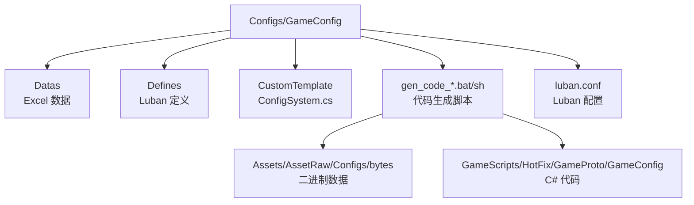
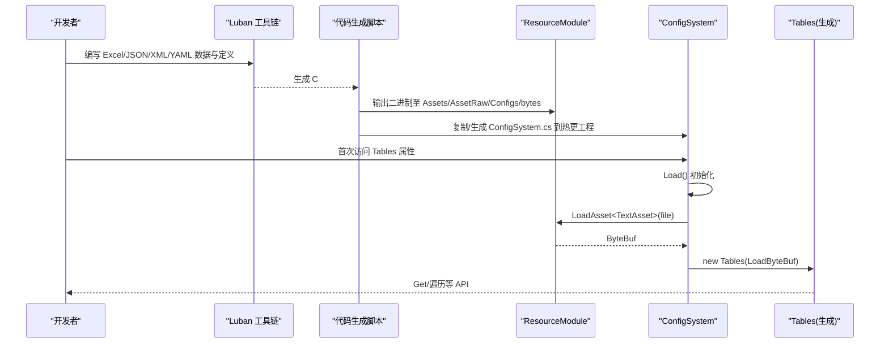
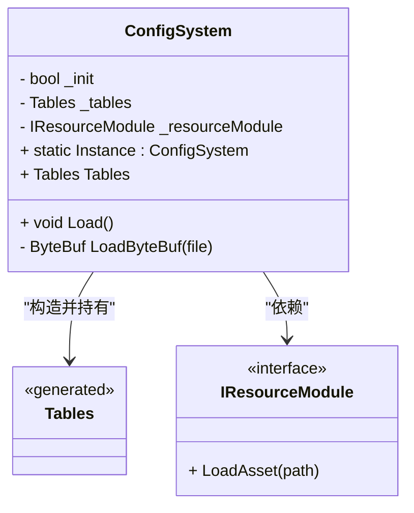
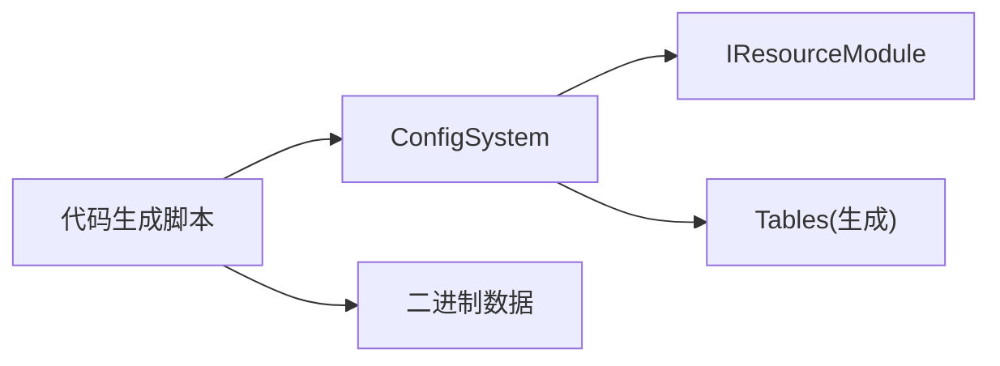

# 最佳实践指南

<cite>
**本文引用的文件**   
- [Books/3-6-配置表模块.md](file://Books/3-6-配置表模块.md)
- [Configs/GameConfig/luban.conf](file://Configs/GameConfig/luban.conf)
- [Configs/GameConfig/CustomTemplate/ConfigSystem.cs](file://Configs/GameConfig/CustomTemplate/ConfigSystem.cs)
- [UnityProject/.codex/skills/luban-dev/references/runtime.md](file://UnityProject/.codex/skills/luban-dev/references/runtime.md)
</cite>

## 目录
1. [引言](#引言)
2. [项目结构](#项目结构)
3. [核心组件](#核心组件)
4. [架构总览](#架构总览)
5. [详细组件分析](#详细组件分析)
6. [依赖关系分析](#依赖关系分析)
7. [性能优化与内存管理](#性能优化与内存管理)
8. [UI 集成模式](#ui-集成模式)
9. [调试与测试](#调试与测试)
10. [安全考虑](#安全考虑)
11. [常见问题与排错](#常见问题与排错)
12. [结论](#结论)

## 引言
本指南围绕 TEngine 的配置表系统（基于 Luban）总结开发、组织、版本控制、性能优化、UI 集成、调试测试与安全等方面的最佳实践。内容结合仓库中的文档与实现，提供可落地的规范与流程建议，帮助团队在大型项目中稳定高效地维护配置数据。

## 项目结构
TEngine 将配置表相关资源集中在 Configs/GameConfig 下，并通过脚本生成客户端与服务端代码及二进制数据：
- Datas：Excel 等原始数据
- Defines：Luban 定义与内置类型
- CustomTemplate：自定义模板（如 ConfigSystem.cs）
- gen_code_*：各平台/模式的代码生成脚本
- luban.conf：Luban 构建配置

图表来源
- [Configs/GameConfig/luban.conf:1-22](file://Configs/GameConfig/luban.conf#L1-L22)
- [Books/3-6-配置表模块.md:34-50](file://Books/3-6-配置表模块.md#L34-L50)

章节来源
- [Books/3-6-配置表模块.md:34-50](file://Books/3-6-配置表模块.md#L34-L50)

## 核心组件
- ConfigSystem：配置加载入口，负责懒加载/同步加载、通过 ResourceModule 读取二进制并构造 Tables。
- Tables：由 Luban 生成的配置表集合，提供按 Key 查询、遍历等能力。
- ResourceModule：资源模块，负责从资源路径加载 TextAsset 并提供字节流。
- Luban 工具链：根据 luban.conf 与 Excel/JSON/XML/YAML 等输入，生成 C# 代码与二进制数据。

章节来源
- [Configs/GameConfig/CustomTemplate/ConfigSystem.cs:1-58](file://Configs/GameConfig/CustomTemplate/ConfigSystem.cs#L1-L58)
- [Books/3-6-配置表模块.md:1-32](file://Books/3-6-配置表模块.md#L1-L32)

## 架构总览
下图展示配置表从定义到运行时访问的完整链路：

图表来源
- [Configs/GameConfig/CustomTemplate/ConfigSystem.cs:17-57](file://Configs/GameConfig/CustomTemplate/ConfigSystem.cs#L17-L57)
- [Books/3-6-配置表模块.md:46-50](file://Books/3-6-配置表模块.md#L46-L50)

## 详细组件分析

### ConfigSystem 组件
职责与行为要点：
- 单例访问：Instance 提供全局入口。
- 懒加载：首次访问 Tables 时触发 Load。
- 资源加载：通过 ModuleSystem.GetModule<IResourceModule>() 获取资源模块，使用 LoadAsset<TextAsset> 读取二进制。
- 构造 Tables：将字节缓冲交给 Luban 生成的 Tables 构造函数进行解析。

图表来源
- [Configs/GameConfig/CustomTemplate/ConfigSystem.cs:9-57](file://Configs/GameConfig/CustomTemplate/ConfigSystem.cs#L9-L57)

章节来源
- [Configs/GameConfig/CustomTemplate/ConfigSystem.cs:9-57](file://Configs/GameConfig/CustomTemplate/ConfigSystem.cs#L9-L57)

### Luban 配置与生成
- luban.conf 定义了分组（client/server/all）、Schema 文件位置、数据目录与目标产物。
- 生成脚本将 ConfigSystem.cs 复制到 Unity 热更工程，并将二进制数据输出到指定目录。

章节来源
- [Configs/GameConfig/luban.conf:1-22](file://Configs/GameConfig/luban.conf#L1-L22)
- [Books/3-6-配置表模块.md:69-78](file://Books/3-6-配置表模块.md#L69-L78)

## 依赖关系分析
- ConfigSystem 依赖 ResourceModule 以加载二进制；Tables 由 Luban 生成，依赖二进制数据。
- 生成脚本将模板文件复制到 Unity 工程，确保运行时代码与资源路径一致。
- 文档指出：ConfigSystem.Tables 首次访问会触发 Load，且依赖 ResourceModule 已初始化。

图表来源
- [Configs/GameConfig/CustomTemplate/ConfigSystem.cs:32-57](file://Configs/GameConfig/CustomTemplate/ConfigSystem.cs#L32-L57)
- [UnityProject/.codex/skills/luban-dev/references/runtime.md:6-11](file://UnityProject/.codex/skills/luban-dev/references/runtime.md#L6-L11)

章节来源
- [UnityProject/.codex/skills/luban-dev/references/runtime.md:6-11](file://UnityProject/.codex/skills/luban-dev/references/runtime.md#L6-L11)

## 性能优化与内存管理
- 优先使用懒加载：按需加载配置，减少启动时内存峰值与首屏耗时。
- 避免重复创建 Tables：通过单例与延迟初始化保证只解析一次。
- 合理组织数据：将大表拆分为多张细粒度表，降低单次解析体积。
- 复用 ByteBuf：避免频繁分配与拷贝，尽量复用底层缓冲。
- 关注资源卸载：当前模板调用 LoadAsset<TextAsset> 后未配对 UnloadAsset，属于已知集成限制，应在业务侧评估是否自行管理生命周期或等待框架改进。

章节来源
- [Books/3-6-配置表模块.md:9-13](file://Books/3-6-配置表模块.md#L9-L13)
- [Configs/GameConfig/CustomTemplate/ConfigSystem.cs:48-57](file://Configs/GameConfig/CustomTemplate/ConfigSystem.cs#L48-L57)
- [UnityProject/.codex/skills/luban-dev/references/runtime.md:11-11](file://UnityProject/.codex/skills/luban-dev/references/runtime.md#L11-L11)

## UI 集成模式
- 数据绑定：UI 层通过 ConfigSystem.Instance.Tables 获取具体表项，再绑定到控件显示。
- 实时更新：当配置变更（例如热更新下发新包）后，重新触发加载或增量刷新，通知 UI 刷新。
- 状态同步：UI 与逻辑层共享同一份 Tables 实例，避免不一致。

说明：本节为概念性指导，不直接分析具体源文件。

## 调试与测试
- 数据校验：利用 Luban 提供的 ref/path/range 等校验特性，在生成阶段发现错误。
- 单元测试：针对配置表管理器封装的查询方法编写用例，覆盖边界值与异常路径。
- 集成测试：模拟资源模块返回不同二进制数据，验证 ConfigSystem 的加载与解析流程。
- 本地化验证：检查静态/动态文本与时间本地化是否正确生效。

章节来源
- [Books/3-6-配置表模块.md:20-31](file://Books/3-6-配置表模块.md#L20-L31)
- [Books/3-6-配置表模块.md:177-189](file://Books/3-6-配置表模块.md#L177-L189)

## 安全考虑
- 数据校验：启用 ref/path/range 等校验，防止非法引用与越界数值。
- 权限控制：服务端侧对敏感配置进行访问控制与签名校验。
- 防篡改机制：对二进制数据进行完整性校验（如哈希/签名），客户端加载前验证。
- 最小暴露原则：仅暴露必要的查询接口，隐藏内部数据结构。

说明：本节为通用安全建议，不直接分析具体源文件。

## 常见问题与排错
- 问题：首次访问 Tables 时报资源模块未初始化。
  - 原因：ConfigSystem 依赖 ResourceModule 已就绪。
  - 处理：确保在访问 ConfigSystem.Tables 之前完成资源模块初始化。
- 问题：内存占用偏高。
  - 原因：一次性加载全部配置或未释放临时对象。
  - 处理：采用懒加载、拆分大表、避免重复解析，必要时自行管理资源释放。
- 问题：TextAsset 未释放导致内存泄漏。
  - 原因：当前模板调用 LoadAsset<TextAsset> 后未配对 UnloadAsset。
  - 处理：在业务侧评估是否需要手动释放，或等待框架修复该集成限制。

章节来源
- [UnityProject/.codex/skills/luban-dev/references/runtime.md:6-11](file://UnityProject/.codex/skills/luban-dev/references/runtime.md#L6-L11)
- [Configs/GameConfig/CustomTemplate/ConfigSystem.cs:48-57](file://Configs/GameConfig/CustomTemplate/ConfigSystem.cs#L48-L57)

## 结论
通过遵循懒加载、合理拆分数据、完善校验与本地化、以及规范的生成与发布流程，可以在 TEngine 中构建高性能、可维护、可扩展的配置表系统。对于已知的集成限制（如 TextAsset 未释放），建议在业务侧采取补偿措施并持续跟踪框架演进。