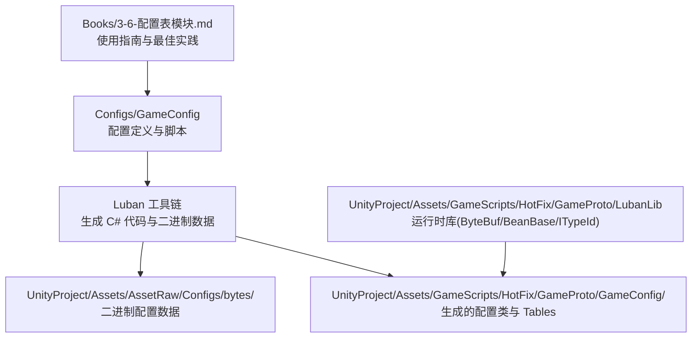
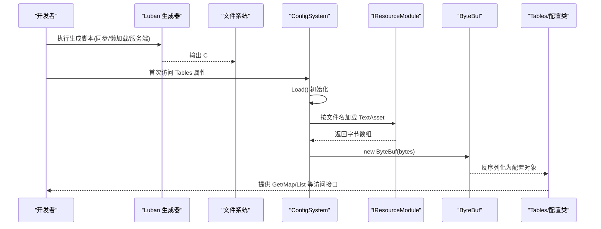
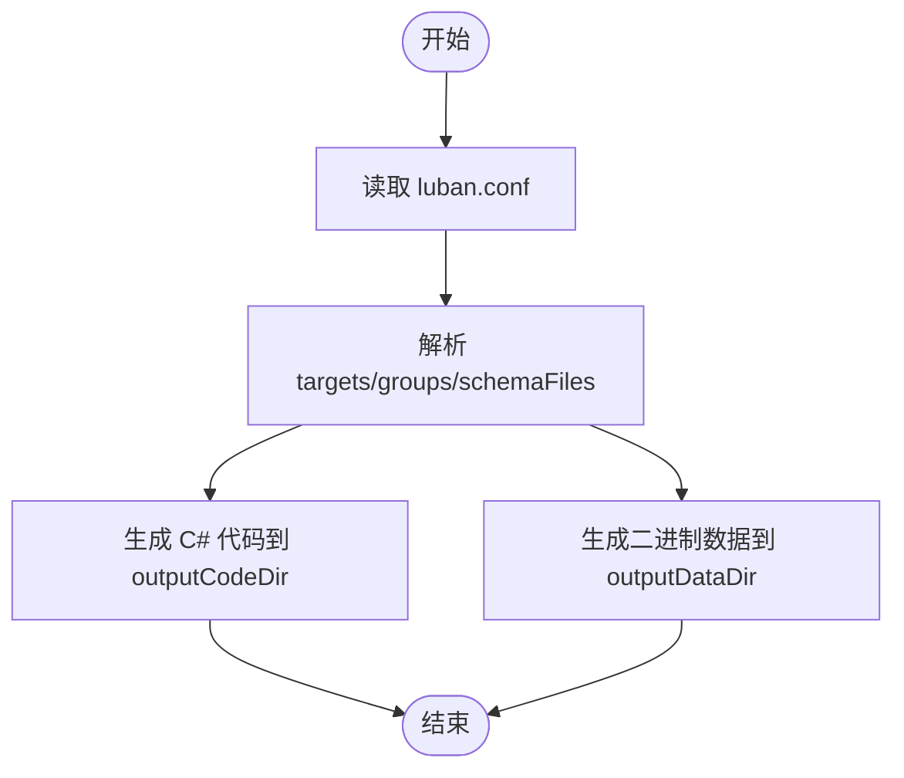
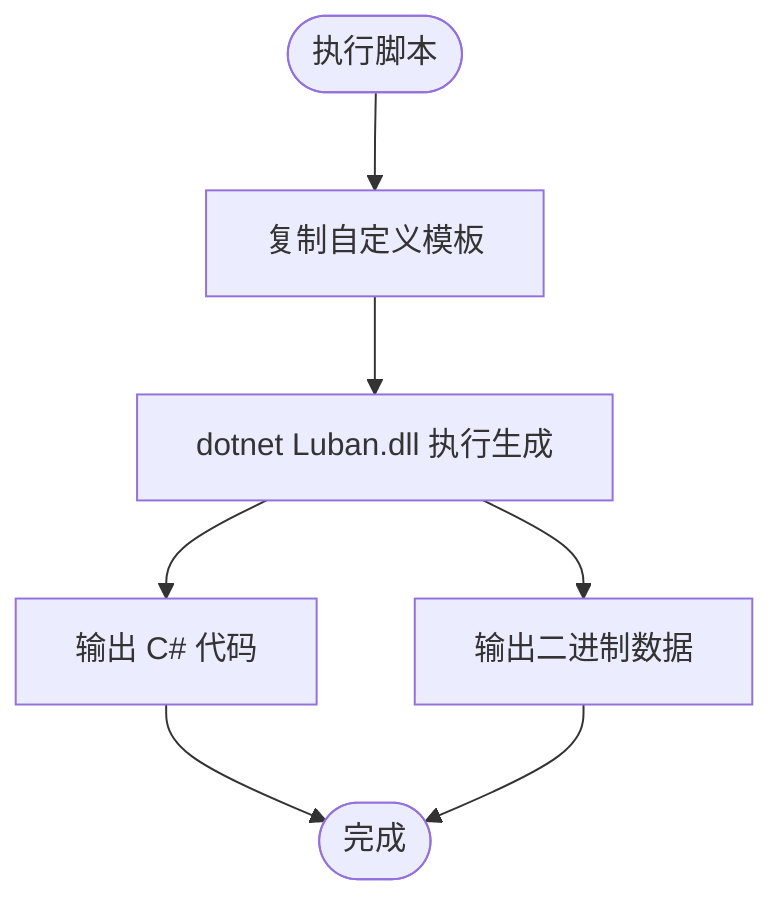
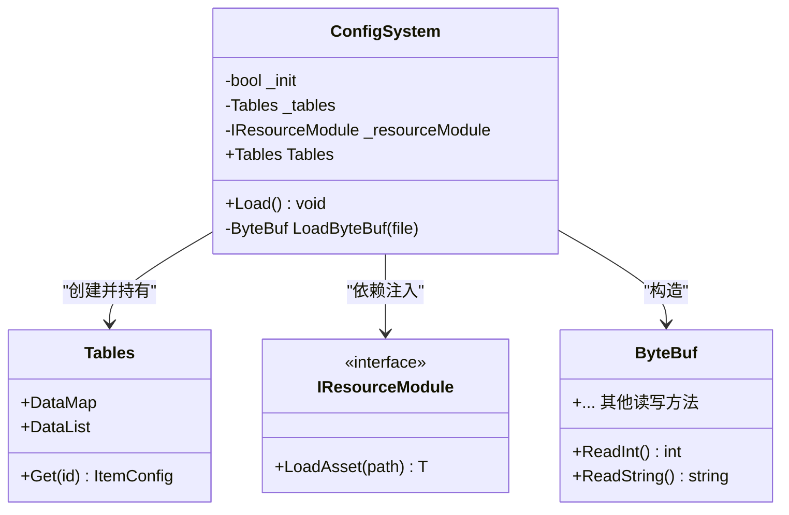
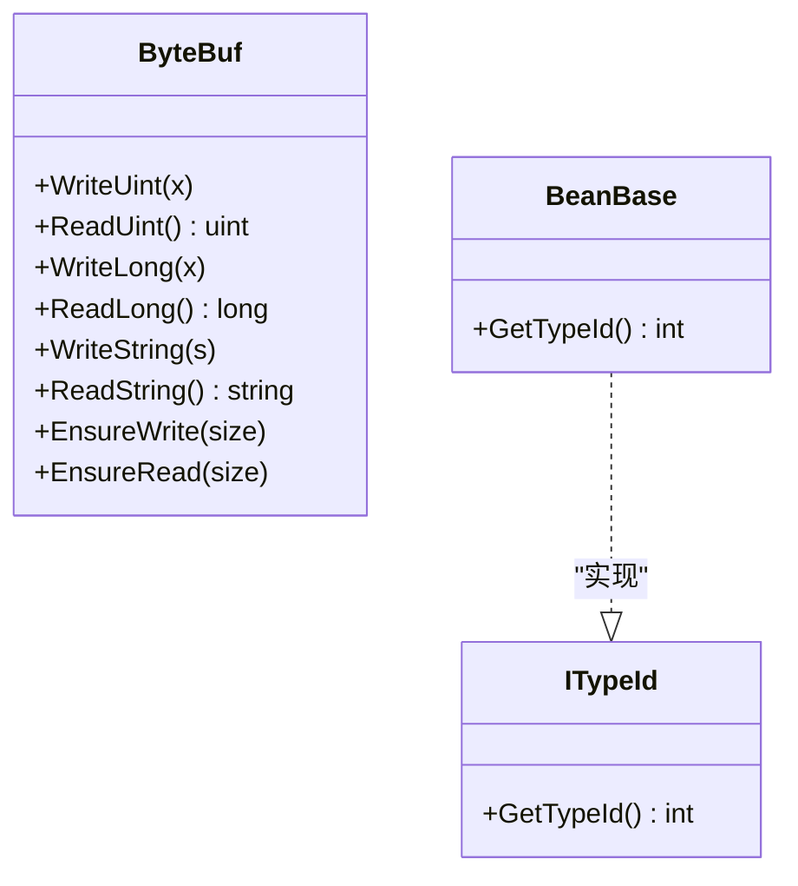
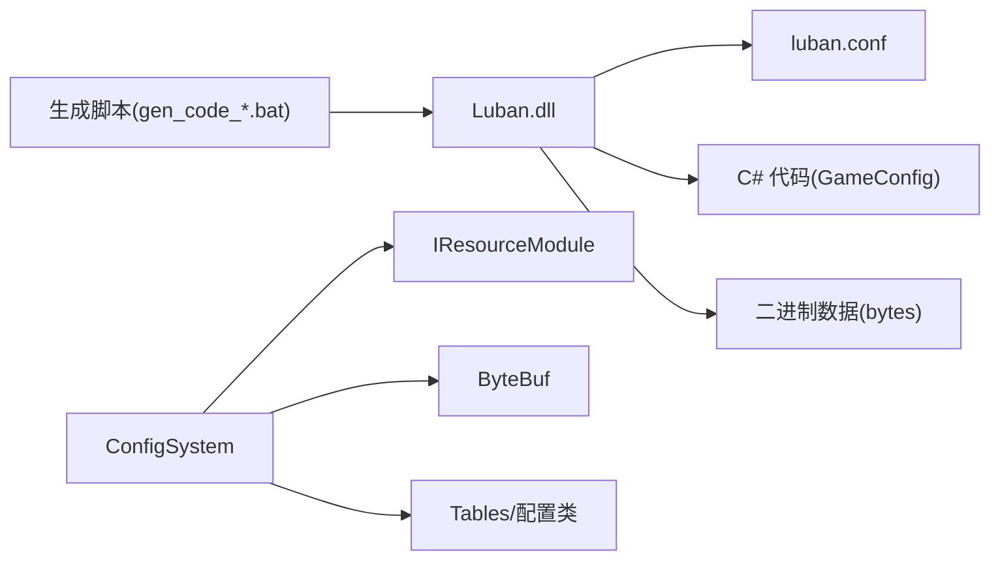

# 配置表系统

<cite>
**本文引用的文件**   
- [3-6-配置表模块.md](file://Books/3-6-配置表模块.md)
- [luban.conf](file://Configs/GameConfig/luban.conf)
- [gen_code_bin_to_project.bat](file://Configs/GameConfig/gen_code_bin_to_project.bat)
- [gen_code_bin_to_project_lazyload.bat](file://Configs/GameConfig/gen_code_bin_to_project_lazyload.bat)
- [gen_code_bin_to_server.bat](file://Configs/GameConfig/gen_code_bin_to_server.bat)
- [ConfigSystem.cs](file://Configs/GameConfig/CustomTemplate/ConfigSystem.cs)
- [ExternalTypeUtil.cs](file://Configs/GameConfig/CustomTemplate/ExternalTypeUtil.cs)
- [BeanBase.cs](file://UnityProject/Assets/GameScripts/HotFix/GameProto/LubanLib/BeanBase.cs)
- [ITypeId.cs](file://UnityProject/Assets/GameScripts/HotFix/GameProto/LubanLib/ITypeId.cs)
- [ByteBuf.cs](file://UnityProject/Assets/GameScripts/HotFix/GameProto/LubanLib/ByteBuf.cs)
</cite>

## 目录
1. [简介](#简介)
2. [项目结构](#项目结构)
3. [核心组件](#核心组件)
4. [架构总览](#架构总览)
5. [详细组件分析](#详细组件分析)
6. [依赖关系分析](#依赖关系分析)
7. [性能考量](#性能考量)
8. [故障排查指南](#故障排查指南)
9. [结论](#结论)
10. [附录](#附录)

## 简介
本文件系统性梳理 TEngine 中基于 Luban 的配置表解决方案，覆盖配置文件设计、代码生成流程、数据校验机制与加载策略（懒加载、异步加载、同步加载），并给出数据结构设计、类型定义、验证规则配置、最佳实践、调试优化与错误处理建议。同时说明配置表与业务逻辑的解耦设计与数据访问模式，帮助团队在大型项目中高效维护与扩展配置体系。

## 项目结构
TEngine 将配置表相关资源集中在以下位置：
- 配置定义与数据源：Configs/GameConfig/Datas（Excel 等）
- 生成脚本与模板：Configs/GameConfig/*.bat 与 CustomTemplate
- 运行时库：UnityProject/Assets/GameScripts/HotFix/GameProto/LubanLib
- 文档与示例：Books/3-6-配置表模块.md

图表来源
- [3-6-配置表模块.md:34-50](file://Books/3-6-配置表模块.md#L34-L50)
- [gen_code_bin_to_project.bat:1-23](file://Configs/GameConfig/gen_code_bin_to_project.bat#L1-L23)
- [gen_code_bin_to_project_lazyload.bat:1-24](file://Configs/GameConfig/gen_code_bin_to_project_lazyload.bat#L1-L24)
- [gen_code_bin_to_server.bat:1-20](file://Configs/GameConfig/gen_code_bin_to_server.bat#L1-L20)

章节来源
- [3-6-配置表模块.md:34-50](file://Books/3-6-配置表模块.md#L34-L50)

## 核心组件
- 配置定义与数据源
  - Excel 数据表：__tables__.xlsx、__beans__.xlsx、__enums__.xlsx、item.xlsx
  - 类型与枚举定义：Defines/builtin.xml
- 生成配置
  - 客户端同步/懒加载生成脚本
  - 服务端生成脚本
  - 统一配置入口：luban.conf
- 运行时库
  - ByteBuf：高性能二进制序列化/反序列化
  - BeanBase/ITypeId：基础 Bean 类型标识
- 配置加载器
  - ConfigSystem：单例、懒加载入口、通过 IResourceModule 加载二进制数据

章节来源
- [luban.conf:1-22](file://Configs/GameConfig/luban.conf#L1-L22)
- [gen_code_bin_to_project.bat:1-23](file://Configs/GameConfig/gen_code_bin_to_project.bat#L1-L23)
- [gen_code_bin_to_project_lazyload.bat:1-24](file://Configs/GameConfig/gen_code_bin_to_project_lazyload.bat#L1-L24)
- [gen_code_bin_to_server.bat:1-20](file://Configs/GameConfig/gen_code_bin_to_server.bat#L1-L20)
- [ConfigSystem.cs:1-58](file://Configs/GameConfig/CustomTemplate/ConfigSystem.cs#L1-L58)
- [ByteBuf.cs:1-800](file://UnityProject/Assets/GameScripts/HotFix/GameProto/LubanLib/ByteBuf.cs#L1-L800)
- [BeanBase.cs:1-8](file://UnityProject/Assets/GameScripts/HotFix/GameProto/LubanLib/BeanBase.cs#L1-L8)
- [ITypeId.cs:1-8](file://UnityProject/Assets/GameScripts/HotFix/GameProto/LubanLib/ITypeId.cs#L1-L8)

## 架构总览
下图展示从配置定义到运行期访问的整体链路：Excel 数据经 Luban 生成 C# 代码与二进制数据；运行时通过 ConfigSystem 按需加载二进制数据，并由 ByteBuf 解析为强类型对象供业务调用。

图表来源
- [gen_code_bin_to_project.bat:1-23](file://Configs/GameConfig/gen_code_bin_to_project.bat#L1-L23)
- [gen_code_bin_to_project_lazyload.bat:1-24](file://Configs/GameConfig/gen_code_bin_to_project_lazyload.bat#L1-L24)
- [gen_code_bin_to_server.bat:1-20](file://Configs/GameConfig/gen_code_bin_to_server.bat#L1-L20)
- [ConfigSystem.cs:1-58](file://Configs/GameConfig/CustomTemplate/ConfigSystem.cs#L1-L58)
- [ByteBuf.cs:1-800](file://UnityProject/Assets/GameScripts/HotFix/GameProto/LubanLib/ByteBuf.cs#L1-L800)

## 详细组件分析

### 配置定义与生成配置（Luban）
- 目标分组与产物
  - groups：c/s/e 分别对应客户端、服务端、枚举
  - targets：client/server/all 三种构建目标，指定 manager、topModule 与分组
- 数据源
  - schemaFiles：Defines、Datas/__tables__.xlsx、Datas/__beans__.xlsx、Datas/__enums__.xlsx
- 输出路径
  - outputCodeDir：C# 代码输出目录
  - outputDataDir：二进制数据输出目录

图表来源
- [luban.conf:1-22](file://Configs/GameConfig/luban.conf#L1-L22)

章节来源
- [luban.conf:1-22](file://Configs/GameConfig/luban.conf#L1-L22)

### 代码生成脚本
- 客户端同步生成：gen_code_bin_to_project.bat
  - 复制自定义模板至生成目录
  - 调用 Luban 生成 cs-bin 格式，输出代码与二进制
- 客户端懒加载生成：gen_code_bin_to_project_lazyload.bat
  - 额外参数 --customTemplateDir 指向懒加载模板
- 服务端生成：gen_code_bin_to_server.bat
  - 针对 Server 端输出代码与二进制

图表来源
- [gen_code_bin_to_project.bat:1-23](file://Configs/GameConfig/gen_code_bin_to_project.bat#L1-L23)
- [gen_code_bin_to_project_lazyload.bat:1-24](file://Configs/GameConfig/gen_code_bin_to_project_lazyload.bat#L1-L24)
- [gen_code_bin_to_server.bat:1-20](file://Configs/GameConfig/gen_code_bin_to_server.bat#L1-L20)

章节来源
- [gen_code_bin_to_project.bat:1-23](file://Configs/GameConfig/gen_code_bin_to_project.bat#L1-L23)
- [gen_code_bin_to_project_lazyload.bat:1-24](file://Configs/GameConfig/gen_code_bin_to_project_lazyload.bat#L1-L24)
- [gen_code_bin_to_server.bat:1-20](file://Configs/GameConfig/gen_code_bin_to_server.bat#L1-L20)

### 配置加载器（ConfigSystem）
- 单例与懒加载
  - 首次访问 Tables 属性时触发 Load()
- 二进制数据加载
  - 通过 IResourceModule.LoadAsset<TextAsset> 获取字节流
  - 封装为 ByteBuf 交由 Tables 反序列化
- 可插拔资源模块
  - 支持不同平台或打包方案下的资源加载实现

图表来源
- [ConfigSystem.cs:1-58](file://Configs/GameConfig/CustomTemplate/ConfigSystem.cs#L1-L58)
- [ByteBuf.cs:1-800](file://UnityProject/Assets/GameScripts/HotFix/GameProto/LubanLib/ByteBuf.cs#L1-L800)

章节来源
- [ConfigSystem.cs:1-58](file://Configs/GameConfig/CustomTemplate/ConfigSystem.cs#L1-L58)

### 运行时库（LubanLib）
- ByteBuf
  - 变长整型编码（VarInt）提升小数值存储效率
  - 提供 bool/byte/int/long/string 等读写 API
  - 内部容量自动扩容与内存复用
- BeanBase / ITypeId
  - 为复杂 Bean 提供类型标识，便于多态与序列化分发

图表来源
- [ByteBuf.cs:1-800](file://UnityProject/Assets/GameScripts/HotFix/GameProto/LubanLib/ByteBuf.cs#L1-L800)
- [BeanBase.cs:1-8](file://UnityProject/Assets/GameScripts/HotFix/GameProto/LubanLib/BeanBase.cs#L1-L8)
- [ITypeId.cs:1-8](file://UnityProject/Assets/GameScripts/HotFix/GameProto/LubanLib/ITypeId.cs#L1-L8)

章节来源
- [ByteBuf.cs:1-800](file://UnityProject/Assets/GameScripts/HotFix/GameProto/LubanLib/ByteBuf.cs#L1-L800)
- [BeanBase.cs:1-8](file://UnityProject/Assets/GameScripts/HotFix/GameProto/LubanLib/BeanBase.cs#L1-L8)
- [ITypeId.cs:1-8](file://UnityProject/Assets/GameScripts/HotFix/GameProto/LubanLib/ITypeId.cs#L1-L8)

### 外部类型适配（ExternalTypeUtil）
- 将 Luban 生成的 vector/vector2int/vector3int 等结构转换为 Unity 原生 Vector2/Vector3/Vector4/Vector2Int/Vector3Int
- 作为生成模板的一部分，使配置数据可直接用于渲染与物理计算

章节来源
- [ExternalTypeUtil.cs:1-29](file://Configs/GameConfig/CustomTemplate/ExternalTypeUtil.cs#L1-L29)

## 依赖关系分析
- 生成阶段
  - gen_code_*.bat 依赖 Tools/Luban/Luban.dll 与 Configs/GameConfig/luban.conf
  - 输出：C# 代码（GameConfig 命名空间）、二进制数据（AssetRaw/Configs/bytes）
- 运行阶段
  - ConfigSystem 依赖 IResourceModule 与 ByteBuf
  - 业务模块通过 ConfigSystem.Instance.Tables 访问配置

图表来源
- [gen_code_bin_to_project.bat:1-23](file://Configs/GameConfig/gen_code_bin_to_project.bat#L1-L23)
- [gen_code_bin_to_project_lazyload.bat:1-24](file://Configs/GameConfig/gen_code_bin_to_project_lazyload.bat#L1-L24)
- [gen_code_bin_to_server.bat:1-20](file://Configs/GameConfig/gen_code_bin_to_server.bat#L1-L20)
- [luban.conf:1-22](file://Configs/GameConfig/luban.conf#L1-L22)
- [ConfigSystem.cs:1-58](file://Configs/GameConfig/CustomTemplate/ConfigSystem.cs#L1-L58)
- [ByteBuf.cs:1-800](file://UnityProject/Assets/GameScripts/HotFix/GameProto/LubanLib/ByteBuf.cs#L1-L800)

章节来源
- [gen_code_bin_to_project.bat:1-23](file://Configs/GameConfig/gen_code_bin_to_project.bat#L1-L23)
- [gen_code_bin_to_project_lazyload.bat:1-24](file://Configs/GameConfig/gen_code_bin_to_project_lazyload.bat#L1-L24)
- [gen_code_bin_to_server.bat:1-20](file://Configs/GameConfig/gen_code_bin_to_server.bat#L1-L20)
- [luban.conf:1-22](file://Configs/GameConfig/luban.conf#L1-L22)
- [ConfigSystem.cs:1-58](file://Configs/GameConfig/CustomTemplate/ConfigSystem.cs#L1-L58)
- [ByteBuf.cs:1-800](file://UnityProject/Assets/GameScripts/HotFix/GameProto/LubanLib/ByteBuf.cs#L1-L800)

## 性能考量
- 懒加载优先
  - 仅在首次访问 Tables 时加载，减少启动开销与内存占用
- 二进制序列化
  - VarInt 编码对小整数更紧凑，降低 IO 与内存压力
- 资源加载
  - 通过 IResourceModule 抽象，可按平台选择合适加载方式（Addressables/YooAsset/本地文件）
- 批量访问
  - 对频繁查询的数据，优先使用 DataMap/DataList 避免重复查找

章节来源
- [3-6-配置表模块.md:9-13](file://Books/3-6-配置表模块.md#L9-L13)
- [ByteBuf.cs:1-800](file://UnityProject/Assets/GameScripts/HotFix/GameProto/LubanLib/ByteBuf.cs#L1-L800)

## 故障排查指南
- 生成失败
  - 检查 Tools/Luban/Luban.dll 是否存在且版本匹配
  - 确认 luban.conf 中 schemaFiles 与 dataDir 路径正确
  - 核对输出目录权限与路径长度
- 运行时加载失败
  - 确认二进制文件已生成至 outputDataDir 并被资源模块发现
  - 检查 IResourceModule 实现是否正确加载 TextAsset
  - 查看 ByteBuf 反序列化异常（如越界、类型不匹配）
- 数据校验问题
  - 使用 ref/path/range 等校验特性提前拦截非法数据
  - 在生成阶段开启严格校验，定位具体行与字段

章节来源
- [3-6-配置表模块.md:177-189](file://Books/3-6-配置表模块.md#L177-L189)
- [ConfigSystem.cs:37-57](file://Configs/GameConfig/CustomTemplate/ConfigSystem.cs#L37-L57)
- [ByteBuf.cs:1-800](file://UnityProject/Assets/GameScripts/HotFix/GameProto/LubanLib/ByteBuf.cs#L1-L800)

## 结论
TEngine 通过 Luban 实现了从配置定义、代码生成到运行期加载的完整闭环。借助懒加载、二进制序列化与可插拔资源模块，系统在易用性、性能与可扩展性之间取得良好平衡。配合完善的校验与本地化能力，可满足大型项目的配置管理与国际化需求。

## 附录

### 加载策略对比与适用场景
- 懒加载
  - 特点：首次访问才加载，节省内存与启动时间
  - 适用：大型项目、首屏仅需少量配置
- 异步加载
  - 特点：基于 UniTask 的异步加载，不阻塞主线程
  - 适用：需要并行下载与预热的场景
- 同步加载
  - 特点：一次性加载全部配置，简单直接
  - 适用：小型项目或启动阶段即可全量加载

章节来源
- [3-6-配置表模块.md:9-13](file://Books/3-6-配置表模块.md#L9-L13)

### 数据类型与验证规则
- 数据类型
  - 基础类型：int/long/string/bool 等
  - 复合类型：列表、子结构、嵌套结构
  - 外部类型：Vector2/Vector3/Vector4/Vector2Int/Vector3Int（通过 ExternalTypeUtil 转换）
- 验证规则
  - ref：跨表引用完整性检查
  - path：资源路径存在性检查
  - range：数值范围检查
  - 类型安全：编译期类型检查

章节来源
- [3-6-配置表模块.md:163-189](file://Books/3-6-配置表模块.md#L163-L189)
- [ExternalTypeUtil.cs:1-29](file://Configs/GameConfig/CustomTemplate/ExternalTypeUtil.cs#L1-L29)

### 开发最佳实践
- 命名规范
  - 表名以 Tb 前缀（如 TbItem），Bean 与 Enum 遵循 PascalCase
- 版本管理
  - 将 Excel 与生成代码纳入版本控制，发布前统一执行生成脚本
- 本地化支持
  - 静态文本值与动态文本值分离，结合 main-patch 多地区版本
- 数据访问模式
  - 为每个配置表建立管理器，封装 Get/Query 逻辑，屏蔽底层细节

章节来源
- [3-6-配置表模块.md:200-236](file://Books/3-6-配置表模块.md#L200-L236)