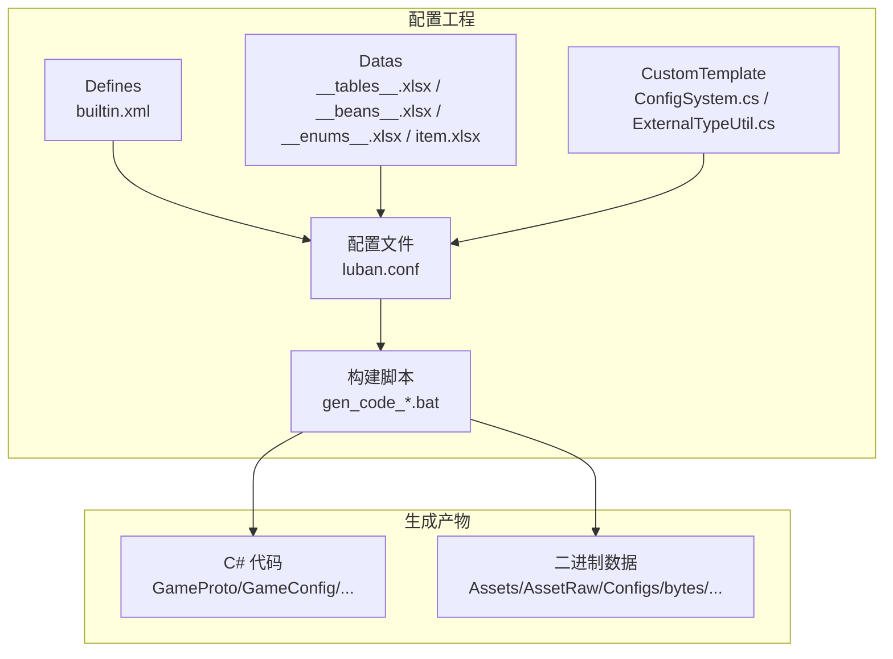
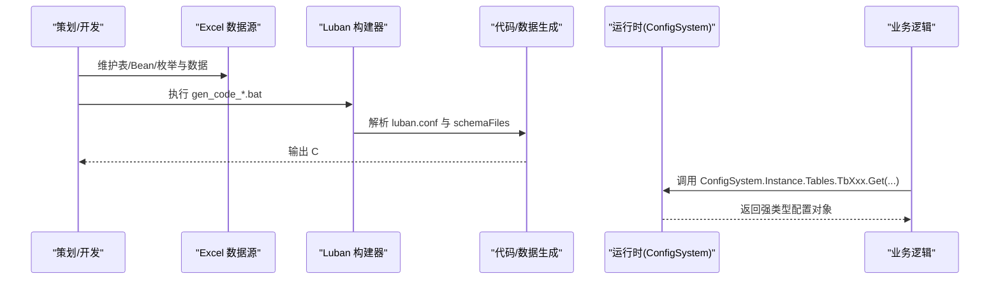
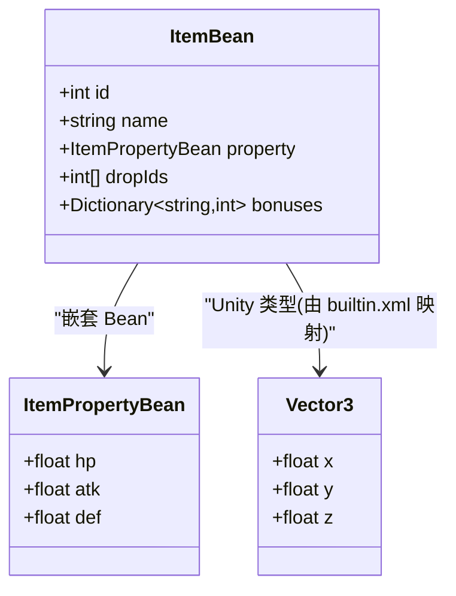
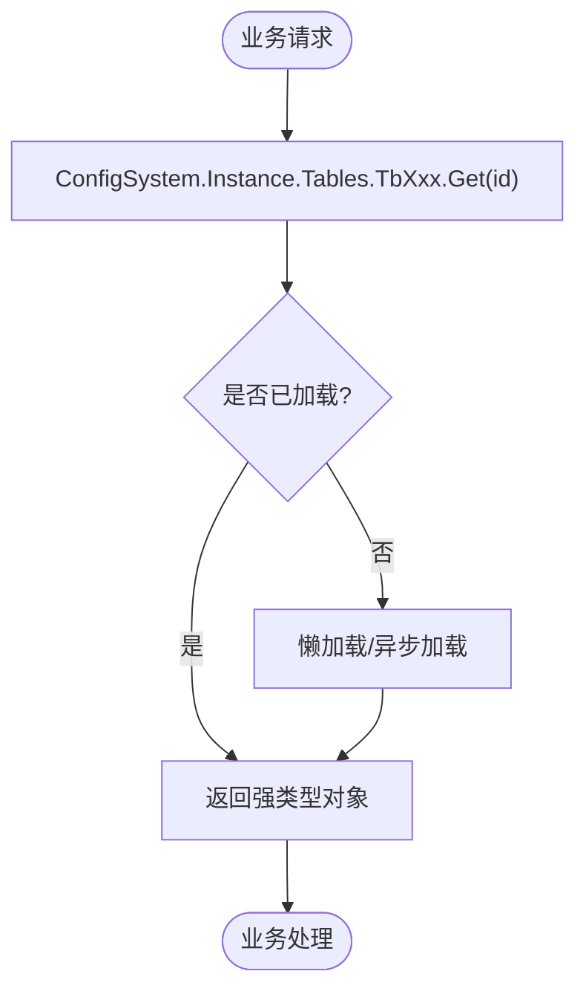
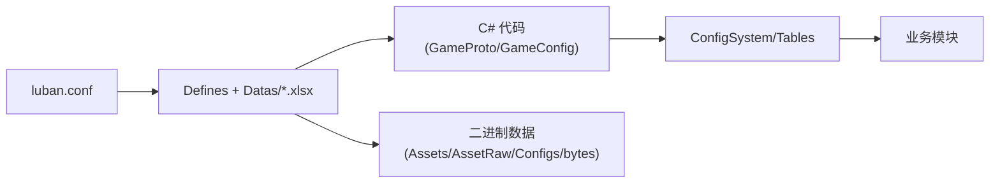

# 配置表设计

<cite>
**本文引用的文件**   
- [3-6-配置表模块.md](file://Books/3-6-配置表模块.md)
- [luban.conf](file://Configs/GameConfig/luban.conf)
- [builtin.xml](file://Configs/GameConfig/Defines/builtin.xml)
- [__tables__.xlsx](file://Configs/GameConfig/Datas/__tables__.xlsx)
- [__beans__.xlsx](file://Configs/GameConfig/Datas/__beans__.xlsx)
- [__enums__.xlsx](file://Configs/GameConfig/Datas/__enums__.xlsx)
- [item.xlsx](file://Configs/GameConfig/Datas/item.xlsx)
- [gen_code_bin_to_project.bat](file://Configs/GameConfig/gen_code_bin_to_project.bat)
- [gen_code_bin_to_project_lazyload.bat](file://Configs/GameConfig/gen_code_bin_to_project_lazyload.bat)
- [gen_code_bin_to_server.bat](file://Configs/GameConfig/gen_code_bin_to_server.bat)
- [ConfigSystem.cs](file://Configs/GameConfig/CustomTemplate/ConfigSystem.cs)
- [ExternalTypeUtil.cs](file://Configs/GameConfig/CustomTemplate/ExternalTypeUtil.cs)
</cite>

## 目录
1. [引言](#引言)
2. [项目结构](#项目结构)
3. [核心组件](#核心组件)
4. [架构总览](#架构总览)
5. [详细组件分析](#详细组件分析)
6. [依赖分析](#依赖分析)
7. [性能考虑](#性能考虑)
8. [故障排查指南](#故障排查指南)
9. [结论](#结论)
10. [附录](#附录)

## 引言
本文件面向 TEngine 项目中基于 Luban 的配置表体系，系统性阐述配置表的组织结构（表、Bean、枚举）、Excel 表格设计规范、复杂数据结构模式（嵌套对象、数组集合、字典映射）、版本管理与向后兼容策略，以及与业务逻辑解耦的设计原则。文档同时提供可视化架构图与流程图，帮助读者快速理解从 Excel 到运行时数据的全链路。

## 项目结构
TEngine 将配置表相关资源集中在 Configs/GameConfig 下，采用“定义 + 数据 + 模板 + 脚本”的分层组织：
- Defines：类型与内置 Bean 的定义（XML）
- Datas：Luban 的数据源（Excel），包含表清单、Bean 清单、枚举清单以及具体业务表
- CustomTemplate：自定义模板（如 ConfigSystem、外部类型工具）
- 生成脚本：针对不同目标（客户端同步/懒加载、服务器）的代码生成入口

图表来源
- [luban.conf:1-22](file://Configs/GameConfig/luban.conf#L1-L22)
- [builtin.xml:1-46](file://Configs/GameConfig/Defines/builtin.xml#L1-L46)
- [3-6-配置表模块.md:34-50](file://Books/3-6-配置表模块.md#L34-L50)

章节来源
- [3-6-配置表模块.md:34-50](file://Books/3-6-配置表模块.md#L34-L50)
- [luban.conf:1-22](file://Configs/GameConfig/luban.conf#L1-L22)

## 核心组件
- 配置系统入口：ConfigSystem（自定义模板），对外暴露 Tables 管理器，统一访问各表
- 外部类型工具：ExternalTypeUtil，为 Unity 类型（Vector2/3/4 等）提供构造桥接
- 类型定义：builtin.xml 中声明 vector2/vector3/vector4/vector2int/vector3int 等 Bean，并映射到 Unity 类型
- 数据源：Datas 下的 Excel 文件，分别承载表清单、Bean 清单、枚举清单与业务数据
- 构建配置：luban.conf 指定 schemaFiles、targets、groups、topModule 等关键参数
- 生成脚本：针对不同运行端（client/server）与加载模式（同步/懒加载）的批处理脚本

章节来源
- [ConfigSystem.cs:9-9](file://Configs/GameConfig/CustomTemplate/ConfigSystem.cs#L9-L9)
- [ExternalTypeUtil.cs:1-1](file://Configs/GameConfig/CustomTemplate/ExternalTypeUtil.cs#L1-L1)
- [builtin.xml:1-46](file://Configs/GameConfig/Defines/builtin.xml#L1-L46)
- [luban.conf:1-22](file://Configs/GameConfig/luban.conf#L1-L22)

## 架构总览
下图展示从 Excel 数据到运行时配置的完整流程：编辑 Excel → Luban 解析与校验 → 生成 C# 代码与二进制数据 → 运行时通过 ConfigSystem 访问。

图表来源
- [3-6-配置表模块.md:69-77](file://Books/3-6-配置表模块.md#L69-L77)
- [luban.conf:8-21](file://Configs/GameConfig/luban.conf#L8-L21)

## 详细组件分析

### 表、Bean、枚举的分类与使用场景
- 表（Table）：以行为单位的数据集合，通常用于可查询、可索引的配置项（如物品、关卡）。在 Datas 中以独立 xlsx 表示，并在 __tables__.xlsx 中注册。
- Bean：可复用的复合数据类型，用于表达结构化字段（如坐标、属性块）。在 Datas 中以独立 xlsx 表示，并在 __beans__.xlsx 中注册；也可在 builtin.xml 中预置 Unity 类型映射。
- 枚举（Enum）：离散取值集合，用于状态、类型标识等。在 Datas 中以独立 xlsx 表示，并在 __enums__.xlsx 中注册。

使用建议
- 表作为业务主数据入口，优先按 ID 索引；Bean 作为子结构复用；枚举用于约束取值范围与语义。
- 对跨表引用使用 ref 校验，对路径类字段使用 path 校验，对数值使用 range 校验。

章节来源
- [3-6-配置表模块.md:163-183](file://Books/3-6-配置表模块.md#L163-L183)
- [luban.conf:8-14](file://Configs/GameConfig/luban.conf#L8-L14)

### Excel 表格设计规范
- 命名规范
  - 表名：TbXxx（如 TbItem），对应生成的 Table 类
  - Bean 名：XxxBean（如 ItemPropertyBean），对应生成的 Bean 类
  - 枚举名：E_Xxx（如 E_ItemType），对应生成的 Enum 类型
  - 列名：小驼峰或下划线风格保持一致，避免特殊字符
- 数据类型映射
  - 基础类型：int、float、string、bool 等
  - 容器类型：List<T>、Dictionary<K,V>
  - 自定义类型：Bean、Enum、Unity 类型（通过 builtin.xml 映射）
- 必填标记
  - 在 Excel 中通过注释或约定列（如“是否必填”）标注；Luban 侧可通过校验规则（range/ref/path）保障完整性
- 示例说明
  - 业务表：item.xlsx 描述物品相关字段
  - 清单表：__tables__.xlsx 列出所有表及其键字段
  - Bean 清单：__beans__.xlsx 列出所有 Bean 及其字段
  - 枚举清单：__enums__.xlsx 列出所有枚举及取值

章节来源
- [item.xlsx:1-1](file://Configs/GameConfig/Datas/item.xlsx#L1-L1)
- [__tables__.xlsx:1-1](file://Configs/GameConfig/Datas/__tables__.xlsx#L1-L1)
- [__beans__.xlsx:1-1](file://Configs/GameConfig/Datas/__beans__.xlsx#L1-L1)
- [__enums__.xlsx:1-1](file://Configs/GameConfig/Datas/__enums__.xlsx#L1-L1)

### 复杂数据结构设计模式
- 嵌套对象（Bean 组合）
  - 在 Bean 中嵌入其他 Bean，形成层级结构，便于表达复杂实体（如角色属性、技能效果）
- 数组集合（List<T>）
  - 使用 List 表达有序集合（如掉落列表、奖励序列）
- 字典映射（Dictionary<K,V>）
  - 使用 Dictionary 表达键值映射（如语言包、条件开关）
- Unity 类型映射
  - 通过 builtin.xml 将 vector2/vector3/vector4 等映射到 UnityEngine 类型，并提供构造方法桥接

图表来源
- [builtin.xml:1-46](file://Configs/GameConfig/Defines/builtin.xml#L1-L46)

章节来源
- [builtin.xml:1-46](file://Configs/GameConfig/Defines/builtin.xml#L1-L46)

### 配置表版本管理与向后兼容
- 版本化策略
  - 通过 group/target 区分不同发布端（c/s/e），结合 topModule 隔离命名空间
  - 使用 main-patch 多地区版本支持差异化配置
- 向后兼容
  - 新增字段默认允许为空，旧客户端忽略未知字段
  - 变更字段时保留旧字段一段时间，逐步迁移
  - 使用 ref/path/range 校验提前发现不兼容数据
- 数据迁移
  - 在 Datas 中维护历史版本快照，配合生成脚本进行增量迁移
  - 对破坏性变更提供转换脚本或补丁表

章节来源
- [3-6-配置表模块.md:184-196](file://Books/3-6-配置表模块.md#L184-L196)
- [luban.conf:1-22](file://Configs/GameConfig/luban.conf#L1-L22)

### 与业务逻辑的解耦设计
- 数据抽象
  - 通过 Bean/Enum/Table 抽象业务概念，业务代码仅依赖生成的强类型
- 接口设计
  - 通过 ConfigSystem 暴露统一的 Tables 访问入口，屏蔽底层加载细节
- 依赖管理
  - 业务模块仅依赖 ConfigSystem 与生成的配置类，避免直接耦合 Excel/Luban
- 加载模式
  - 懒加载：按需加载，减少启动内存占用
  - 同步/异步：根据平台特性选择合适加载方式

图表来源
- [3-6-配置表模块.md:121-134](file://Books/3-6-配置表模块.md#L121-L134)

章节来源
- [3-6-配置表模块.md:121-134](file://Books/3-6-配置表模块.md#L121-L134)

### 实际配置表示例与设计模式应用
- 示例表：item.xlsx（物品配置）
  - 典型字段：id、name、type、property（Bean）、dropIds（List）、bonuses（Dictionary）
- 设计模式
  - 组合模式：ItemBean 组合 ItemPropertyBean
  - 策略模式：通过 Dictionary 表达不同加成策略
  - 适配器模式：ExternalTypeUtil 适配 Unity 类型构造

章节来源
- [item.xlsx:1-1](file://Configs/GameConfig/Datas/item.xlsx#L1-L1)
- [ExternalTypeUtil.cs:1-1](file://Configs/GameConfig/CustomTemplate/ExternalTypeUtil.cs#L1-L1)

## 依赖分析
- 构建配置依赖
  - luban.conf 声明 schemaFiles（Defines、Datas 下的三类 Excel）与 targets（server/client/all）
- 类型映射依赖
  - builtin.xml 将 vector2/vector3/vector4 等映射到 Unity 类型，并通过 ExternalTypeUtil 提供构造方法
- 生成产物依赖
  - 生成 C# 代码至 GameProto/GameConfig，供业务模块通过 ConfigSystem 访问

图表来源
- [luban.conf:8-21](file://Configs/GameConfig/luban.conf#L8-L21)
- [3-6-配置表模块.md:46-50](file://Books/3-6-配置表模块.md#L46-L50)

章节来源
- [luban.conf:8-21](file://Configs/GameConfig/luban.conf#L8-L21)
- [3-6-配置表模块.md:46-50](file://Books/3-6-配置表模块.md#L46-L50)

## 性能考虑
- 懒加载优先：大型项目推荐懒加载，按需加载配置，降低启动开销
- 批量访问优化：对频繁读取的表，可在业务层做缓存或聚合
- 序列化格式：二进制数据体积更小、解析更快，适合移动端
- 内存控制：避免一次性加载全部配置，结合资源模块按需卸载

[本节为通用指导，不涉及具体文件]

## 故障排查指南
- 常见错误
  - ref 校验失败：检查被引用表是否存在对应记录
  - path 校验失败：检查资源路径是否正确且存在
  - range 校验失败：检查数值是否在合法区间
  - 类型不匹配：检查 Excel 单元格类型与定义一致
- 定位步骤
  - 确认 luban.conf 的 schemaFiles 与 dataDir 配置正确
  - 检查 Datas 下 Excel 是否符合规范（表/Bean/枚举清单）
  - 重新执行对应生成脚本（client/server/懒加载）
  - 查看生成日志中的校验报错信息

章节来源
- [3-6-配置表模块.md:177-183](file://Books/3-6-配置表模块.md#L177-L183)
- [gen_code_bin_to_project.bat:1-1](file://Configs/GameConfig/gen_code_bin_to_project.bat#L1-L1)
- [gen_code_bin_to_project_lazyload.bat:1-1](file://Configs/GameConfig/gen_code_bin_to_project_lazyload.bat#L1-L1)
- [gen_code_bin_to_server.bat:1-1](file://Configs/GameConfig/gen_code_bin_to_server.bat#L1-L1)

## 结论
TEngine 的配置表体系以 Luban 为核心，通过清晰的表/Bean/枚举分层、严格的 Excel 规范与强大的校验能力，实现了高内聚、低耦合的配置管理。借助懒加载、本地化与多端生成能力，既能满足策划易用性，又能保证运行时性能与稳定性。建议在项目中坚持“数据驱动、类型安全、渐进演进”的原则，持续完善配置表设计与治理。

## 附录
- 常用命令
  - 客户端同步：执行 gen_code_bin_to_project.bat
  - 客户端懒加载：执行 gen_code_bin_to_project_lazyload.bat
  - 服务器端：执行 gen_code_bin_to_server.bat
- 参考文档
  - 配置表模块文档：Books/3-6-配置表模块.md
  - Luban 官方文档与仓库链接见文档末尾

章节来源
- [3-6-配置表模块.md:69-77](file://Books/3-6-配置表模块.md#L69-L77)
- [3-6-配置表模块.md:240-251](file://Books/3-6-配置表模块.md#L240-L251)