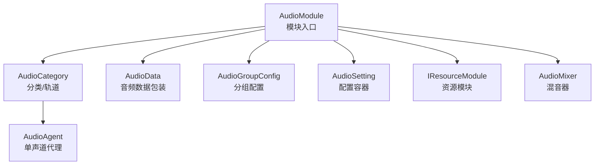
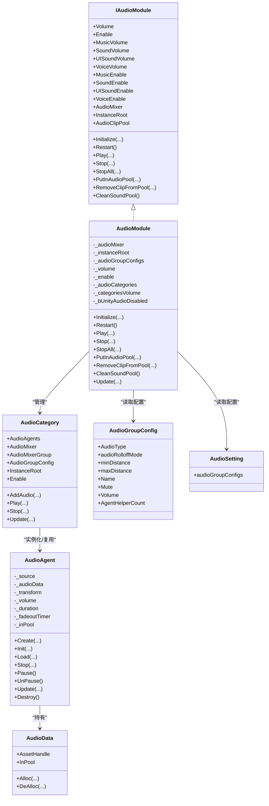
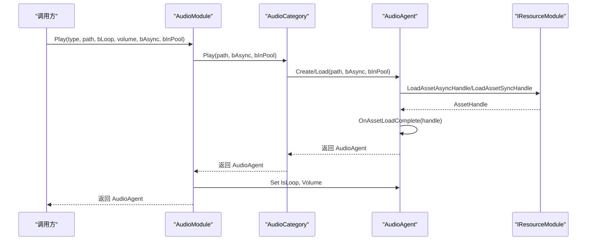
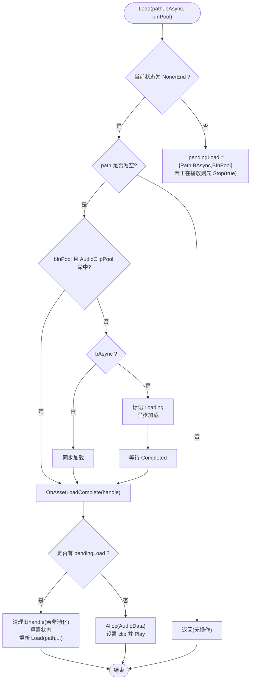
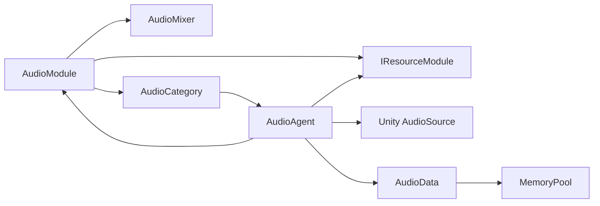

# 音频系统

<cite>
**本文引用的文件**   
- [AudioModule.cs](file://UnityProject/Assets/TEngine/Runtime/Module/AudioModule/AudioModule.cs)
- [IAudioModule.cs](file://UnityProject/Assets/TEngine/Runtime/Module/AudioModule/IAudioModule.cs)
- [AudioCategory.cs](file://UnityProject/Assets/TEngine/Runtime/Module/AudioModule/AudioCategory.cs)
- [AudioAgent.cs](file://UnityProject/Assets/TEngine/Runtime/Module/AudioModule/AudioAgent.cs)
- [AudioData.cs](file://UnityProject/Assets/TEngine/Runtime/Module/AudioModule/AudioData.cs)
- [AudioGroupConfig.cs](file://UnityProject/Assets/TEngine/Runtime/Module/AudioModule/AudioGroupConfig.cs)
- [AudioSetting.cs](file://UnityProject/Assets/TEngine/Runtime/Module/AudioModule/AudioSetting.cs)
</cite>

## 目录
1. [简介](#简介)
2. [项目结构](#项目结构)
3. [核心组件](#核心组件)
4. [架构总览](#架构总览)
5. [详细组件分析](#详细组件分析)
6. [依赖关系分析](#依赖关系分析)
7. [性能与内存优化](#性能与内存优化)
8. [使用指南](#使用指南)
9. [调试与监控](#调试与监控)
10. [跨平台适配最佳实践](#跨平台适配最佳实践)
11. [与资源管理、事件系统的集成](#与资源管理事件系统的集成)
12. [故障排查](#故障排查)
13. [结论](#结论)

## 简介
本章节概述 TEngine 音频系统的目标与设计思想。音频系统围绕 AudioModule 作为统一入口，通过分类（AudioCategory）管理多路声道，以 AudioAgent 封装单个 AudioSource 的生命周期与播放控制；借助 AudioMixer 实现分类音量与开关控制；结合 YooAsset 进行异步资源加载与对象池复用；并通过 IResourceModule 接入框架资源体系。系统支持音效、背景音乐、UI 音效、语音等多类音频的独立控制与统一管理，提供全局音量、分类音量、分类开关、渐出停止、预加载与缓存等能力。

## 项目结构
音频模块位于 Runtime/Module/AudioModule 下，核心文件包括：
- AudioModule.cs：模块入口、分类初始化、音量与开关控制、播放/停止、资源池管理、更新轮询
- IAudioModule.cs：对外暴露的音频模块接口
- AudioCategory.cs：按类型划分轨道，管理一组 AudioAgent
- AudioAgent.cs：单声道代理，封装 AudioSource 生命周期、加载、播放、暂停、渐出
- AudioData.cs：音频数据包装，配合内存池管理 AssetHandle
- AudioGroupConfig.cs：每类音频的配置（最大并发、衰减模式、距离范围、默认音量等）
- AudioSetting.cs：ScriptableObject 配置容器，承载 AudioGroupConfig[]

图表来源
- [AudioModule.cs:11-396](file://UnityProject/Assets/TEngine/Runtime/Module/AudioModule/AudioModule.cs#L11-L396)
- [AudioCategory.cs:12-100](file://UnityProject/Assets/TEngine/Runtime/Module/AudioModule/AudioCategory.cs#L12-L100)
- [AudioAgent.cs:11-233](file://UnityProject/Assets/TEngine/Runtime/Module/AudioModule/AudioAgent.cs#L11-L233)
- [AudioData.cs:8-66](file://UnityProject/Assets/TEngine/Runtime/Module/AudioModule/AudioData.cs#L8-L66)
- [AudioGroupConfig.cs:11-69](file://UnityProject/Assets/TEngine/Runtime/Module/AudioModule/AudioGroupConfig.cs#L11-L69)
- [AudioSetting.cs:5-9](file://UnityProject/Assets/TEngine/Runtime/Module/AudioModule/AudioSetting.cs#L5-L9)

章节来源
- [AudioModule.cs:11-396](file://UnityProject/Assets/TEngine/Runtime/Module/AudioModule/AudioModule.cs#L11-L396)
- [AudioCategory.cs:12-100](file://UnityProject/Assets/TEngine/Runtime/Module/AudioModule/AudioCategory.cs#L12-L100)
- [AudioAgent.cs:11-233](file://UnityProject/Assets/TEngine/Runtime/Module/AudioModule/AudioAgent.cs#L11-L233)
- [AudioData.cs:8-66](file://UnityProject/Assets/TEngine/Runtime/Module/AudioModule/AudioData.cs#L8-L66)
- [AudioGroupConfig.cs:11-69](file://UnityProject/Assets/TEngine/Runtime/Module/AudioModule/AudioGroupConfig.cs#L11-L69)
- [AudioSetting.cs:5-9](file://UnityProject/Assets/TEngine/Runtime/Module/AudioModule/AudioSetting.cs#L5-L9)

## 核心组件
- AudioModule：模块生命周期、分类初始化、全局/分类音量与开关、播放/停止、资源池管理、Update 轮询
- IAudioModule：对外 API 契约，包含音量、开关、播放、停止、资源池等方法
- AudioCategory：按 AudioType 划分的轨道，维护固定数量的 AudioAgent，负责空闲通道选择与批量停止
- AudioAgent：封装 AudioSource，处理异步/同步加载、循环、音量、位置、暂停/恢复、渐出停止、状态机
- AudioData：对 AssetHandle 的轻量包装，配合 MemoryPool 减少分配
- AudioGroupConfig：每类音频的配置项（名称、静音、音量、并发数、衰减模式、距离范围）
- AudioSetting：ScriptableObject 配置载体，持有 AudioGroupConfig[]

章节来源
- [IAudioModule.cs:8-127](file://UnityProject/Assets/TEngine/Runtime/Module/AudioModule/IAudioModule.cs#L8-L127)
- [AudioModule.cs:11-571](file://UnityProject/Assets/TEngine/Runtime/Module/AudioModule/AudioModule.cs#L11-L571)
- [AudioCategory.cs:12-196](file://UnityProject/Assets/TEngine/Runtime/Module/AudioModule/AudioCategory.cs#L12-L196)
- [AudioAgent.cs:11-432](file://UnityProject/Assets/TEngine/Runtime/Module/AudioModule/AudioAgent.cs#L11-L432)
- [AudioData.cs:8-66](file://UnityProject/Assets/TEngine/Runtime/Module/AudioModule/AudioData.cs#L8-L66)
- [AudioGroupConfig.cs:11-69](file://UnityProject/Assets/TEngine/Runtime/Module/AudioModule/AudioGroupConfig.cs#L11-L69)
- [AudioSetting.cs:5-9](file://UnityProject/Assets/TEngine/Runtime/Module/AudioModule/AudioSetting.cs#L5-L9)

## 架构总览
音频系统采用“模块-分类-代理”三层结构：
- 模块层（AudioModule）：负责初始化、全局控制、分类聚合、资源池管理、更新调度
- 分类层（AudioCategory）：按类型隔离，维护固定数量声道，决定复用策略
- 代理层（AudioAgent）：封装具体播放行为，管理 AudioSource 与资源句柄

图表来源
- [IAudioModule.cs:8-127](file://UnityProject/Assets/TEngine/Runtime/Module/AudioModule/IAudioModule.cs#L8-L127)
- [AudioModule.cs:11-571](file://UnityProject/Assets/TEngine/Runtime/Module/AudioModule/AudioModule.cs#L11-L571)
- [AudioCategory.cs:12-196](file://UnityProject/Assets/TEngine/Runtime/Module/AudioModule/AudioCategory.cs#L12-L196)
- [AudioAgent.cs:11-432](file://UnityProject/Assets/TEngine/Runtime/Module/AudioModule/AudioAgent.cs#L11-L432)
- [AudioData.cs:8-66](file://UnityProject/Assets/TEngine/Runtime/Module/AudioModule/AudioData.cs#L8-L66)
- [AudioGroupConfig.cs:11-69](file://UnityProject/Assets/TEngine/Runtime/Module/AudioModule/AudioGroupConfig.cs#L11-L69)
- [AudioSetting.cs:5-9](file://UnityProject/Assets/TEngine/Runtime/Module/AudioModule/AudioSetting.cs#L5-L9)

## 详细组件分析

### AudioModule 模块
职责与要点：
- 初始化：从 Settings.AudioSetting 获取 AudioGroupConfig[]，创建各分类 AudioCategory，绑定 AudioMixer 与 InstanceRoot
- 音量与开关：通过 AudioMixer.SetFloat 设置分贝值，同时维护 _categoriesVolume 缓存；全局 Enable/Volume 直接操作 AudioListener
- 分类控制：Music/Sound/UISound/Voice 四类独立开关与音量
- 播放控制：根据类型分发到对应 AudioCategory.Play，并设置 IsLoop 与 Volume
- 停止控制：按类型或全部停止，支持 fadeout
- 资源池：提供 PutInAudioPool/RemoveClipFromPool/CleanSoundPool 管理 AudioClip 的 AssetHandle
- 更新轮询：调用各分类 Update，进而驱动 AudioAgent.Update

关键流程（播放）：

图表来源
- [AudioModule.cs:441-458](file://UnityProject/Assets/TEngine/Runtime/Module/AudioModule/AudioModule.cs#L441-L458)
- [AudioCategory.cs:122-164](file://UnityProject/Assets/TEngine/Runtime/Module/AudioModule/AudioCategory.cs#L122-L164)
- [AudioAgent.cs:198-277](file://UnityProject/Assets/TEngine/Runtime/Module/AudioModule/AudioAgent.cs#L198-L277)
- [AudioAgent.cs:326-375](file://UnityProject/Assets/TEngine/Runtime/Module/AudioModule/AudioAgent.cs#L326-L375)

章节来源
- [AudioModule.cs:322-430](file://UnityProject/Assets/TEngine/Runtime/Module/AudioModule/AudioModule.cs#L322-L430)
- [AudioModule.cs:441-571](file://UnityProject/Assets/TEngine/Runtime/Module/AudioModule/AudioModule.cs#L441-L571)

### AudioCategory 分类/轨道
职责与要点：
- 构造时根据 AudioGroupConfig 查找 AudioMixerGroup，创建固定数量的 AudioAgent
- 播放策略：优先复用空闲通道；若无空闲则复用“已播放最久”的通道（基于 Duration），实现“超过最大发声数时 fadeout 复用”
- 批量停止：遍历所有 Agent 调用 Stop(fadeout)
- 更新：逐 Agent 调用 Update

章节来源
- [AudioCategory.cs:74-100](file://UnityProject/Assets/TEngine/Runtime/Module/AudioModule/AudioCategory.cs#L74-L100)
- [AudioCategory.cs:122-196](file://UnityProject/Assets/TEngine/Runtime/Module/AudioModule/AudioCategory.cs#L122-L196)

### AudioAgent 音频代理
职责与要点：
- 生命周期：Create -> Init -> Load -> Playing/FadingOut/End -> Destroy
- 加载：支持异步/同步；若启用池化则优先从 AudioClipPool 取 AssetHandle
- 播放：OnAssetLoadComplete 中设置 clip 并 Play，记录时长与状态
- 控制：Stop(fadeout)、Pause、UnPause、IsLoop、Volume、Position
- 状态机：Playing、FadingOut、End 等状态在 Update 中推进，渐出期间线性降低音量后停止

图表来源
- [AudioAgent.cs:241-277](file://UnityProject/Assets/TEngine/Runtime/Module/AudioModule/AudioAgent.cs#L241-L277)
- [AudioAgent.cs:326-375](file://UnityProject/Assets/TEngine/Runtime/Module/AudioModule/AudioAgent.cs#L326-L375)

章节来源
- [AudioAgent.cs:198-432](file://UnityProject/Assets/TEngine/Runtime/Module/AudioModule/AudioAgent.cs#L198-L432)

### AudioData 音频数据包装
职责与要点：
- 包装 AssetHandle，标记 InPool 以区分是否由外部池管理
- 通过 MemoryPool 分配/回收，避免频繁 GC
- RecycleToPool 中仅在非池化管理时释放 AssetHandle

章节来源
- [AudioData.cs:8-66](file://UnityProject/Assets/TEngine/Runtime/Module/AudioModule/AudioData.cs#L8-L66)

### AudioGroupConfig 分组配置
职责与要点：
- 定义每类音频的名称、静音、默认音量、并发数（AgentHelperCount）
- 3D 声音衰减模式与距离范围（minDistance/maxDistance）
- 与 AudioMixer 的分类名保持一致以便匹配

章节来源
- [AudioGroupConfig.cs:11-69](file://UnityProject/Assets/TEngine/Runtime/Module/AudioModule/AudioGroupConfig.cs#L11-L69)

### AudioSetting 配置容器
职责与要点：
- ScriptableObject 类型，用于编辑器配置 AudioGroupConfig[]
- 被 AudioModule.OnInit 读取并传入 Initialize

章节来源
- [AudioSetting.cs:5-9](file://UnityProject/Assets/TEngine/Runtime/Module/AudioModule/AudioSetting.cs#L5-L9)

## 依赖关系分析
- AudioModule 依赖：
  - IResourceModule：通过 ModuleSystem.GetModule 获取，用于异步/同步加载 AudioClip
  - AudioMixer：通过 Resources.Load 或外部注入，用于分类音量与开关
  - AudioCategory：按 AudioType 构建多个实例
  - AudioSetting：从 Settings 读取 AudioGroupConfig[]
- AudioCategory 依赖：
  - AudioAgent：创建与管理固定数量实例
  - AudioMixer/AudioMixerGroup：定位对应分组
- AudioAgent 依赖：
  - IResourceModule：加载 AudioClip
  - IAudioModule：访问 AudioClipPool
  - Unity AudioSource：实际播放
- AudioData 依赖：
  - MemoryPool：对象池分配/回收
  - YooAsset AssetHandle：资源句柄

图表来源
- [AudioModule.cs:320-396](file://UnityProject/Assets/TEngine/Runtime/Module/AudioModule/AudioModule.cs#L320-L396)
- [AudioCategory.cs:74-100](file://UnityProject/Assets/TEngine/Runtime/Module/AudioModule/AudioCategory.cs#L74-L100)
- [AudioAgent.cs:211-233](file://UnityProject/Assets/TEngine/Runtime/Module/AudioModule/AudioAgent.cs#L211-L233)
- [AudioData.cs:44-66](file://UnityProject/Assets/TEngine/Runtime/Module/AudioModule/AudioData.cs#L44-L66)

章节来源
- [AudioModule.cs:320-396](file://UnityProject/Assets/TEngine/Runtime/Module/AudioModule/AudioModule.cs#L320-L396)
- [AudioCategory.cs:74-100](file://UnityProject/Assets/TEngine/Runtime/Module/AudioModule/AudioCategory.cs#L74-L100)
- [AudioAgent.cs:211-233](file://UnityProject/Assets/TEngine/Runtime/Module/AudioModule/AudioAgent.cs#L211-L233)
- [AudioData.cs:44-66](file://UnityProject/Assets/TEngine/Runtime/Module/AudioModule/AudioData.cs#L44-L66)

## 性能与内存优化
- 并发控制与复用：
  - 每个分类维护固定数量的 AudioAgent，超过并发上限时复用“已播放最久”的通道，避免无限增长
- 资源池：
  - AudioClipPool 缓存 AssetHandle，减少重复加载开销；支持 PutInAudioPool/RemoveClipFromPool/CleanSoundPool
- 内存池：
  - AudioData 通过 MemoryPool 分配/回收，降低 GC 压力
- 异步加载：
  - 默认支持异步加载，避免主线程阻塞；必要时可同步加载
- 音量控制：
  - 使用 AudioMixer.SetFloat 以分贝控制，避免频繁修改 AudioSource.volume
- 3D 音频参数：
  - 通过 AudioGroupConfig 统一设置 rolloff 模式与距离范围，便于调优空间音效

[本节为通用指导，不直接分析具体文件]

## 使用指南
- 初始化：
  - 准备 AudioSetting（ScriptableObject），填写 AudioGroupConfig[]
  - 在模块 OnInit 中调用 Initialize(audioGroupConfigs, instanceRoot?, audioMixer?)
- 播放音效/音乐：
  - 调用 Play(type, path, bLoop=false, volume=1.0f, bAsync=false, bInPool=false)
  - 返回 AudioAgent，可进一步设置 IsLoop、Volume、Position
- 停止：
  - 按类型停止：Stop(type, fadeout=false)
  - 全部停止：StopAll(fadeout=false)
- 音量与开关：
  - 全局：Volume、Enable
  - 分类：MusicVolume/SoundVolume/UISoundVolume/VoiceVolume 与 MusicEnable/SoundEnable/UISoundEnable/VoiceEnable
- 预加载与缓存：
  - PutInAudioPool(list) 预加载常用音效
  - RemoveClipFromPool(list)/CleanSoundPool() 释放缓存

章节来源
- [AudioModule.cs:322-430](file://UnityProject/Assets/TEngine/Runtime/Module/AudioModule/AudioModule.cs#L322-L430)
- [AudioModule.cs:441-571](file://UnityProject/Assets/TEngine/Runtime/Module/AudioModule/AudioModule.cs#L441-L571)
- [IAudioModule.cs:8-127](file://UnityProject/Assets/TEngine/Runtime/Module/AudioModule/IAudioModule.cs#L8-L127)

## 调试与监控
- 运行时状态：
  - AudioAgent.IsFree、IsPlaying、Duration、Length 可用于统计与调试
- 日志输出：
  - 当无可用通道时会输出错误日志，便于排查并发不足问题
- 更新回调：
  - AudioModule.Update(elapseSeconds, realElapseSeconds) 会驱动各分类与代理的 Update，可在上层逻辑中观察帧耗时

章节来源
- [AudioCategory.cs:122-164](file://UnityProject/Assets/TEngine/Runtime/Module/AudioModule/AudioCategory.cs#L122-L164)
- [AudioAgent.cs:93-179](file://UnityProject/Assets/TEngine/Runtime/Module/AudioModule/AudioAgent.cs#L93-L179)
- [AudioModule.cs:560-569](file://UnityProject/Assets/TEngine/Runtime/Module/AudioModule/AudioModule.cs#L560-L569)

## 跨平台适配最佳实践
- Unity 音频禁用检测：
  - 在编辑器环境下通过反射检测 AudioSettings.unityAudioDisabled，若为真则跳过音频相关逻辑，避免异常
- 版本兼容：
  - 针对 Unity 6000+ 使用 EntityId，否则使用 int InstanceID，保证兼容性
- 资源路径：
  - 确保 AudioClip 路径在不同平台一致，或通过资源管理器统一映射

章节来源
- [AudioModule.cs:362-377](file://UnityProject/Assets/TEngine/Runtime/Module/AudioModule/AudioModule.cs#L362-L377)
- [AudioAgent.cs:13-17](file://UnityProject/Assets/TEngine/Runtime/Module/AudioModule/AudioAgent.cs#L13-L17)
- [AudioAgent.cs:228-232](file://UnityProject/Assets/TEngine/Runtime/Module/AudioModule/AudioAgent.cs#L228-L232)

## 与资源管理、事件系统的集成
- 资源管理：
  - 通过 IResourceModule 的 LoadAssetAsyncHandle/LoadAssetSyncHandle 加载 AudioClip
  - 将 AssetHandle 交由 AudioData 管理，并在合适时机 Dispose
- 事件系统：
  - 本音频模块未直接使用事件系统；如需扩展，可在 AudioAgent 完成加载或播放结束时触发自定义事件（例如 Completed、Error）
- 本地化：
  - 可通过 LocalizeTarget_UnityStandard_AudioSource 对 AudioSource 文本进行本地化（与本音频模块解耦）

章节来源
- [AudioModule.cs:499-553](file://UnityProject/Assets/TEngine/Runtime/Module/AudioModule/AudioModule.cs#L499-L553)
- [AudioAgent.cs:241-277](file://UnityProject/Assets/TEngine/Runtime/Module/AudioModule/AudioAgent.cs#L241-L277)
- [AudioData.cs:44-66](file://UnityProject/Assets/TEngine/Runtime/Module/AudioModule/AudioData.cs#L44-L66)

## 故障排查
- 无可用通道：
  - 现象：日志提示无通道可播放
  - 解决：增大对应分类的 AgentHelperCount，或减少并发播放数量
- 音频无声：
  - 检查全局 Enable/Volume 与分类 Music/Sound/UISound/Voice 的 Enable/Volume
  - 确认 AudioMixer 分组名称与配置一致
- 内存泄漏：
  - 检查是否正确调用 CleanSoundPool 或 RemoveClipFromPool
  - 确认 AudioData.InPool 标志正确，避免重复释放
- 平台差异：
  - 确认 Unity 音频未被禁用（编辑器环境）
  - 检查资源路径在不同平台的可用性

章节来源
- [AudioCategory.cs:122-164](file://UnityProject/Assets/TEngine/Runtime/Module/AudioModule/AudioCategory.cs#L122-L164)
- [AudioModule.cs:441-571](file://UnityProject/Assets/TEngine/Runtime/Module/AudioModule/AudioModule.cs#L441-L571)
- [AudioData.cs:20-36](file://UnityProject/Assets/TEngine/Runtime/Module/AudioModule/AudioData.cs#L20-L36)

## 结论
TEngine 音频系统以 AudioModule 为核心，通过分类与代理分层管理，结合 AudioMixer 与 YooAsset 实现了高性能、可扩展的音频播放方案。其设计兼顾了易用性与性能，提供了丰富的控制能力与资源管理机制，适合在复杂游戏场景中稳定运行。建议在实际项目中合理配置并发数、启用异步加载与资源池，并结合场景需求扩展事件与监控能力。