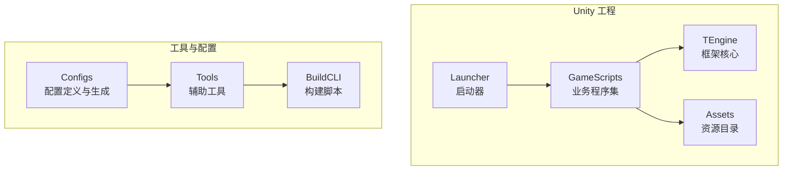
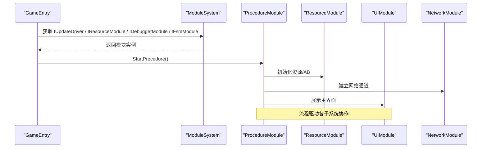
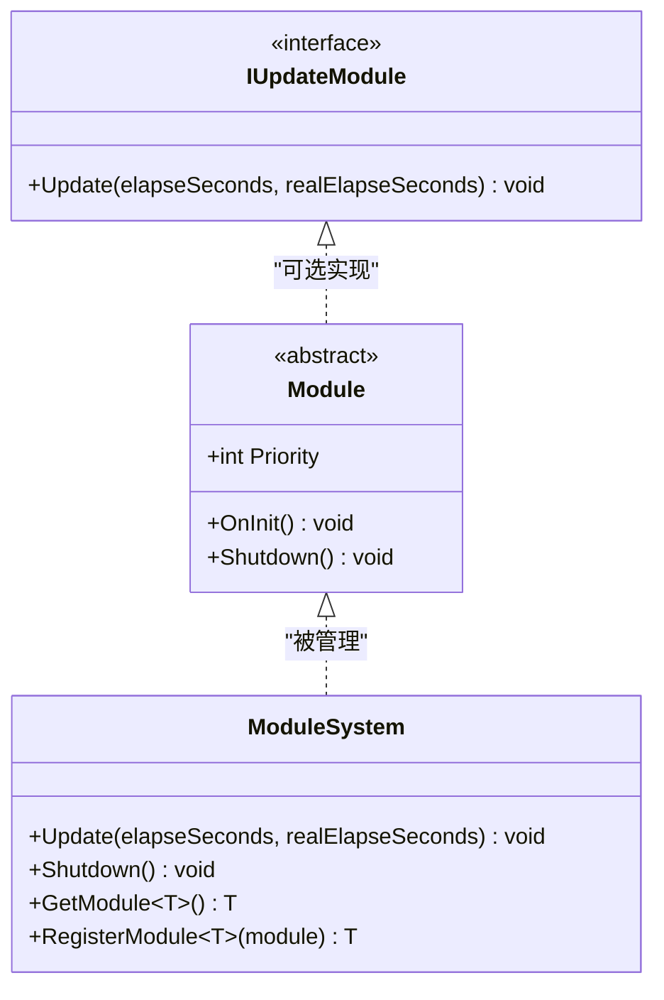
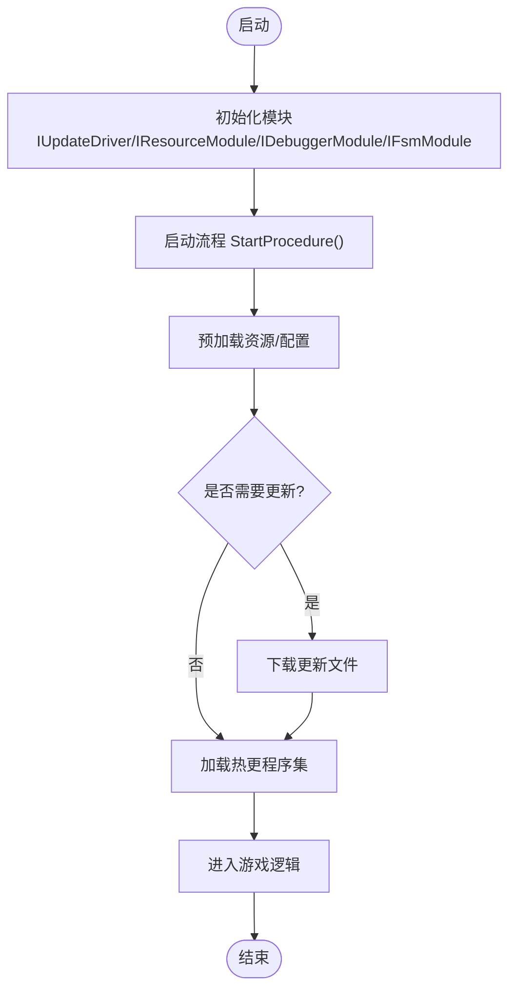
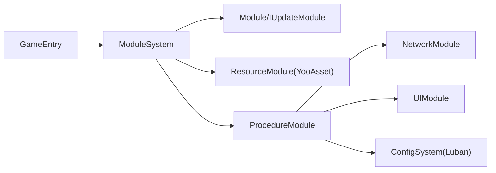

# 项目概述

<cite>
**本文引用的文件**   
- [README.md](file://README.md)
- [Books/0-介绍.md](file://Books/0-介绍.md)
- [Books/1-快速开始.md](file://Books/1-快速开始.md)
- [Books/2-框架概览.md](file://Books/2-框架概览.md)
- [UnityProject/Assets/GameScripts/GameEntry.cs](file://UnityProject/Assets/GameScripts/GameEntry.cs)
- [UnityProject/Assets/TEngine/Runtime/Core/ModuleSystem.cs](file://UnityProject/Assets/TEngine/Runtime/Core/ModuleSystem.cs)
- [UnityProject/Assets/TEngine/Runtime/Core/Module.cs](file://UnityProject/Assets/TEngine/Runtime/Core/Module.cs)
</cite>

## 目录
1. [简介](#简介)
2. [项目结构](#项目结构)
3. [核心组件](#核心组件)
4. [架构总览](#架构总览)
5. [详细组件分析](#详细组件分析)
6. [依赖关系分析](#依赖关系分析)
7. [性能与内存特性](#性能与内存特性)
8. [系统要求与支持平台](#系统要求与支持平台)
9. [快速开始指南](#快速开始指南)
10. [故障排查要点](#故障排查要点)
11. [结论](#结论)

## 简介
TEngine 是一套面向 Unity 的商业级全平台游戏框架解决方案，强调“开箱即用、高性能、模块化、热更新”的核心价值。它通过集成 YooAsset、HybridCLR、Luban、UniTask 等成熟技术栈，提供资源管理、事件分发、UI 框架、配置表、流程控制、网络通信等完整能力，帮助团队快速搭建可维护、可扩展、可热更的客户端工程。

- 核心价值
  - 开箱即用：标准化的启动流程与工具链，缩短上手时间
  - 高性能：基于 UniTask 的异步体系与零 GC 事件分发
  - 高内聚低耦合：模块化解耦，便于替换与裁剪
  - 热更新：HybridCLR 全平台热更新流程已打通
  - 资源管理：YooAsset 驱动，LRU/ARC 缓存策略与自动释放
  - 配置表：Luban 生成代码，支持懒加载/异步/同步加载
  - UI 框架：商业化开发流程，支持代码自动生成
  - 全平台：Windows、macOS、Android、iOS、WebGL、微信小游戏

- 技术栈选择与决策
  - Unity：跨平台引擎底座
  - HybridCLR：原生 C# 热更新方案，覆盖多平台
  - YooAsset：百万 DAU 验证的资源管理与 AB 构建
  - Luban：配置表生成与校验，提升数据质量与效率
  - UniTask：零 GC 异步任务，提升运行时性能

章节来源
- [README.md:20-33](file://README.md#L20-L33)
- [Books/0-介绍.md:19-54](file://Books/0-介绍.md#L19-L54)

## 项目结构
整体采用“引擎 + 框架 + 业务”的分层组织方式：
- UnityProject/Assets/TEngine：框架核心（Editor 与 Runtime）
- UnityProject/Assets/GameScripts：业务程序集（Main 与 HotFix）
- UnityProject/Assets/Launcher：启动器与引导界面
- UnityProject/Assets/AssetRaw/AssetArt：资源目录（热更与静态资源）
- Configs/Tools/BuildCLI：配置生成与构建脚本

图示来源
- [README.md:173-199](file://README.md#L173-L199)
- [Books/1-快速开始.md:34-61](file://Books/1-快速开始.md#L34-L61)

章节来源
- [README.md:173-199](file://README.md#L173-L199)
- [Books/1-快速开始.md:34-61](file://Books/1-快速开始.md#L34-L61)

## 核心组件
- 模块系统（ModuleSystem）
  - 负责模块注册、生命周期管理、按优先级轮询执行
  - 提供统一入口获取模块实例，支持接口访问
- 模块抽象（Module/IUpdateModule）
  - 定义模块初始化、关闭与 Update 轮询契约
- 启动入口（GameEntry）
  - 在 Awake 中初始化关键模块并启动流程

章节来源
- [UnityProject/Assets/TEngine/Runtime/Core/ModuleSystem.cs:1-208](file://UnityProject/Assets/TEngine/Runtime/Core/ModuleSystem.cs#L1-L208)
- [UnityProject/Assets/TEngine/Runtime/Core/Module.cs:1-40](file://UnityProject/Assets/TEngine/Runtime/Core/Module.cs#L1-L40)
- [UnityProject/Assets/GameScripts/GameEntry.cs:1-15](file://UnityProject/Assets/GameScripts/GameEntry.cs#L1-L15)

## 架构总览
TEngine 以“模块系统”为中枢，向上暴露统一的 GameModule 访问点，向下对接资源、事件、UI、配置、流程、网络等子系统。启动时由 GameEntry 触发，依次初始化更新驱动、资源模块、调试模块、FSM 模块，随后进入 Procedure 流程完成热更、资源准备与游戏启动。

图示来源
- [UnityProject/Assets/GameScripts/GameEntry.cs:6-13](file://UnityProject/Assets/GameScripts/GameEntry.cs#L6-L13)
- [Books/2-框架概览.md:105-112](file://Books/2-框架概览.md#L105-L112)

## 详细组件分析

### 模块系统与生命周期
- ModuleSystem
  - 维护模块映射与更新队列，按优先级排序执行 Update
  - 提供 GetModule<T>() 与 RegisterModule<T>() 两种注册/获取方式
  - Shutdown 时统一清理模块、内存池与缓存
- Module/IUpdateModule
  - 定义 OnInit/Shutdown 与 Update 接口，规范模块行为

图示来源
- [UnityProject/Assets/TEngine/Runtime/Core/Module.cs:1-40](file://UnityProject/Assets/TEngine/Runtime/Core/Module.cs#L1-L40)
- [UnityProject/Assets/TEngine/Runtime/Core/ModuleSystem.cs:1-208](file://UnityProject/Assets/TEngine/Runtime/Core/ModuleSystem.cs#L1-L208)

章节来源
- [UnityProject/Assets/TEngine/Runtime/Core/ModuleSystem.cs:1-208](file://UnityProject/Assets/TEngine/Runtime/Core/ModuleSystem.cs#L1-L208)
- [UnityProject/Assets/TEngine/Runtime/Core/Module.cs:1-40](file://UnityProject/Assets/TEngine/Runtime/Core/Module.cs#L1-L40)

### 启动流程与流程模块
- GameEntry
  - 在 Awake 中初始化关键模块并调用流程启动
- ProcedureModule
  - 提供从启动到进入游戏的全链路流程，如初始化包体、预加载、版本检查、下载、清理缓存、加载程序集、启动游戏等

图示来源
- [UnityProject/Assets/GameScripts/GameEntry.cs:6-13](file://UnityProject/Assets/GameScripts/GameEntry.cs#L6-L13)
- [Books/2-框架概览.md:105-112](file://Books/2-框架概览.md#L105-L112)

章节来源
- [UnityProject/Assets/GameScripts/GameEntry.cs:1-15](file://UnityProject/Assets/GameScripts/GameEntry.cs#L1-L15)
- [Books/2-框架概览.md:105-112](file://Books/2-框架概览.md#L105-L112)

### 资源与配置（概念性说明）
- 资源模块（ResourceModule）
  - 基于 YooAsset，提供 AssetReference 自动生命周期管理、LRU/ARC 缓存、同步/异步加载
- 配置表模块（ConfigSystem）
  - 基于 Luban，支持懒加载、异步/同步加载，具备强校验能力

章节来源
- [Books/2-框架概览.md:69-103](file://Books/2-框架概览.md#L69-L103)

## 依赖关系分析
- 内部依赖
  - GameEntry 依赖 ModuleSystem 与各子系统模块
  - ModuleSystem 依赖 Module/IUpdateModule 契约
- 外部依赖
  - YooAsset：资源打包与加载
  - HybridCLR：热更新 DLL 加载与运行
  - Luban：配置表生成与解析
  - UniTask：异步任务与协程替代

图示来源
- [UnityProject/Assets/GameScripts/GameEntry.cs:6-13](file://UnityProject/Assets/GameScripts/GameEntry.cs#L6-L13)
- [UnityProject/Assets/TEngine/Runtime/Core/ModuleSystem.cs:1-208](file://UnityProject/Assets/TEngine/Runtime/Core/ModuleSystem.cs#L1-L208)
- [Books/2-框架概览.md:69-112](file://Books/2-框架概览.md#L69-L112)

章节来源
- [UnityProject/Assets/GameScripts/GameEntry.cs:1-15](file://UnityProject/Assets/GameScripts/GameEntry.cs#L1-L15)
- [UnityProject/Assets/TEngine/Runtime/Core/ModuleSystem.cs:1-208](file://UnityProject/Assets/TEngine/Runtime/Core/ModuleSystem.cs#L1-L208)
- [Books/2-框架概览.md:69-112](file://Books/2-框架概览.md#L69-L112)

## 性能与内存特性
- 异步与零 GC
  - 基于 UniTask 的异步体系，避免传统协程带来的额外分配
  - 事件系统采用整型 ID，减少字符串哈希与装箱
- 资源与对象复用
  - YooAsset 自动释放与 LRU/ARC 策略降低峰值内存
  - 内存池与对象池减少频繁创建销毁
- 模块调度优化
  - 模块按优先级有序轮询，减少不必要的遍历与分配

章节来源
- [Books/0-介绍.md:27-31](file://Books/0-介绍.md#L27-L31)
- [Books/2-框架概览.md:114-128](file://Books/2-框架概览.md#L114-L128)

## 系统要求与支持平台
- Unity 版本
  - 推荐：Unity 2021.3.20f1c1
  - 支持：2019.4 / 2020.3 / 2021.3 / 2022.3
- 开发环境
  - .NET 4.x；Visual Studio 2019+ 或 Rider
- 支持平台
  - Windows、macOS、Android、iOS、WebGL、微信小游戏

章节来源
- [README.md:52-59](file://README.md#L52-L59)
- [README.md:205-224](file://README.md#L205-L224)
- [Books/1-快速开始.md:25-32](file://Books/1-快速开始.md#L25-L32)

## 快速开始指南
- 编辑器模式运行
  - 使用 Unity 2021.3.20f1c1 打开项目
  - 选择 EditorMode 下的模拟模式，点击 Launcher 运行
- 打包运行（含热更新）
  - 安装并启用 HybridCLR，生成必要代码
  - 构建热更新 DLL 与 AB 包
  - 打开 Build Settings 进行打包运行

章节来源
- [README.md:52-85](file://README.md#L52-L85)
- [Books/1-快速开始.md:1-23](file://Books/1-快速开始.md#L1-L23)

## 故障排查要点
- 常见问题定位
  - 若出现模块类型无法找到或无法创建的异常，请检查模块命名空间与程序集是否正确
  - 若热更新未生效，确认是否已完成 HybridCLR 的安装、符号开启与代码生成步骤
- 建议排查路径
  - 检查 ModuleSystem 的模块注册与优先级设置
  - 核对 Procedure 流程是否按预期推进至“加载程序集/启动游戏”阶段

章节来源
- [UnityProject/Assets/TEngine/Runtime/Core/ModuleSystem.cs:68-119](file://UnityProject/Assets/TEngine/Runtime/Core/ModuleSystem.cs#L68-L119)
- [Books/1-快速开始.md:15-23](file://Books/1-快速开始.md#L15-L23)

## 结论
TEngine 以清晰的模块架构与成熟的第三方技术栈组合，提供了从资源、事件、UI、配置到流程与网络的完整能力，兼顾易用性与高性能，适合商业项目的快速落地与持续迭代。通过标准化流程与工具链，开发者可将精力集中在玩法与体验上，同时享受热更新与严格内存管理带来的长期收益。